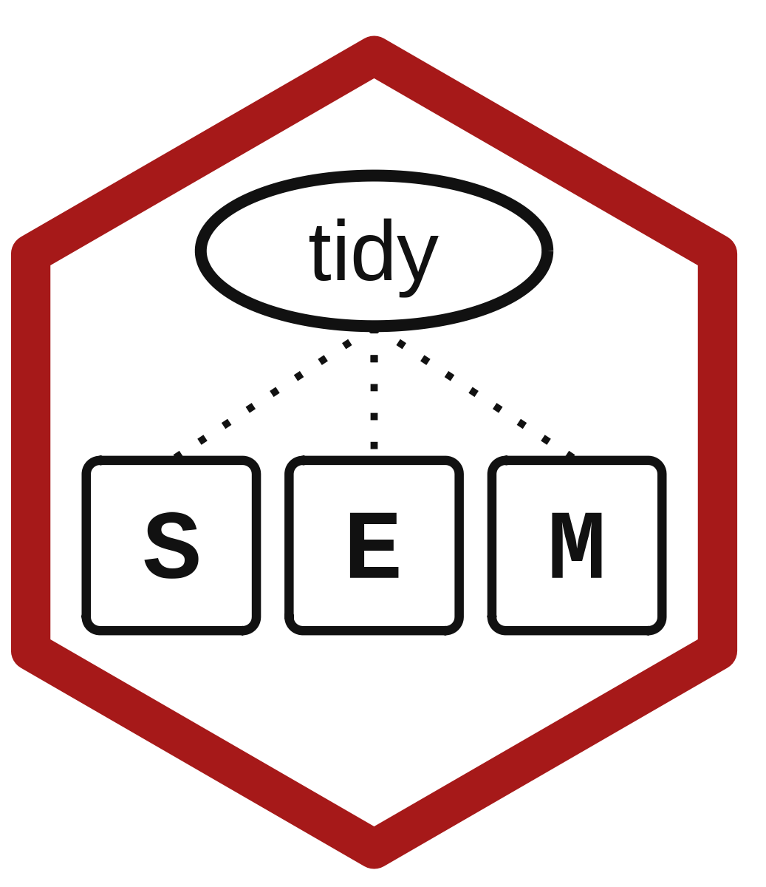

<!-- README.md is generated from README.Rmd. Please edit that file -->

```{r, echo = FALSE}
knitr::opts_chunk$set(
  collapse = TRUE,
  comment = "#>",
  fig.path = "man/figures/README-"
)
```

# tidySEM <a href='https://github.com/cjvanlissa/tidySEM'></a>

[](https://cran.r-project.org/package=tidySEM)
[](https://r-pkg.org/pkg/tidySEM)
[](https://lifecycle.r-lib.org/articles/stages.html#maturing)
[](https://github.com/cjvanlissa/tidySEM/actions/workflows/R-CMD-check.yaml)
[](https://www.contributor-covenant.org/version/2/0/code_of_conduct.html)
<!--[](https://codeofmerit.org/CODE_OF_CONDUCT.md)-->

`r yaml::read_yaml("DESCRIPTION")$Description`

The `tidySEM` package offers the following functionality:

* Generate SEM model syntax in a top-down, tidy way, regardless of what software is used to estimate it
* Tabulate model output in a publication-ready, uniform manner,
* Make easily customizable graphs for SEM-models,
* Estimate latent class analyses / mixture models in `OpenMx`

These functions are designed with the [*tidy tools manifesto* (Wickham, last updated 23-11-2019)](https://tidyverse.tidyverse.org/articles/manifesto.html) in mind, and interface with the existing suite of packages in the [`tidyverse`](https://tidyverse.tidyverse.org/).

## Installation

You can install the public release of `tidySEM` from CRAN with:

```{r, eval = F}
install.packages("tidySEM")
```

You can install the development version of metamixture from [GitHub](https://github.com/) with:

``` r
# install.packages("pak")
pak::pak("cjvanlissa/tidySEM")
```

## Documentation

Every user-facing function in the package is documented, and the documentation can be accessed by running `?function_name` in the R console, e.g., `?graph_sem`.

Furthermore, the `tidySEM` package includes the following vignettes:

**Structural Equation Modeling in General**

- [Generating syntax and estimating models](https://cjvanlissa.github.io/tidySEM/articles/Generating_syntax.html): Generate model syntax and estimate structural equation models.
- [Tabulating results](https://cjvanlissa.github.io/tidySEM/articles/Tabulating_results.html): Extract, format, and report model parameters and fit statistics.
- [Plotting graphs](https://cjvanlissa.github.io/tidySEM/articles/Plotting_graphs.html): Create and customize graphical representations of structural equation models.
- [Graphing conventions for SEM](https://cjvanlissa.github.io/tidySEM/articles/sem_graph.html): Understand the graphical notation and conventions used to represent structural equation models.
- [Ordinal modeling in OpenMx](https://cjvanlissa.github.io/tidySEM/articles/openmx_ordinal.html): Specify ordinal measurement models in OpenMx, including thresholds and their parameterization.

**Latent Class Analysis / Mixture Modeling**

- [Introduction to latent class analysis](https://cjvanlissa.github.io/tidySEM/articles/lca_introduction.html): An introduction to latent class and profile analysis, covering data preparation, model estimation, class enumeration, interpretation, and reporting.
- [Exploratory latent class analysis](https://cjvanlissa.github.io/tidySEM/articles/lca_exploratory.html): Explore latent class solutions and determine the appropriate number of classes.
- [Confirmatory latent class analysis](https://cjvanlissa.github.io/tidySEM/articles/lca_confirmatory.html): Specify and test theoretically motivated latent class models.
- [Latent class analysis with ordinal indicators](https://cjvanlissa.github.io/tidySEM/articles/lca_ordinal.html): Estimate and interpret latent class models with ordered categorical indicators.
- [Mixed-indicator latent class analysis](https://cjvanlissa.github.io/tidySEM/articles/mixed_lca.html): Estimate latent class models combining continuous and categorical indicators.
- [Latent class growth analysis](https://cjvanlissa.github.io/tidySEM/articles/lca_lcga.html): Identify latent classes with distinct longitudinal trajectories.
- [Auxiliary variable analyses](https://cjvanlissa.github.io/tidySEM/articles/lca_auxiliary.html): Examine relationships between latent class membership and external variables using BCH, two-step maximum likelihood, and pseudo-class methods.
- [PMC tutorial](https://cjvanlissa.github.io/tidySEM/articles/pmc_tutorial.html): Compare competing mixture models using Predictive Model Comparison.
- [SMART-LCA checklist](https://cjvanlissa.github.io/tidySEM/articles/SMART_LCA_checklist.html): Apply reporting guidelines and recommended practices to improve the transparency and reproducibility of latent class analyses.


## Citing tidySEM

> `r paste(format(citation("tidySEM"), style = "text"), collapse = "\n\n")`

To cite the latent class analysis functionality in tidySEM, cite:

> Van Lissa, C. J., Garnier-Villarreal, M., & Anadria, D. (2023). *Recommended Practices in Latent Class Analysis using the Open-Source R-Package tidySEM.* Structural Equation Modeling. https://doi.org/10.1080/10705511.2023.2250920

## Contributing and Contact Information

If you have ideas, please get involved. You can contribute by opening an issue on 'GitHub', or sending a pull request with proposed features (see further instructions below).

* File a 'GitHub' issue [here](https://github.com/cjvanlissa/tidySEM)
* Make a pull request [here](https://github.com/cjvanlissa/tidySEM/pulls)

By participating in this project, you agree to abide by the [Contributor Covenant](https://www.contributor-covenant.org/version/2/0/code_of_conduct.html).

### Pull requests

* Please always contribute via pull request instead of committing to master, so I can review the contribution.
    + You can either fork the repository to your own account and then submit a pull request, or make minor changes directly on this repository, and choose to commit them to a different branch and send a pull request when you save those changes
*	If you fix an issue, in your Commit message, please write “closes #issuenumber” so we can trace which commits fixed which issues
* Please add a line to NEWS.md for each bug fix or feature contribution
* Please increment the minor version number in DESCRIPTION, e.g.: 0.2.3.1 -> 0.2.3.2
