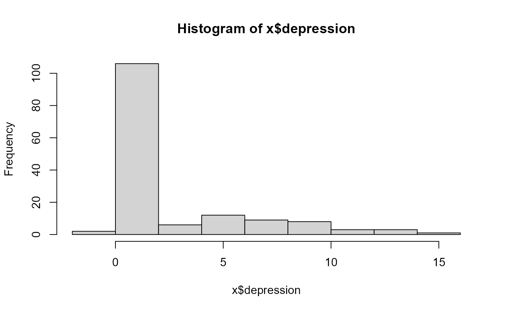
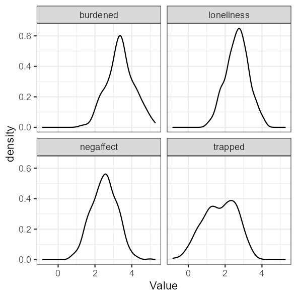
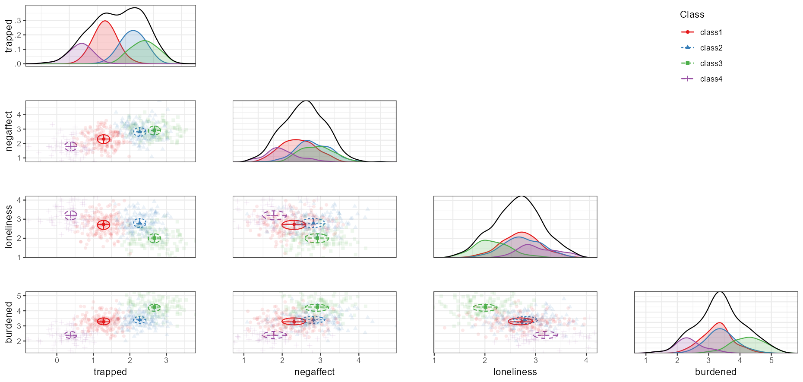
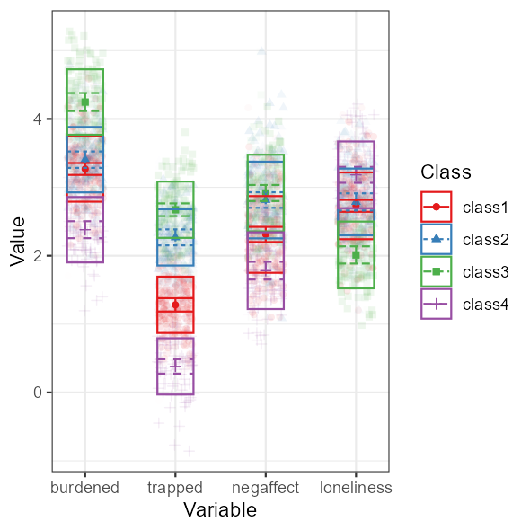

# Confirmatory Latent Class Analysis

When theory makes specific predictions about the number of latent
classes, or even their parameter values - a confirmatory use of LCA is
in order.

This vignette explains confirmatory Latent Class Analysis (LCA) using
`tidySEM`, as discussed in [Van Lissa, C. J., Garnier-Villarreal, M., &
Anadria, D. (2023). *Recommended Practices in Latent Class Analysis
using the Open-Source R-Package tidySEM.* Structural Equation
Modeling.](https://doi.org/10.1080/10705511.2023.2250920).

## Example 1: Depression

For example, suppose that clinical psychological theory proposes the
existence of two subpopulations:

- people **without depression**
- people **with depression**

If all we know is people’s depression score, then we can try to identify
two latent classes, corresponding to these subpopulations. Suppose that
the theory further specifies that a depression score of about 10 or
higher is required to count as depressed. We will use this theory to
formulate two increasingly specific hypotheses:

1.  a **two-class model** should fit better than a one-class model.
    Adding a third class should not significantly improve fit.
2.  the class means should be close to **0** for the non-depressed class
    and **10** for the depressed class.

The second hypothesis is considerably stronger because it constrains the
class-specific means to exact values.

### Simulate example data

We first create a simple dataset containing a single continuous
depression score.

``` r
library(tidySEM)

set.seed(123)
x <- data.frame(depression = c(rnorm(50, mean = 6, sd = 4), rbeta(100,
    2, 3)))
hist(x$depression)
```



### Test the number of classes

The first confirmatory hypothesis concerns **class enumeration**. Theory
predicts two classes, so we estimate one-, two-, and three-class
solutions. Note that some analyses take along time to run. For
computationally intensive analyses like this, it is convenient to save
the results to a file using
[`saveRDS()`](https://rdrr.io/r/base/readRDS.html), so you can load the
results from that file directly without having to wait for the code to
run.

``` r
res <- tidySEM:::run_cached(mx_profiles(x, classes = 1:3))
```

``` r
table_fit(res)
#>          Name Classes   LL   n Parameters AIC BIC saBIC Entropy prob_min
#> 1 equal var 1       1 -398 150          2 801 807   800    1.00     1.00
#> 2 equal var 2       2 -347 150          4 701 713   701    0.95     0.94
#> 3 equal var 3       3 -315 150          6 642 660   641    0.97     0.96
#>   prob_max n_min n_max np_ratio np_local
#> 1     1.00  1.00  1.00       75       75
#> 2     1.00  0.17  0.83       38       17
#> 3     0.99  0.12  0.72       25       14
```

The fit table lets us inspect information criteria and other model-fit
statistics across the competing class solutions.

If we want to test the theory, we can compare adjacent class solutions
using the bootstrapped likelihood ratio test (BLRT).

``` r
res_blrt <- BLRT(res)
```

``` r
res_blrt
#> Bootstrapped Likelihood Ratio Test:
#> 
#>  null  alt    lr df blrt_p samples
#>  mix1 mix2 103.5  2      0      65
#>  mix2 mix3  63.2  2      0      94
```

### Translate theoretical assumptions into parameter constraints

The models above still allow all parameters to be estimated freely from
the data. That tests only the broad hypothesis that two groups exist.
The groups themselves could diverge substantially from what was
theorized.

Our theory posits that the non-depressed class should have a mean near
0, whereas the depressed class should have a mean near 10 (technically,
the minimum value in that class should be 10, but that’s a bit more
difficult to enforce).

We can represent this stronger hypothesis by fixing the two class means
to these values, or by e.g. setting a parameter constraint for the two
classes.

First, create the two-class profile model without estimating it and
examine its parameters. For this, we will use the `OpenMx` function
[`omxGetParameters()`](https://rdrr.io/pkg/OpenMx/man/omxGetParameters.html):

``` r
res_theory <- mx_profiles(x, classes = 2, run = FALSE)
library(OpenMx)
omxGetParameters(res_theory)
#> equal var 2.weights[1,2]                       v1                      m11 
#>                     0.26                     2.30                     0.73 
#>                      m21 
#>                     8.36
```

The relevant mean parameters are `m11` and `m21`. We can either fix
these means to the exact values of 0 and 10:

``` r
res_theory <- omxSetParameters(res_theory, labels = c("m11",
    "m21"), values = c(0, 10), free = FALSE)
```

Or alternatively, we could set a lower and upper bound for these
parameters, thus allowing bounded free estimation:

``` r
res_theory_bounds <- omxSetParameters(res_theory, labels = c("m11",
    "m21"), values = c(0, 10), free = TRUE, lbound = c(NA, 10),
    ubound = c(1, NA))
```

Now, run your chosen model:

``` r
res_theory <- run_mx(res_theory)
res_theory_bounds <- run_mx(res_theory_bounds)
```

Next, compare the unconstrained two-class solution with the
theory-constrained model.

``` r
compare_these <- list(baseline = res[[2]], theory = res_theory,
    theory_bounds = res_theory_bounds)

table_fit(compare_these)
#>                      Name Classes   LL   n Parameters AIC BIC saBIC Entropy
#> baseline             mix2       2 -347 150          4 701 713   701    0.95
#> theory        equal var 2       2 -369 150          2 741 747   741    0.95
#> theory_bounds equal var 2       2 -351 150          4 709 721   709    0.96
#>               prob_min prob_max n_min n_max
#> baseline          0.94     1.00  0.17  0.83
#> theory            0.96     0.99  0.17  0.83
#> theory_bounds     0.97     0.99  0.16  0.84
```

We can also compare the models using the BLRT:

``` r
blrt_theory <- BLRT(list(res[[2]], res_theory))
```

``` r
blrt_theory
#> Bootstrapped Likelihood Ratio Test:
#> 
#>  null         alt    lr df blrt_p samples
#>  mix2 equal var 2 -44.1 -2   0.47     100
```

Note that fixing the class means to exact values is a very strong
assumption. In many real applications, theory may imply that class means
should be **near** certain values rather than exactly equal to them. You
can also manually specify **start values**, and then test if the
estimated **parameter values** deviate significantly from these:

``` r
res_theory_starts <- omxSetParameters(res_theory, labels = c("m11",
    "m21"), values = c(0, 10), free = TRUE)
res_theory_starts <- run_mx(res_theory_starts)
```

``` r
omxGetParameters(res_theory_starts)
#> equal var 2.weights[1,2]                       v1                      m11 
#>                     0.22                     2.49                     0.87 
#>                      m21 
#>                     8.84
wald_test(res_theory_starts, "m11 = 0; m21 = 10")
#> Wald tests for linear hypotheses:
#>  Hypothesis df chisq       p
#>       m11=0  1  31.2 2.3e-08
#>      m21=10  1   8.8 3.0e-03
```

## Example 2: Caregiver Compass

For this next example, we will use simulated data are based on work by
Zegwaard and colleagues, who sought to establish a typology of
caregivers who support a close other receiving outpatient psychological
care. Qualitative research among experts resulted in a theory
postulating the existence of four types of caregivers (translated from
the original Dutch):

**Balanced**

> The balanced caregiver experiences relative balance between the costs
> and benefits of caring for a close other.

**Imbalanced**

> The imbalanced caregiver experiences a precarious balance between the
> costs and benefits of caring for a close other.

**Lonely**

> The lonely caregiver experiences a strong sense of isolation.

**Entrapped**

> The entrapped caregiver strongly feels a sense of being entangled in
> responsibilities which are difficult to fulfill.

The goal of this confirmatory study was to validate this hypothesized
class solution in a sample of caregivers. A convenience sample was used,
with no prior sample size justification. To view the data documentation,
run the command
[`?tidySEM::zegwaard_carecompass`](https://cjvanlissa.github.io/tidySEM/reference/zegwaard_carecompass.md)
in the R console.

### Loading the Data

To load the data, simply attach the `tidySEM` package. For convenience,
we assign the variables used for analysis to an object called `df`. We
first only use the four scales:
`c("burdened", "trapped", "negaffect", "loneliness")`.

``` r
# Load required packages
library(tidySEM)
library(ggplot2)
# Load data
df <- zegwaard_carecompass[, c("burdened", "trapped", "negaffect",
    "loneliness")]
```

### Descriptive statistics

We use
[`tidySEM::descriptives()`](https://cjvanlissa.github.io/tidySEM/reference/descriptives.md)
to describe the data numerically. Because all scales are continuous, we
select only columns for continuous data to de-clutter the table:

``` r
desc <- tidySEM::descriptives(df)
desc <- desc[, c("name", "n", "missing", "unique", "mean", "median",
    "sd", "min", "max", "skew_2se", "kurt_2se")]
desc
```

| name       |   n | missing | unique | mean | median |   sd |   min | max | skew_2se | kurt_2se |
|:-----------|----:|--------:|-------:|-----:|-------:|-----:|------:|----:|---------:|---------:|
| burdened   | 509 |    0.01 |    509 |  3.4 |    3.4 | 0.75 |  1.20 | 5.3 |     0.17 |    -0.41 |
| trapped    | 505 |    0.02 |    505 |  1.7 |    1.8 | 0.90 | -0.86 | 3.8 |    -1.03 |    -1.52 |
| negaffect  | 506 |    0.01 |    506 |  2.5 |    2.5 | 0.69 |  0.71 | 5.0 |     0.08 |    -0.38 |
| loneliness | 510 |    0.01 |    510 |  2.7 |    2.7 | 0.62 |  0.98 | 4.2 |    -0.33 |    -0.62 |

Descriptive statistics

The table indicates two potential causes for concern: there is a small
percentage of missingness, and all variables have relatively high
kurtosis. Since there are some missing values, we can conduct an MCAR
test using `mice::mcar(df)`. According to Hawkins’ test, there is no
evidence to reject the assumptions of multivariate normality and MCAR,
$`\tilde{\chi^2}(6) = 3.78, \tilde{p} = 0.71`$. Missing data will be
accounted for using FIML.

Additionally, we can plot the data. The `ggplot2` function
[`geom_density()`](https://ggplot2.tidyverse.org/reference/geom_density.html)
is useful for continuous data. Visual inspection confirms the
conclusions from the
[`descriptives()`](https://cjvanlissa.github.io/tidySEM/reference/descriptives.md)
table: the data are kurtotic (peaked).

``` r
df_plot <- df
names(df_plot) <- paste0("Value.", names(df_plot))
df_plot <- reshape(df_plot, varying = names(df_plot), direction = "long",
    timevar = "Variable")
ggplot(df_plot, aes(x = Value)) + geom_density() + facet_wrap(~Variable) +
    theme_bw()
```



### Conducting Latent Profile Analysis

As all variables are continuous, we can use the convenience function
[`tidySEM::mx_profiles()`](https://cjvanlissa.github.io/tidySEM/reference/mx_profiles.md),
which is a wrapper for the generic function
[`mx_mixture()`](https://cjvanlissa.github.io/tidySEM/reference/mx_mixture.md)
optimized for continuous indicators. Its default settings are
appropriate for LPA, assuming fixed variances across classes and zero
covariances. Its arguments are `data` and number of `classes`. All
variables in `data` are included in the analysis, which is why we first
selected the indicator variables. As this is a confirmatory LCA, we do
not follow a strictly data-driven class enumeration procedure. We will
set the maximum number of classes $`K`$ to one more than the
theoretically expected number. We set a seed to ensure replicable
results.

``` r
set.seed(123)
res <- mx_profiles(data = df, classes = 1:5)
```

``` r
fit <- table_fit(res)
```

This analysis should produce some messages about cluster initialization.
These relate to the selection of starting values, which relies on the
K-means algorithm and is not robust to missing data. The algorithm
automatically switches to hierarchical clustering, no further action is
required.

### Class Enumeration

To compare the fit of the theoretical model against other models, we
create a model fit table using
[`table_fit()`](https://cjvanlissa.github.io/tidySEM/reference/table_fit.md)
and retain relevant columns. We also determine whether any models can be
disqualified.

In this example, all models converge without issues. If, for example,
the two-class solution had not converged, we could use the function
`res[[2]] <- mxTryHard(res[[2]])` to aid convergence.

Next, we check for local identifiability. The sample size is
consistently reported as 513, which means that partially missing cases
were indeed included via FIML. The smallest class size occurs in the
5-class model, where the smallest class is assigned 7% of cases, or 38
cases. This model has 28 parameters, approximately 6 per class. We thus
have at least five observations per parameter in every class, and do not
disqualify the 5-class model.

There are concerns about theoretical interpretability of all solutions,
as the entropies and minimum classification probabilities are all low.
However, in this confirmatory use case, we address this when
interpreting the results.

``` r
fit <- table_fit(res)  # model fit table
fit[, c("Name", "LL", "Parameters", "n", "BIC", "Entropy", "prob_min",
    "prob_max", "n_min", "n_max", "np_ratio", "np_local")]
```

| Name        |    LL |   p |   n |  BIC | Entropy | p_min | p_max | n_min | n_max |
|:------------|------:|----:|----:|-----:|--------:|------:|------:|------:|------:|
| equal var 1 | -2242 |   8 | 513 | 4534 |    1.00 |  1.00 |  1.00 |  1.00 |  1.00 |
| equal var 2 | -2031 |  13 | 513 | 4144 |    0.74 |  0.91 |  0.93 |  0.42 |  0.58 |
| equal var 3 | -1951 |  18 | 513 | 4015 |    0.78 |  0.89 |  0.91 |  0.19 |  0.54 |
| equal var 4 | -1916 |  23 | 513 | 3976 |    0.75 |  0.81 |  0.92 |  0.16 |  0.34 |
| equal var 5 | -1910 |  28 | 513 | 3995 |    0.76 |  0.64 |  0.92 |  0.08 |  0.34 |

Model fit table

#### Using ICs

the 4-class solution has the lowest BIC, which means it is preferred
over all other solutions including a 1-class solution and a solution
with more classes. Note that a scree plot for the BIC can be plotted by
calling `plot(fit)`. Following the elbow criterion, a three-class
solution would also be defensible. The function `ic_weights(fit)` allows
us to compute IC weights; it indicates that, conditional on the set of
models, the 4-class model has a posterior model probability of nearly
100%.

#### Using LMR tests

If we conduct LMR tests, we find that the tests are significant for all
pairwise model comparisons, except for the 5-class model:

``` r
lr_lmr(res)
```

| null | alt  |   lr |  df |    p |   w2 | p_w2 |
|:-----|:-----|-----:|----:|-----:|-----:|-----:|
| mix1 | mix2 | 10.2 |   5 | 0.00 | 0.82 | 0.00 |
| mix2 | mix3 |  5.3 |   5 | 0.00 | 0.44 | 0.00 |
| mix3 | mix4 |  4.1 |   5 | 0.00 | 0.14 | 0.00 |
| mix4 | mix5 |  1.6 |   5 | 0.05 | 0.03 | 0.04 |

LMR test table

#### Using BLRT tests

We can also use the BLRT test. As it is very computationally expensive,
we will use a low number of replications here. In practice, one might
use a much higher number (1000+) for published research. Keep in mind
that the p-value of the BLRT is subject to Monte Carlo error; if it
fluctuates when analyses are replicated or its value is very close to
the critical threshold, consider increasing the number of replications.

To accelerate computations, we can use the `future` package for parallel
computing (see
[`?plan`](https://future.futureverse.org/reference/plan.html) to select
the appropriate back-end for your system). To track the function’s
progress, we use the `progressr` ecosystem, which allows users to choose
how they want to be informed. The example below uses a progress bar:

``` r
library(future)
library(progressr)
plan(multisession)  # Parallel processing for Windows
handlers("progress")  # Progress bar
set.seed(1)
res_blrt <- BLRT(res, replications = 100)
res_blrt
```

|             | null | alt  |  lr |  df | blrt_p | samples |
|:------------|:-----|:-----|----:|----:|-------:|--------:|
| equal var 1 | mix1 | mix2 | 421 |   5 |   0.00 |     100 |
| equal var 2 | mix2 | mix3 | 160 |   5 |   0.00 |     100 |
| equal var 3 | mix3 | mix4 |  70 |   5 |   0.00 |     100 |
| equal var 4 | mix4 | mix5 |  12 |   5 |   0.19 |     100 |

BLRT test table

In sum, across all class enumeration criteria, there is strong support
for a 4-class solution.

### Optional: Alternative Model Specifications

In the case of confirmatory LCA, the theory would be refuted by strong
evidence against the hypothesized model and number of classes. In the
preceding, we only compared the theoretical model against models with
different number of classes. Imagine, however, that a Reviewer argues
that variance ought to be freely estimated across classes. We could
compare our theoretical model against their competing model as follows.
Note that we can put two models into a list to compare them.

``` r
res_alt <- mx_profiles(df, classes = 4, variances = "varying")
compare <- list(res[[4]], res_alt)
table_fit(compare)
```

| Name       |    LL | Parameters |  BIC | Entropy | prob_min | prob_max | n_min | n_max |
|:-----------|------:|-----------:|-----:|--------:|---------:|---------:|------:|------:|
| mix4       | -1916 |         23 | 3976 |    0.75 |     0.81 |     0.92 |  0.16 |  0.34 |
| free var 4 | -1909 |         35 | 4037 |    0.78 |     0.84 |     0.92 |  0.16 |  0.32 |

Comparing competing theoretical models

The alternative model incurs 12 additional parameters for the free
variances. Yet, it has a higher BIC, which indicates that this
additional complexity does not outweigh the increase in fit.

### Interpreting the Final Class Solution

To interpret the final class solution, we first reorder the 4-class
model by class size. This helps prevent label switching.

``` r
res_final <- mx_switch_labels(res[[4]])
```

The 4-class model yielded classes of reasonable size; using
`class_pro`the largest class comprised 33%, and the smallest comprised
16% of cases. However, the entropy was low, $`S = .75`$, indicating poor
class separability. Furthermore, the posterior classification
probability ranged from $`[.81, .92]`$, which means that at least some
classes had a high classification error. We produce a table of the
results below.

``` r
table_results(res_final, columns = c("label", "est", "se", "confint",
    "class"))
```

| label                       | est  | se   | confint        | class  |
|:----------------------------|:-----|:-----|:---------------|:-------|
| Means.burdened.class1       | 3.27 | 0.04 | \[3.18, 3.36\] | class1 |
| Means.trapped.class1        | 1.28 | 0.05 | \[1.18, 1.38\] | class1 |
| Means.negaffect.class1      | 2.31 | 0.06 | \[2.20, 2.42\] | class1 |
| Means.loneliness.class1     | 2.73 | 0.04 | \[2.64, 2.82\] | class1 |
| Variances.burdened.class1   | 0.23 | 0.02 | \[0.19, 0.27\] | class1 |
| Variances.trapped.class1    | 0.17 | 0.02 | \[0.14, 0.20\] | class1 |
| Variances.negaffect.class1  | 0.31 | 0.02 | \[0.27, 0.36\] | class1 |
| Variances.loneliness.class1 | 0.24 | 0.02 | \[0.20, 0.28\] | class1 |
| Means.burdened.class2       | 3.40 | 0.06 | \[3.28, 3.52\] | class2 |
| Means.trapped.class2        | 2.27 | 0.06 | \[2.15, 2.38\] | class2 |
| Means.negaffect.class2      | 2.81 | 0.06 | \[2.70, 2.93\] | class2 |
| Means.loneliness.class2     | 2.79 | 0.06 | \[2.66, 2.91\] | class2 |
| Means.burdened.class3       | 4.25 | 0.07 | \[4.12, 4.38\] | class3 |
| Means.trapped.class3        | 2.67 | 0.05 | \[2.58, 2.77\] | class3 |
| Means.negaffect.class3      | 2.92 | 0.06 | \[2.80, 3.03\] | class3 |
| Means.loneliness.class3     | 2.01 | 0.06 | \[1.89, 2.14\] | class3 |
| Means.burdened.class4       | 2.38 | 0.06 | \[2.26, 2.50\] | class4 |
| Means.trapped.class4        | 0.38 | 0.05 | \[0.28, 0.49\] | class4 |
| Means.negaffect.class4      | 1.78 | 0.07 | \[1.65, 1.91\] | class4 |
| Means.loneliness.class4     | 3.18 | 0.06 | \[3.07, 3.30\] | class4 |
| mix4.weights\[1,1\].NA      | 1.00 | NA   | NA             | NA     |
| mix4.weights\[1,2\].NA      | 0.86 | 0.15 | \[0.56, 1.15\] | NA     |
| mix4.weights\[1,3\].NA      | 0.66 | 0.11 | \[0.44, 0.88\] | NA     |
| mix4.weights\[1,4\].NA      | 0.47 | 0.08 | \[0.32, 0.63\] | NA     |

Four-class model results

The results are best interpreted by examining a plot of the model and
data, however. Relevant plot functions are
[`plot_bivariate()`](https://cjvanlissa.github.io/tidySEM/reference/plot_bivariate.md),
[`plot_density()`](https://cjvanlissa.github.io/tidySEM/reference/plot_density.md),
and
[`plot_profiles()`](https://cjvanlissa.github.io/tidySEM/reference/plot_profiles.md).
However, we omit the density plots, because
[`plot_bivariate()`](https://cjvanlissa.github.io/tidySEM/reference/plot_bivariate.md)
also includes them.

``` r
plot_bivariate(res_final)
```



Bivariate profile plot

On the diagonal of the bivariate plot are weighted density plots: normal
approximations of the density function of observed data, weighed by
class probability. On the off-diagonal are plots for each pair of
indicators, with the class means indicated by a point, class standard
deviations indicated by lines, and covariances indicated by circles. As
this model has zero covariances, all circles are round (albeit warped by
the different scales of the X and Y axes)

The marginal density plots show that trappedness distinguishes classes
rather well. For all other indicators, groups are not always clearly
separated in terms of marginal density: class 2 and 3 coalesce on
negative affect, 1 and 2 coalesce on loneliness, and 1 and 2 coalesce on
burden. Nevertheless, the off-diagonal scatterplots show reasonable
bivariate separation for all classes.

We can obtain a more classic profile plot using
`plot_profiles(res_final)`. This plot conveys less information than the
bivariate plot, but is readily interpretable. Below is a comparison
between the most common type of visualization for LPA, and the
best-practices visualization provided by `tidySEM`. Note that the best
practices plot includes class means and error bars, standard deviations,
and a ribbon plot of raw data weighted by class probability to indicate
how well the classes describe the observed distribution. The overlap
between the classes is clearly visible in this figure; this is why the
entropy and classification probabilities are relatively low.

Based on the bivariate plot, we can label class 1 as the *balanced* type
(33%), class 2 as the *imbalanced* type (29%), class 3 as the
*entrapped* type (22%), and class 4 as the *lonely* type (16%). Note
however that the observed classes do not match the hypothesized pattern
of class parameters exactly.

``` r
plot_profiles(res_final)
```



Profile plot

### Predicting class membership

This LCA model was developed to help classify care providers in a
clinical context, so that mental healthcare professionals can provide
tailored support to those who take care of their clients. In `tidySEM`,
it is possible to predict class membership for new data. Imagine that we
administer the care compass questionnaire to a new individual. We can
assign their scale scores to a `data.frame`, and supply it to the
[`predict_class()`](https://cjvanlissa.github.io/tidySEM/reference/predict_class.md)
function (in previous versions, we overloaded the
[`predict()`](https://rdrr.io/r/stats/predict.html) function) via the
`newdata` argument. The result includes the individual’s most likely
class, as well as posterior probabilities for all classes.

``` r
df_new <- data.frame(burdened = 2, trapped = 0.5, negaffect = 1.5,
    loneliness = 4)
predict_class(res_final, newdata = df_new)
#>   [1] 1 4 1 1 1 3 2 1 3 3 2 1 4 4 2 1 2 3 2 3 2 3 3 1 1 1 3 2 3 4 2 2 4 4 1 3 2
#>  [38] 3 4 3 1 3 2 2 1 3 1 3 4 2 2 1 2 1 1 4 4 1 2 1 1 1 4 2 4 2 4 4 1 2 1 1 2 2
#>  [75] 1 4 3 1 1 3 4 3 1 2 3 1 4 3 3 3 2 2 3 4 1 2 2 4 3 2 1 1 1 1 3 4 2 1 2 2 2
#> [112] 1 1 2 3 4 2 3 1 2 2 4 4 2 1 2 1 3 1 3 3 3 4 1 3 2 2 3 4 4 4 2 1 1 3 3 2 2
#> [149] 3 1 1 2 2 3 1 1 1 3 3 3 1 1 2 1 2 1 3 1 2 2 4 1 3 4 2 1 3 3 1 4 2 4 3 3 1
#> [186] 2 2 2 2 1 4 1 3 2 1 1 4 4 1 3 4 2 2 2 2 1 3 1 2 1 2 3 3 1 2 2 2 4 4 2 3 4
#> [223] 4 4 1 3 1 2 2 2 1 3 1 2 4 1 2 3 1 2 4 2 1 2 2 4 4 1 1 1 2 3 2 1 1 2 1 4 2
#> [260] 3 3 1 2 3 1 1 1 3 1 3 2 2 2 1 2 2 4 3 3 1 3 2 3 3 1 2 1 3 4 3 4 1 2 1 3 3
#> [297] 1 1 1 3 3 1 2 1 1 2 1 1 1 1 1 1 3 1 3 1 4 3 2 2 2 1 4 1 4 1 2 4 2 2 1 1 1
#> [334] 3 1 2 1 1 1 2 1 3 1 3 3 2 2 3 4 1 2 2 2 2 4 1 2 3 1 3 3 1 1 2 2 1 1 1 2 3
#> [371] 4 1 1 1 2 1 1 2 4 3 1 2 1 4 2 4 2 4 1 1 3 3 1 4 1 4 1 1 2 2 1 1 4 3 1 2 2
#> [408] 4 1 2 3 2 4 2 1 1 3 2 1 3 1 2 2 4 3 2 2 4 1 4 1 1 2 2 2 4 2 2 1 2 4 2 3 4
#> [445] 2 1 4 2 2 1 4 1 1 1 2 3 3 1 3 2 1 3 4 2 1 2 2 4 3 1 1 1 3 2 2 1 1 4 1 1 1
#> [482] 3 4 4 1 3 3 1 3 2 1 3 3 3 2 3 1 2 1 1 4 4 2 1 3 2 2 2 1 1 4 3 1
```
