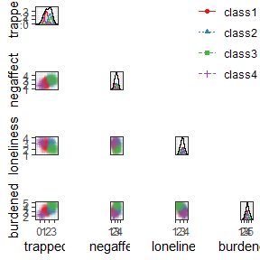

When theory makes specific predictions about the number of latent classes, or even their parameter values - a confirmatory use of LCA is in order.


This vignette explains confirmatory Latent Class Analysis (LCA) using `tidySEM`,
as discussed in [Van Lissa, C. J., Garnier-Villarreal, M., & Anadria, D. (2023). *Recommended Practices in Latent Class Analysis using the Open-Source R-Package tidySEM.* Structural Equation Modeling.](https://doi.org/10.1080/10705511.2023.2250920).


# Example 1: Depression

For example, suppose that clinical psychological theory proposes the existence of two subpopulations:

- people **without depression**
- people **with depression**

If all we know is people's depression score, then we can try to identify two latent classes, corresponding to these subpopulations. Suppose that the theory further specifies that a depression score of about 10 or higher is required to count as depressed. We will use this theory to formulate two increasingly specific hypotheses:

1. a **two-class model** should fit better than a one-class model. Adding a third class should not significantly improve fit.
2. the class means should be close to **0** for the non-depressed class and **10** for the depressed class.

The second hypothesis is considerably stronger because it constrains the class-specific means to exact values.

## Simulate example data

We first create a simple dataset containing a single continuous depression score.


``` r
library(tidySEM)
library(OpenMx)

set.seed(123)
x <- data.frame(depression = c(rnorm(50, mean = 6, sd = 4), rbeta(100,
    2, 3)))
hist(x$depression)
```

<!-- -->

## Test the number of classes

The first confirmatory hypothesis concerns **class enumeration**. Theory predicts two classes, so we estimate one-, two-, and three-class solutions.
Note that some analyses take along time to run.
For computationally intensive analyses like this, it is convenient to save the results to a file using `saveRDS()`,
so you can load the results from that file directly without having to wait for the code to run.


``` r
res <- mx_profiles(x, classes = 1:3)
#> 
MxComputeSimAnnealing(tsallis1996) evaluations 858 fit 728.958 change -527.9
MxComputeSimAnnealing(tsallis1996) evaluations 6518 fit 690.318 change -1722
                                                                            
saveRDS(res, "res_depression.rds")
```


``` r
res <- readRDS("res_depression.rds")
table_fit(res)
#>          Name Classes   LL   n Parameters AIC BIC saBIC Entropy prob_min prob_max n_min n_max
#> 1 equal var 1       1 -398 150          2 801 807   800    1.00     1.00     1.00  1.00  1.00
#> 2 equal var 2       2 -347 150          4 701 713   701    0.95     0.94     1.00  0.17  0.83
#> 3 equal var 3       3 -315 150          6 642 660   641    0.97     0.96     0.99  0.12  0.72
#>   np_ratio np_local
#> 1       75       75
#> 2       38       17
#> 3       25       14
```

The fit table lets us inspect information criteria and other model-fit statistics across the competing class solutions.

If we want to test the theory, we can compare adjacent class solutions using the bootstrapped likelihood ratio test (BLRT).


``` r
res_blrt <- BLRT(res)
saveRDS(res_blrt, "blrt_depression.rds")
```


``` r
res_blrt <- readRDS("blrt_depression.rds")
res_blrt
#> Bootstrapped Likelihood Ratio Test:
#> 
#>  null  alt    lr df blrt_p samples
#>  mix1 mix2 103.5  2      0      65
#>  mix2 mix3  63.2  2      0      94
```


## Translate theoretical assumptions into parameter constraints

The models above still allow all parameters to be estimated freely from the data. That tests only the broad hypothesis that two groups exist.
The groups themselves could diverge substantially from what was theorized.

Our theory posits that the non-depressed class should have a mean near 0, whereas the depressed class should have a mean near 10 (technically, the minimum value in that class should be 10, but that's a bit more difficult to enforce).

We can represent this stronger hypothesis by fixing the two class means to these values,
or by e.g. setting a parameter constraint for the two classes.

First, create the two-class profile model without estimating it and examine its parameters:


``` r
res_theory <- mx_profiles(x, classes = 2, run = FALSE)
omxGetParameters(res_theory)
#> equal var 2.weights[1,2]                       v1                      m11 
#>                     0.26                     2.30                     0.73 
#>                      m21 
#>                     8.36
```

The relevant mean parameters are `m11` and `m21`. We can either fix these means to the exact values of 0 and 10:


``` r
res_theory <- omxSetParameters(res_theory, labels = c("m11",
    "m21"), values = c(0, 10), free = FALSE)
```

Or alternatively, we could set a lower and upper bound for these parameters, thus allowing bounded free estimation:


``` r
res_theory_bounds <- omxSetParameters(res_theory, labels = c("m11",
    "m21"), values = c(0, 10), free = TRUE, lbound = c(NA, 10),
    ubound = c(1, NA))
```

Now, run your chosen model:


``` r
res_theory <- run_mx(res_theory)
res_theory_bounds <- run_mx(res_theory_bounds)
#> 
MxComputeSimAnnealing(tsallis1996) evaluations 960 fit 1144.66 change -2935
                                                                           
```

Next, compare the unconstrained two-class solution with the theory-constrained model.


``` r
compare_these <- list(baseline = res[[2]], theory = res_theory,
    theory_bounds = res_theory_bounds)

table_fit(compare_these)
#>                      Name Classes   LL   n Parameters AIC BIC saBIC Entropy prob_min prob_max
#> baseline             mix2       2 -347 150          4 701 713   701    0.95     0.94     1.00
#> theory        equal var 2       2 -369 150          2 741 747   741    0.95     0.96     0.99
#> theory_bounds equal var 2       2 -351 150          4 709 721   709    0.96     0.97     0.99
#>               n_min n_max
#> baseline       0.17  0.83
#> theory         0.17  0.83
#> theory_bounds  0.16  0.84
```

We can also compare the models using the BLRT:


``` r
blrt_theory <- BLRT(list(res[[2]], res_theory))
saveRDS(blrt_theory, "blrt_theory.rds")
```


``` r
blrt_theory <- readRDS("blrt_theory.rds")
blrt_theory
#> Bootstrapped Likelihood Ratio Test:
#> 
#>  null         alt    lr df blrt_p samples
#>  mix2 equal var 2 -44.1 -2   0.47     100
```


Note that fixing the class means to exact values is a very strong assumption.
In many real applications, theory may imply that class means should be **near** certain values rather than exactly equal to them.
You can also manually specify **start values**, and then test if the estimated **parameter values** deviate significantly from these:


``` r
res_theory_starts <- omxSetParameters(res_theory, labels = c("m11",
    "m21"), values = c(0, 10), free = TRUE)
res_theory_starts <- run_mx(res_theory_starts)
#> 
MxComputeSimAnnealing(tsallis1996) evaluations 3507 fit 693.185 change -0.07426
                                                                               
omxGetParameters(res_theory_starts)
#> equal var 2.weights[1,2]                       v1                      m11 
#>                     0.22                     2.49                     0.87 
#>                      m21 
#>                     8.84
wald_test(res_theory_starts, "m11 = 0; m21 = 10")
#> Wald tests for linear hypotheses:
#>  Hypothesis df chisq       p
#>       m11=0  1  31.2 2.3e-08
#>      m21=10  1   8.8 3.0e-03
```


# Example 2: Caregiver Compass

For this next example, we will use simulated data are based on work by Zegwaard and colleagues,
who sought to establish a typology of caregivers who support a close other receiving outpatient psychological care.
Qualitative research among experts resulted in a theory postulating the existence of four types of caregivers (translated from the original Dutch):

**Balanced**

> The balanced caregiver experiences relative balance between the costs and benefits of caring for a close other.

**Imbalanced**

> The imbalanced caregiver experiences a precarious balance between the costs and benefits of caring for a close other.

**Lonely**

> The lonely caregiver experiences a strong sense of isolation.

**Entrapped**

> The entrapped caregiver strongly feels a sense of being entangled in responsibilities which are difficult to fulfill.

The goal of this confirmatory study was to validate this hypothesized class solution in a sample of caregivers.
A convenience sample was used, with no prior sample size justification.
To view the data documentation,
run the command `?tidySEM::zegwaard_carecompass` in the R console.

## Loading the Data

To load the data, simply attach the `tidySEM` package.
For convenience, we assign the variables used for analysis to an object called `df`.
We first only use the four scales: `c("burdened", "trapped", "negaffect", "loneliness")`.


``` r
# Load required packages
library(tidySEM)
library(ggplot2)
library(OpenMx)
# Load data
df <- zegwaard_carecompass[, c("burdened", "trapped", "negaffect",
    "loneliness")]
```

## Descriptive statistics

We use `tidySEM::descriptives()` to describe the data numerically.
Because all scales are continuous,
we select only columns for continuous data to de-clutter the table:


``` r
desc <- tidySEM::descriptives(df)
desc <- desc[, c("name", "n", "missing", "unique", "mean", "median",
    "sd", "min", "max", "skew_2se", "kurt_2se")]
desc
```


Table: Descriptive statistics

|name       |   n| missing| unique| mean| median|   sd|   min| max| skew_2se| kurt_2se|
|:----------|---:|-------:|------:|----:|------:|----:|-----:|---:|--------:|--------:|
|burdened   | 509|    0.01|    509|  3.4|    3.4| 0.75|  1.20| 5.3|     0.17|    -0.41|
|trapped    | 505|    0.02|    505|  1.7|    1.8| 0.90| -0.86| 3.8|    -1.03|    -1.52|
|negaffect  | 506|    0.01|    506|  2.5|    2.5| 0.69|  0.71| 5.0|     0.08|    -0.38|
|loneliness | 510|    0.01|    510|  2.7|    2.7| 0.62|  0.98| 4.2|    -0.33|    -0.62|


The table indicates two potential causes for concern:
there is a small percentage of missingness,
and all variables have relatively high kurtosis.
Since there are some missing values,
we can conduct an MCAR test using `mice::mcar(df)`.
According to Hawkins' test,
there is no evidence to reject the assumptions of multivariate normality and MCAR, $\tilde{\chi^2}(6) = 3.78, \tilde{p} = 0.71$.
Missing data will be accounted for using FIML.

Additionally, we can plot the data.
The `ggplot2` function `geom_density()` is useful for continuous data.
Visual inspection confirms the conclusions from the `descriptives()` table:
the data are kurtotic (peaked).


``` r
df_plot <- df
names(df_plot) <- paste0("Value.", names(df_plot))
df_plot <- reshape(df_plot, varying = names(df_plot), direction = "long",
    timevar = "Variable")
ggplot(df_plot, aes(x = Value)) + geom_density() + facet_wrap(~Variable) +
    theme_bw()
```


## Conducting Latent Profile Analysis

As all variables are continuous, we can use the convenience function
`tidySEM::mx_profiles()`,
which is a wrapper for the generic function `mx_mixture()` optimized for continuous indicators.
Its default settings are appropriate for LPA, assuming fixed variances across classes and zero covariances.
Its arguments are `data` and number of `classes`.
All variables in `data` are included in the analysis,
which is why we first selected the indicator variables.
As this is a confirmatory LCA,
we do not follow a strictly data-driven class enumeration procedure.
We will set the maximum number of classes $K$ to one more than the theoretically expected number.
We set a seed to ensure replicable results.


```
#> 
MxComputeSimAnnealing(tsallis1996) evaluations 872 fit 6940.28 change -628.1
MxComputeSimAnnealing(tsallis1996) evaluations 2425 fit 7076.14 change 395  
MxComputeSimAnnealing(tsallis1996) evaluations 3966 fit 6597.95 change -753.7
MxComputeSimAnnealing(tsallis1996) evaluations 5478 fit 4723.73 change 656.1 
MxComputeSimAnnealing(tsallis1996) evaluations 6999 fit 6216.17 change -137.3
MxComputeSimAnnealing(tsallis1996) evaluations 8513 fit 4062.82 change -3493 
MxComputeSimAnnealing(tsallis1996) evaluations 10011 fit 4062.77 change -1418
MxComputeSimAnnealing(tsallis1996) evaluations 11508 fit 6315.65 change 64.47
MxComputeSimAnnealing(tsallis1996) evaluations 12993 fit 4063.13 change -292.4
MxComputeSimAnnealing(tsallis1996) evaluations 14478 fit 4790.77 change 726.2 
MxComputeSimAnnealing(tsallis1996) evaluations 15967 fit 6308.3 change 4.912 
                                                                            
#> 
MxComputeSimAnnealing(tsallis1996) evaluations 526 fit 4882.53 change 2.272
MxComputeSimAnnealing(tsallis1996) evaluations 1558 fit 8766.32 change -789.4
MxComputeSimAnnealing(tsallis1996) evaluations 2583 fit 7436.28 change -2535 
MxComputeSimAnnealing(tsallis1996) evaluations 3607 fit 10772.5 change 6173 
MxComputeSimAnnealing(tsallis1996) evaluations 4624 fit 5431.97 change 54  
MxComputeSimAnnealing(tsallis1996) evaluations 5650 fit 4026.8 change -1252
MxComputeSimAnnealing(tsallis1996) evaluations 6671 fit 9318.88 change 2235
MxComputeSimAnnealing(tsallis1996) evaluations 7688 fit 4043.31 change -349.3
MxComputeSimAnnealing(tsallis1996) evaluations 8708 fit 3932.42 change -1624 
MxComputeSimAnnealing(tsallis1996) evaluations 9723 fit 4806.03 change 8.753
MxComputeSimAnnealing(tsallis1996) evaluations 10554 fit 3903.12 change -0.4546
MxComputeSimAnnealing(tsallis1996) evaluations 11519 fit 4678.25 change 773.7  
MxComputeSimAnnealing(tsallis1996) evaluations 12531 fit 3903.36 change 0.2926
MxComputeSimAnnealing(tsallis1996) evaluations 13539 fit 3907.34 change -906.1
MxComputeSimAnnealing(tsallis1996) evaluations 14540 fit 3903.45 change 0.3005
MxComputeSimAnnealing(tsallis1996) evaluations 15546 fit 5664.87 change 1761  
MxComputeSimAnnealing(tsallis1996) evaluations 16555 fit 3902.8 change -1772
MxComputeSimAnnealing(tsallis1996) evaluations 17560 fit 4499.09 change 596.4
MxComputeSimAnnealing(tsallis1996) evaluations 18562 fit 3902.71 change -48.09
MxComputeSimAnnealing(tsallis1996) evaluations 19564 fit 3902.71 change -1767 
MxComputeSimAnnealing(tsallis1996) evaluations 20566 fit 3950.27 change 46.96
MxComputeSimAnnealing(tsallis1996) evaluations 21568 fit 4823.96 change 1.97 
MxComputeSimAnnealing(tsallis1996) evaluations 22567 fit 3915.84 change -3.561
                                                                              
#> 
MxComputeSimAnnealing(tsallis1996) evaluations 703 fit 9260.09 change -92.17
MxComputeSimAnnealing(tsallis1996) evaluations 1464 fit 4652.11 change -2.347
MxComputeSimAnnealing(tsallis1996) evaluations 2229 fit 4705.7 change 12.15  
MxComputeSimAnnealing(tsallis1996) evaluations 2991 fit 4878.86 change -0.1781
MxComputeSimAnnealing(tsallis1996) evaluations 3752 fit 4741.14 change -161.1 
MxComputeSimAnnealing(tsallis1996) evaluations 4510 fit 4873.02 change 728.1 
MxComputeSimAnnealing(tsallis1996) evaluations 5266 fit 4860.55 change 197.5
MxComputeSimAnnealing(tsallis1996) evaluations 6023 fit 4681.13 change 488.8
MxComputeSimAnnealing(tsallis1996) evaluations 6780 fit 4713.26 change 326.7
MxComputeSimAnnealing(tsallis1996) evaluations 7537 fit 4525.43 change -6.681
MxComputeSimAnnealing(tsallis1996) evaluations 8296 fit 4472.69 change 541.3 
MxComputeSimAnnealing(tsallis1996) evaluations 9054 fit 4489.29 change -2.01
MxComputeSimAnnealing(tsallis1996) evaluations 9813 fit 4491.88 change -2.015
MxComputeSimAnnealing(tsallis1996) evaluations 10564 fit 3833.68 change -235.8
MxComputeSimAnnealing(tsallis1996) evaluations 11320 fit 3835.69 change -55.92
MxComputeSimAnnealing(tsallis1996) evaluations 12074 fit 4658.89 change 810.1 
MxComputeSimAnnealing(tsallis1996) evaluations 12827 fit 3852.25 change -643.4
MxComputeSimAnnealing(tsallis1996) evaluations 13577 fit 4174.07 change -412.2
MxComputeSimAnnealing(tsallis1996) evaluations 14328 fit 4661.79 change 659.1 
MxComputeSimAnnealing(tsallis1996) evaluations 15079 fit 4492.75 change -6358
MxComputeSimAnnealing(tsallis1996) evaluations 15827 fit 3832.92 change 0.3616
MxComputeSimAnnealing(tsallis1996) evaluations 16573 fit 3858.99 change 7.476 
MxComputeSimAnnealing(tsallis1996) evaluations 17321 fit 4580.67 change 747.9
MxComputeSimAnnealing(tsallis1996) evaluations 18067 fit 5621.64 change 1777 
MxComputeSimAnnealing(tsallis1996) evaluations 18818 fit 3832.53 change -4.474
MxComputeSimAnnealing(tsallis1996) evaluations 19567 fit 4495.43 change 3.675 
MxComputeSimAnnealing(tsallis1996) evaluations 20313 fit 4575.96 change 727.2
MxComputeSimAnnealing(tsallis1996) evaluations 21058 fit 9167.48 change 5087 
MxComputeSimAnnealing(tsallis1996) evaluations 21805 fit 3832.66 change 0.08774
MxComputeSimAnnealing(tsallis1996) evaluations 22551 fit 3832.53 change -5.389 
MxComputeSimAnnealing(tsallis1996) evaluations 23297 fit 3836.92 change -298.2
MxComputeSimAnnealing(tsallis1996) evaluations 24045 fit 3832.61 change -808.4
MxComputeSimAnnealing(tsallis1996) evaluations 24789 fit 3840.62 change 8.034 
MxComputeSimAnnealing(tsallis1996) evaluations 25534 fit 4583.34 change 645.7
MxComputeSimAnnealing(tsallis1996) evaluations 26279 fit 3962.46 change 129.9
MxComputeSimAnnealing(tsallis1996) evaluations 27027 fit 4597.95 change -24.08
MxComputeSimAnnealing(tsallis1996) evaluations 27774 fit 3832.73 change 0.1978
MxComputeSimAnnealing(tsallis1996) evaluations 28514 fit 3840.03 change -658  
MxComputeSimAnnealing(tsallis1996) evaluations 29257 fit 3832.57 change -785
                                                                            
#> 
MxComputeSimAnnealing(tsallis1996) evaluations 100 fit 4689.82 change -8620
MxComputeSimAnnealing(tsallis1996) evaluations 709 fit 11163 change 4359   
MxComputeSimAnnealing(tsallis1996) evaluations 1323 fit 4110.47 change 10.3
MxComputeSimAnnealing(tsallis1996) evaluations 1935 fit 4264.86 change 3.343
MxComputeSimAnnealing(tsallis1996) evaluations 2541 fit 4606.05 change -6.474
MxComputeSimAnnealing(tsallis1996) evaluations 3150 fit 8867.86 change 3661  
MxComputeSimAnnealing(tsallis1996) evaluations 3760 fit 3902.84 change -207.6
MxComputeSimAnnealing(tsallis1996) evaluations 4369 fit 4252.9 change -10.65 
MxComputeSimAnnealing(tsallis1996) evaluations 4982 fit 4741.76 change 1.159
MxComputeSimAnnealing(tsallis1996) evaluations 5593 fit 4607.79 change 561.5
MxComputeSimAnnealing(tsallis1996) evaluations 6201 fit 4579.14 change -4842
MxComputeSimAnnealing(tsallis1996) evaluations 6807 fit 3900.9 change -331.7
MxComputeSimAnnealing(tsallis1996) evaluations 7418 fit 4676.12 change 1.178
MxComputeSimAnnealing(tsallis1996) evaluations 8029 fit 4584.5 change 571.4 
MxComputeSimAnnealing(tsallis1996) evaluations 8636 fit 7599.22 change -286.1
MxComputeSimAnnealing(tsallis1996) evaluations 9243 fit 4142.18 change 269   
MxComputeSimAnnealing(tsallis1996) evaluations 9851 fit 4649.63 change 661.8
MxComputeSimAnnealing(tsallis1996) evaluations 10461 fit 4445.35 change 503.4
MxComputeSimAnnealing(tsallis1996) evaluations 11069 fit 9780 change 5594    
MxComputeSimAnnealing(tsallis1996) evaluations 11674 fit 3835.36 change 6.565
MxComputeSimAnnealing(tsallis1996) evaluations 12277 fit 6190.97 change 2357 
MxComputeSimAnnealing(tsallis1996) evaluations 12884 fit 4005.2 change 163.5
MxComputeSimAnnealing(tsallis1996) evaluations 13490 fit 3827.43 change -399.9
MxComputeSimAnnealing(tsallis1996) evaluations 14094 fit 4018.55 change -452.8
MxComputeSimAnnealing(tsallis1996) evaluations 14696 fit 4625.07 change -242.3
MxComputeSimAnnealing(tsallis1996) evaluations 15297 fit 3821.5 change -0.8934
MxComputeSimAnnealing(tsallis1996) evaluations 15904 fit 3846.96 change 22.8  
MxComputeSimAnnealing(tsallis1996) evaluations 16512 fit 3821.61 change -707.3
MxComputeSimAnnealing(tsallis1996) evaluations 17121 fit 4605.2 change 784.2  
MxComputeSimAnnealing(tsallis1996) evaluations 17728 fit 4058.62 change 33.6
MxComputeSimAnnealing(tsallis1996) evaluations 18332 fit 4885.14 change 337.9
MxComputeSimAnnealing(tsallis1996) evaluations 18932 fit 4075.72 change 58.85
MxComputeSimAnnealing(tsallis1996) evaluations 19537 fit 4917.9 change -3.147
MxComputeSimAnnealing(tsallis1996) evaluations 20143 fit 6766.6 change 2946  
MxComputeSimAnnealing(tsallis1996) evaluations 20746 fit 3821.96 change -431.6
MxComputeSimAnnealing(tsallis1996) evaluations 21350 fit 3820.99 change -330.8
MxComputeSimAnnealing(tsallis1996) evaluations 21953 fit 3820.45 change -91.86
MxComputeSimAnnealing(tsallis1996) evaluations 22558 fit 3820.45 change -746.3
MxComputeSimAnnealing(tsallis1996) evaluations 23161 fit 3820.98 change -0.6024
MxComputeSimAnnealing(tsallis1996) evaluations 23765 fit 3820.45 change -1104  
MxComputeSimAnnealing(tsallis1996) evaluations 24365 fit 4071.75 change -8.449
MxComputeSimAnnealing(tsallis1996) evaluations 24971 fit 4925.95 change 1105  
MxComputeSimAnnealing(tsallis1996) evaluations 25575 fit 3820.44 change -3333
MxComputeSimAnnealing(tsallis1996) evaluations 26180 fit 4002.04 change 181.6
MxComputeSimAnnealing(tsallis1996) evaluations 26785 fit 3820.44 change -0.006772
MxComputeSimAnnealing(tsallis1996) evaluations 27390 fit 4061.25 change -16.74   
MxComputeSimAnnealing(tsallis1996) evaluations 27992 fit 3820.45 change -99.9 
MxComputeSimAnnealing(tsallis1996) evaluations 28595 fit 3825.13 change -2.218
MxComputeSimAnnealing(tsallis1996) evaluations 29198 fit 3820.84 change 0.407 
MxComputeSimAnnealing(tsallis1996) evaluations 29800 fit 3820.43 change -264.4
MxComputeSimAnnealing(tsallis1996) evaluations 30400 fit 3820.43 change -77.75
MxComputeSimAnnealing(tsallis1996) evaluations 31002 fit 3821.04 change -41.45
MxComputeSimAnnealing(tsallis1996) evaluations 31606 fit 3840.48 change 19.9  
MxComputeSimAnnealing(tsallis1996) evaluations 32210 fit 3888.75 change 68.31
MxComputeSimAnnealing(tsallis1996) evaluations 32814 fit 3827.04 change 6.522
MxComputeSimAnnealing(tsallis1996) evaluations 33413 fit 4887.72 change 1067 
MxComputeSimAnnealing(tsallis1996) evaluations 34017 fit 3820.43 change -833.3
MxComputeSimAnnealing(tsallis1996) evaluations 34616 fit 3974.8 change -32.37 
MxComputeSimAnnealing(tsallis1996) evaluations 35212 fit 4573.51 change 716.4
MxComputeSimAnnealing(tsallis1996) evaluations 35814 fit 3842.61 change 22.08
                                                                             
```

``` r
set.seed(123)
res <- mx_profiles(data = df, classes = 1:5)
```


This analysis should produce some messages about cluster initialization.
These relate to the selection of starting values,
which relies on the K-means algorithm and is not robust to missing data.
The algorithm automatically switches to hierarchical clustering, no further action is required.

## Class Enumeration

To compare the fit of the theoretical model against other models,
we create a model fit table using
`table_fit()` and retain relevant columns.
We also determine whether any models can be disqualified.

In this example, all models converge without issues.
If, for example, the two-class solution had not converged, we could use the function `res[[2]] <- mxTryHard(res[[2]])` to aid convergence.

Next, we check for local identifiability.
The sample size is consistently reported as 513,
which means that partially missing cases were indeed included via FIML.
The smallest class size occurs in the 5-class model,
where the smallest class is assigned 7% of cases, or 38 cases.
This model has 28 parameters, approximately 6 per class.
We thus have at least five observations per parameter in every class,
and do not disqualify the 5-class model.

There are concerns about theoretical interpretability of all solutions,
as the entropies and minimum classification probabilities are all low.
However, in this confirmatory use case, we address this when interpreting the results.


``` r
fit <- table_fit(res)  # model fit table
fit[, c("Name", "LL", "Parameters", "n", "BIC", "Entropy", "prob_min",
    "prob_max", "n_min", "n_max", "np_ratio", "np_local")]
```


Table: Model fit table

|Name        |    LL|  p|   n|  BIC| Entropy| p_min| p_max| n_min| n_max|
|:-----------|-----:|--:|---:|----:|-------:|-----:|-----:|-----:|-----:|
|equal var 1 | -2242|  8| 513| 4534|    1.00|  1.00|  1.00|  1.00|  1.00|
|equal var 2 | -2031| 13| 513| 4144|    0.74|  0.91|  0.93|  0.42|  0.58|
|equal var 3 | -1951| 18| 513| 4015|    0.78|  0.89|  0.91|  0.19|  0.54|
|equal var 4 | -1916| 23| 513| 3976|    0.75|  0.81|  0.92|  0.16|  0.34|
|equal var 5 | -1910| 28| 513| 3995|    0.76|  0.64|  0.92|  0.08|  0.34|


### Using ICs

the 4-class solution has the lowest BIC,
which means it is preferred over all other solutions including a 1-class solution and a solution with more classes.
Note that a scree plot for the BIC can be plotted by calling `plot(fit)`.
Following the elbow criterion, a three-class solution would also be defensible.
The function `ic_weights(fit)` allows us to compute IC weights;
it indicates that, conditional on the set of models,
the 4-class model has a posterior model probability of nearly 100%.

### Using LMR tests

If we conduct LMR tests, we find that the tests are significant for all pairwise model comparisons, except for the 5-class model:


``` r
lr_lmr(res)
```


Table: LMR test table

|null |alt  |   lr| df|    p|   w2| p_w2|
|:----|:----|----:|--:|----:|----:|----:|
|mix1 |mix2 | 10.2|  5| 0.00| 0.82| 0.00|
|mix2 |mix3 |  5.3|  5| 0.00| 0.44| 0.00|
|mix3 |mix4 |  4.1|  5| 0.00| 0.14| 0.00|
|mix4 |mix5 |  1.6|  5| 0.05| 0.03| 0.04|


### Using BLRT tests

We can also use the BLRT test.
As it is very computationally expensive,
we will use a low number of replications here.
In practice, one might use a much higher number (1000+) for published research.
Keep in mind that the p-value of the BLRT is subject to Monte Carlo error;
if it fluctuates when analyses are replicated or its value is very close to the critical threshold, consider increasing the number of replications.

To accelerate computations, we can use the `future` package for parallel computing (see `?plan` to select the appropriate back-end for your system).
To track the function's progress,
we use the `progressr` ecosystem,
which allows users to choose how they want to be informed.
The example below uses a progress bar:


``` r
library(future)
library(progressr)
plan(multisession)  # Parallel processing for Windows
handlers("progress")  # Progress bar
set.seed(1)
res_blrt <- BLRT(res, replications = 100)
```


Table: BLRT test table

|null |alt  |    lr| df| blrt_p| samples|
|:----|:----|-----:|--:|------:|-------:|
|mix1 |mix2 | 421.2|  5|   0.00|     100|
|mix2 |mix3 | 160.0|  5|   0.00|     100|
|mix3 |mix4 |  70.2|  5|   0.00|     100|
|mix4 |mix5 |   7.8|  5|   0.36|     100|


In sum, across all class enumeration criteria, there is strong support for a 4-class solution.

## Optional: Alternative Model Specifications

In the case of confirmatory LCA, the theory would be refuted by strong evidence against the hypothesized model and number of classes.
In the preceding, we only compared the theoretical model against models with different number of classes.
Imagine, however, that a Reviewer argues that variance ought to be freely estimated across classes.
We could compare our theoretical model against their competing model as follows.
Note that we can put two models into a list to compare them.


```
#> 
MxComputeSimAnnealing(tsallis1996) evaluations 113 fit 9215.45 change 2111
MxComputeSimAnnealing(tsallis1996) evaluations 837 fit 5031.12 change 1.304
MxComputeSimAnnealing(tsallis1996) evaluations 1568 fit 5057.53 change 0   
MxComputeSimAnnealing(tsallis1996) evaluations 2300 fit 4581.86 change 5.841
MxComputeSimAnnealing(tsallis1996) evaluations 3030 fit 4589.16 change 0    
MxComputeSimAnnealing(tsallis1996) evaluations 3758 fit 4528.82 change 91.7
MxComputeSimAnnealing(tsallis1996) evaluations 4485 fit 4814.15 change 1.369
MxComputeSimAnnealing(tsallis1996) evaluations 5213 fit 5056.79 change 25.67
MxComputeSimAnnealing(tsallis1996) evaluations 5940 fit 4581.86 change 5.841
MxComputeSimAnnealing(tsallis1996) evaluations 6666 fit 4656 change -7.434  
MxComputeSimAnnealing(tsallis1996) evaluations 7393 fit 3866.29 change -2825
MxComputeSimAnnealing(tsallis1996) evaluations 8123 fit 4780.53 change 622.5
MxComputeSimAnnealing(tsallis1996) evaluations 8853 fit 5069.99 change 26.11
MxComputeSimAnnealing(tsallis1996) evaluations 9583 fit 5029.79 change 128.9
MxComputeSimAnnealing(tsallis1996) evaluations 10309 fit 4439.56 change 83.41
MxComputeSimAnnealing(tsallis1996) evaluations 11038 fit 4645.69 change 278.6
MxComputeSimAnnealing(tsallis1996) evaluations 11765 fit 3853.02 change -855.6
MxComputeSimAnnealing(tsallis1996) evaluations 12490 fit 4239.81 change -314.2
MxComputeSimAnnealing(tsallis1996) evaluations 13215 fit 4441 change 0        
MxComputeSimAnnealing(tsallis1996) evaluations 13936 fit 4729.28 change 0.01518
MxComputeSimAnnealing(tsallis1996) evaluations 14663 fit 3954.13 change -1006  
MxComputeSimAnnealing(tsallis1996) evaluations 15390 fit 3822.8 change -649.8
MxComputeSimAnnealing(tsallis1996) evaluations 16115 fit 3894.18 change -505.1
MxComputeSimAnnealing(tsallis1996) evaluations 16841 fit 4752.67 change 0.01252
MxComputeSimAnnealing(tsallis1996) evaluations 17564 fit 4413.34 change 583    
MxComputeSimAnnealing(tsallis1996) evaluations 18287 fit 4219.31 change -357.2
MxComputeSimAnnealing(tsallis1996) evaluations 19012 fit 3935.83 change 114.7 
MxComputeSimAnnealing(tsallis1996) evaluations 19736 fit 4820.95 change -22.02
MxComputeSimAnnealing(tsallis1996) evaluations 20458 fit 4008.67 change 56.07 
MxComputeSimAnnealing(tsallis1996) evaluations 21178 fit 4766.25 change 945.5
MxComputeSimAnnealing(tsallis1996) evaluations 21904 fit 4816.23 change 930.2
MxComputeSimAnnealing(tsallis1996) evaluations 22628 fit 4574.06 change 633.9
MxComputeSimAnnealing(tsallis1996) evaluations 23352 fit 3820.01 change -957.1
MxComputeSimAnnealing(tsallis1996) evaluations 24076 fit 3827.95 change 8.29  
MxComputeSimAnnealing(tsallis1996) evaluations 24795 fit 4625.04 change 793.1
MxComputeSimAnnealing(tsallis1996) evaluations 25519 fit 4639.74 change 452.9
MxComputeSimAnnealing(tsallis1996) evaluations 26241 fit 3819.43 change -4.259
MxComputeSimAnnealing(tsallis1996) evaluations 26960 fit 4190.57 change -4797 
MxComputeSimAnnealing(tsallis1996) evaluations 27683 fit 4127.03 change 308  
MxComputeSimAnnealing(tsallis1996) evaluations 28403 fit 3819.05 change -365.3
MxComputeSimAnnealing(tsallis1996) evaluations 29127 fit 4959.2 change 1136   
MxComputeSimAnnealing(tsallis1996) evaluations 29849 fit 3818.67 change -836.5
MxComputeSimAnnealing(tsallis1996) evaluations 30573 fit 3846.69 change 27.52 
MxComputeSimAnnealing(tsallis1996) evaluations 31294 fit 4770.76 change 766.5
MxComputeSimAnnealing(tsallis1996) evaluations 32014 fit 3818.56 change -855.3
MxComputeSimAnnealing(tsallis1996) evaluations 32737 fit 3990.79 change 30.94 
MxComputeSimAnnealing(tsallis1996) evaluations 33459 fit 3819.39 change -812.5
MxComputeSimAnnealing(tsallis1996) evaluations 34179 fit 3852.85 change -535.8
MxComputeSimAnnealing(tsallis1996) evaluations 34901 fit 3818.5 change -94.21 
MxComputeSimAnnealing(tsallis1996) evaluations 35623 fit 3818.71 change 0.2177
MxComputeSimAnnealing(tsallis1996) evaluations 36343 fit 4718.35 change 870.8 
MxComputeSimAnnealing(tsallis1996) evaluations 37064 fit 3820.08 change -63.68
MxComputeSimAnnealing(tsallis1996) evaluations 37787 fit 3818.51 change -895.3
MxComputeSimAnnealing(tsallis1996) evaluations 38510 fit 3935.97 change 117.4 
MxComputeSimAnnealing(tsallis1996) evaluations 39227 fit 3979.77 change 161.2
MxComputeSimAnnealing(tsallis1996) evaluations 39945 fit 3818.48 change -17.99
MxComputeSimAnnealing(tsallis1996) evaluations 40668 fit 3823.52 change -16.27
MxComputeSimAnnealing(tsallis1996) evaluations 41390 fit 3843.34 change 23.75 
MxComputeSimAnnealing(tsallis1996) evaluations 42112 fit 3818.48 change -4   
MxComputeSimAnnealing(tsallis1996) evaluations 42831 fit 3828.86 change 9.979
MxComputeSimAnnealing(tsallis1996) evaluations 43551 fit 4728.04 change 908.3
MxComputeSimAnnealing(tsallis1996) evaluations 44270 fit 3818.48 change -401.1
                                                                              
```

``` r
res_alt <- mx_profiles(df, classes = 4, variances = "varying")
compare <- list(res[[4]], res_alt)
table_fit(compare)
```


Table: Comparing competing theoretical models

|Name       |    LL| Parameters|  BIC| Entropy| prob_min| prob_max| n_min| n_max|
|:----------|-----:|----------:|----:|-------:|--------:|--------:|-----:|-----:|
|mix4       | -1916|         23| 3976|    0.75|     0.81|     0.92|  0.16|  0.34|
|free var 4 | -1909|         35| 4037|    0.78|     0.84|     0.92|  0.16|  0.32|


The alternative model incurs 12 additional parameters for the free variances.
Yet, it has a higher BIC, which indicates that this additional complexity does not outweigh the increase in fit.

## Interpreting the Final Class Solution

To interpret the final class solution,
we first reorder the 4-class model by class size.
This helps prevent label switching.


``` r
res_final <- mx_switch_labels(res[[4]])
```

```
#> 
MxComputeNumericDeriv 234/276
                             
```

The 4-class model yielded classes of reasonable size;
using `class_pro`the largest class comprised 33%,
and the smallest comprised 16% of cases.
However, the entropy was low, $S = .75$, indicating poor class separability.
Furthermore, the posterior classification probability ranged from $[.81, .92]$, which means that at least some classes had a high classification error.
We produce a table of the results below.


``` r
table_results(res_final, columns = c("label", "est", "se", "confint",
    "class"))
```


Table: Four-class model results

|label                       |  est|   se|confint      |class  |
|:---------------------------|----:|----:|:------------|:------|
|Means.burdened.class1       | 3.27| 0.04|[3.18, 3.36] |class1 |
|Means.trapped.class1        | 1.28| 0.05|[1.18, 1.38] |class1 |
|Means.negaffect.class1      | 2.31| 0.06|[2.20, 2.42] |class1 |
|Means.loneliness.class1     | 2.73| 0.04|[2.64, 2.82] |class1 |
|Variances.burdened.class1   | 0.23| 0.02|[0.19, 0.27] |class1 |
|Variances.trapped.class1    | 0.17| 0.02|[0.14, 0.20] |class1 |
|Variances.negaffect.class1  | 0.31| 0.02|[0.27, 0.36] |class1 |
|Variances.loneliness.class1 | 0.24| 0.02|[0.20, 0.28] |class1 |
|Means.burdened.class2       | 3.40| 0.06|[3.28, 3.52] |class2 |
|Means.trapped.class2        | 2.27| 0.06|[2.15, 2.38] |class2 |
|Means.negaffect.class2      | 2.81| 0.06|[2.70, 2.93] |class2 |
|Means.loneliness.class2     | 2.79| 0.06|[2.66, 2.91] |class2 |
|Means.burdened.class3       | 4.25| 0.07|[4.12, 4.38] |class3 |
|Means.trapped.class3        | 2.67| 0.05|[2.58, 2.77] |class3 |
|Means.negaffect.class3      | 2.92| 0.06|[2.80, 3.03] |class3 |
|Means.loneliness.class3     | 2.01| 0.06|[1.89, 2.14] |class3 |
|Means.burdened.class4       | 2.38| 0.06|[2.26, 2.50] |class4 |
|Means.trapped.class4        | 0.38| 0.05|[0.28, 0.49] |class4 |
|Means.negaffect.class4      | 1.78| 0.07|[1.65, 1.91] |class4 |
|Means.loneliness.class4     | 3.18| 0.06|[3.07, 3.30] |class4 |
|mix4.weights[1,1].NA        | 1.00|   NA|NA           |NA     |
|mix4.weights[1,2].NA        | 0.86| 0.15|[0.56, 1.15] |NA     |
|mix4.weights[1,3].NA        | 0.66| 0.11|[0.44, 0.88] |NA     |
|mix4.weights[1,4].NA        | 0.47| 0.08|[0.32, 0.63] |NA     |


The results are best interpreted by examining a plot of the model and data, however.
Relevant plot functions are `plot_bivariate()`, `plot_density()`, and `plot_profiles()`.
However, we omit the density plots, because `plot_bivariate()` also includes them.


``` r
plot_bivariate(res_final)
```
<!-- -->
<div class="figure">

<p class="caption">Bivariate profile plot</p>
</div>

On the diagonal of the bivariate plot are weighted density plots:
normal approximations of the density function of observed data,
weighed by class probability.
On the off-diagonal are plots for each pair of indicators,
with the class means indicated by a point,
class standard deviations indicated by lines,
and covariances indicated by circles.
As this model has zero covariances,
all circles are round (albeit warped by the different scales of the X and Y axes)

The marginal density plots show that trappedness distinguishes classes rather well.
For all other indicators, groups are not always clearly separated in terms of marginal density: class 2 and 3 coalesce on negative affect, 1 and 2 coalesce on loneliness, and 1 and 2 coalesce on burden.
Nevertheless, the off-diagonal scatterplots show reasonable bivariate separation for all classes.

We can obtain a more classic profile plot using `plot_profiles(res_final)`.
This plot conveys less information than the bivariate plot,
but is readily interpretable.
Below is a comparison between the most common type of visualization
for LPA, and the best-practices visualization provided by `tidySEM`.
Note that the best practices plot includes class means and error bars,
standard deviations,
and a ribbon plot of raw data weighted by class probability to indicate how well the classes describe the observed distribution.
The overlap between the classes is clearly visible in this figure;
this is why the entropy and classification probabilities are relatively low.

Based on the bivariate plot, we can label class 1 as the *balanced* type (33%),
class 2 as the *imbalanced* type (29%), class 3 as the *entrapped* type (22%),
and class 4 as the *lonely* type (16%).
Note however that the observed classes do not match the hypothesized pattern of class parameters exactly.


``` r
plot_profiles(res_final)
```
<!-- -->
<div class="figure">

<p class="caption">Bivariate profile plot</p>
</div>


## Predicting class membership

This LCA model was developed to help classify care providers in a clinical context,
so that mental healthcare professionals can provide tailored support to those who take care of their clients.
In `tidySEM`, it is possible to predict class membership for new data.
Imagine that we administer the care compass questionnaire to a new individual.
We can assign their scale scores to a `data.frame`,
and supply it to the `predict_class()` function (in previous versions, we overloaded the `predict()` function) via the `newdata` argument.
The result includes the individual's most likely class,
as well as posterior probabilities for all classes.


``` r
df_new <- data.frame(burdened = 2, trapped = 0.5, negaffect = 1.5,
    loneliness = 4)
predict_class(res_final, newdata = df_new)
#>       class1  class2  class3 class4 predicted
#> [1,] 0.00081 4.6e-08 1.4e-15      1         4
```
