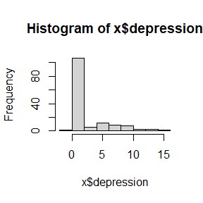
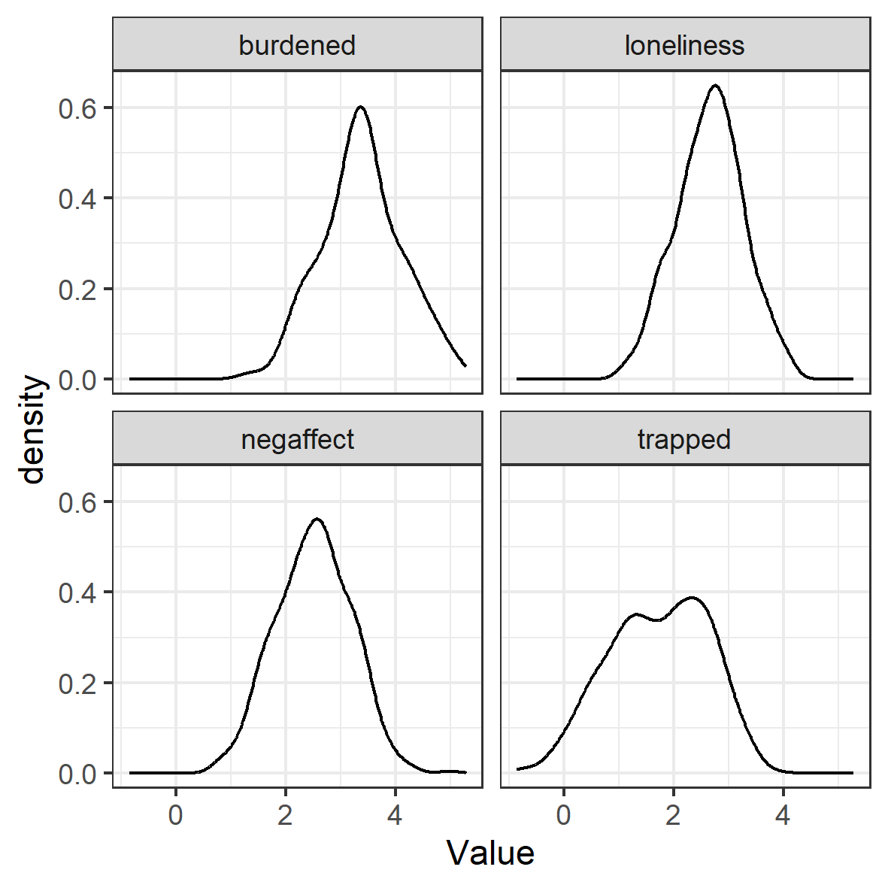
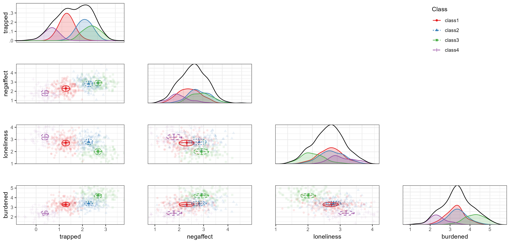
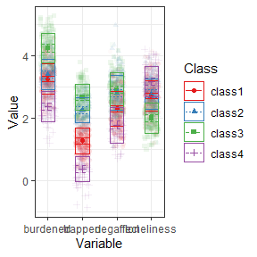
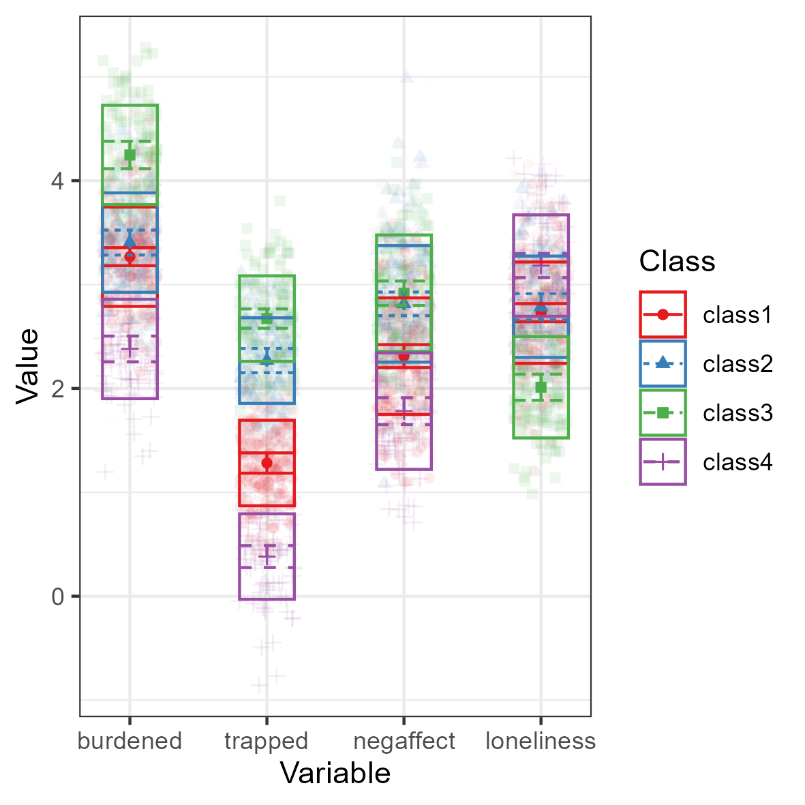

When theory makes specific predictions about the number of latent classes, or even their parameter values - a confirmatory use of LCA is in order.


This vignette explains confirmatory Latent Class Analysis (LCA) using `tidySEM`,
as discussed in [Van Lissa, C. J., Garnier-Villarreal, M., & Anadria, D. (2023). *Recommended Practices in Latent Class Analysis using the Open-Source R-Package tidySEM.* Structural Equation Modeling.](https://doi.org/10.1080/10705511.2023.2250920).


# Example 1: Depression

For example, suppose that clinical psychological theory proposes the existence of two subpopulations:

- people **without depression**
- people **with depression**

If all we know is people's depression score, then we can try to identify two latent classes, corresponding to these subpopulations. Suppose that the theory further specifies that a depression score of about 10 or higher is required to count as depressed. We will use this theory to formulate two increasingly specific hypotheses:

1. a **two-class model** should fit better than a one-class model. Adding a third class should not significantly improve fit.
2. the class means should be close to **0** for the non-depressed class and **10** for the depressed class.

The second hypothesis is considerably stronger because it constrains the class-specific means to exact values.

## Simulate example data

We first create a simple dataset containing a single continuous depression score.


``` r
library(tidySEM)
library(OpenMx)

set.seed(123)
x <- data.frame(depression = c(rnorm(50, mean = 6, sd = 4), rbeta(100,
    2, 3)))
hist(x$depression)
```

<!-- -->

## Test the number of classes

The first confirmatory hypothesis concerns **class enumeration**. Theory predicts two classes, so we estimate one-, two-, and three-class solutions.
Note that some analyses take along time to run.
For computationally intensive analyses like this, it is convenient to save the results to a file using `saveRDS()`,
so you can load the results from that file directly without having to wait for the code to run.


``` r
res <- mx_profiles(x, classes = 1:3)
#> 
MxComputeSimAnnealing(tsallis1996) evaluations 4242 fit 693.252 change -28.76
                                                                             
#> 
MxComputeSimAnnealing(tsallis1996) evaluations 1345 fit 5373.95 change 3156
MxComputeSimAnnealing(tsallis1996) evaluations 4517 fit 629.948 change -202.7
                                                                             
saveRDS(res, "res_depression.rds")
```


``` r
res <- readRDS("res_depression.rds")
table_fit(res)
#>          Name Classes   LL   n Parameters AIC BIC saBIC Entropy prob_min prob_max n_min n_max
#> 1 equal var 1       1 -398 150          2 801 807   800    1.00     1.00     1.00  1.00  1.00
#> 2 equal var 2       2 -347 150          4 701 713   701    0.95     0.94     1.00  0.17  0.83
#> 3 equal var 3       3 -315 150          6 642 660   641    0.97     0.96     0.99  0.12  0.72
#>   np_ratio np_local
#> 1       75       75
#> 2       38       17
#> 3       25       14
```

The fit table lets us inspect information criteria and other model-fit statistics across the competing class solutions.

If we want to test the theory, we can compare adjacent class solutions using the bootstrapped likelihood ratio test (BLRT).


``` r
res_blrt <- BLRT(res)
saveRDS(res_blrt, "blrt_depression.rds")
```


``` r
res_blrt <- readRDS("blrt_depression.rds")
res_blrt
#> Bootstrapped Likelihood Ratio Test:
#> 
#>  null  alt    lr df blrt_p samples
#>  mix1 mix2 103.5  2      0      65
#>  mix2 mix3  63.2  2      0      94
```


## Translate theoretical assumptions into parameter constraints

The models above still allow all parameters to be estimated freely from the data. That tests only the broad hypothesis that two groups exist.
The groups themselves could diverge substantially from what was theorized.

Our theory posits that the non-depressed class should have a mean near 0, whereas the depressed class should have a mean near 10 (technically, the minimum value in that class should be 10, but that's a bit more difficult to enforce).

We can represent this stronger hypothesis by fixing the two class means to these values,
or by e.g. setting a parameter constraint for the two classes.

First, create the two-class profile model without estimating it and examine its parameters:


``` r
res_theory <- mx_profiles(x, classes = 2, run = FALSE)
omxGetParameters(res_theory)
#> equal var 2.weights[1,2]                       v1                      m11 
#>                     0.26                     2.30                     0.73 
#>                      m21 
#>                     8.36
```

The relevant mean parameters are `m11` and `m21`. We can either fix these means to the exact values of 0 and 10:


``` r
res_theory <- omxSetParameters(res_theory, labels = c("m11",
    "m21"), values = c(0, 10), free = FALSE)
```

Or alternatively, we could set a lower and upper bound for these parameters, thus allowing bounded free estimation:


``` r
res_theory_bounds <- omxSetParameters(res_theory, labels = c("m11",
    "m21"), values = c(0, 10), free = TRUE, lbound = c(NA, 10),
    ubound = c(1, NA))
```

Now, run your chosen model:


``` r
res_theory <- run_mx(res_theory)
res_theory_bounds <- run_mx(res_theory_bounds)
#> 
MxComputeSimAnnealing(tsallis1996) evaluations 643 fit 4209.12 change 3036
                                                                          
```

Next, compare the unconstrained two-class solution with the theory-constrained model.


``` r
compare_these <- list(baseline = res[[2]], theory = res_theory,
    theory_bounds = res_theory_bounds)

table_fit(compare_these)
#>                      Name Classes   LL   n Parameters AIC BIC saBIC Entropy prob_min prob_max
#> baseline             mix2       2 -347 150          4 701 713   701    0.95     0.94     1.00
#> theory        equal var 2       2 -369 150          2 741 747   741    0.95     0.96     0.99
#> theory_bounds equal var 2       2 -351 150          4 709 721   709    0.96     0.97     0.99
#>               n_min n_max
#> baseline       0.17  0.83
#> theory         0.17  0.83
#> theory_bounds  0.16  0.84
```

We can also compare the models using the BLRT:


``` r
blrt_theory <- BLRT(list(res[[2]], res_theory))
saveRDS(blrt_theory, "blrt_theory.rds")
```


``` r
blrt_theory <- readRDS("blrt_theory.rds")
blrt_theory
#> Bootstrapped Likelihood Ratio Test:
#> 
#>  null         alt    lr df blrt_p samples
#>  mix2 equal var 2 -44.1 -2   0.47     100
```


Note that fixing the class means to exact values is a very strong assumption.
In many real applications, theory may imply that class means should be **near** certain values rather than exactly equal to them.
You can also manually specify **start values**, and then test if the estimated **parameter values** deviate significantly from these:


``` r
res_theory_starts <- omxSetParameters(res_theory, labels = c("m11",
    "m21"), values = c(0, 10), free = TRUE)
res_theory_starts <- run_mx(res_theory_starts)
#> 
MxComputeSimAnnealing(tsallis1996) evaluations 104 fit 1272.7 change -2845
MxComputeSimAnnealing(tsallis1996) evaluations 4934 fit 693.165 change -369
                                                                           
omxGetParameters(res_theory_starts)
#> equal var 2.weights[1,2]                       v1                      m11 
#>                     0.22                     2.49                     0.87 
#>                      m21 
#>                     8.84
wald_test(res_theory_starts, "m11 = 0; m21 = 10")
#> Wald tests for linear hypotheses:
#>  Hypothesis df chisq       p
#>       m11=0  1  31.2 2.3e-08
#>      m21=10  1   8.8 3.0e-03
```


# Example 2: Caregiver Compass

For this next example, we will use simulated data are based on work by Zegwaard and colleagues,
who sought to establish a typology of caregivers who support a close other receiving outpatient psychological care.
Qualitative research among experts resulted in a theory postulating the existence of four types of caregivers (translated from the original Dutch):

**Balanced**

> The balanced caregiver experiences relative balance between the costs and benefits of caring for a close other.

**Imbalanced**

> The imbalanced caregiver experiences a precarious balance between the costs and benefits of caring for a close other.

**Lonely**

> The lonely caregiver experiences a strong sense of isolation.

**Entrapped**

> The entrapped caregiver strongly feels a sense of being entangled in responsibilities which are difficult to fulfill.

The goal of this confirmatory study was to validate this hypothesized class solution in a sample of caregivers.
A convenience sample was used, with no prior sample size justification.
To view the data documentation,
run the command `?tidySEM::zegwaard_carecompass` in the R console.

## Loading the Data

To load the data, simply attach the `tidySEM` package.
For convenience, we assign the variables used for analysis to an object called `df`.
We first only use the four scales: `c("burdened", "trapped", "negaffect", "loneliness")`.


``` r
# Load required packages
library(tidySEM)
library(ggplot2)
library(OpenMx)
# Load data
df <- zegwaard_carecompass[, c("burdened", "trapped", "negaffect",
    "loneliness")]
```

## Descriptive statistics

We use `tidySEM::descriptives()` to describe the data numerically.
Because all scales are continuous,
we select only columns for continuous data to de-clutter the table:


``` r
desc <- tidySEM::descriptives(df)
desc <- desc[, c("name", "n", "missing", "unique", "mean", "median",
    "sd", "min", "max", "skew_2se", "kurt_2se")]
desc
```


Table: Descriptive statistics

|name       |   n| missing| unique| mean| median|   sd|   min| max| skew_2se| kurt_2se|
|:----------|---:|-------:|------:|----:|------:|----:|-----:|---:|--------:|--------:|
|burdened   | 509|    0.01|    509|  3.4|    3.4| 0.75|  1.20| 5.3|     0.17|    -0.41|
|trapped    | 505|    0.02|    505|  1.7|    1.8| 0.90| -0.86| 3.8|    -1.03|    -1.52|
|negaffect  | 506|    0.01|    506|  2.5|    2.5| 0.69|  0.71| 5.0|     0.08|    -0.38|
|loneliness | 510|    0.01|    510|  2.7|    2.7| 0.62|  0.98| 4.2|    -0.33|    -0.62|


The table indicates two potential causes for concern:
there is a small percentage of missingness,
and all variables have relatively high kurtosis.
Since there are some missing values,
we can conduct an MCAR test using `mice::mcar(df)`.
According to Hawkins' test,
there is no evidence to reject the assumptions of multivariate normality and MCAR, $\tilde{\chi^2}(6) = 3.78, \tilde{p} = 0.71$.
Missing data will be accounted for using FIML.

Additionally, we can plot the data.
The `ggplot2` function `geom_density()` is useful for continuous data.
Visual inspection confirms the conclusions from the `descriptives()` table:
the data are kurtotic (peaked).


``` r
df_plot <- df
names(df_plot) <- paste0("Value.", names(df_plot))
df_plot <- reshape(df_plot, varying = names(df_plot), direction = "long",
    timevar = "Variable")
ggplot(df_plot, aes(x = Value)) + geom_density() + facet_wrap(~Variable) +
    theme_bw()
```



## Conducting Latent Profile Analysis

As all variables are continuous, we can use the convenience function
`tidySEM::mx_profiles()`,
which is a wrapper for the generic function `mx_mixture()` optimized for continuous indicators.
Its default settings are appropriate for LPA, assuming fixed variances across classes and zero covariances.
Its arguments are `data` and number of `classes`.
All variables in `data` are included in the analysis,
which is why we first selected the indicator variables.
As this is a confirmatory LCA,
we do not follow a strictly data-driven class enumeration procedure.
We will set the maximum number of classes $K$ to one more than the theoretically expected number.
We set a seed to ensure replicable results.


```
#> 
MxComputeSimAnnealing(tsallis1996) evaluations 704 fit 6952.16 change 11.88
MxComputeSimAnnealing(tsallis1996) evaluations 1596 fit 7581.1 change 2328 
MxComputeSimAnnealing(tsallis1996) evaluations 2482 fit 7525.19 change -28
MxComputeSimAnnealing(tsallis1996) evaluations 3360 fit 5541.55 change 423.1
MxComputeSimAnnealing(tsallis1996) evaluations 4228 fit 6596.45 change 4.825
MxComputeSimAnnealing(tsallis1996) evaluations 5095 fit 7428.18 change -17.7
MxComputeSimAnnealing(tsallis1996) evaluations 5911 fit 4179.99 change -217.4
MxComputeSimAnnealing(tsallis1996) evaluations 6752 fit 4063.72 change -2255 
MxComputeSimAnnealing(tsallis1996) evaluations 7587 fit 4097 change -337    
MxComputeSimAnnealing(tsallis1996) evaluations 8436 fit 4268.55 change 176
MxComputeSimAnnealing(tsallis1996) evaluations 9276 fit 4112.89 change 50.14
MxComputeSimAnnealing(tsallis1996) evaluations 10116 fit 6316.8 change 2242 
MxComputeSimAnnealing(tsallis1996) evaluations 10927 fit 4088.84 change -266.1
MxComputeSimAnnealing(tsallis1996) evaluations 11739 fit 4094.89 change -3414 
MxComputeSimAnnealing(tsallis1996) evaluations 12540 fit 4062.83 change -0.3207
MxComputeSimAnnealing(tsallis1996) evaluations 13339 fit 4063.72 change 0.7879 
MxComputeSimAnnealing(tsallis1996) evaluations 14086 fit 4062.96 change -2646 
MxComputeSimAnnealing(tsallis1996) evaluations 14824 fit 4062.8 change -0.9768
MxComputeSimAnnealing(tsallis1996) evaluations 15591 fit 4375.85 change 313.1 
MxComputeSimAnnealing(tsallis1996) evaluations 16364 fit 4062.74 change -0.1419
                                                                               
#> 
MxComputeSimAnnealing(tsallis1996) evaluations 269 fit 5409.31 change -22.66
MxComputeSimAnnealing(tsallis1996) evaluations 801 fit 21451 change 1.192e+04
MxComputeSimAnnealing(tsallis1996) evaluations 1346 fit 5369.64 change 19.9  
MxComputeSimAnnealing(tsallis1996) evaluations 1911 fit 4880.26 change 9.807
MxComputeSimAnnealing(tsallis1996) evaluations 2478 fit 5383.43 change 135.5
MxComputeSimAnnealing(tsallis1996) evaluations 3043 fit 5424.59 change 26.11
MxComputeSimAnnealing(tsallis1996) evaluations 3616 fit 5431.97 change 53.9 
MxComputeSimAnnealing(tsallis1996) evaluations 4182 fit 5233.57 change 350.9
MxComputeSimAnnealing(tsallis1996) evaluations 4750 fit 3974.13 change -1368
MxComputeSimAnnealing(tsallis1996) evaluations 5324 fit 5276.76 change -9.468
MxComputeSimAnnealing(tsallis1996) evaluations 5892 fit 3926.62 change -864.9
MxComputeSimAnnealing(tsallis1996) evaluations 6439 fit 3915.9 change -1537  
MxComputeSimAnnealing(tsallis1996) evaluations 6982 fit 5124.41 change 1168
MxComputeSimAnnealing(tsallis1996) evaluations 7525 fit 5137.96 change 21.3
MxComputeSimAnnealing(tsallis1996) evaluations 8082 fit 4885.48 change -121.6
MxComputeSimAnnealing(tsallis1996) evaluations 8647 fit 4808.18 change 903.5 
MxComputeSimAnnealing(tsallis1996) evaluations 9187 fit 4968.61 change 1058 
MxComputeSimAnnealing(tsallis1996) evaluations 9742 fit 3903.76 change -902.3
MxComputeSimAnnealing(tsallis1996) evaluations 10298 fit 4795.47 change -224.6
MxComputeSimAnnealing(tsallis1996) evaluations 10854 fit 3904.05 change -1081 
MxComputeSimAnnealing(tsallis1996) evaluations 11413 fit 3902.86 change -1078
MxComputeSimAnnealing(tsallis1996) evaluations 11967 fit 5642.26 change 1738 
MxComputeSimAnnealing(tsallis1996) evaluations 12516 fit 6502.01 change 1685
MxComputeSimAnnealing(tsallis1996) evaluations 13072 fit 4821.39 change 917.4
MxComputeSimAnnealing(tsallis1996) evaluations 13624 fit 3904.47 change -16.71
MxComputeSimAnnealing(tsallis1996) evaluations 14175 fit 3904.78 change -0.9195
MxComputeSimAnnealing(tsallis1996) evaluations 14738 fit 4990.37 change -672.7 
MxComputeSimAnnealing(tsallis1996) evaluations 15288 fit 3902.72 change -921.6
MxComputeSimAnnealing(tsallis1996) evaluations 15852 fit 3902.76 change 0.03864
MxComputeSimAnnealing(tsallis1996) evaluations 16395 fit 4590.66 change 687.9  
MxComputeSimAnnealing(tsallis1996) evaluations 16953 fit 3902.71 change -354.4
MxComputeSimAnnealing(tsallis1996) evaluations 17502 fit 4046.1 change -774.6 
MxComputeSimAnnealing(tsallis1996) evaluations 18041 fit 3917.69 change 14.96
MxComputeSimAnnealing(tsallis1996) evaluations 18604 fit 9036.61 change 5134 
MxComputeSimAnnealing(tsallis1996) evaluations 19160 fit 3902.72 change -0.7483
MxComputeSimAnnealing(tsallis1996) evaluations 19725 fit 5671.14 change 1768   
MxComputeSimAnnealing(tsallis1996) evaluations 20285 fit 3902.71 change -1067
MxComputeSimAnnealing(tsallis1996) evaluations 20855 fit 4902.39 change 988  
MxComputeSimAnnealing(tsallis1996) evaluations 21424 fit 3907.21 change -913.2
MxComputeSimAnnealing(tsallis1996) evaluations 21994 fit 4132.32 change 229.5 
MxComputeSimAnnealing(tsallis1996) evaluations 22541 fit 3905.75 change -916.9
                                                                              
#> 
MxComputeSimAnnealing(tsallis1996) evaluations 184 fit 4879.04 change -21.34
MxComputeSimAnnealing(tsallis1996) evaluations 606 fit 8772.72 change 2034  
MxComputeSimAnnealing(tsallis1996) evaluations 1040 fit 4753.96 change 1.503
MxComputeSimAnnealing(tsallis1996) evaluations 1459 fit 7905.46 change 701.5
MxComputeSimAnnealing(tsallis1996) evaluations 1892 fit 4753.97 change 0.01369
MxComputeSimAnnealing(tsallis1996) evaluations 2321 fit 4705.7 change 12.15   
MxComputeSimAnnealing(tsallis1996) evaluations 2751 fit 4654.46 change -3859
MxComputeSimAnnealing(tsallis1996) evaluations 3176 fit 4902.24 change 23.38
MxComputeSimAnnealing(tsallis1996) evaluations 3597 fit 6437.09 change -1799
MxComputeSimAnnealing(tsallis1996) evaluations 4019 fit 4124.14 change -170.2
MxComputeSimAnnealing(tsallis1996) evaluations 4441 fit 4873.02 change 22.64 
MxComputeSimAnnealing(tsallis1996) evaluations 4865 fit 5644.22 change 578.9
MxComputeSimAnnealing(tsallis1996) evaluations 5289 fit 4860.55 change 197.5
MxComputeSimAnnealing(tsallis1996) evaluations 5703 fit 4861.18 change 188.3
MxComputeSimAnnealing(tsallis1996) evaluations 6130 fit 9421.08 change 169.6
MxComputeSimAnnealing(tsallis1996) evaluations 6555 fit 4538.21 change -322.7
MxComputeSimAnnealing(tsallis1996) evaluations 6973 fit 4639.6 change 241.5  
MxComputeSimAnnealing(tsallis1996) evaluations 7416 fit 4191.95 change -1473
MxComputeSimAnnealing(tsallis1996) evaluations 7839 fit 4721.05 change -4.873
MxComputeSimAnnealing(tsallis1996) evaluations 8247 fit 6074.52 change -205.8
MxComputeSimAnnealing(tsallis1996) evaluations 8661 fit 4510.18 change 674.8 
MxComputeSimAnnealing(tsallis1996) evaluations 9106 fit 4119.92 change -598.1
MxComputeSimAnnealing(tsallis1996) evaluations 9523 fit 4723.6 change -0.2238
MxComputeSimAnnealing(tsallis1996) evaluations 9919 fit 4570.68 change 0.01274
MxComputeSimAnnealing(tsallis1996) evaluations 10341 fit 3907.06 change -166.5
MxComputeSimAnnealing(tsallis1996) evaluations 10760 fit 4751.99 change 909.7 
MxComputeSimAnnealing(tsallis1996) evaluations 11180 fit 3869.85 change -789.7
MxComputeSimAnnealing(tsallis1996) evaluations 11563 fit 3889.58 change -593.6
MxComputeSimAnnealing(tsallis1996) evaluations 11981 fit 3834.34 change -5.882
MxComputeSimAnnealing(tsallis1996) evaluations 12393 fit 3833.14 change -922.3
MxComputeSimAnnealing(tsallis1996) evaluations 12811 fit 3836.39 change -832.8
MxComputeSimAnnealing(tsallis1996) evaluations 13217 fit 4497.05 change -2.249
MxComputeSimAnnealing(tsallis1996) evaluations 13636 fit 4764.74 change 924.2 
MxComputeSimAnnealing(tsallis1996) evaluations 14041 fit 3833.34 change -27.34
MxComputeSimAnnealing(tsallis1996) evaluations 14462 fit 4780.12 change 287.1 
MxComputeSimAnnealing(tsallis1996) evaluations 14880 fit 4649.14 change -128.2
MxComputeSimAnnealing(tsallis1996) evaluations 15300 fit 3833.09 change -719.4
MxComputeSimAnnealing(tsallis1996) evaluations 15715 fit 4577.05 change 742.1 
MxComputeSimAnnealing(tsallis1996) evaluations 16155 fit 3897.38 change 64.61
MxComputeSimAnnealing(tsallis1996) evaluations 16575 fit 4490.24 change 657.7
MxComputeSimAnnealing(tsallis1996) evaluations 17013 fit 3832.54 change -0.9263
MxComputeSimAnnealing(tsallis1996) evaluations 17433 fit 4311.24 change 470.5  
MxComputeSimAnnealing(tsallis1996) evaluations 17853 fit 3837.18 change 4.644
MxComputeSimAnnealing(tsallis1996) evaluations 18269 fit 3832.52 change -0.01408
MxComputeSimAnnealing(tsallis1996) evaluations 18693 fit 3832.64 change -556.2  
MxComputeSimAnnealing(tsallis1996) evaluations 19119 fit 4581.61 change 0.01418
MxComputeSimAnnealing(tsallis1996) evaluations 19534 fit 3832.53 change -751.1 
MxComputeSimAnnealing(tsallis1996) evaluations 19945 fit 4578.58 change 741   
MxComputeSimAnnealing(tsallis1996) evaluations 20367 fit 3832.79 change -0.04123
MxComputeSimAnnealing(tsallis1996) evaluations 20781 fit 3832.61 change -531.5  
MxComputeSimAnnealing(tsallis1996) evaluations 21196 fit 5911.04 change 1150  
MxComputeSimAnnealing(tsallis1996) evaluations 21621 fit 3832.51 change -5.076
MxComputeSimAnnealing(tsallis1996) evaluations 22037 fit 4482.99 change 611.1 
MxComputeSimAnnealing(tsallis1996) evaluations 22442 fit 3832.53 change -1.06
MxComputeSimAnnealing(tsallis1996) evaluations 22832 fit 3832.53 change 0.00618
MxComputeSimAnnealing(tsallis1996) evaluations 23244 fit 4502.9 change 668.8   
MxComputeSimAnnealing(tsallis1996) evaluations 23649 fit 3859.75 change 27.03
MxComputeSimAnnealing(tsallis1996) evaluations 24065 fit 3843.24 change 10.72
MxComputeSimAnnealing(tsallis1996) evaluations 24486 fit 3838.27 change -8.42
MxComputeSimAnnealing(tsallis1996) evaluations 24905 fit 3832.52 change -0.009345
MxComputeSimAnnealing(tsallis1996) evaluations 25321 fit 4790.9 change 958.3     
MxComputeSimAnnealing(tsallis1996) evaluations 25743 fit 3832.7 change 0.1624
MxComputeSimAnnealing(tsallis1996) evaluations 26165 fit 3832.53 change 0.007316
MxComputeSimAnnealing(tsallis1996) evaluations 26565 fit 3832.52 change -0.002843
MxComputeSimAnnealing(tsallis1996) evaluations 26972 fit 3832.52 change -1.796   
MxComputeSimAnnealing(tsallis1996) evaluations 27369 fit 3832.52 change -0.1032
MxComputeSimAnnealing(tsallis1996) evaluations 27851 fit 3839.17 change -295.7 
MxComputeSimAnnealing(tsallis1996) evaluations 28431 fit 4569.93 change 737.3 
MxComputeSimAnnealing(tsallis1996) evaluations 28819 fit 4617.33 change 784.8
MxComputeSimAnnealing(tsallis1996) evaluations 29215 fit 3832.67 change 0.1545
                                                                              
#> 
MxComputeSimAnnealing(tsallis1996) evaluations 264 fit 10631 change 864.1
MxComputeSimAnnealing(tsallis1996) evaluations 613 fit 4740.73 change 9.537
MxComputeSimAnnealing(tsallis1996) evaluations 963 fit 10953.4 change 2526 
MxComputeSimAnnealing(tsallis1996) evaluations 1311 fit 4607.56 change 7.887
MxComputeSimAnnealing(tsallis1996) evaluations 1659 fit 4110.47 change 10.3 
MxComputeSimAnnealing(tsallis1996) evaluations 2011 fit 4607.56 change 7.887
MxComputeSimAnnealing(tsallis1996) evaluations 2352 fit 4263.54 change -478.3
MxComputeSimAnnealing(tsallis1996) evaluations 2700 fit 7293.13 change -1193 
MxComputeSimAnnealing(tsallis1996) evaluations 3053 fit 4252.9 change -10.65
MxComputeSimAnnealing(tsallis1996) evaluations 3404 fit 4689.82 change -1130
MxComputeSimAnnealing(tsallis1996) evaluations 3750 fit 4741.88 change 1.158
MxComputeSimAnnealing(tsallis1996) evaluations 4099 fit 6985.95 change 2592 
MxComputeSimAnnealing(tsallis1996) evaluations 4445 fit 4606.05 change 22.48
MxComputeSimAnnealing(tsallis1996) evaluations 4795 fit 4117.42 change 10.61
MxComputeSimAnnealing(tsallis1996) evaluations 5131 fit 4117.42 change 10.61
MxComputeSimAnnealing(tsallis1996) evaluations 5480 fit 4614.29 change -86.18
MxComputeSimAnnealing(tsallis1996) evaluations 5829 fit 4115.44 change -1.43 
MxComputeSimAnnealing(tsallis1996) evaluations 6176 fit 4691.64 change -1582
MxComputeSimAnnealing(tsallis1996) evaluations 6524 fit 4234.69 change 74.75
MxComputeSimAnnealing(tsallis1996) evaluations 6876 fit 4673.19 change 14.61
MxComputeSimAnnealing(tsallis1996) evaluations 7225 fit 4239.53 change -10.15
MxComputeSimAnnealing(tsallis1996) evaluations 7576 fit 4626.22 change -1992 
MxComputeSimAnnealing(tsallis1996) evaluations 7923 fit 4671.31 change 0.009658
MxComputeSimAnnealing(tsallis1996) evaluations 8269 fit 9013.71 change 3633    
MxComputeSimAnnealing(tsallis1996) evaluations 8609 fit 3935.06 change 54.08
MxComputeSimAnnealing(tsallis1996) evaluations 8954 fit 3933.73 change -653.9
MxComputeSimAnnealing(tsallis1996) evaluations 9304 fit 5731.04 change 1710  
MxComputeSimAnnealing(tsallis1996) evaluations 9650 fit 3869.79 change -625.2
MxComputeSimAnnealing(tsallis1996) evaluations 9997 fit 4101.28 change -6.145
MxComputeSimAnnealing(tsallis1996) evaluations 10343 fit 3835.26 change -3784
MxComputeSimAnnealing(tsallis1996) evaluations 10692 fit 4579.05 change -71.94
MxComputeSimAnnealing(tsallis1996) evaluations 11037 fit 4024.99 change -2.487
MxComputeSimAnnealing(tsallis1996) evaluations 11380 fit 4016.58 change 144.5 
MxComputeSimAnnealing(tsallis1996) evaluations 11725 fit 4486.35 change -197.4
MxComputeSimAnnealing(tsallis1996) evaluations 12060 fit 4598.04 change 129.7 
MxComputeSimAnnealing(tsallis1996) evaluations 12402 fit 3943.48 change -644.6
MxComputeSimAnnealing(tsallis1996) evaluations 12747 fit 4026.14 change 9.41  
MxComputeSimAnnealing(tsallis1996) evaluations 13090 fit 4919.57 change 986.4
MxComputeSimAnnealing(tsallis1996) evaluations 13436 fit 3824.99 change -957 
MxComputeSimAnnealing(tsallis1996) evaluations 13780 fit 3946.07 change -108.9
MxComputeSimAnnealing(tsallis1996) evaluations 14123 fit 3823.3 change -4066  
MxComputeSimAnnealing(tsallis1996) evaluations 14468 fit 4866.31 change 341.1
MxComputeSimAnnealing(tsallis1996) evaluations 14809 fit 3821.67 change -0.3627
MxComputeSimAnnealing(tsallis1996) evaluations 15151 fit 3821.87 change 0.3495 
MxComputeSimAnnealing(tsallis1996) evaluations 15487 fit 3998.08 change -20.17
MxComputeSimAnnealing(tsallis1996) evaluations 15831 fit 5920.47 change 2099  
MxComputeSimAnnealing(tsallis1996) evaluations 16170 fit 6757.22 change 2753
MxComputeSimAnnealing(tsallis1996) evaluations 16515 fit 3821.52 change -283.2
MxComputeSimAnnealing(tsallis1996) evaluations 16859 fit 4027.94 change 186.2 
MxComputeSimAnnealing(tsallis1996) evaluations 17201 fit 5660.96 change 1838 
MxComputeSimAnnealing(tsallis1996) evaluations 17546 fit 3820.96 change -0.08126
MxComputeSimAnnealing(tsallis1996) evaluations 17890 fit 4651.11 change 1.058   
MxComputeSimAnnealing(tsallis1996) evaluations 18232 fit 3823.6 change -91.63
MxComputeSimAnnealing(tsallis1996) evaluations 18580 fit 4571.63 change 513.5
MxComputeSimAnnealing(tsallis1996) evaluations 18911 fit 3820.63 change -0.2716
MxComputeSimAnnealing(tsallis1996) evaluations 19221 fit 4148.37 change -2699  
MxComputeSimAnnealing(tsallis1996) evaluations 19563 fit 3820.54 change -738.4
MxComputeSimAnnealing(tsallis1996) evaluations 19905 fit 4617.01 change 795.6 
MxComputeSimAnnealing(tsallis1996) evaluations 20248 fit 3877.83 change -133.3
MxComputeSimAnnealing(tsallis1996) evaluations 20591 fit 10756.8 change 3166  
MxComputeSimAnnealing(tsallis1996) evaluations 20934 fit 4098.35 change 267.6
MxComputeSimAnnealing(tsallis1996) evaluations 21281 fit 4004.96 change 184.3
MxComputeSimAnnealing(tsallis1996) evaluations 21621 fit 3923.19 change -105.1
MxComputeSimAnnealing(tsallis1996) evaluations 21960 fit 3837.44 change -236.6
MxComputeSimAnnealing(tsallis1996) evaluations 22298 fit 4153.55 change 333.1 
MxComputeSimAnnealing(tsallis1996) evaluations 22641 fit 3820.58 change -1.47
MxComputeSimAnnealing(tsallis1996) evaluations 22978 fit 3884.15 change 47.56
MxComputeSimAnnealing(tsallis1996) evaluations 23322 fit 3821.31 change 0.7941
MxComputeSimAnnealing(tsallis1996) evaluations 23663 fit 4006.14 change 185.7 
MxComputeSimAnnealing(tsallis1996) evaluations 24005 fit 3820.47 change 0.0239
MxComputeSimAnnealing(tsallis1996) evaluations 24346 fit 3829.75 change -136.6
MxComputeSimAnnealing(tsallis1996) evaluations 24687 fit 3820.59 change 0.144 
MxComputeSimAnnealing(tsallis1996) evaluations 25033 fit 3820.52 change 0.08351
MxComputeSimAnnealing(tsallis1996) evaluations 25375 fit 3932.63 change 112.2  
MxComputeSimAnnealing(tsallis1996) evaluations 25709 fit 4076.82 change 43.97
MxComputeSimAnnealing(tsallis1996) evaluations 26052 fit 4920.98 change 1101 
MxComputeSimAnnealing(tsallis1996) evaluations 26398 fit 3820.57 change -378.7
MxComputeSimAnnealing(tsallis1996) evaluations 26744 fit 3820.51 change -181.9
MxComputeSimAnnealing(tsallis1996) evaluations 27085 fit 3820.46 change -2275 
MxComputeSimAnnealing(tsallis1996) evaluations 27428 fit 3820.44 change -0.0148
MxComputeSimAnnealing(tsallis1996) evaluations 27766 fit 4565.53 change 745.1  
MxComputeSimAnnealing(tsallis1996) evaluations 28105 fit 3820.44 change -5.419
MxComputeSimAnnealing(tsallis1996) evaluations 28449 fit 3997.99 change 177.6 
MxComputeSimAnnealing(tsallis1996) evaluations 28790 fit 4058.25 change -24.86
MxComputeSimAnnealing(tsallis1996) evaluations 29128 fit 3853.6 change 24.72  
MxComputeSimAnnealing(tsallis1996) evaluations 29468 fit 5810.55 change 1990
MxComputeSimAnnealing(tsallis1996) evaluations 29806 fit 3824.86 change -329.5
MxComputeSimAnnealing(tsallis1996) evaluations 30149 fit 3821.35 change 0.9179
MxComputeSimAnnealing(tsallis1996) evaluations 30482 fit 3820.42 change -0.00262
MxComputeSimAnnealing(tsallis1996) evaluations 30820 fit 4927.81 change 359     
MxComputeSimAnnealing(tsallis1996) evaluations 31157 fit 3824.65 change 2.837
MxComputeSimAnnealing(tsallis1996) evaluations 31493 fit 3823.42 change 2.985
MxComputeSimAnnealing(tsallis1996) evaluations 31829 fit 3820.43 change -1106
MxComputeSimAnnealing(tsallis1996) evaluations 32145 fit 3820.46 change -8.217
MxComputeSimAnnealing(tsallis1996) evaluations 32470 fit 3820.47 change -750.2
MxComputeSimAnnealing(tsallis1996) evaluations 32797 fit 3820.63 change 0.1966
MxComputeSimAnnealing(tsallis1996) evaluations 33126 fit 3845.35 change -150.8
MxComputeSimAnnealing(tsallis1996) evaluations 33457 fit 3821.45 change -829.2
MxComputeSimAnnealing(tsallis1996) evaluations 33792 fit 3820.43 change -1106 
MxComputeSimAnnealing(tsallis1996) evaluations 34126 fit 4520.75 change 699.4
MxComputeSimAnnealing(tsallis1996) evaluations 34450 fit 3870.02 change 49.59
MxComputeSimAnnealing(tsallis1996) evaluations 34780 fit 3820.88 change -180.2
MxComputeSimAnnealing(tsallis1996) evaluations 35116 fit 3820.46 change -0.05012
MxComputeSimAnnealing(tsallis1996) evaluations 35449 fit 3996.35 change -2.301  
MxComputeSimAnnealing(tsallis1996) evaluations 35792 fit 3820.87 change 0.4343
                                                                              
```

``` r
set.seed(123)
res <- mx_profiles(data = df, classes = 1:5)
```


This analysis should produce some messages about cluster initialization.
These relate to the selection of starting values,
which relies on the K-means algorithm and is not robust to missing data.
The algorithm automatically switches to hierarchical clustering, no further action is required.

## Class Enumeration

To compare the fit of the theoretical model against other models,
we create a model fit table using
`table_fit()` and retain relevant columns.
We also determine whether any models can be disqualified.

In this example, all models converge without issues.
If, for example, the two-class solution had not converged, we could use the function `res[[2]] <- mxTryHard(res[[2]])` to aid convergence.

Next, we check for local identifiability.
The sample size is consistently reported as 513,
which means that partially missing cases were indeed included via FIML.
The smallest class size occurs in the 5-class model,
where the smallest class is assigned 7% of cases, or 38 cases.
This model has 28 parameters, approximately 6 per class.
We thus have at least five observations per parameter in every class,
and do not disqualify the 5-class model.

There are concerns about theoretical interpretability of all solutions,
as the entropies and minimum classification probabilities are all low.
However, in this confirmatory use case, we address this when interpreting the results.


``` r
fit <- table_fit(res)  # model fit table
fit[, c("Name", "LL", "Parameters", "n", "BIC", "Entropy", "prob_min",
    "prob_max", "n_min", "n_max", "np_ratio", "np_local")]
```


Table: Model fit table

|Name        |    LL|  p|   n|  BIC| Entropy| p_min| p_max| n_min| n_max|
|:-----------|-----:|--:|---:|----:|-------:|-----:|-----:|-----:|-----:|
|equal var 1 | -2242|  8| 513| 4534|    1.00|  1.00|  1.00|  1.00|  1.00|
|equal var 2 | -2031| 13| 513| 4144|    0.74|  0.91|  0.93|  0.42|  0.58|
|equal var 3 | -1951| 18| 513| 4015|    0.78|  0.89|  0.91|  0.19|  0.54|
|equal var 4 | -1916| 23| 513| 3976|    0.75|  0.81|  0.92|  0.16|  0.34|
|equal var 5 | -1910| 28| 513| 3995|    0.76|  0.64|  0.92|  0.08|  0.34|


### Using ICs

the 4-class solution has the lowest BIC,
which means it is preferred over all other solutions including a 1-class solution and a solution with more classes.
Note that a scree plot for the BIC can be plotted by calling `plot(fit)`.
Following the elbow criterion, a three-class solution would also be defensible.
The function `ic_weights(fit)` allows us to compute IC weights;
it indicates that, conditional on the set of models,
the 4-class model has a posterior model probability of nearly 100%.

### Using LMR tests

If we conduct LMR tests, we find that the tests are significant for all pairwise model comparisons, except for the 5-class model:


``` r
lr_lmr(res)
```


Table: LMR test table

|null |alt  |   lr| df|    p|   w2| p_w2|
|:----|:----|----:|--:|----:|----:|----:|
|mix1 |mix2 | 10.2|  5| 0.00| 0.82| 0.00|
|mix2 |mix3 |  5.3|  5| 0.00| 0.44| 0.00|
|mix3 |mix4 |  4.1|  5| 0.00| 0.14| 0.00|
|mix4 |mix5 |  1.6|  5| 0.05| 0.03| 0.04|


### Using BLRT tests

We can also use the BLRT test.
As it is very computationally expensive,
we will use a low number of replications here.
In practice, one might use a much higher number (1000+) for published research.
Keep in mind that the p-value of the BLRT is subject to Monte Carlo error;
if it fluctuates when analyses are replicated or its value is very close to the critical threshold, consider increasing the number of replications.

To accelerate computations, we can use the `future` package for parallel computing (see `?plan` to select the appropriate back-end for your system).
To track the function's progress,
we use the `progressr` ecosystem,
which allows users to choose how they want to be informed.
The example below uses a progress bar:


``` r
library(future)
library(progressr)
plan(multisession)  # Parallel processing for Windows
handlers("progress")  # Progress bar
set.seed(1)
res_blrt <- BLRT(res, replications = 100)
```


Table: BLRT test table

|null |alt  |    lr| df| blrt_p| samples|
|:----|:----|-----:|--:|------:|-------:|
|mix1 |mix2 | 421.2|  5|   0.00|     100|
|mix2 |mix3 | 160.0|  5|   0.00|     100|
|mix3 |mix4 |  70.2|  5|   0.00|     100|
|mix4 |mix5 |   7.8|  5|   0.36|     100|


In sum, across all class enumeration criteria, there is strong support for a 4-class solution.

## Optional: Alternative Model Specifications

In the case of confirmatory LCA, the theory would be refuted by strong evidence against the hypothesized model and number of classes.
In the preceding, we only compared the theoretical model against models with different number of classes.
Imagine, however, that a Reviewer argues that variance ought to be freely estimated across classes.
We could compare our theoretical model against their competing model as follows.
Note that we can put two models into a list to compare them.


```
#> 
MxComputeSimAnnealing(tsallis1996) evaluations 42 fit 7085.03 change 2271
MxComputeSimAnnealing(tsallis1996) evaluations 471 fit 4660.39 change -8.054
MxComputeSimAnnealing(tsallis1996) evaluations 902 fit 5057.53 change 99.91 
MxComputeSimAnnealing(tsallis1996) evaluations 1330 fit 4586.89 change -69.46
MxComputeSimAnnealing(tsallis1996) evaluations 1757 fit 6891.96 change 2078  
MxComputeSimAnnealing(tsallis1996) evaluations 2189 fit 4589.16 change 215 
MxComputeSimAnnealing(tsallis1996) evaluations 2612 fit 4587.24 change -1.923
MxComputeSimAnnealing(tsallis1996) evaluations 3039 fit 4887.98 change 135.6 
MxComputeSimAnnealing(tsallis1996) evaluations 3468 fit 4802.29 change -11.88
MxComputeSimAnnealing(tsallis1996) evaluations 3893 fit 6025.4 change -422.9 
MxComputeSimAnnealing(tsallis1996) evaluations 4321 fit 4660.39 change -8.054
MxComputeSimAnnealing(tsallis1996) evaluations 4742 fit 4666.78 change 6.384 
MxComputeSimAnnealing(tsallis1996) evaluations 5176 fit 5029.82 change -24.41
MxComputeSimAnnealing(tsallis1996) evaluations 5607 fit 6150.8 change 1337   
MxComputeSimAnnealing(tsallis1996) evaluations 6037 fit 4666.78 change 6.384
MxComputeSimAnnealing(tsallis1996) evaluations 6460 fit 4311.87 change -4.497
MxComputeSimAnnealing(tsallis1996) evaluations 6871 fit 4667.88 change 236.9 
MxComputeSimAnnealing(tsallis1996) evaluations 7286 fit 4797.97 change 0.01536
MxComputeSimAnnealing(tsallis1996) evaluations 7702 fit 4796.38 change 0      
MxComputeSimAnnealing(tsallis1996) evaluations 8119 fit 4792.08 change 368.4
MxComputeSimAnnealing(tsallis1996) evaluations 8534 fit 5075.03 change 772.6
MxComputeSimAnnealing(tsallis1996) evaluations 8953 fit 5033.88 change 751.8
MxComputeSimAnnealing(tsallis1996) evaluations 9376 fit 4966.25 change -65.74
MxComputeSimAnnealing(tsallis1996) evaluations 9791 fit 3855.85 change -360.4
MxComputeSimAnnealing(tsallis1996) evaluations 10208 fit 4432.5 change -5.439
MxComputeSimAnnealing(tsallis1996) evaluations 10636 fit 4993.88 change -23.39
MxComputeSimAnnealing(tsallis1996) evaluations 11045 fit 3863.1 change -570.9 
MxComputeSimAnnealing(tsallis1996) evaluations 11472 fit 4617.59 change 636.8
MxComputeSimAnnealing(tsallis1996) evaluations 11893 fit 3944.45 change 101.5
MxComputeSimAnnealing(tsallis1996) evaluations 12313 fit 4963.58 change 0    
MxComputeSimAnnealing(tsallis1996) evaluations 12745 fit 4727.17 change 0.5332
MxComputeSimAnnealing(tsallis1996) evaluations 13178 fit 3859.1 change 11.9   
MxComputeSimAnnealing(tsallis1996) evaluations 13610 fit 3826.19 change -0.4287
MxComputeSimAnnealing(tsallis1996) evaluations 14037 fit 3836.66 change -2.377 
MxComputeSimAnnealing(tsallis1996) evaluations 14467 fit 3826.02 change -721.2
MxComputeSimAnnealing(tsallis1996) evaluations 14897 fit 4287.4 change 269.9  
MxComputeSimAnnealing(tsallis1996) evaluations 15319 fit 4472.57 change 1.206
MxComputeSimAnnealing(tsallis1996) evaluations 15746 fit 4843.25 change -107.1
MxComputeSimAnnealing(tsallis1996) evaluations 16175 fit 4746.23 change 1.186 
MxComputeSimAnnealing(tsallis1996) evaluations 16604 fit 4542.54 change 71.73
MxComputeSimAnnealing(tsallis1996) evaluations 17034 fit 3821.66 change -683.7
MxComputeSimAnnealing(tsallis1996) evaluations 17466 fit 3829.54 change -728.7
MxComputeSimAnnealing(tsallis1996) evaluations 17892 fit 3821.65 change -973.3
MxComputeSimAnnealing(tsallis1996) evaluations 18318 fit 4587.42 change 760   
MxComputeSimAnnealing(tsallis1996) evaluations 18742 fit 3829.29 change -725.1
MxComputeSimAnnealing(tsallis1996) evaluations 19168 fit 3821.13 change -638.3
MxComputeSimAnnealing(tsallis1996) evaluations 19587 fit 4382.03 change 537   
MxComputeSimAnnealing(tsallis1996) evaluations 20009 fit 4524.08 change 93.69
MxComputeSimAnnealing(tsallis1996) evaluations 20436 fit 4826.78 change 1005 
MxComputeSimAnnealing(tsallis1996) evaluations 20855 fit 3832.77 change -1018
MxComputeSimAnnealing(tsallis1996) evaluations 21282 fit 4781.43 change 958  
MxComputeSimAnnealing(tsallis1996) evaluations 21708 fit 3820.62 change -379.1
MxComputeSimAnnealing(tsallis1996) evaluations 22131 fit 4136.45 change 312   
MxComputeSimAnnealing(tsallis1996) evaluations 22553 fit 4368.96 change 10.32
MxComputeSimAnnealing(tsallis1996) evaluations 22979 fit 4376.73 change 556.6
MxComputeSimAnnealing(tsallis1996) evaluations 23396 fit 3820.15 change -649.6
MxComputeSimAnnealing(tsallis1996) evaluations 23811 fit 3840.31 change -331  
MxComputeSimAnnealing(tsallis1996) evaluations 24238 fit 3821.75 change 2.158
MxComputeSimAnnealing(tsallis1996) evaluations 24641 fit 3819.56 change -822.4
MxComputeSimAnnealing(tsallis1996) evaluations 25033 fit 6882.08 change 3052  
MxComputeSimAnnealing(tsallis1996) evaluations 25449 fit 4784.92 change 13.58
MxComputeSimAnnealing(tsallis1996) evaluations 25867 fit 4785.11 change 963.3
MxComputeSimAnnealing(tsallis1996) evaluations 26302 fit 3821.06 change 2.12 
MxComputeSimAnnealing(tsallis1996) evaluations 26717 fit 4711.19 change 25.77
MxComputeSimAnnealing(tsallis1996) evaluations 27136 fit 4710.97 change 868.5
MxComputeSimAnnealing(tsallis1996) evaluations 27548 fit 3820.9 change -957.1
MxComputeSimAnnealing(tsallis1996) evaluations 27955 fit 3820.3 change 1.563 
MxComputeSimAnnealing(tsallis1996) evaluations 28368 fit 3824.72 change -193.2
MxComputeSimAnnealing(tsallis1996) evaluations 28787 fit 3820.67 change -9.83 
MxComputeSimAnnealing(tsallis1996) evaluations 29205 fit 3822.58 change -890.6
MxComputeSimAnnealing(tsallis1996) evaluations 29627 fit 3819.24 change -883.3
MxComputeSimAnnealing(tsallis1996) evaluations 30041 fit 4048.64 change 229.4 
MxComputeSimAnnealing(tsallis1996) evaluations 30462 fit 4143.07 change 323.9
MxComputeSimAnnealing(tsallis1996) evaluations 30871 fit 3818.58 change -26.15
MxComputeSimAnnealing(tsallis1996) evaluations 31288 fit 4346.5 change 520.8  
MxComputeSimAnnealing(tsallis1996) evaluations 31704 fit 3854.75 change -790.6
MxComputeSimAnnealing(tsallis1996) evaluations 32112 fit 4707.55 change 4.254 
MxComputeSimAnnealing(tsallis1996) evaluations 32527 fit 3818.52 change -29.76
MxComputeSimAnnealing(tsallis1996) evaluations 32940 fit 3819.03 change 0.5161
MxComputeSimAnnealing(tsallis1996) evaluations 33355 fit 4125.24 change -643  
MxComputeSimAnnealing(tsallis1996) evaluations 33766 fit 3818.54 change -859.9
MxComputeSimAnnealing(tsallis1996) evaluations 34178 fit 4388.6 change 568.2  
MxComputeSimAnnealing(tsallis1996) evaluations 34591 fit 4716.12 change 897.6
MxComputeSimAnnealing(tsallis1996) evaluations 35023 fit 4693.43 change 874.9
MxComputeSimAnnealing(tsallis1996) evaluations 35437 fit 4655.58 change 837  
MxComputeSimAnnealing(tsallis1996) evaluations 35849 fit 3822.94 change 4.453
MxComputeSimAnnealing(tsallis1996) evaluations 36252 fit 3818.49 change -2.757
MxComputeSimAnnealing(tsallis1996) evaluations 36663 fit 3818.64 change -475  
MxComputeSimAnnealing(tsallis1996) evaluations 37082 fit 3865.34 change -807.6
MxComputeSimAnnealing(tsallis1996) evaluations 37495 fit 3818.51 change 0.02796
MxComputeSimAnnealing(tsallis1996) evaluations 37916 fit 3818.48 change -103.3 
MxComputeSimAnnealing(tsallis1996) evaluations 38336 fit 4720.15 change 833.4 
MxComputeSimAnnealing(tsallis1996) evaluations 38752 fit 3818.48 change -51.5
MxComputeSimAnnealing(tsallis1996) evaluations 39162 fit 3818.8 change -781.9
MxComputeSimAnnealing(tsallis1996) evaluations 39575 fit 3818.49 change -0.6317
MxComputeSimAnnealing(tsallis1996) evaluations 39993 fit 3819.21 change -802.1 
MxComputeSimAnnealing(tsallis1996) evaluations 40404 fit 4725.99 change 907.5 
MxComputeSimAnnealing(tsallis1996) evaluations 40818 fit 3818.69 change 0.1819
MxComputeSimAnnealing(tsallis1996) evaluations 41228 fit 3818.48 change -0.00987
MxComputeSimAnnealing(tsallis1996) evaluations 41647 fit 4592.01 change 773.5   
MxComputeSimAnnealing(tsallis1996) evaluations 42066 fit 3818.52 change -792.9
MxComputeSimAnnealing(tsallis1996) evaluations 42483 fit 4611.33 change 792.5 
MxComputeSimAnnealing(tsallis1996) evaluations 42902 fit 3823.65 change 5.107
MxComputeSimAnnealing(tsallis1996) evaluations 43323 fit 4612.84 change 794.4
MxComputeSimAnnealing(tsallis1996) evaluations 43746 fit 4595.76 change 777.3
MxComputeSimAnnealing(tsallis1996) evaluations 44165 fit 3888.47 change 69.98
MxComputeSimAnnealing(tsallis1996) evaluations 44570 fit 3819.07 change -906.9
                                                                              
```

``` r
res_alt <- mx_profiles(df, classes = 4, variances = "varying")
compare <- list(res[[4]], res_alt)
table_fit(compare)
```


Table: Comparing competing theoretical models

|Name       |    LL| Parameters|  BIC| Entropy| prob_min| prob_max| n_min| n_max|
|:----------|-----:|----------:|----:|-------:|--------:|--------:|-----:|-----:|
|mix4       | -1916|         23| 3976|    0.75|     0.81|     0.92|  0.16|  0.34|
|free var 4 | -1909|         35| 4037|    0.78|     0.84|     0.92|  0.16|  0.32|


The alternative model incurs 12 additional parameters for the free variances.
Yet, it has a higher BIC, which indicates that this additional complexity does not outweigh the increase in fit.

## Interpreting the Final Class Solution

To interpret the final class solution,
we first reorder the 4-class model by class size.
This helps prevent label switching.


``` r
res_final <- mx_switch_labels(res[[4]])
```

```
#> 
MxComputeNumericDeriv 85/276
MxComputeNumericDeriv 216/276
                             
```

The 4-class model yielded classes of reasonable size;
using `class_pro`the largest class comprised 33%,
and the smallest comprised 16% of cases.
However, the entropy was low, $S = .75$, indicating poor class separability.
Furthermore, the posterior classification probability ranged from $[.81, .92]$, which means that at least some classes had a high classification error.
We produce a table of the results below.


``` r
table_results(res_final, columns = c("label", "est", "se", "confint",
    "class"))
```


Table: Four-class model results

|label                       |  est|   se|confint      |class  |
|:---------------------------|----:|----:|:------------|:------|
|Means.burdened.class1       | 3.27| 0.04|[3.18, 3.36] |class1 |
|Means.trapped.class1        | 1.28| 0.05|[1.18, 1.38] |class1 |
|Means.negaffect.class1      | 2.31| 0.06|[2.20, 2.42] |class1 |
|Means.loneliness.class1     | 2.73| 0.04|[2.64, 2.82] |class1 |
|Variances.burdened.class1   | 0.23| 0.02|[0.19, 0.27] |class1 |
|Variances.trapped.class1    | 0.17| 0.02|[0.14, 0.20] |class1 |
|Variances.negaffect.class1  | 0.31| 0.02|[0.27, 0.36] |class1 |
|Variances.loneliness.class1 | 0.24| 0.02|[0.20, 0.28] |class1 |
|Means.burdened.class2       | 3.40| 0.06|[3.28, 3.52] |class2 |
|Means.trapped.class2        | 2.27| 0.06|[2.15, 2.38] |class2 |
|Means.negaffect.class2      | 2.81| 0.06|[2.70, 2.93] |class2 |
|Means.loneliness.class2     | 2.79| 0.06|[2.66, 2.91] |class2 |
|Means.burdened.class3       | 4.25| 0.07|[4.12, 4.38] |class3 |
|Means.trapped.class3        | 2.67| 0.05|[2.58, 2.77] |class3 |
|Means.negaffect.class3      | 2.92| 0.06|[2.80, 3.03] |class3 |
|Means.loneliness.class3     | 2.01| 0.06|[1.89, 2.14] |class3 |
|Means.burdened.class4       | 2.38| 0.06|[2.26, 2.50] |class4 |
|Means.trapped.class4        | 0.38| 0.05|[0.28, 0.49] |class4 |
|Means.negaffect.class4      | 1.78| 0.07|[1.65, 1.91] |class4 |
|Means.loneliness.class4     | 3.18| 0.06|[3.07, 3.30] |class4 |
|mix4.weights[1,1].NA        | 1.00|   NA|NA           |NA     |
|mix4.weights[1,2].NA        | 0.86| 0.15|[0.56, 1.15] |NA     |
|mix4.weights[1,3].NA        | 0.66| 0.11|[0.44, 0.88] |NA     |
|mix4.weights[1,4].NA        | 0.47| 0.08|[0.32, 0.63] |NA     |


The results are best interpreted by examining a plot of the model and data, however.
Relevant plot functions are `plot_bivariate()`, `plot_density()`, and `plot_profiles()`.
However, we omit the density plots, because `plot_bivariate()` also includes them.


``` r
plot_bivariate(res_final)
```
<!-- -->
<div class="figure">

<p class="caption">Bivariate profile plot</p>
</div>

On the diagonal of the bivariate plot are weighted density plots:
normal approximations of the density function of observed data,
weighed by class probability.
On the off-diagonal are plots for each pair of indicators,
with the class means indicated by a point,
class standard deviations indicated by lines,
and covariances indicated by circles.
As this model has zero covariances,
all circles are round (albeit warped by the different scales of the X and Y axes)

The marginal density plots show that trappedness distinguishes classes rather well.
For all other indicators, groups are not always clearly separated in terms of marginal density: class 2 and 3 coalesce on negative affect, 1 and 2 coalesce on loneliness, and 1 and 2 coalesce on burden.
Nevertheless, the off-diagonal scatterplots show reasonable bivariate separation for all classes.

We can obtain a more classic profile plot using `plot_profiles(res_final)`.
This plot conveys less information than the bivariate plot,
but is readily interpretable.
Below is a comparison between the most common type of visualization
for LPA, and the best-practices visualization provided by `tidySEM`.
Note that the best practices plot includes class means and error bars,
standard deviations,
and a ribbon plot of raw data weighted by class probability to indicate how well the classes describe the observed distribution.
The overlap between the classes is clearly visible in this figure;
this is why the entropy and classification probabilities are relatively low.

Based on the bivariate plot, we can label class 1 as the *balanced* type (33%),
class 2 as the *imbalanced* type (29%), class 3 as the *entrapped* type (22%),
and class 4 as the *lonely* type (16%).
Note however that the observed classes do not match the hypothesized pattern of class parameters exactly.


``` r
plot_profiles(res_final)
```
<!-- -->
<div class="figure">

<p class="caption">Profile plot</p>
</div>


## Predicting class membership

This LCA model was developed to help classify care providers in a clinical context,
so that mental healthcare professionals can provide tailored support to those who take care of their clients.
In `tidySEM`, it is possible to predict class membership for new data.
Imagine that we administer the care compass questionnaire to a new individual.
We can assign their scale scores to a `data.frame`,
and supply it to the `predict_class()` function (in previous versions, we overloaded the `predict()` function) via the `newdata` argument.
The result includes the individual's most likely class,
as well as posterior probabilities for all classes.


``` r
df_new <- data.frame(burdened = 2, trapped = 0.5, negaffect = 1.5,
    loneliness = 4)
predict_class(res_final, newdata = df_new)
#>       class1  class2  class3 class4 predicted
#> [1,] 0.00081 4.6e-08 1.4e-15      1         4
```
