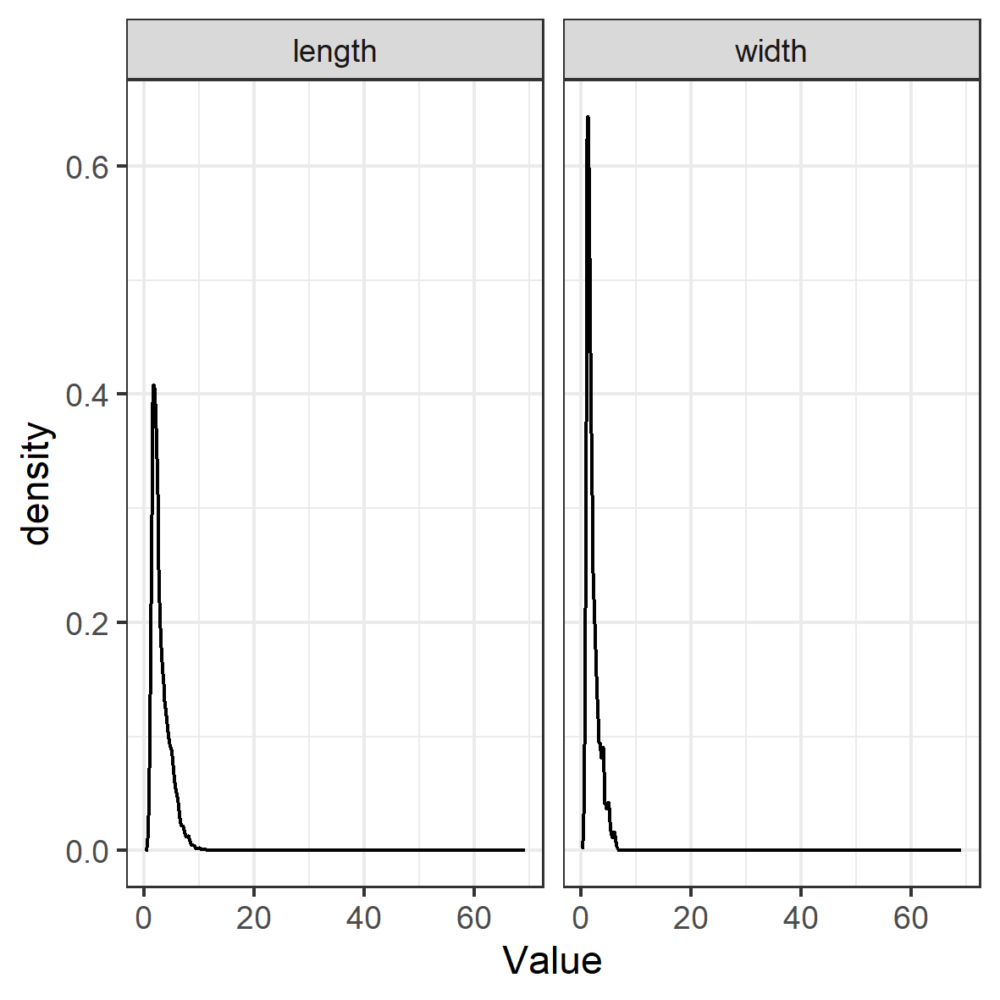
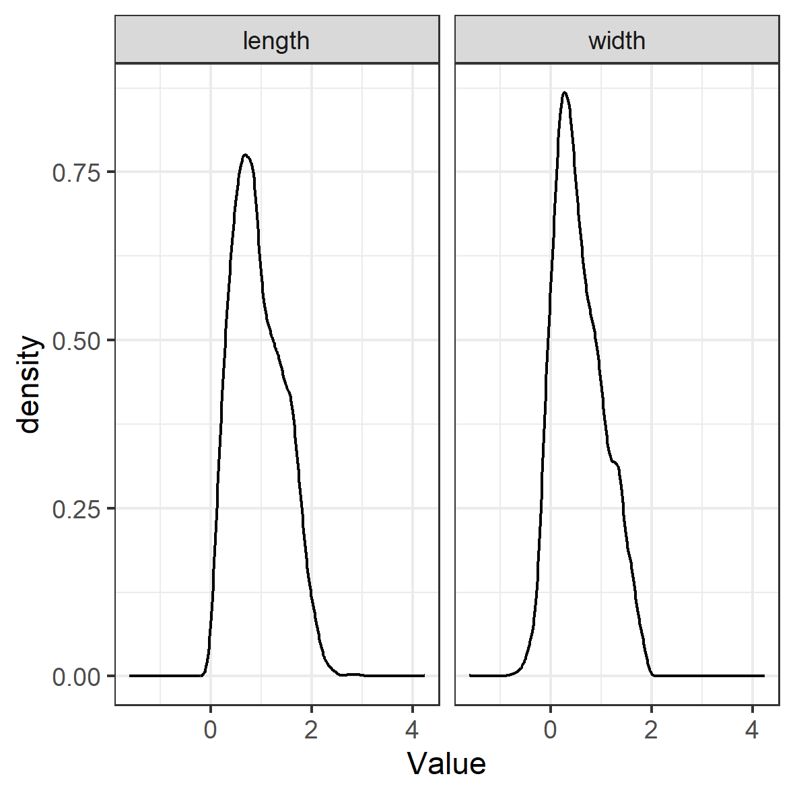
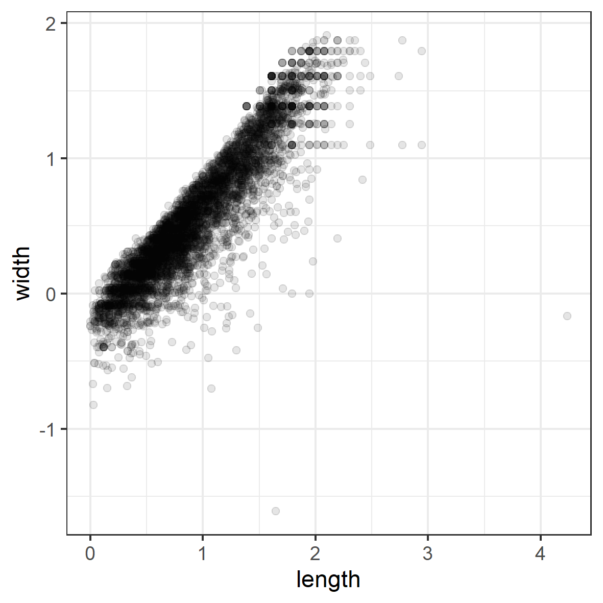
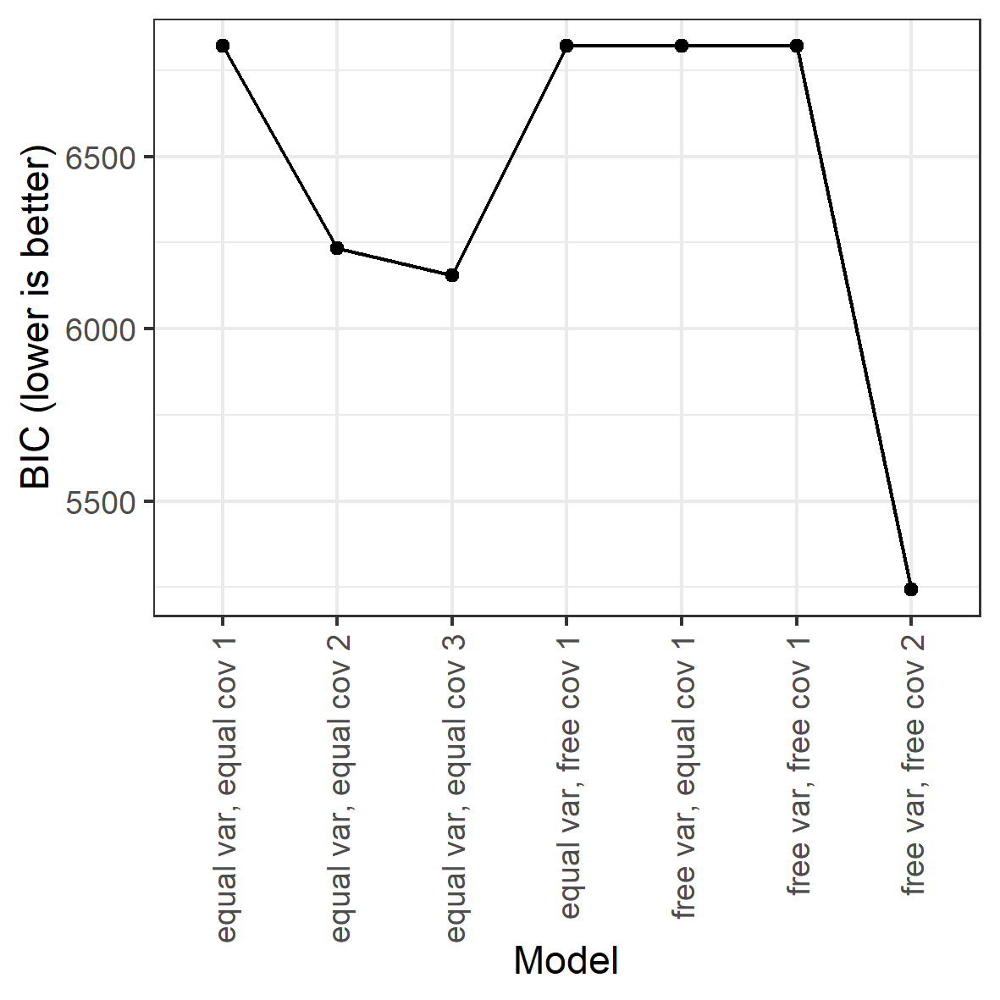
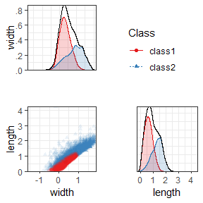
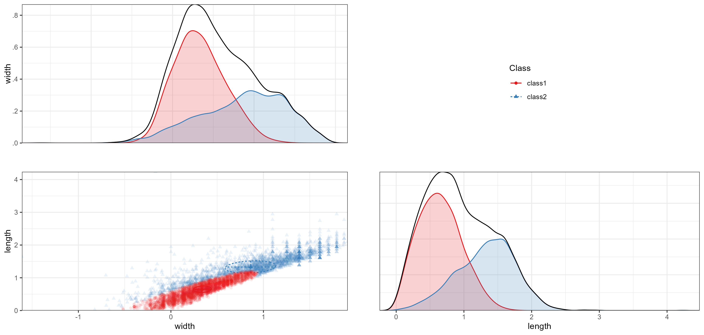

This is an example of exploratory latent class analysis (LCA) with continuous indicators,
otherwise known as latent profile analysis (LPA) or finite Gaussian mixture modeling, using `tidySEM`.
See Van Lissa, C. J., Garnier-Villarreal, M., & Anadria, D. (2023). *Recommended Practices in Latent Class Analysis using the Open-Source R-Package tidySEM.* Structural Equation Modeling. https://doi.org/10.1080/10705511.2023.2250920.
The present example uses data collected by Alkema as part of a study on ocean microplastics.
The purpose of this study was to provide a more nuanced model for the distribution of different sizes of ocean microplastics than the commonly used normal distribution.
To this end, a mixture of normals was used.
Since there is no theoretical reason to expect a certain number of classes, this is an exploratory LCA.
To view its documentation,
run the command `?tidySEM::alkema_microplastics` in the R console.
The original analyses are available at https://github.com/cjvanlissa/lise_microplastics;
in this vignette, we take a different approach to the analysis to showcase other possibilities.

## Loading the Data

To load the data, simply attach the `tidySEM` package.
For convenience, we assign the variables used for analysis to an object called `df`.
As explained in the paper, the classes are quite different for lines, films, and fragments.
For this reason, we here only use data from fragments.
The indicators are fragments' length and width in millimeters.
The sample size was not planned.


``` r
# Load required packages
library(tidySEM)
library(ggplot2)
# Load data
df_analyze <- alkema_microplastics[alkema_microplastics$category ==
    "Fragment", ]
df <- df_analyze[, c("length", "width")]
```

## Descriptive statistics

As per the best practices,
the first step in LCA is examining the observed data.
We use `tidySEM::descriptives()` to describe the data numerically.
Because all items are continuous,
we remove columns for categorical data to de-clutter the table:


``` r
desc <- tidySEM::descriptives(df)
desc <- desc[, c("name", "type", "n", "unique", "mean", "median",
    "sd", "min", "max", "skew_2se", "kurt_2se")]
knitr::kable(desc, caption = "Descriptive statistics")
```


Table: Descriptive statistics

|name   |type    |    n| unique| mean| median|  sd| min|  max| skew_2se| kurt_2se|
|:------|:-------|----:|------:|----:|------:|---:|---:|----:|--------:|--------:|
|length |numeric | 5605|   2086|  2.9|    2.4| 1.9| 1.0| 69.2|      137|     2095|
|width  |numeric | 5605|   2079|  2.0|    1.6| 1.1| 0.2|  6.8|       22|       14|


The data are correctly coded as `numeric`
and the distributional characteristics match the intended measurement level.
The variable scales are comparable (both in millimeters and no large discrepancies between variances).
There are no missing values; if any variables had missing values, we would report an MCAR test with `mice::mcar()`,
and explain that missing data are accounted for using FIML.
Additionally, we can plot the data.
The `ggplot2` function `geom_density()` is useful to visualize continuous data:


``` r
df_plot <- df
names(df_plot) <- paste0("Value.", names(df_plot))
df_plot <- reshape(df_plot, varying = names(df_plot), direction = "long",
    timevar = "Variable")
ggplot(df_plot, aes(x = Value)) + geom_density() + facet_wrap(~Variable) +
    theme_bw()
```

<!-- -->

Both the table above and the density plot indicate that the data are extremely right-skewed and kurtotic.
With this in mind, it can be useful to transform and rescale the data.
We will use a log transformation.


``` r
df_plot$Value <- log(df_plot$Value)
ggplot(df_plot, aes(x = Value)) + geom_density() + facet_wrap(~Variable) +
    theme_bw()
```

<!-- -->

The log transformation addresses the aforementioned concerns regarding skew and kurtosis.
To confirm this, reshape the data to wide format
and examine a scatterplot:


``` r
df <- reshape(df_plot, direction = "wide", v.names = "Value")[,
    -1]
names(df) <- gsub("Value.", "", names(df), fixed = TRUE)
ggplot(df, aes(x = length, y = width)) + geom_point(alpha = 0.1) +
    theme_bw()
```

<!-- -->

<!-- As evident from the scatterplot, there is a very strong linear tend in the data. -->
<!-- This indicates that fragments tend to be coextensive (when length goes up, width goes up). -->
<!-- We can analyze these data in their original dimensions (length and width). -->
<!-- Alternatively, we can use PCA to rotate the data such that the first dimension can be interpreted as "size", -->
<!-- and the second dimension can be interpreted as "shape": -->


## Conducting Latent Profile Analysis

As all variables are continuous, we can use the convenience function
`tidySEM::mx_profiles()`,
which is a wrapper for the generic function `mx_mixture()` optimized for continuous indicators.
Its default settings are appropriate for LPA, assuming fixed variances across classes and zero covariances.
Its arguments are `data` and number of `classes`.
All variables in `data` are included in the analysis,
which is why we first selected the indicator variables.
The models are estimated using simulated annealing,
with start values determined via initial K-means clustering.

As this is an exploratory LCA,
we will conduct a rather extensive search across model specifications and number of classes.
We will set the maximum number of classes $K$ to three to limit computational demands.
We set a seed to ensure replicable results.

As the analysis takes a long time to compute,
it is prudent to save the results to disk immediately, so as not to lose them.
For this, we use the function `saveRDS()`.
We can later use `res <- readRDS("res_gmm.RData")` to load the analysis from the file.


``` r
library(OpenMx)
set.seed(123)
res <- mx_profiles(data = df, classes = 1:3, variances = c("equal",
    "varying"), covariances = c("equal", "varying"), expand_grid = TRUE)
saveRDS(res, "res_gmm.RData")
```

```
#> 
MxComputeSimAnnealing(tsallis1996) evaluations 77 fit 35507.3 change 7605
MxComputeSimAnnealing(tsallis1996) evaluations 168 fit 81088.1 change -2.243e+04
MxComputeSimAnnealing(tsallis1996) evaluations 261 fit 35239.1 change 7336      
MxComputeSimAnnealing(tsallis1996) evaluations 350 fit 70019.2 change 3.446e+04
MxComputeSimAnnealing(tsallis1996) evaluations 445 fit 35557.6 change 7655     
MxComputeSimAnnealing(tsallis1996) evaluations 536 fit 107223 change 5.651e+04
MxComputeSimAnnealing(tsallis1996) evaluations 625 fit 46195.8 change -2.152e+04
MxComputeSimAnnealing(tsallis1996) evaluations 715 fit 27902.6 change -1.829e+04
MxComputeSimAnnealing(tsallis1996) evaluations 808 fit 41527.7 change 7458      
MxComputeSimAnnealing(tsallis1996) evaluations 899 fit 27902.6 change -1.829e+04
MxComputeSimAnnealing(tsallis1996) evaluations 992 fit 67898.1 change 4.931e+04 
MxComputeSimAnnealing(tsallis1996) evaluations 1080 fit 67355.1 change 2.805e+04
MxComputeSimAnnealing(tsallis1996) evaluations 1171 fit 27902.6 change -1.829e+04
MxComputeSimAnnealing(tsallis1996) evaluations 1264 fit 36057.8 change 5775      
MxComputeSimAnnealing(tsallis1996) evaluations 1354 fit 45827.6 change -368.3
MxComputeSimAnnealing(tsallis1996) evaluations 1444 fit 27902.6 change 0     
MxComputeSimAnnealing(tsallis1996) evaluations 1540 fit 27902.6 change 0
MxComputeSimAnnealing(tsallis1996) evaluations 1632 fit 41249.5 change 1.355e+04
MxComputeSimAnnealing(tsallis1996) evaluations 1722 fit 6417.83 change -3.978e+04
MxComputeSimAnnealing(tsallis1996) evaluations 1812 fit 27902.6 change 0         
MxComputeSimAnnealing(tsallis1996) evaluations 1904 fit 33083.4 change 1.848e+04
MxComputeSimAnnealing(tsallis1996) evaluations 1988 fit 9833.26 change -1.807e+04
MxComputeSimAnnealing(tsallis1996) evaluations 2081 fit 46195.8 change 2.03e+04  
MxComputeSimAnnealing(tsallis1996) evaluations 2170 fit 45784 change -411.9    
MxComputeSimAnnealing(tsallis1996) evaluations 2265 fit 46195.8 change 3.963e+04
MxComputeSimAnnealing(tsallis1996) evaluations 2353 fit 46195.8 change 2.603e+04
MxComputeSimAnnealing(tsallis1996) evaluations 2444 fit 6496.98 change -2.141e+04
MxComputeSimAnnealing(tsallis1996) evaluations 2534 fit 51081.7 change 3.546e+04 
MxComputeSimAnnealing(tsallis1996) evaluations 2625 fit 46324.9 change 2.199e+04
MxComputeSimAnnealing(tsallis1996) evaluations 2716 fit 27562.2 change 1.885e+04
MxComputeSimAnnealing(tsallis1996) evaluations 2806 fit 7296.49 change -7981    
MxComputeSimAnnealing(tsallis1996) evaluations 2897 fit 6388.39 change -2.89e+04
MxComputeSimAnnealing(tsallis1996) evaluations 2986 fit 6542.54 change -3.978e+04
MxComputeSimAnnealing(tsallis1996) evaluations 3074 fit 6396.85 change 9.225     
MxComputeSimAnnealing(tsallis1996) evaluations 3163 fit 27390.5 change 1.663e+04
MxComputeSimAnnealing(tsallis1996) evaluations 3252 fit 27252.1 change 0        
MxComputeSimAnnealing(tsallis1996) evaluations 3342 fit 89829.6 change 8.348e+04
MxComputeSimAnnealing(tsallis1996) evaluations 3433 fit 44701.7 change 3.469e+04
MxComputeSimAnnealing(tsallis1996) evaluations 3522 fit 46597.3 change 0        
MxComputeSimAnnealing(tsallis1996) evaluations 3614 fit 30713.1 change 1.204e+04
MxComputeSimAnnealing(tsallis1996) evaluations 3704 fit 36883.4 change -1.304e+05
MxComputeSimAnnealing(tsallis1996) evaluations 3792 fit 9040.1 change -1.305e+04 
MxComputeSimAnnealing(tsallis1996) evaluations 3882 fit 19884 change 1.355e+04  
MxComputeSimAnnealing(tsallis1996) evaluations 3972 fit 26654.9 change 0      
MxComputeSimAnnealing(tsallis1996) evaluations 4061 fit 17297.1 change -9358
MxComputeSimAnnealing(tsallis1996) evaluations 4149 fit 32105.3 change 2.546e+04
MxComputeSimAnnealing(tsallis1996) evaluations 4237 fit 33962.8 change 7847     
MxComputeSimAnnealing(tsallis1996) evaluations 4328 fit 47511.8 change 9487
MxComputeSimAnnealing(tsallis1996) evaluations 4416 fit 11304.2 change 4979
MxComputeSimAnnealing(tsallis1996) evaluations 4504 fit 6296.62 change -6126
MxComputeSimAnnealing(tsallis1996) evaluations 4594 fit 47145.1 change 0    
MxComputeSimAnnealing(tsallis1996) evaluations 4680 fit 6510.2 change -3.276e+04
MxComputeSimAnnealing(tsallis1996) evaluations 4769 fit 35014.4 change 2.474e+04
MxComputeSimAnnealing(tsallis1996) evaluations 4857 fit 24971.7 change 1.02e+04 
MxComputeSimAnnealing(tsallis1996) evaluations 4947 fit 25019.9 change 1.352e+04
MxComputeSimAnnealing(tsallis1996) evaluations 5036 fit 24913.3 change 1.862e+04
MxComputeSimAnnealing(tsallis1996) evaluations 5124 fit 24769.5 change 1.616e+04
MxComputeSimAnnealing(tsallis1996) evaluations 5211 fit 6980.07 change -4.027e+04
MxComputeSimAnnealing(tsallis1996) evaluations 5300 fit 24121.4 change 1.475e+04 
MxComputeSimAnnealing(tsallis1996) evaluations 5388 fit 24300.3 change 0        
MxComputeSimAnnealing(tsallis1996) evaluations 5477 fit 6261.56 change -330.7
MxComputeSimAnnealing(tsallis1996) evaluations 5566 fit 15907.5 change 9550  
MxComputeSimAnnealing(tsallis1996) evaluations 5654 fit 18610.5 change 9340
MxComputeSimAnnealing(tsallis1996) evaluations 5741 fit 6264.44 change -275.4
MxComputeSimAnnealing(tsallis1996) evaluations 5830 fit 6596.32 change 316.2 
MxComputeSimAnnealing(tsallis1996) evaluations 5916 fit 6253.94 change 1.093
MxComputeSimAnnealing(tsallis1996) evaluations 6004 fit 24059 change 0      
MxComputeSimAnnealing(tsallis1996) evaluations 6092 fit 12501.2 change -1.163e+04
MxComputeSimAnnealing(tsallis1996) evaluations 6180 fit 6248.43 change -2.953    
MxComputeSimAnnealing(tsallis1996) evaluations 6267 fit 24007.2 change 1.693e+04
MxComputeSimAnnealing(tsallis1996) evaluations 6354 fit 8370.11 change -3.903e+04
MxComputeSimAnnealing(tsallis1996) evaluations 6441 fit 6248.08 change -2.045e+04
MxComputeSimAnnealing(tsallis1996) evaluations 6529 fit 48449.3 change 3.959e+04 
MxComputeSimAnnealing(tsallis1996) evaluations 6615 fit 6263.4 change -2374     
MxComputeSimAnnealing(tsallis1996) evaluations 6704 fit 6246.74 change 3.055
MxComputeSimAnnealing(tsallis1996) evaluations 6790 fit 6303.23 change 44.49
MxComputeSimAnnealing(tsallis1996) evaluations 6877 fit 6246.27 change -1.734e+04
MxComputeSimAnnealing(tsallis1996) evaluations 6963 fit 23590.6 change 1.735e+04 
MxComputeSimAnnealing(tsallis1996) evaluations 7049 fit 48553 change 3.614e+04  
MxComputeSimAnnealing(tsallis1996) evaluations 7136 fit 91471.8 change 5.528e+04
MxComputeSimAnnealing(tsallis1996) evaluations 7220 fit 23443.7 change 1.708e+04
MxComputeSimAnnealing(tsallis1996) evaluations 7306 fit 48536.4 change 0        
MxComputeSimAnnealing(tsallis1996) evaluations 7394 fit 7996.87 change -2427
MxComputeSimAnnealing(tsallis1996) evaluations 7480 fit 6249.94 change -6.715e+04
MxComputeSimAnnealing(tsallis1996) evaluations 7570 fit 43942.7 change 3.769e+04 
MxComputeSimAnnealing(tsallis1996) evaluations 7657 fit 6247.31 change 15.39    
MxComputeSimAnnealing(tsallis1996) evaluations 7745 fit 48296.3 change 4.207e+04
MxComputeSimAnnealing(tsallis1996) evaluations 7828 fit 23133.3 change 1.687e+04
MxComputeSimAnnealing(tsallis1996) evaluations 7918 fit 9855.02 change -2.338e+04
MxComputeSimAnnealing(tsallis1996) evaluations 8007 fit 6251.39 change -1.411e+04
MxComputeSimAnnealing(tsallis1996) evaluations 8094 fit 6628.87 change 338.1     
MxComputeSimAnnealing(tsallis1996) evaluations 8184 fit 9494.62 change 3009 
MxComputeSimAnnealing(tsallis1996) evaluations 8269 fit 6232.72 change -256.1
MxComputeSimAnnealing(tsallis1996) evaluations 8356 fit 6217.86 change 0.3608
MxComputeSimAnnealing(tsallis1996) evaluations 8444 fit 22809.8 change 1.37e+04
MxComputeSimAnnealing(tsallis1996) evaluations 8531 fit 6219.05 change -12.29  
MxComputeSimAnnealing(tsallis1996) evaluations 8620 fit 6215.67 change -11.69
MxComputeSimAnnealing(tsallis1996) evaluations 8708 fit 6620.26 change -1.611e+04
MxComputeSimAnnealing(tsallis1996) evaluations 8795 fit 6209.07 change -4.063e+04
MxComputeSimAnnealing(tsallis1996) evaluations 8882 fit 47330.5 change 4.112e+04 
MxComputeSimAnnealing(tsallis1996) evaluations 8968 fit 68912.7 change 6.254e+04
MxComputeSimAnnealing(tsallis1996) evaluations 9055 fit 6202.07 change 0.09189  
MxComputeSimAnnealing(tsallis1996) evaluations 9138 fit 6207.34 change -4405  
MxComputeSimAnnealing(tsallis1996) evaluations 9225 fit 44264.2 change 3.806e+04
MxComputeSimAnnealing(tsallis1996) evaluations 9312 fit 6313.68 change 40       
MxComputeSimAnnealing(tsallis1996) evaluations 9401 fit 11767.2 change 5570
MxComputeSimAnnealing(tsallis1996) evaluations 9489 fit 6269.06 change -49.88
MxComputeSimAnnealing(tsallis1996) evaluations 9576 fit 6196.83 change -2299 
MxComputeSimAnnealing(tsallis1996) evaluations 9663 fit 7146.9 change 820.4 
MxComputeSimAnnealing(tsallis1996) evaluations 9749 fit 6204.99 change -1.555e+04
MxComputeSimAnnealing(tsallis1996) evaluations 9835 fit 7009.39 change 819.9     
MxComputeSimAnnealing(tsallis1996) evaluations 9921 fit 6189.44 change -8.909
MxComputeSimAnnealing(tsallis1996) evaluations 10003 fit 6229.37 change 40.53
MxComputeSimAnnealing(tsallis1996) evaluations 10083 fit 6236.88 change -7113
MxComputeSimAnnealing(tsallis1996) evaluations 10143 fit 6188.87 change -1.394e+05
MxComputeSimAnnealing(tsallis1996) evaluations 10211 fit 10626.1 change -3.568e+04
                                                                                  
#> 
MxComputeSimAnnealing(tsallis1996) evaluations 57 fit 17364.9 change -8868
MxComputeSimAnnealing(tsallis1996) evaluations 117 fit 92193.4 change 6.248e+04
MxComputeSimAnnealing(tsallis1996) evaluations 178 fit 17364.9 change -8868    
MxComputeSimAnnealing(tsallis1996) evaluations 238 fit 95712.9 change 6.741e+04
MxComputeSimAnnealing(tsallis1996) evaluations 299 fit 17364.9 change -8868    
MxComputeSimAnnealing(tsallis1996) evaluations 360 fit 116575 change 5.857e+04
MxComputeSimAnnealing(tsallis1996) evaluations 419 fit 26232.6 change 0       
MxComputeSimAnnealing(tsallis1996) evaluations 458 fit 57545.4 change 2.897e+04
MxComputeSimAnnealing(tsallis1996) evaluations 518 fit 26232.6 change 0        
MxComputeSimAnnealing(tsallis1996) evaluations 574 fit 17364.9 change -8868
MxComputeSimAnnealing(tsallis1996) evaluations 632 fit 21471.3 change 0    
MxComputeSimAnnealing(tsallis1996) evaluations 692 fit 79417.1 change 2.375e+04
MxComputeSimAnnealing(tsallis1996) evaluations 753 fit 21471.3 change 0        
MxComputeSimAnnealing(tsallis1996) evaluations 809 fit 28986.3 change 7515
MxComputeSimAnnealing(tsallis1996) evaluations 869 fit 26232.6 change -2.996e+04
MxComputeSimAnnealing(tsallis1996) evaluations 928 fit 21471.3 change 4106      
MxComputeSimAnnealing(tsallis1996) evaluations 989 fit 84305.6 change 4303
MxComputeSimAnnealing(tsallis1996) evaluations 1047 fit 17364.9 change -8868
MxComputeSimAnnealing(tsallis1996) evaluations 1111 fit 26232.6 change -2.596e+04
MxComputeSimAnnealing(tsallis1996) evaluations 1169 fit 17364.9 change 0         
MxComputeSimAnnealing(tsallis1996) evaluations 1232 fit 26232.6 change 1.977e+04
MxComputeSimAnnealing(tsallis1996) evaluations 1289 fit 17364.9 change -8868    
MxComputeSimAnnealing(tsallis1996) evaluations 1350 fit 37486.8 change 1.068e+04
MxComputeSimAnnealing(tsallis1996) evaluations 1409 fit 26232.6 change 0        
MxComputeSimAnnealing(tsallis1996) evaluations 1469 fit 26785.8 change 5315
MxComputeSimAnnealing(tsallis1996) evaluations 1531 fit 17364.9 change -8868
MxComputeSimAnnealing(tsallis1996) evaluations 1591 fit 63864.4 change 4.312e+04
MxComputeSimAnnealing(tsallis1996) evaluations 1652 fit 17130.4 change -9102    
MxComputeSimAnnealing(tsallis1996) evaluations 1716 fit 26232.6 change -1.138e+04
MxComputeSimAnnealing(tsallis1996) evaluations 1775 fit 19423.9 change 2293      
MxComputeSimAnnealing(tsallis1996) evaluations 1836 fit 85427.9 change -1.271e+04
MxComputeSimAnnealing(tsallis1996) evaluations 1898 fit 16611.5 change -4858     
MxComputeSimAnnealing(tsallis1996) evaluations 1961 fit 17130.4 change 0    
MxComputeSimAnnealing(tsallis1996) evaluations 2019 fit 29041.4 change 7594
MxComputeSimAnnealing(tsallis1996) evaluations 2082 fit 17142.2 change 7304
MxComputeSimAnnealing(tsallis1996) evaluations 2140 fit 13821.1 change -7627
MxComputeSimAnnealing(tsallis1996) evaluations 2205 fit 21447.6 change 0    
MxComputeSimAnnealing(tsallis1996) evaluations 2267 fit 26231.8 change -0.009525
MxComputeSimAnnealing(tsallis1996) evaluations 2326 fit 21447.6 change 0        
MxComputeSimAnnealing(tsallis1996) evaluations 2386 fit 54575.4 change -497.4
MxComputeSimAnnealing(tsallis1996) evaluations 2445 fit 17142.2 change 0     
MxComputeSimAnnealing(tsallis1996) evaluations 2507 fit 47998.9 change -4.214e+04
MxComputeSimAnnealing(tsallis1996) evaluations 2564 fit 26229.8 change 0         
MxComputeSimAnnealing(tsallis1996) evaluations 2623 fit 21306.5 change 1.337e+04
MxComputeSimAnnealing(tsallis1996) evaluations 2681 fit 77866.3 change -3568    
MxComputeSimAnnealing(tsallis1996) evaluations 2742 fit 17223.1 change 0    
MxComputeSimAnnealing(tsallis1996) evaluations 2802 fit 67780.7 change 4.864e+04
MxComputeSimAnnealing(tsallis1996) evaluations 2854 fit 9781.4 change -1.153e+04
MxComputeSimAnnealing(tsallis1996) evaluations 2942 fit 21306.5 change 0        
MxComputeSimAnnealing(tsallis1996) evaluations 3002 fit 63439.7 change 4.37e+04
MxComputeSimAnnealing(tsallis1996) evaluations 3061 fit 6630.89 change -1.063e+04
MxComputeSimAnnealing(tsallis1996) evaluations 3120 fit 15873.1 change 9193      
MxComputeSimAnnealing(tsallis1996) evaluations 3184 fit 20896.4 change -410.2
MxComputeSimAnnealing(tsallis1996) evaluations 3241 fit 8848.58 change -1.463e+04
MxComputeSimAnnealing(tsallis1996) evaluations 3300 fit 26228.9 change -2.333e+04
MxComputeSimAnnealing(tsallis1996) evaluations 3359 fit 21306.5 change 4051      
MxComputeSimAnnealing(tsallis1996) evaluations 3418 fit 23205.9 change 1.674e+04
MxComputeSimAnnealing(tsallis1996) evaluations 3478 fit 17424.4 change -8804    
MxComputeSimAnnealing(tsallis1996) evaluations 3537 fit 6464.28 change -23.05
MxComputeSimAnnealing(tsallis1996) evaluations 3596 fit 40994.7 change 3.156e+04
MxComputeSimAnnealing(tsallis1996) evaluations 3656 fit 21304.2 change 3880     
MxComputeSimAnnealing(tsallis1996) evaluations 3718 fit 26228.9 change -6.528e+04
MxComputeSimAnnealing(tsallis1996) evaluations 3776 fit 13583.6 change -3899     
MxComputeSimAnnealing(tsallis1996) evaluations 3835 fit 52163.5 change 4.503e+04
MxComputeSimAnnealing(tsallis1996) evaluations 3895 fit 26118.3 change 1.878e+04
MxComputeSimAnnealing(tsallis1996) evaluations 3953 fit 10906.4 change -6675    
MxComputeSimAnnealing(tsallis1996) evaluations 4012 fit 29012.9 change -675 
MxComputeSimAnnealing(tsallis1996) evaluations 4073 fit 17581 change 0     
MxComputeSimAnnealing(tsallis1996) evaluations 4131 fit 16851.5 change -4526
MxComputeSimAnnealing(tsallis1996) evaluations 4192 fit 25998.8 change 0    
MxComputeSimAnnealing(tsallis1996) evaluations 4251 fit 7755.22 change -1.359e+04
MxComputeSimAnnealing(tsallis1996) evaluations 4312 fit 25998.8 change 1.649e+04 
MxComputeSimAnnealing(tsallis1996) evaluations 4370 fit 17223.3 change 0        
MxComputeSimAnnealing(tsallis1996) evaluations 4429 fit 33201.3 change 1.841e+04
MxComputeSimAnnealing(tsallis1996) evaluations 4487 fit 41525.1 change 2.979e+04
MxComputeSimAnnealing(tsallis1996) evaluations 4547 fit 7037.62 change -9613    
MxComputeSimAnnealing(tsallis1996) evaluations 4604 fit 6411.69 change -1.347e+04
MxComputeSimAnnealing(tsallis1996) evaluations 4661 fit 18243 change 1.158e+04   
MxComputeSimAnnealing(tsallis1996) evaluations 4721 fit 16539.7 change 9939   
MxComputeSimAnnealing(tsallis1996) evaluations 4780 fit 6375.89 change -1.348e+04
MxComputeSimAnnealing(tsallis1996) evaluations 4839 fit 18330.4 change -3.034e+04
MxComputeSimAnnealing(tsallis1996) evaluations 4898 fit 10183.9 change -6353     
MxComputeSimAnnealing(tsallis1996) evaluations 4957 fit 6388.53 change -2625
MxComputeSimAnnealing(tsallis1996) evaluations 5017 fit 24738.6 change 0    
MxComputeSimAnnealing(tsallis1996) evaluations 5074 fit 16503.5 change 112.4
MxComputeSimAnnealing(tsallis1996) evaluations 5134 fit 11707 change -1365  
MxComputeSimAnnealing(tsallis1996) evaluations 5195 fit 16497.9 change 0  
MxComputeSimAnnealing(tsallis1996) evaluations 5257 fit 12144.2 change -2830
MxComputeSimAnnealing(tsallis1996) evaluations 5316 fit 16363.1 change 0    
MxComputeSimAnnealing(tsallis1996) evaluations 5375 fit 6353.24 change -1.54e+04
MxComputeSimAnnealing(tsallis1996) evaluations 5436 fit 16190.1 change -9075    
MxComputeSimAnnealing(tsallis1996) evaluations 5495 fit 7660.94 change 1280 
MxComputeSimAnnealing(tsallis1996) evaluations 5552 fit 54086.4 change 2.591e+04
MxComputeSimAnnealing(tsallis1996) evaluations 5613 fit 6324.84 change -9525    
MxComputeSimAnnealing(tsallis1996) evaluations 5668 fit 13881.4 change -2332
MxComputeSimAnnealing(tsallis1996) evaluations 5728 fit 15412.4 change -1.195e+04
MxComputeSimAnnealing(tsallis1996) evaluations 5787 fit 7414.08 change -1.792e+04
MxComputeSimAnnealing(tsallis1996) evaluations 5847 fit 6382.48 change -1229     
MxComputeSimAnnealing(tsallis1996) evaluations 5904 fit 51281.7 change 4.19e+04
MxComputeSimAnnealing(tsallis1996) evaluations 5964 fit 16208.8 change 9838    
MxComputeSimAnnealing(tsallis1996) evaluations 6027 fit 13291.1 change 6816
MxComputeSimAnnealing(tsallis1996) evaluations 6087 fit 6338.55 change -9870
MxComputeSimAnnealing(tsallis1996) evaluations 6149 fit 10486.3 change 1532 
MxComputeSimAnnealing(tsallis1996) evaluations 6207 fit 16208.8 change 9890
MxComputeSimAnnealing(tsallis1996) evaluations 6267 fit 8081.55 change 1765
MxComputeSimAnnealing(tsallis1996) evaluations 6325 fit 11276.4 change 3092
MxComputeSimAnnealing(tsallis1996) evaluations 6385 fit 6290.16 change -1.245e+04
MxComputeSimAnnealing(tsallis1996) evaluations 6445 fit 12725.5 change 6400      
MxComputeSimAnnealing(tsallis1996) evaluations 6504 fit 15897.3 change 0   
MxComputeSimAnnealing(tsallis1996) evaluations 6566 fit 19182.8 change 867.1
MxComputeSimAnnealing(tsallis1996) evaluations 6624 fit 6284.97 change -1.926e+04
MxComputeSimAnnealing(tsallis1996) evaluations 6682 fit 13852.2 change -4359     
MxComputeSimAnnealing(tsallis1996) evaluations 6742 fit 62078.6 change 4.725e+04
MxComputeSimAnnealing(tsallis1996) evaluations 6803 fit 6519.13 change -1.181e+04
MxComputeSimAnnealing(tsallis1996) evaluations 6864 fit 26127 change 1.373e+04   
MxComputeSimAnnealing(tsallis1996) evaluations 6923 fit 6282.18 change -9327  
MxComputeSimAnnealing(tsallis1996) evaluations 6984 fit 39606.9 change 3.335e+04
MxComputeSimAnnealing(tsallis1996) evaluations 7040 fit 25207.5 change 1.849e+04
MxComputeSimAnnealing(tsallis1996) evaluations 7100 fit 6257.61 change -622.7   
MxComputeSimAnnealing(tsallis1996) evaluations 7159 fit 6223.32 change -5.477e+04
MxComputeSimAnnealing(tsallis1996) evaluations 7218 fit 6365.36 change -1.85e+04 
MxComputeSimAnnealing(tsallis1996) evaluations 7278 fit 6585.91 change 368.7    
MxComputeSimAnnealing(tsallis1996) evaluations 7337 fit 8814.9 change -6786 
MxComputeSimAnnealing(tsallis1996) evaluations 7394 fit 6204.2 change 21.8 
MxComputeSimAnnealing(tsallis1996) evaluations 7452 fit 16856.5 change 0  
MxComputeSimAnnealing(tsallis1996) evaluations 7512 fit 15490.1 change 7446
MxComputeSimAnnealing(tsallis1996) evaluations 7571 fit 6177.48 change -8572
MxComputeSimAnnealing(tsallis1996) evaluations 7630 fit 6179.85 change 4.616
MxComputeSimAnnealing(tsallis1996) evaluations 7689 fit 24400.2 change 1.804e+04
MxComputeSimAnnealing(tsallis1996) evaluations 7745 fit 6221.16 change 47.2     
MxComputeSimAnnealing(tsallis1996) evaluations 7804 fit 6943.89 change 769.2
MxComputeSimAnnealing(tsallis1996) evaluations 7864 fit 12760.9 change 4760 
MxComputeSimAnnealing(tsallis1996) evaluations 7922 fit 6169.31 change -0.7435
MxComputeSimAnnealing(tsallis1996) evaluations 7981 fit 8760.64 change -7855  
MxComputeSimAnnealing(tsallis1996) evaluations 8041 fit 24518.4 change 9410 
MxComputeSimAnnealing(tsallis1996) evaluations 8097 fit 6167.87 change -126.9
MxComputeSimAnnealing(tsallis1996) evaluations 8156 fit 6151.45 change 6.908 
MxComputeSimAnnealing(tsallis1996) evaluations 8216 fit 6166.7 change -199.1
MxComputeSimAnnealing(tsallis1996) evaluations 8277 fit 6156.48 change -9950
MxComputeSimAnnealing(tsallis1996) evaluations 8338 fit 6143.59 change -3254
MxComputeSimAnnealing(tsallis1996) evaluations 8397 fit 6253.85 change -7769
MxComputeSimAnnealing(tsallis1996) evaluations 8455 fit 7068.68 change 925.7
MxComputeSimAnnealing(tsallis1996) evaluations 8515 fit 6147.85 change 8.318
MxComputeSimAnnealing(tsallis1996) evaluations 8575 fit 6149.21 change -9398
MxComputeSimAnnealing(tsallis1996) evaluations 8632 fit 29398.5 change 2.326e+04
MxComputeSimAnnealing(tsallis1996) evaluations 8693 fit 6154.82 change -7498    
MxComputeSimAnnealing(tsallis1996) evaluations 8753 fit 30362.6 change 2.422e+04
MxComputeSimAnnealing(tsallis1996) evaluations 8810 fit 28137 change 2.2e+04    
MxComputeSimAnnealing(tsallis1996) evaluations 8869 fit 6874.87 change -7026
MxComputeSimAnnealing(tsallis1996) evaluations 8928 fit 6135.43 change -3.097
MxComputeSimAnnealing(tsallis1996) evaluations 8985 fit 7041.79 change -5217 
MxComputeSimAnnealing(tsallis1996) evaluations 9042 fit 12259.4 change -1.283e+04
MxComputeSimAnnealing(tsallis1996) evaluations 9101 fit 15576.8 change 8966      
MxComputeSimAnnealing(tsallis1996) evaluations 9159 fit 6140.41 change 8.039
MxComputeSimAnnealing(tsallis1996) evaluations 9217 fit 7350.13 change 986.3
MxComputeSimAnnealing(tsallis1996) evaluations 9275 fit 6129.61 change -1.911e+04
MxComputeSimAnnealing(tsallis1996) evaluations 9332 fit 12547 change 6419        
MxComputeSimAnnealing(tsallis1996) evaluations 9390 fit 6216.44 change -1.011e+04
MxComputeSimAnnealing(tsallis1996) evaluations 9448 fit 40888.2 change 3.476e+04 
MxComputeSimAnnealing(tsallis1996) evaluations 9506 fit 6125.38 change -0.02436 
MxComputeSimAnnealing(tsallis1996) evaluations 9563 fit 15444.6 change 1724    
MxComputeSimAnnealing(tsallis1996) evaluations 9619 fit 6169.02 change 16.64
MxComputeSimAnnealing(tsallis1996) evaluations 9677 fit 40194.4 change 602.1
MxComputeSimAnnealing(tsallis1996) evaluations 9735 fit 25273.9 change -1.075e+04
MxComputeSimAnnealing(tsallis1996) evaluations 9792 fit 6125.5 change -6865      
MxComputeSimAnnealing(tsallis1996) evaluations 9848 fit 13476.1 change 0   
MxComputeSimAnnealing(tsallis1996) evaluations 9906 fit 6115.34 change -8847
MxComputeSimAnnealing(tsallis1996) evaluations 9965 fit 33824.8 change 2.771e+04
MxComputeSimAnnealing(tsallis1996) evaluations 10021 fit 6110.89 change -16.89  
MxComputeSimAnnealing(tsallis1996) evaluations 10079 fit 13417.5 change 0     
MxComputeSimAnnealing(tsallis1996) evaluations 10137 fit 6111.62 change -8747
MxComputeSimAnnealing(tsallis1996) evaluations 10196 fit 6111.31 change -4.94e+04
MxComputeSimAnnealing(tsallis1996) evaluations 10254 fit 6137.23 change -1.89e+04
MxComputeSimAnnealing(tsallis1996) evaluations 10313 fit 6109.83 change -0.05767 
MxComputeSimAnnealing(tsallis1996) evaluations 10370 fit 6501.15 change 391.8   
MxComputeSimAnnealing(tsallis1996) evaluations 10428 fit 6269.71 change -1591
MxComputeSimAnnealing(tsallis1996) evaluations 10487 fit 9337.59 change 3226 
MxComputeSimAnnealing(tsallis1996) evaluations 10546 fit 10912.7 change -3481
MxComputeSimAnnealing(tsallis1996) evaluations 10604 fit 25396.8 change -9579
MxComputeSimAnnealing(tsallis1996) evaluations 10662 fit 13275.6 change 7159 
MxComputeSimAnnealing(tsallis1996) evaluations 10721 fit 6107.1 change 0.5312
MxComputeSimAnnealing(tsallis1996) evaluations 10780 fit 6106.67 change -1477
MxComputeSimAnnealing(tsallis1996) evaluations 10838 fit 7621.95 change 1504 
MxComputeSimAnnealing(tsallis1996) evaluations 10896 fit 6131.25 change -8371
MxComputeSimAnnealing(tsallis1996) evaluations 10955 fit 36301 change 2.435e+04
MxComputeSimAnnealing(tsallis1996) evaluations 11013 fit 13168.7 change 7063   
MxComputeSimAnnealing(tsallis1996) evaluations 11070 fit 6107.03 change -531.8
MxComputeSimAnnealing(tsallis1996) evaluations 11128 fit 8681.87 change 2586  
MxComputeSimAnnealing(tsallis1996) evaluations 11187 fit 25280.7 change 1.653e+04
MxComputeSimAnnealing(tsallis1996) evaluations 11247 fit 14072.5 change 4629     
MxComputeSimAnnealing(tsallis1996) evaluations 11307 fit 6086.78 change -3.634e+04
MxComputeSimAnnealing(tsallis1996) evaluations 11365 fit 12887.1 change 6801      
MxComputeSimAnnealing(tsallis1996) evaluations 11423 fit 6090.96 change -7577
MxComputeSimAnnealing(tsallis1996) evaluations 11482 fit 6541.68 change -3.396e+04
MxComputeSimAnnealing(tsallis1996) evaluations 11540 fit 13903.5 change 7769      
MxComputeSimAnnealing(tsallis1996) evaluations 11596 fit 6084.52 change -284.8
MxComputeSimAnnealing(tsallis1996) evaluations 11654 fit 6083.8 change -7782  
MxComputeSimAnnealing(tsallis1996) evaluations 11714 fit 6119.55 change 16.59
MxComputeSimAnnealing(tsallis1996) evaluations 11772 fit 6083.38 change -33.73
MxComputeSimAnnealing(tsallis1996) evaluations 11830 fit 6458.52 change -160  
MxComputeSimAnnealing(tsallis1996) evaluations 11887 fit 6086.8 change 4.774
MxComputeSimAnnealing(tsallis1996) evaluations 11947 fit 6085.13 change -1.997e+04
MxComputeSimAnnealing(tsallis1996) evaluations 12006 fit 13798.6 change 7595      
MxComputeSimAnnealing(tsallis1996) evaluations 12063 fit 21946.7 change 1.586e+04
MxComputeSimAnnealing(tsallis1996) evaluations 12121 fit 6505.55 change -2472    
MxComputeSimAnnealing(tsallis1996) evaluations 12178 fit 6081.49 change -1.997e+04
MxComputeSimAnnealing(tsallis1996) evaluations 12236 fit 13807 change 3993        
MxComputeSimAnnealing(tsallis1996) evaluations 12297 fit 18499.9 change 1.239e+04
MxComputeSimAnnealing(tsallis1996) evaluations 12354 fit 6147.15 change -1.992e+04
MxComputeSimAnnealing(tsallis1996) evaluations 12413 fit 6080.07 change -14.62    
MxComputeSimAnnealing(tsallis1996) evaluations 12472 fit 6290.65 change -1667 
MxComputeSimAnnealing(tsallis1996) evaluations 12529 fit 6078.95 change 0.1095
MxComputeSimAnnealing(tsallis1996) evaluations 12587 fit 6079.09 change -0.2026
MxComputeSimAnnealing(tsallis1996) evaluations 12644 fit 6081.17 change -1234  
MxComputeSimAnnealing(tsallis1996) evaluations 12705 fit 26073.8 change 2e+04
MxComputeSimAnnealing(tsallis1996) evaluations 12762 fit 12533.4 change 6451 
MxComputeSimAnnealing(tsallis1996) evaluations 12819 fit 13522.1 change 7440
MxComputeSimAnnealing(tsallis1996) evaluations 12877 fit 6077.67 change -1.115
MxComputeSimAnnealing(tsallis1996) evaluations 12936 fit 6299.98 change -84.02
MxComputeSimAnnealing(tsallis1996) evaluations 12991 fit 6076.27 change -6422 
MxComputeSimAnnealing(tsallis1996) evaluations 13047 fit 6077.56 change -134.1
MxComputeSimAnnealing(tsallis1996) evaluations 13105 fit 12892.3 change 392.5 
MxComputeSimAnnealing(tsallis1996) evaluations 13162 fit 6076.81 change 0.7947
MxComputeSimAnnealing(tsallis1996) evaluations 13221 fit 6790.17 change -1.075e+04
MxComputeSimAnnealing(tsallis1996) evaluations 13277 fit 26327.8 change 2.025e+04 
MxComputeSimAnnealing(tsallis1996) evaluations 13332 fit 6414.27 change 338.4    
MxComputeSimAnnealing(tsallis1996) evaluations 13389 fit 12470 change -3460  
MxComputeSimAnnealing(tsallis1996) evaluations 13446 fit 13414.1 change 7327
MxComputeSimAnnealing(tsallis1996) evaluations 13508 fit 26473 change -4.209e+04
MxComputeSimAnnealing(tsallis1996) evaluations 13564 fit 6104.21 change -2.033e+04
MxComputeSimAnnealing(tsallis1996) evaluations 13620 fit 6085.59 change 8.859     
MxComputeSimAnnealing(tsallis1996) evaluations 13678 fit 6075.37 change -7154
MxComputeSimAnnealing(tsallis1996) evaluations 13735 fit 6075.14 change -110 
MxComputeSimAnnealing(tsallis1996) evaluations 13793 fit 7121.78 change 912.5
MxComputeSimAnnealing(tsallis1996) evaluations 13850 fit 26359.1 change 1.566e+04
MxComputeSimAnnealing(tsallis1996) evaluations 13906 fit 6874.61 change 800.8    
MxComputeSimAnnealing(tsallis1996) evaluations 13965 fit 8277.15 change -4861
MxComputeSimAnnealing(tsallis1996) evaluations 14020 fit 19895.2 change 1.38e+04
MxComputeSimAnnealing(tsallis1996) evaluations 14075 fit 6073.09 change -202.9  
                                                                              
#> 
MxComputeSimAnnealing(tsallis1996) evaluations 28 fit 45297.7 change 0
MxComputeSimAnnealing(tsallis1996) evaluations 118 fit 42175.9 change -3122
MxComputeSimAnnealing(tsallis1996) evaluations 208 fit 37177.2 change -8120
MxComputeSimAnnealing(tsallis1996) evaluations 299 fit 45297.7 change 3279 
MxComputeSimAnnealing(tsallis1996) evaluations 390 fit 45297.7 change 0   
MxComputeSimAnnealing(tsallis1996) evaluations 480 fit 45297.7 change 0
MxComputeSimAnnealing(tsallis1996) evaluations 571 fit 18809.8 change -2.649e+04
MxComputeSimAnnealing(tsallis1996) evaluations 661 fit 28979.3 change -1.632e+04
MxComputeSimAnnealing(tsallis1996) evaluations 752 fit 18964.8 change 3240      
MxComputeSimAnnealing(tsallis1996) evaluations 842 fit 28979.3 change 0   
MxComputeSimAnnealing(tsallis1996) evaluations 928 fit 45297.7 change 1.03e+04
MxComputeSimAnnealing(tsallis1996) evaluations 1018 fit 45297.7 change 1.268e+04
MxComputeSimAnnealing(tsallis1996) evaluations 1108 fit 33470.7 change -1.183e+04
MxComputeSimAnnealing(tsallis1996) evaluations 1199 fit 44884.1 change -413.5    
MxComputeSimAnnealing(tsallis1996) evaluations 1289 fit 45297.7 change 1.997e+04
MxComputeSimAnnealing(tsallis1996) evaluations 1378 fit 26779.8 change -1.759e+04
MxComputeSimAnnealing(tsallis1996) evaluations 1468 fit 44542.1 change -755.6    
MxComputeSimAnnealing(tsallis1996) evaluations 1556 fit 45297.7 change 2.589e+04
MxComputeSimAnnealing(tsallis1996) evaluations 1646 fit 45297.7 change 2.718e+04
MxComputeSimAnnealing(tsallis1996) evaluations 1736 fit 45297.7 change 1.067e+04
MxComputeSimAnnealing(tsallis1996) evaluations 1824 fit 28979.3 change 0        
MxComputeSimAnnealing(tsallis1996) evaluations 1911 fit 28979.3 change -1.632e+04
MxComputeSimAnnealing(tsallis1996) evaluations 2001 fit 15788.3 change -2.951e+04
MxComputeSimAnnealing(tsallis1996) evaluations 2091 fit 14775 change -3.052e+04  
MxComputeSimAnnealing(tsallis1996) evaluations 2180 fit 45297.7 change 0       
MxComputeSimAnnealing(tsallis1996) evaluations 2270 fit 6234.74 change -3.906e+04
MxComputeSimAnnealing(tsallis1996) evaluations 2360 fit 45079.9 change -217.8    
MxComputeSimAnnealing(tsallis1996) evaluations 2450 fit 45297.7 change 0     
MxComputeSimAnnealing(tsallis1996) evaluations 2541 fit 9336.51 change -3.407e+04
MxComputeSimAnnealing(tsallis1996) evaluations 2630 fit 44651.2 change -1155     
MxComputeSimAnnealing(tsallis1996) evaluations 2719 fit 44846 change -960.1 
MxComputeSimAnnealing(tsallis1996) evaluations 2805 fit 13129 change -1.554e+04
MxComputeSimAnnealing(tsallis1996) evaluations 2892 fit 17679 change -1.099e+04
MxComputeSimAnnealing(tsallis1996) evaluations 2982 fit 16592.8 change -2456   
MxComputeSimAnnealing(tsallis1996) evaluations 3069 fit 45806.1 change 3.857e+04
MxComputeSimAnnealing(tsallis1996) evaluations 3158 fit 20535.8 change 2626     
MxComputeSimAnnealing(tsallis1996) evaluations 3248 fit 45806.1 change 6508
MxComputeSimAnnealing(tsallis1996) evaluations 3333 fit 23770.3 change -711.9
MxComputeSimAnnealing(tsallis1996) evaluations 3421 fit 23919.4 change -2.122e+04
MxComputeSimAnnealing(tsallis1996) evaluations 3510 fit 45143.2 change 1232      
MxComputeSimAnnealing(tsallis1996) evaluations 3599 fit 6191.08 change -2.847e+04
MxComputeSimAnnealing(tsallis1996) evaluations 3686 fit 17158.5 change 3885      
MxComputeSimAnnealing(tsallis1996) evaluations 3774 fit 30629.2 change 2.456e+04
MxComputeSimAnnealing(tsallis1996) evaluations 3862 fit 19708.4 change -1.092e+04
MxComputeSimAnnealing(tsallis1996) evaluations 3952 fit 30629.2 change 0         
MxComputeSimAnnealing(tsallis1996) evaluations 4040 fit 6838.38 change -3.786e+04
MxComputeSimAnnealing(tsallis1996) evaluations 4130 fit 8989.57 change -3.396e+04
MxComputeSimAnnealing(tsallis1996) evaluations 4220 fit 5796.94 change -565.8    
MxComputeSimAnnealing(tsallis1996) evaluations 4310 fit 44615.9 change 3.821e+04
MxComputeSimAnnealing(tsallis1996) evaluations 4400 fit 7183.49 change -9904    
MxComputeSimAnnealing(tsallis1996) evaluations 4490 fit 44225.4 change 3.526e+04
MxComputeSimAnnealing(tsallis1996) evaluations 4578 fit 44225.4 change 2.976e+04
MxComputeSimAnnealing(tsallis1996) evaluations 4666 fit 44225.4 change 3.83e+04 
MxComputeSimAnnealing(tsallis1996) evaluations 4755 fit 10520.8 change -2.064e+04
MxComputeSimAnnealing(tsallis1996) evaluations 4844 fit 31158.3 change 2.313e+04 
MxComputeSimAnnealing(tsallis1996) evaluations 4930 fit 43685.7 change 3.457e+04
MxComputeSimAnnealing(tsallis1996) evaluations 5019 fit 43685.7 change 0        
MxComputeSimAnnealing(tsallis1996) evaluations 5098 fit 43625.8 change 3.785e+04
MxComputeSimAnnealing(tsallis1996) evaluations 5249 fit 6118.15 change -9672    
MxComputeSimAnnealing(tsallis1996) evaluations 5402 fit 31272.6 change 1.868e+04
MxComputeSimAnnealing(tsallis1996) evaluations 5555 fit 17870.3 change 1.199e+04
MxComputeSimAnnealing(tsallis1996) evaluations 5708 fit 44915.9 change 0        
MxComputeSimAnnealing(tsallis1996) evaluations 5861 fit 14973.8 change 9247
MxComputeSimAnnealing(tsallis1996) evaluations 6014 fit 29268.1 change 268 
MxComputeSimAnnealing(tsallis1996) evaluations 6166 fit 24761.8 change 1.877e+04
MxComputeSimAnnealing(tsallis1996) evaluations 6318 fit 11717.7 change -3.381e+04
MxComputeSimAnnealing(tsallis1996) evaluations 6470 fit 33640.5 change -1.183e+04
MxComputeSimAnnealing(tsallis1996) evaluations 6622 fit 15095.2 change 657.4     
MxComputeSimAnnealing(tsallis1996) evaluations 6774 fit 29737 change 2.304e+04
MxComputeSimAnnealing(tsallis1996) evaluations 6926 fit 45708.1 change 3.471e+04
MxComputeSimAnnealing(tsallis1996) evaluations 7076 fit 5660.39 change -14.73   
MxComputeSimAnnealing(tsallis1996) evaluations 7229 fit 21201.2 change -2.425e+04
MxComputeSimAnnealing(tsallis1996) evaluations 7382 fit 5650.36 change -1.179e+04
MxComputeSimAnnealing(tsallis1996) evaluations 7534 fit 28311.5 change 0         
MxComputeSimAnnealing(tsallis1996) evaluations 7685 fit 5734.14 change -2.32e+04
MxComputeSimAnnealing(tsallis1996) evaluations 7836 fit 6354.46 change 598.4    
MxComputeSimAnnealing(tsallis1996) evaluations 7989 fit 36549.8 change 3.077e+04
MxComputeSimAnnealing(tsallis1996) evaluations 8139 fit 42373 change 3.657e+04  
MxComputeSimAnnealing(tsallis1996) evaluations 8290 fit 5697.71 change -2.081e+04
MxComputeSimAnnealing(tsallis1996) evaluations 8441 fit 17941 change -2.685e+04  
MxComputeSimAnnealing(tsallis1996) evaluations 8591 fit 7876.37 change -3.692e+04
MxComputeSimAnnealing(tsallis1996) evaluations 8742 fit 7171.46 change 1591      
MxComputeSimAnnealing(tsallis1996) evaluations 8894 fit 27171 change -511.3
MxComputeSimAnnealing(tsallis1996) evaluations 9045 fit 5660.25 change 84.53
MxComputeSimAnnealing(tsallis1996) evaluations 9198 fit 44823 change 3.666e+04
MxComputeSimAnnealing(tsallis1996) evaluations 9349 fit 14481.2 change -3.02e+04
MxComputeSimAnnealing(tsallis1996) evaluations 9498 fit 5564.64 change -1287    
MxComputeSimAnnealing(tsallis1996) evaluations 9648 fit 44845.6 change 3.621e+04
MxComputeSimAnnealing(tsallis1996) evaluations 9798 fit 44793.4 change 3.91e+04 
MxComputeSimAnnealing(tsallis1996) evaluations 9948 fit 5697.02 change -4.552e+04
MxComputeSimAnnealing(tsallis1996) evaluations 10098 fit 12998.8 change -3.124e+04
MxComputeSimAnnealing(tsallis1996) evaluations 10249 fit 7178.19 change 1659      
MxComputeSimAnnealing(tsallis1996) evaluations 10400 fit 5518.97 change -39.24
MxComputeSimAnnealing(tsallis1996) evaluations 10551 fit 5548.31 change -1.825e+04
MxComputeSimAnnealing(tsallis1996) evaluations 10700 fit 5529.69 change -12.03    
MxComputeSimAnnealing(tsallis1996) evaluations 10851 fit 26328.8 change 2.081e+04
MxComputeSimAnnealing(tsallis1996) evaluations 11000 fit 5507.79 change -3.844e+04
MxComputeSimAnnealing(tsallis1996) evaluations 11150 fit 44143.3 change 0         
MxComputeSimAnnealing(tsallis1996) evaluations 11301 fit 5516.68 change -3.868e+04
MxComputeSimAnnealing(tsallis1996) evaluations 11450 fit 5516.8 change 8.121      
MxComputeSimAnnealing(tsallis1996) evaluations 11599 fit 10519.5 change 4915
MxComputeSimAnnealing(tsallis1996) evaluations 11747 fit 44823.5 change 3.933e+04
MxComputeSimAnnealing(tsallis1996) evaluations 11895 fit 27398.4 change 1.629e+04
MxComputeSimAnnealing(tsallis1996) evaluations 12046 fit 44008.6 change 3.852e+04
MxComputeSimAnnealing(tsallis1996) evaluations 12195 fit 5490.45 change -2.003e+04
MxComputeSimAnnealing(tsallis1996) evaluations 12344 fit 25406 change 1.991e+04   
MxComputeSimAnnealing(tsallis1996) evaluations 12492 fit 25402.1 change 1.726e+04
MxComputeSimAnnealing(tsallis1996) evaluations 12641 fit 5888.87 change -3.838e+04
MxComputeSimAnnealing(tsallis1996) evaluations 12789 fit 5581.85 change -499.5    
                                                                              
#> 
MxComputeSimAnnealing(tsallis1996) evaluations 83 fit 27254.4 change -6.731e+04
MxComputeSimAnnealing(tsallis1996) evaluations 170 fit 22802.2 change 0        
MxComputeSimAnnealing(tsallis1996) evaluations 256 fit 17127.7 change 0
MxComputeSimAnnealing(tsallis1996) evaluations 342 fit 27254.4 change 0
MxComputeSimAnnealing(tsallis1996) evaluations 428 fit 27254.4 change -3.07e+04
MxComputeSimAnnealing(tsallis1996) evaluations 516 fit 32084.8 change 9283     
MxComputeSimAnnealing(tsallis1996) evaluations 601 fit 17127.7 change 0   
MxComputeSimAnnealing(tsallis1996) evaluations 688 fit 17127.7 change -1.013e+04
MxComputeSimAnnealing(tsallis1996) evaluations 775 fit 22105.9 change -5148     
MxComputeSimAnnealing(tsallis1996) evaluations 861 fit 27481.9 change 4680 
MxComputeSimAnnealing(tsallis1996) evaluations 948 fit 13574.8 change -9227
MxComputeSimAnnealing(tsallis1996) evaluations 1034 fit 17127.7 change 0   
MxComputeSimAnnealing(tsallis1996) evaluations 1121 fit 27254.4 change 619.9
MxComputeSimAnnealing(tsallis1996) evaluations 1206 fit 31215 change 1.765e+04
MxComputeSimAnnealing(tsallis1996) evaluations 1293 fit 22802.2 change 0      
MxComputeSimAnnealing(tsallis1996) evaluations 1379 fit 17127.7 change 327.5
MxComputeSimAnnealing(tsallis1996) evaluations 1466 fit 27254.4 change 8717 
MxComputeSimAnnealing(tsallis1996) evaluations 1552 fit 58656.5 change 4.688e+04
MxComputeSimAnnealing(tsallis1996) evaluations 1640 fit 19317.8 change -3484    
MxComputeSimAnnealing(tsallis1996) evaluations 1726 fit 17127.7 change 0    
MxComputeSimAnnealing(tsallis1996) evaluations 1813 fit 17127.7 change -1.013e+04
MxComputeSimAnnealing(tsallis1996) evaluations 1900 fit 27254.4 change 0         
MxComputeSimAnnealing(tsallis1996) evaluations 1986 fit 9863.95 change -1.294e+04
MxComputeSimAnnealing(tsallis1996) evaluations 2073 fit 22802.2 change 7358      
MxComputeSimAnnealing(tsallis1996) evaluations 2161 fit 17127.7 change 0   
MxComputeSimAnnealing(tsallis1996) evaluations 2248 fit 17127.7 change -1.013e+04
MxComputeSimAnnealing(tsallis1996) evaluations 2335 fit 19586 change -7668       
MxComputeSimAnnealing(tsallis1996) evaluations 2421 fit 30115.7 change 8757
MxComputeSimAnnealing(tsallis1996) evaluations 2508 fit 10785.5 change -1.202e+04
MxComputeSimAnnealing(tsallis1996) evaluations 2594 fit 14727.9 change -1236     
MxComputeSimAnnealing(tsallis1996) evaluations 2681 fit 27103.9 change 1.165e+04
MxComputeSimAnnealing(tsallis1996) evaluations 2767 fit 28573.3 change 6106     
MxComputeSimAnnealing(tsallis1996) evaluations 2854 fit 10480.2 change -5559
MxComputeSimAnnealing(tsallis1996) evaluations 2941 fit 17127.7 change 0    
MxComputeSimAnnealing(tsallis1996) evaluations 3027 fit 27254.4 change 7693
MxComputeSimAnnealing(tsallis1996) evaluations 3115 fit 9097.66 change -1.457e+04
MxComputeSimAnnealing(tsallis1996) evaluations 3202 fit 11886.1 change -1.441e+04
MxComputeSimAnnealing(tsallis1996) evaluations 3290 fit 22763.3 change 0         
MxComputeSimAnnealing(tsallis1996) evaluations 3377 fit 11823.4 change -5365
MxComputeSimAnnealing(tsallis1996) evaluations 3465 fit 17187.9 change 4870 
MxComputeSimAnnealing(tsallis1996) evaluations 3552 fit 27186 change 0     
MxComputeSimAnnealing(tsallis1996) evaluations 3638 fit 27186 change 1.853e+04
MxComputeSimAnnealing(tsallis1996) evaluations 3725 fit 22763.3 change 1.516e+04
MxComputeSimAnnealing(tsallis1996) evaluations 3811 fit 17187.9 change 0        
MxComputeSimAnnealing(tsallis1996) evaluations 3898 fit 17187.9 change -9998
MxComputeSimAnnealing(tsallis1996) evaluations 3985 fit 16725.9 change -4178
MxComputeSimAnnealing(tsallis1996) evaluations 4070 fit 22763.3 change 447.3
MxComputeSimAnnealing(tsallis1996) evaluations 4157 fit 22765.3 change 5814 
MxComputeSimAnnealing(tsallis1996) evaluations 4243 fit 16435.7 change -1.06e+04
MxComputeSimAnnealing(tsallis1996) evaluations 4330 fit 13374.3 change -1.366e+04
MxComputeSimAnnealing(tsallis1996) evaluations 4415 fit 22765.3 change 0         
MxComputeSimAnnealing(tsallis1996) evaluations 4502 fit 13436.5 change -2893
MxComputeSimAnnealing(tsallis1996) evaluations 4588 fit 16219.3 change -1.107e+04
MxComputeSimAnnealing(tsallis1996) evaluations 4673 fit 27287.6 change -1.349e+04
MxComputeSimAnnealing(tsallis1996) evaluations 4760 fit 6691.77 change -1.622e+04
MxComputeSimAnnealing(tsallis1996) evaluations 4847 fit 22907.2 change 6821      
MxComputeSimAnnealing(tsallis1996) evaluations 4934 fit 16086.5 change 444.5
MxComputeSimAnnealing(tsallis1996) evaluations 5021 fit 27224.6 change 1.09e+04
MxComputeSimAnnealing(tsallis1996) evaluations 5107 fit 52159.1 change 3.256e+04
MxComputeSimAnnealing(tsallis1996) evaluations 5192 fit 8909.97 change -7370    
MxComputeSimAnnealing(tsallis1996) evaluations 5277 fit 26859.5 change 0    
MxComputeSimAnnealing(tsallis1996) evaluations 5363 fit 26859.5 change 2.068e+04
MxComputeSimAnnealing(tsallis1996) evaluations 5449 fit 6123.33 change -1.704e+04
MxComputeSimAnnealing(tsallis1996) evaluations 5535 fit 6236.91 change -1.004e+04
MxComputeSimAnnealing(tsallis1996) evaluations 5621 fit 26859.5 change 0         
MxComputeSimAnnealing(tsallis1996) evaluations 5707 fit 36254.6 change 2.992e+04
MxComputeSimAnnealing(tsallis1996) evaluations 5793 fit 11117.9 change -1.204e+04
MxComputeSimAnnealing(tsallis1996) evaluations 5878 fit 16279.6 change 1.006e+04 
MxComputeSimAnnealing(tsallis1996) evaluations 5963 fit 21426.5 change 1.532e+04
MxComputeSimAnnealing(tsallis1996) evaluations 6048 fit 23115.6 change 1.649e+04
MxComputeSimAnnealing(tsallis1996) evaluations 6134 fit 9774.8 change -6284     
MxComputeSimAnnealing(tsallis1996) evaluations 6220 fit 26783.4 change 4433
MxComputeSimAnnealing(tsallis1996) evaluations 6307 fit 12587.5 change 5934
MxComputeSimAnnealing(tsallis1996) evaluations 6393 fit 7136.86 change -1.597e+04
MxComputeSimAnnealing(tsallis1996) evaluations 6480 fit 16137.7 change 310.3     
MxComputeSimAnnealing(tsallis1996) evaluations 6566 fit 10667.6 change 3893 
MxComputeSimAnnealing(tsallis1996) evaluations 6652 fit 13960.7 change -4580
MxComputeSimAnnealing(tsallis1996) evaluations 6737 fit 14060.5 change -1070
MxComputeSimAnnealing(tsallis1996) evaluations 6823 fit 5899.68 change -2.218e+04
MxComputeSimAnnealing(tsallis1996) evaluations 6910 fit 16487.7 change 8174      
MxComputeSimAnnealing(tsallis1996) evaluations 6996 fit 5785.94 change -9510
MxComputeSimAnnealing(tsallis1996) evaluations 7082 fit 11359.9 change -3353
MxComputeSimAnnealing(tsallis1996) evaluations 7168 fit 12000.3 change -1.53e+04
MxComputeSimAnnealing(tsallis1996) evaluations 7253 fit 9964.8 change -4.868e+04
MxComputeSimAnnealing(tsallis1996) evaluations 7340 fit 20485 change -3173      
MxComputeSimAnnealing(tsallis1996) evaluations 7425 fit 14493 change 1817 
MxComputeSimAnnealing(tsallis1996) evaluations 7511 fit 27216.3 change -66.44
MxComputeSimAnnealing(tsallis1996) evaluations 7598 fit 27282.8 change 1.629e+04
MxComputeSimAnnealing(tsallis1996) evaluations 7684 fit 23637 change 1.789e+04  
MxComputeSimAnnealing(tsallis1996) evaluations 7770 fit 12817.3 change -1577  
MxComputeSimAnnealing(tsallis1996) evaluations 7856 fit 27283.1 change 1.917e+04
MxComputeSimAnnealing(tsallis1996) evaluations 7941 fit 30758.5 change 7122     
MxComputeSimAnnealing(tsallis1996) evaluations 8028 fit 23647.6 change 0   
MxComputeSimAnnealing(tsallis1996) evaluations 8114 fit 10971.6 change -3428
MxComputeSimAnnealing(tsallis1996) evaluations 8200 fit 17144.1 change 5557 
MxComputeSimAnnealing(tsallis1996) evaluations 8286 fit 31023.6 change 7473
MxComputeSimAnnealing(tsallis1996) evaluations 8372 fit 24100.2 change 1.833e+04
MxComputeSimAnnealing(tsallis1996) evaluations 8459 fit 14037.6 change 0        
MxComputeSimAnnealing(tsallis1996) evaluations 8545 fit 5860.65 change -765.6
MxComputeSimAnnealing(tsallis1996) evaluations 8631 fit 6159.74 change 316.7 
MxComputeSimAnnealing(tsallis1996) evaluations 8716 fit 5733.44 change -8246
MxComputeSimAnnealing(tsallis1996) evaluations 8801 fit 28201.4 change 2.247e+04
MxComputeSimAnnealing(tsallis1996) evaluations 8886 fit 5720 change -6.532      
MxComputeSimAnnealing(tsallis1996) evaluations 8972 fit 25428.2 change 1.162e+04
MxComputeSimAnnealing(tsallis1996) evaluations 9057 fit 20723.2 change -7593    
MxComputeSimAnnealing(tsallis1996) evaluations 9142 fit 5799.62 change -1737
MxComputeSimAnnealing(tsallis1996) evaluations 9227 fit 8796.03 change -4988
MxComputeSimAnnealing(tsallis1996) evaluations 9312 fit 28671.5 change 0    
MxComputeSimAnnealing(tsallis1996) evaluations 9396 fit 5715.58 change -1.969e+04
MxComputeSimAnnealing(tsallis1996) evaluations 9481 fit 13525.7 change 0         
MxComputeSimAnnealing(tsallis1996) evaluations 9566 fit 5733.69 change -2.313e+04
MxComputeSimAnnealing(tsallis1996) evaluations 9651 fit 29527.8 change 6882      
MxComputeSimAnnealing(tsallis1996) evaluations 9736 fit 5714.6 change -1661
MxComputeSimAnnealing(tsallis1996) evaluations 9822 fit 29079.5 change 0   
MxComputeSimAnnealing(tsallis1996) evaluations 9908 fit 14502.2 change 8823
MxComputeSimAnnealing(tsallis1996) evaluations 9993 fit 5699.28 change -1.267e+04
MxComputeSimAnnealing(tsallis1996) evaluations 10079 fit 8753.66 change 3088     
MxComputeSimAnnealing(tsallis1996) evaluations 10165 fit 9658.51 change -1.954e+04
MxComputeSimAnnealing(tsallis1996) evaluations 10249 fit 5641.15 change -596      
MxComputeSimAnnealing(tsallis1996) evaluations 10334 fit 13189.2 change 5315
MxComputeSimAnnealing(tsallis1996) evaluations 10420 fit 5661.57 change -2.366e+04
MxComputeSimAnnealing(tsallis1996) evaluations 10503 fit 24517.5 change 1.702e+04 
MxComputeSimAnnealing(tsallis1996) evaluations 10587 fit 29331.9 change 2.369e+04
MxComputeSimAnnealing(tsallis1996) evaluations 10672 fit 5961.49 change 197.2    
MxComputeSimAnnealing(tsallis1996) evaluations 10757 fit 5634.58 change -7538
MxComputeSimAnnealing(tsallis1996) evaluations 10843 fit 13172.8 change 4446 
MxComputeSimAnnealing(tsallis1996) evaluations 10927 fit 40050 change 3.435e+04
MxComputeSimAnnealing(tsallis1996) evaluations 11012 fit 5641.71 change -7374  
MxComputeSimAnnealing(tsallis1996) evaluations 11097 fit 7153.36 change -9142
MxComputeSimAnnealing(tsallis1996) evaluations 11182 fit 5612.4 change -18.4 
MxComputeSimAnnealing(tsallis1996) evaluations 11266 fit 12995.9 change 0   
MxComputeSimAnnealing(tsallis1996) evaluations 11351 fit 28940.9 change -54.08
MxComputeSimAnnealing(tsallis1996) evaluations 11435 fit 5670.91 change -1.848e+04
MxComputeSimAnnealing(tsallis1996) evaluations 11520 fit 12897.2 change 0         
MxComputeSimAnnealing(tsallis1996) evaluations 11605 fit 11821.1 change -1.153e+04
MxComputeSimAnnealing(tsallis1996) evaluations 11689 fit 5596.46 change -12.69    
MxComputeSimAnnealing(tsallis1996) evaluations 11773 fit 12515.1 change 3902  
MxComputeSimAnnealing(tsallis1996) evaluations 11857 fit 33694.6 change 2.81e+04
MxComputeSimAnnealing(tsallis1996) evaluations 11942 fit 24299.2 change 1.157e+04
MxComputeSimAnnealing(tsallis1996) evaluations 12026 fit 20131.4 change -8932    
MxComputeSimAnnealing(tsallis1996) evaluations 12110 fit 24328.7 change 1.872e+04
MxComputeSimAnnealing(tsallis1996) evaluations 12194 fit 12673.4 change 0        
MxComputeSimAnnealing(tsallis1996) evaluations 12280 fit 12704 change 2139
MxComputeSimAnnealing(tsallis1996) evaluations 12364 fit 10003.8 change 4401
MxComputeSimAnnealing(tsallis1996) evaluations 12447 fit 28870.6 change 2.32e+04
MxComputeSimAnnealing(tsallis1996) evaluations 12531 fit 5551.65 change -1.493e+04
MxComputeSimAnnealing(tsallis1996) evaluations 12617 fit 5600.37 change -6935     
MxComputeSimAnnealing(tsallis1996) evaluations 12701 fit 5548.87 change -2.317e+04
MxComputeSimAnnealing(tsallis1996) evaluations 12786 fit 5547.95 change -1.799e+04
MxComputeSimAnnealing(tsallis1996) evaluations 12871 fit 5549.8 change -6917      
MxComputeSimAnnealing(tsallis1996) evaluations 12956 fit 5584.99 change -2.319e+04
MxComputeSimAnnealing(tsallis1996) evaluations 13040 fit 6248.31 change 687       
MxComputeSimAnnealing(tsallis1996) evaluations 13124 fit 12470 change 5884 
MxComputeSimAnnealing(tsallis1996) evaluations 13208 fit 6846 change -2.318e+04
MxComputeSimAnnealing(tsallis1996) evaluations 13292 fit 7944.95 change 2398   
MxComputeSimAnnealing(tsallis1996) evaluations 13377 fit 28986.9 change 2.333e+04
MxComputeSimAnnealing(tsallis1996) evaluations 13462 fit 5546.13 change -0.006866
MxComputeSimAnnealing(tsallis1996) evaluations 13546 fit 6004.99 change -6255    
MxComputeSimAnnealing(tsallis1996) evaluations 13630 fit 10800 change 2951   
MxComputeSimAnnealing(tsallis1996) evaluations 13714 fit 5544.2 change -1.032e+04
MxComputeSimAnnealing(tsallis1996) evaluations 13798 fit 8910.99 change 2363     
MxComputeSimAnnealing(tsallis1996) evaluations 13883 fit 5543.86 change 0.02936
MxComputeSimAnnealing(tsallis1996) evaluations 13968 fit 5543.55 change -11.49 
MxComputeSimAnnealing(tsallis1996) evaluations 14052 fit 5543.56 change -2.281e+04
MxComputeSimAnnealing(tsallis1996) evaluations 14137 fit 11758.3 change 6215      
MxComputeSimAnnealing(tsallis1996) evaluations 14221 fit 5543.41 change -4.062
MxComputeSimAnnealing(tsallis1996) evaluations 14305 fit 5528.83 change -2.346e+04
MxComputeSimAnnealing(tsallis1996) evaluations 14389 fit 5520.75 change -1.668e+04
MxComputeSimAnnealing(tsallis1996) evaluations 14473 fit 5607.94 change -1.98e+04 
MxComputeSimAnnealing(tsallis1996) evaluations 14557 fit 11615.4 change 5620     
MxComputeSimAnnealing(tsallis1996) evaluations 14641 fit 7352.2 change -4800
MxComputeSimAnnealing(tsallis1996) evaluations 14725 fit 7857.69 change 2369
MxComputeSimAnnealing(tsallis1996) evaluations 14809 fit 5485.68 change -205.5
MxComputeSimAnnealing(tsallis1996) evaluations 14892 fit 5809.19 change 312.7 
MxComputeSimAnnealing(tsallis1996) evaluations 14976 fit 5834.5 change 204.5 
MxComputeSimAnnealing(tsallis1996) evaluations 15060 fit 5480.46 change -6640
MxComputeSimAnnealing(tsallis1996) evaluations 15145 fit 5486.08 change -2.277e+04
MxComputeSimAnnealing(tsallis1996) evaluations 15228 fit 5541.95 change -1.662e+04
MxComputeSimAnnealing(tsallis1996) evaluations 15312 fit 17398 change -1.126e+04  
MxComputeSimAnnealing(tsallis1996) evaluations 15396 fit 5479.08 change 7.174   
MxComputeSimAnnealing(tsallis1996) evaluations 15480 fit 5470.7 change 1.545 
MxComputeSimAnnealing(tsallis1996) evaluations 15563 fit 5616.05 change 109.4
MxComputeSimAnnealing(tsallis1996) evaluations 15648 fit 5466.21 change -1.653e+04
MxComputeSimAnnealing(tsallis1996) evaluations 15732 fit 28959.2 change 2.343e+04 
MxComputeSimAnnealing(tsallis1996) evaluations 15816 fit 5475.62 change -1.19e+04
MxComputeSimAnnealing(tsallis1996) evaluations 15899 fit 10156.6 change -1861    
MxComputeSimAnnealing(tsallis1996) evaluations 15983 fit 16987.9 change 3310 
MxComputeSimAnnealing(tsallis1996) evaluations 16066 fit 5467.65 change -3.993
MxComputeSimAnnealing(tsallis1996) evaluations 16150 fit 15239.2 change 716.8 
MxComputeSimAnnealing(tsallis1996) evaluations 16234 fit 21442.3 change 9264 
MxComputeSimAnnealing(tsallis1996) evaluations 16318 fit 11611.5 change -1.745e+04
MxComputeSimAnnealing(tsallis1996) evaluations 16401 fit 8880.31 change -2916     
MxComputeSimAnnealing(tsallis1996) evaluations 16484 fit 5429.29 change -72.29
MxComputeSimAnnealing(tsallis1996) evaluations 16566 fit 31017.2 change 2.559e+04
MxComputeSimAnnealing(tsallis1996) evaluations 16650 fit 9914.15 change 4403     
MxComputeSimAnnealing(tsallis1996) evaluations 16733 fit 5392.62 change -1.923e+04
MxComputeSimAnnealing(tsallis1996) evaluations 16818 fit 20941.4 change 1.554e+04 
MxComputeSimAnnealing(tsallis1996) evaluations 16902 fit 5391.8 change -825.3    
MxComputeSimAnnealing(tsallis1996) evaluations 16986 fit 5622.67 change -980.3
MxComputeSimAnnealing(tsallis1996) evaluations 17070 fit 11647 change 0       
MxComputeSimAnnealing(tsallis1996) evaluations 17153 fit 7877.38 change 2387
MxComputeSimAnnealing(tsallis1996) evaluations 17237 fit 20802.3 change 9241
MxComputeSimAnnealing(tsallis1996) evaluations 17321 fit 14248.8 change -1.378e+04
MxComputeSimAnnealing(tsallis1996) evaluations 17404 fit 5389.95 change -6032     
MxComputeSimAnnealing(tsallis1996) evaluations 17488 fit 5635.65 change 237.4
MxComputeSimAnnealing(tsallis1996) evaluations 17573 fit 28276.2 change 1.802e+04
MxComputeSimAnnealing(tsallis1996) evaluations 17656 fit 10718.4 change 2804     
MxComputeSimAnnealing(tsallis1996) evaluations 17740 fit 14634.4 change -1.382e+04
MxComputeSimAnnealing(tsallis1996) evaluations 17824 fit 20412.7 change 1.503e+04 
MxComputeSimAnnealing(tsallis1996) evaluations 17907 fit 28451.5 change 2.294e+04
MxComputeSimAnnealing(tsallis1996) evaluations 17991 fit 5928.18 change -1.442e+04
MxComputeSimAnnealing(tsallis1996) evaluations 18075 fit 11465.2 change 6041      
MxComputeSimAnnealing(tsallis1996) evaluations 18160 fit 5591.34 change -2.296e+04
MxComputeSimAnnealing(tsallis1996) evaluations 18244 fit 5362.05 change -1.515e+04
MxComputeSimAnnealing(tsallis1996) evaluations 18328 fit 11282.1 change 5925      
MxComputeSimAnnealing(tsallis1996) evaluations 18411 fit 5349.99 change -8400
MxComputeSimAnnealing(tsallis1996) evaluations 18495 fit 5423.25 change -66.33
MxComputeSimAnnealing(tsallis1996) evaluations 18577 fit 5348.89 change -1.377e+04
MxComputeSimAnnealing(tsallis1996) evaluations 18661 fit 11372.4 change 1544      
MxComputeSimAnnealing(tsallis1996) evaluations 18745 fit 28167 change 2.07e+04
MxComputeSimAnnealing(tsallis1996) evaluations 18828 fit 19881.5 change 2558  
MxComputeSimAnnealing(tsallis1996) evaluations 18911 fit 5481.48 change 134.6
MxComputeSimAnnealing(tsallis1996) evaluations 18994 fit 19957.2 change 1.42e+04
MxComputeSimAnnealing(tsallis1996) evaluations 19078 fit 5976.92 change 349.4   
MxComputeSimAnnealing(tsallis1996) evaluations 19161 fit 5342.72 change -1.458e+04
                                                                                  
#> 
MxComputeSimAnnealing(tsallis1996) evaluations 108 fit 46966.6 change -7.884e+04
MxComputeSimAnnealing(tsallis1996) evaluations 264 fit 27285.8 change 0         
MxComputeSimAnnealing(tsallis1996) evaluations 421 fit 46966.6 change 1.117e+04
MxComputeSimAnnealing(tsallis1996) evaluations 574 fit 46966.6 change -1.212e+05
MxComputeSimAnnealing(tsallis1996) evaluations 729 fit 46966.6 change -700.5    
MxComputeSimAnnealing(tsallis1996) evaluations 885 fit 27285.8 change 0     
MxComputeSimAnnealing(tsallis1996) evaluations 1040 fit 36327.3 change 9041
MxComputeSimAnnealing(tsallis1996) evaluations 1195 fit 46966.6 change -2.257e+04
MxComputeSimAnnealing(tsallis1996) evaluations 1350 fit 46966.6 change 0         
MxComputeSimAnnealing(tsallis1996) evaluations 1506 fit 27285.8 change 0
MxComputeSimAnnealing(tsallis1996) evaluations 1661 fit 35140.9 change 7855
MxComputeSimAnnealing(tsallis1996) evaluations 1818 fit 46966.6 change 0   
MxComputeSimAnnealing(tsallis1996) evaluations 1972 fit 46966.6 change 0
MxComputeSimAnnealing(tsallis1996) evaluations 2127 fit 27114.5 change 0
MxComputeSimAnnealing(tsallis1996) evaluations 2281 fit 27114.5 change 0
MxComputeSimAnnealing(tsallis1996) evaluations 2436 fit 34636.9 change 1324
MxComputeSimAnnealing(tsallis1996) evaluations 2592 fit 47243.1 change 7390
MxComputeSimAnnealing(tsallis1996) evaluations 2747 fit 27114.5 change -2.013e+04
MxComputeSimAnnealing(tsallis1996) evaluations 2901 fit 27114.5 change 0         
MxComputeSimAnnealing(tsallis1996) evaluations 3054 fit 26390 change 0  
MxComputeSimAnnealing(tsallis1996) evaluations 3209 fit 10520.4 change -1.582e+04
MxComputeSimAnnealing(tsallis1996) evaluations 3364 fit 7125.12 change -1.479e+04
MxComputeSimAnnealing(tsallis1996) evaluations 3518 fit 50486.3 change 1803      
MxComputeSimAnnealing(tsallis1996) evaluations 3673 fit 37502.5 change -1.118e+04
MxComputeSimAnnealing(tsallis1996) evaluations 3828 fit 22080.4 change -4257     
MxComputeSimAnnealing(tsallis1996) evaluations 3981 fit 25067 change -716.8 
MxComputeSimAnnealing(tsallis1996) evaluations 4135 fit 6001.38 change -463.1
MxComputeSimAnnealing(tsallis1996) evaluations 4288 fit 7525.85 change -1.638e+04
MxComputeSimAnnealing(tsallis1996) evaluations 4441 fit 5925.87 change -1422     
MxComputeSimAnnealing(tsallis1996) evaluations 4594 fit 15201.8 change -9800
MxComputeSimAnnealing(tsallis1996) evaluations 4747 fit 5911.76 change -185.7
MxComputeSimAnnealing(tsallis1996) evaluations 4901 fit 8393.61 change 323.9 
MxComputeSimAnnealing(tsallis1996) evaluations 5056 fit 52074.2 change 1.422e+04
MxComputeSimAnnealing(tsallis1996) evaluations 5209 fit 52074.2 change 3.573e+04
MxComputeSimAnnealing(tsallis1996) evaluations 5362 fit 52874.3 change 4.014e+04
MxComputeSimAnnealing(tsallis1996) evaluations 5517 fit 12381.2 change -4.061e+04
MxComputeSimAnnealing(tsallis1996) evaluations 5669 fit 24006.6 change -2.899e+04
MxComputeSimAnnealing(tsallis1996) evaluations 5821 fit 53148.8 change 4.144e+04 
MxComputeSimAnnealing(tsallis1996) evaluations 5973 fit 32563.6 change 2.666e+04
MxComputeSimAnnealing(tsallis1996) evaluations 6127 fit 53298.2 change 3.558e+04
MxComputeSimAnnealing(tsallis1996) evaluations 6280 fit 6337.58 change -2294    
MxComputeSimAnnealing(tsallis1996) evaluations 6430 fit 24713.5 change 0    
MxComputeSimAnnealing(tsallis1996) evaluations 6582 fit 24155.3 change 0
MxComputeSimAnnealing(tsallis1996) evaluations 6733 fit 53869.2 change 4.206e+04
MxComputeSimAnnealing(tsallis1996) evaluations 6885 fit 52356.3 change -1481    
MxComputeSimAnnealing(tsallis1996) evaluations 7034 fit 16835.5 change 1.093e+04
MxComputeSimAnnealing(tsallis1996) evaluations 7185 fit 24005.4 change 1.723e+04
MxComputeSimAnnealing(tsallis1996) evaluations 7338 fit 6897.74 change -1.713e+04
MxComputeSimAnnealing(tsallis1996) evaluations 7489 fit 5882.71 change -4.813e+04
MxComputeSimAnnealing(tsallis1996) evaluations 7642 fit 53606.4 change 670       
MxComputeSimAnnealing(tsallis1996) evaluations 7794 fit 52670.9 change -769.2
MxComputeSimAnnealing(tsallis1996) evaluations 7944 fit 24346.7 change 3702  
MxComputeSimAnnealing(tsallis1996) evaluations 8094 fit 6223.41 change -1.703e+04
MxComputeSimAnnealing(tsallis1996) evaluations 8246 fit 23086.4 change 1.725e+04 
MxComputeSimAnnealing(tsallis1996) evaluations 8396 fit 5836.14 change -76.69   
MxComputeSimAnnealing(tsallis1996) evaluations 8546 fit 5866.88 change -81.12
MxComputeSimAnnealing(tsallis1996) evaluations 8697 fit 22811.2 change 0     
MxComputeSimAnnealing(tsallis1996) evaluations 8847 fit 53460.1 change 3.486e+04
MxComputeSimAnnealing(tsallis1996) evaluations 9000 fit 5793.34 change -1141    
MxComputeSimAnnealing(tsallis1996) evaluations 9150 fit 42053.7 change 3.601e+04
MxComputeSimAnnealing(tsallis1996) evaluations 9300 fit 5921.92 change 169.2    
MxComputeSimAnnealing(tsallis1996) evaluations 9450 fit 43082.3 change 3.691e+04
MxComputeSimAnnealing(tsallis1996) evaluations 9600 fit 5752.35 change -1.646e+04
MxComputeSimAnnealing(tsallis1996) evaluations 9750 fit 21702.8 change 1.557e+04 
MxComputeSimAnnealing(tsallis1996) evaluations 9900 fit 25202.8 change -2.25e+04
MxComputeSimAnnealing(tsallis1996) evaluations 10051 fit 50246.8 change 3.481e+04
MxComputeSimAnnealing(tsallis1996) evaluations 10203 fit 5742.39 change 18.13    
MxComputeSimAnnealing(tsallis1996) evaluations 10353 fit 21821.7 change 1.61e+04
MxComputeSimAnnealing(tsallis1996) evaluations 10503 fit 5851.65 change -4.395e+04
MxComputeSimAnnealing(tsallis1996) evaluations 10651 fit 5714.76 change -17.11    
MxComputeSimAnnealing(tsallis1996) evaluations 10801 fit 5712.45 change -17.2 
MxComputeSimAnnealing(tsallis1996) evaluations 10950 fit 79994.8 change 6.521e+04
MxComputeSimAnnealing(tsallis1996) evaluations 11100 fit 5704.95 change -1.545e+04
MxComputeSimAnnealing(tsallis1996) evaluations 11249 fit 5703.05 change -0.5344   
MxComputeSimAnnealing(tsallis1996) evaluations 11399 fit 5702.93 change -0.0009679
                                                                                  
#> 
MxComputeSimAnnealing(tsallis1996) evaluations 74 fit 23673.7 change -1.237e+05
MxComputeSimAnnealing(tsallis1996) evaluations 178 fit 23673.7 change -5.954e+04
MxComputeSimAnnealing(tsallis1996) evaluations 283 fit 62950.8 change 3.928e+04 
MxComputeSimAnnealing(tsallis1996) evaluations 387 fit 85043.8 change 6.137e+04
MxComputeSimAnnealing(tsallis1996) evaluations 491 fit 85897.2 change 6.222e+04
MxComputeSimAnnealing(tsallis1996) evaluations 596 fit 23673.7 change 0        
MxComputeSimAnnealing(tsallis1996) evaluations 700 fit 23673.7 change -4.539e+04
MxComputeSimAnnealing(tsallis1996) evaluations 805 fit 23673.7 change 0         
MxComputeSimAnnealing(tsallis1996) evaluations 909 fit 23673.7 change 0
MxComputeSimAnnealing(tsallis1996) evaluations 1014 fit 15763.9 change -7910
MxComputeSimAnnealing(tsallis1996) evaluations 1119 fit 15763.9 change 0    
MxComputeSimAnnealing(tsallis1996) evaluations 1224 fit 15763.9 change 0
MxComputeSimAnnealing(tsallis1996) evaluations 1328 fit 15763.9 change 0
MxComputeSimAnnealing(tsallis1996) evaluations 1433 fit 17930.8 change 2167
MxComputeSimAnnealing(tsallis1996) evaluations 1538 fit 17930.8 change 0   
MxComputeSimAnnealing(tsallis1996) evaluations 1641 fit 17930.8 change 2167
MxComputeSimAnnealing(tsallis1996) evaluations 1745 fit 17930.8 change 2167
MxComputeSimAnnealing(tsallis1996) evaluations 1850 fit 17930.8 change 0   
MxComputeSimAnnealing(tsallis1996) evaluations 1955 fit 17930.8 change 0
MxComputeSimAnnealing(tsallis1996) evaluations 2060 fit 16195.3 change -1735
MxComputeSimAnnealing(tsallis1996) evaluations 2167 fit 23673.7 change -5.996e+04
MxComputeSimAnnealing(tsallis1996) evaluations 2273 fit 23673.7 change 0         
MxComputeSimAnnealing(tsallis1996) evaluations 2378 fit 23673.7 change 0
MxComputeSimAnnealing(tsallis1996) evaluations 2483 fit 15763.9 change -7708
MxComputeSimAnnealing(tsallis1996) evaluations 2588 fit 15763.9 change 0    
MxComputeSimAnnealing(tsallis1996) evaluations 2692 fit 15763.9 change 0
MxComputeSimAnnealing(tsallis1996) evaluations 2796 fit 15763.9 change 0
MxComputeSimAnnealing(tsallis1996) evaluations 2901 fit 13859.1 change -1905
MxComputeSimAnnealing(tsallis1996) evaluations 3006 fit 17930.8 change 2167 
MxComputeSimAnnealing(tsallis1996) evaluations 3109 fit 15763.9 change 0   
MxComputeSimAnnealing(tsallis1996) evaluations 3214 fit 17934.5 change 2171
MxComputeSimAnnealing(tsallis1996) evaluations 3317 fit 15723.9 change -40.06
MxComputeSimAnnealing(tsallis1996) evaluations 3422 fit 17934.5 change 2171  
MxComputeSimAnnealing(tsallis1996) evaluations 3525 fit 15763.9 change 0   
MxComputeSimAnnealing(tsallis1996) evaluations 3627 fit 15763.9 change -7905
MxComputeSimAnnealing(tsallis1996) evaluations 3730 fit 23539 change 1.332e+04
MxComputeSimAnnealing(tsallis1996) evaluations 3834 fit 23539 change 0        
MxComputeSimAnnealing(tsallis1996) evaluations 3937 fit 23539 change 0
MxComputeSimAnnealing(tsallis1996) evaluations 4039 fit 23347.3 change -6.362e+04
MxComputeSimAnnealing(tsallis1996) evaluations 4142 fit 7636.31 change -1377     
MxComputeSimAnnealing(tsallis1996) evaluations 4245 fit 26171.1 change 1.968e+04
MxComputeSimAnnealing(tsallis1996) evaluations 4348 fit 10996.2 change 2976     
MxComputeSimAnnealing(tsallis1996) evaluations 4451 fit 16755.9 change 9844
MxComputeSimAnnealing(tsallis1996) evaluations 4554 fit 16186.5 change 0   
MxComputeSimAnnealing(tsallis1996) evaluations 4657 fit 16186.5 change -202.8
MxComputeSimAnnealing(tsallis1996) evaluations 4760 fit 15821.2 change 438.6 
MxComputeSimAnnealing(tsallis1996) evaluations 4863 fit 6044.38 change -9777
MxComputeSimAnnealing(tsallis1996) evaluations 4966 fit 15821.2 change -5422
MxComputeSimAnnealing(tsallis1996) evaluations 5071 fit 16066.2 change 0    
MxComputeSimAnnealing(tsallis1996) evaluations 5175 fit 15960.6 change 0
MxComputeSimAnnealing(tsallis1996) evaluations 5280 fit 15333.4 change -174.5
MxComputeSimAnnealing(tsallis1996) evaluations 5384 fit 15508 change 9546    
MxComputeSimAnnealing(tsallis1996) evaluations 5487 fit 15861 change 0   
MxComputeSimAnnealing(tsallis1996) evaluations 5589 fit 22476.9 change 0
MxComputeSimAnnealing(tsallis1996) evaluations 5692 fit 22183.5 change -4610
MxComputeSimAnnealing(tsallis1996) evaluations 5795 fit 27490.2 change 2.166e+04
MxComputeSimAnnealing(tsallis1996) evaluations 5900 fit 22476.9 change 0        
MxComputeSimAnnealing(tsallis1996) evaluations 6004 fit 15452.2 change -8123
MxComputeSimAnnealing(tsallis1996) evaluations 6108 fit 8043.38 change -1.553e+04
MxComputeSimAnnealing(tsallis1996) evaluations 6210 fit 23574.5 change 1.773e+04 
MxComputeSimAnnealing(tsallis1996) evaluations 6314 fit 24176.1 change 1.81e+04 
MxComputeSimAnnealing(tsallis1996) evaluations 6417 fit 40493.5 change 3.466e+04
MxComputeSimAnnealing(tsallis1996) evaluations 6521 fit 10996.1 change 655.3    
MxComputeSimAnnealing(tsallis1996) evaluations 6625 fit 31311.8 change 2.553e+04
MxComputeSimAnnealing(tsallis1996) evaluations 6728 fit 9329.5 change 3435      
MxComputeSimAnnealing(tsallis1996) evaluations 6832 fit 11379.1 change 5611
MxComputeSimAnnealing(tsallis1996) evaluations 6938 fit 24149.4 change 1.363e+04
MxComputeSimAnnealing(tsallis1996) evaluations 7041 fit 27286.3 change 2.044e+04
MxComputeSimAnnealing(tsallis1996) evaluations 7145 fit 37139.8 change 2.957e+04
MxComputeSimAnnealing(tsallis1996) evaluations 7249 fit 16242.3 change 1531     
MxComputeSimAnnealing(tsallis1996) evaluations 7354 fit 24186.6 change 1.844e+04
MxComputeSimAnnealing(tsallis1996) evaluations 7455 fit 5749.26 change -8913    
MxComputeSimAnnealing(tsallis1996) evaluations 7558 fit 15668.3 change 9919 
MxComputeSimAnnealing(tsallis1996) evaluations 7661 fit 5749.6 change -203.2
MxComputeSimAnnealing(tsallis1996) evaluations 7764 fit 15595.2 change 9843 
MxComputeSimAnnealing(tsallis1996) evaluations 7868 fit 6813.55 change 265.9
MxComputeSimAnnealing(tsallis1996) evaluations 7970 fit 7417.44 change -7428
MxComputeSimAnnealing(tsallis1996) evaluations 8073 fit 9747.41 change -1.473e+04
MxComputeSimAnnealing(tsallis1996) evaluations 8176 fit 24335.5 change -142.9    
MxComputeSimAnnealing(tsallis1996) evaluations 8279 fit 24464.6 change 1.869e+04
MxComputeSimAnnealing(tsallis1996) evaluations 8383 fit 5733.92 change -3101    
MxComputeSimAnnealing(tsallis1996) evaluations 8485 fit 5732.82 change 19.32
MxComputeSimAnnealing(tsallis1996) evaluations 8589 fit 24828.5 change 1.912e+04
MxComputeSimAnnealing(tsallis1996) evaluations 8693 fit 6731.42 change -4.491e+04
MxComputeSimAnnealing(tsallis1996) evaluations 8795 fit 6376.92 change -1.458e+04
MxComputeSimAnnealing(tsallis1996) evaluations 8899 fit 19484.9 change 1.116e+04 
MxComputeSimAnnealing(tsallis1996) evaluations 9001 fit 5731.86 change -9757    
MxComputeSimAnnealing(tsallis1996) evaluations 9104 fit 5713.23 change -9770
MxComputeSimAnnealing(tsallis1996) evaluations 9206 fit 14226 change 7270   
MxComputeSimAnnealing(tsallis1996) evaluations 9309 fit 6131.1 change -8275
MxComputeSimAnnealing(tsallis1996) evaluations 9411 fit 24970.3 change 0   
MxComputeSimAnnealing(tsallis1996) evaluations 9514 fit 5703.82 change -8.125e+04
MxComputeSimAnnealing(tsallis1996) evaluations 9618 fit 24799.5 change 1.836e+04 
MxComputeSimAnnealing(tsallis1996) evaluations 9720 fit 24501.4 change 1.883e+04
MxComputeSimAnnealing(tsallis1996) evaluations 9823 fit 46520.1 change 4.072e+04
MxComputeSimAnnealing(tsallis1996) evaluations 9926 fit 5937.23 change 200.4    
MxComputeSimAnnealing(tsallis1996) evaluations 10030 fit 30891.9 change 2.393e+04
MxComputeSimAnnealing(tsallis1996) evaluations 10132 fit 5765.21 change -9184    
MxComputeSimAnnealing(tsallis1996) evaluations 10234 fit 14748.7 change 9041 
MxComputeSimAnnealing(tsallis1996) evaluations 10337 fit 5637.34 change -1322
MxComputeSimAnnealing(tsallis1996) evaluations 10440 fit 5678.65 change -8377
MxComputeSimAnnealing(tsallis1996) evaluations 10541 fit 5628.31 change -50.91
MxComputeSimAnnealing(tsallis1996) evaluations 10643 fit 24552.5 change 1.039e+04
MxComputeSimAnnealing(tsallis1996) evaluations 10745 fit 15934.7 change 1.012e+04
MxComputeSimAnnealing(tsallis1996) evaluations 10848 fit 18514.9 change 1.289e+04
MxComputeSimAnnealing(tsallis1996) evaluations 10951 fit 5706.23 change -7288    
MxComputeSimAnnealing(tsallis1996) evaluations 11053 fit 14451.1 change 8829 
MxComputeSimAnnealing(tsallis1996) evaluations 11155 fit 13405.8 change 7776
MxComputeSimAnnealing(tsallis1996) evaluations 11259 fit 13673.3 change 0   
MxComputeSimAnnealing(tsallis1996) evaluations 11361 fit 14556.4 change 8762
MxComputeSimAnnealing(tsallis1996) evaluations 11464 fit 24594 change 1.897e+04
MxComputeSimAnnealing(tsallis1996) evaluations 11566 fit 25137.2 change 7403   
MxComputeSimAnnealing(tsallis1996) evaluations 11668 fit 5620.79 change -88.63
MxComputeSimAnnealing(tsallis1996) evaluations 11771 fit 5641.52 change 22.13 
MxComputeSimAnnealing(tsallis1996) evaluations 11873 fit 5738.52 change 119.2
MxComputeSimAnnealing(tsallis1996) evaluations 11975 fit 5698.72 change 86.53
MxComputeSimAnnealing(tsallis1996) evaluations 12077 fit 13835.7 change -1.134e+04
MxComputeSimAnnealing(tsallis1996) evaluations 12179 fit 5604.76 change -186.5    
MxComputeSimAnnealing(tsallis1996) evaluations 12281 fit 25602.5 change -1.019e+05
MxComputeSimAnnealing(tsallis1996) evaluations 12384 fit 20899.7 change 1.53e+04  
MxComputeSimAnnealing(tsallis1996) evaluations 12486 fit 16212.5 change 1.059e+04
MxComputeSimAnnealing(tsallis1996) evaluations 12589 fit 7851.61 change -1299    
MxComputeSimAnnealing(tsallis1996) evaluations 12691 fit 14054.3 change -5.944
MxComputeSimAnnealing(tsallis1996) evaluations 12793 fit 13459.3 change 0     
MxComputeSimAnnealing(tsallis1996) evaluations 12894 fit 5562.64 change -6932
MxComputeSimAnnealing(tsallis1996) evaluations 12996 fit 6624.23 change 1033 
MxComputeSimAnnealing(tsallis1996) evaluations 13099 fit 7171.44 change 1569
MxComputeSimAnnealing(tsallis1996) evaluations 13201 fit 5559.21 change -214.3
MxComputeSimAnnealing(tsallis1996) evaluations 13302 fit 5564.36 change 7.122 
MxComputeSimAnnealing(tsallis1996) evaluations 13404 fit 13346.3 change 0    
MxComputeSimAnnealing(tsallis1996) evaluations 13506 fit 17655.4 change 1.209e+04
MxComputeSimAnnealing(tsallis1996) evaluations 13607 fit 6282.35 change -2915    
MxComputeSimAnnealing(tsallis1996) evaluations 13709 fit 21666.6 change 1.612e+04
MxComputeSimAnnealing(tsallis1996) evaluations 13813 fit 28148.2 change 1.859e+04
MxComputeSimAnnealing(tsallis1996) evaluations 13915 fit 5547.46 change 0.7407   
MxComputeSimAnnealing(tsallis1996) evaluations 14018 fit 8768.76 change -4751 
MxComputeSimAnnealing(tsallis1996) evaluations 14120 fit 5545.79 change 1.621
MxComputeSimAnnealing(tsallis1996) evaluations 14223 fit 5547.01 change 2.594
MxComputeSimAnnealing(tsallis1996) evaluations 14325 fit 5737.03 change 192.9
MxComputeSimAnnealing(tsallis1996) evaluations 14428 fit 24461 change -3176  
MxComputeSimAnnealing(tsallis1996) evaluations 14530 fit 5560.07 change -2.725e+04
MxComputeSimAnnealing(tsallis1996) evaluations 14632 fit 14443.1 change 8900      
MxComputeSimAnnealing(tsallis1996) evaluations 14734 fit 5542.39 change -0.5022
MxComputeSimAnnealing(tsallis1996) evaluations 14835 fit 5543.88 change -7.391 
MxComputeSimAnnealing(tsallis1996) evaluations 14937 fit 5535.6 change -1.881e+04
MxComputeSimAnnealing(tsallis1996) evaluations 15039 fit 24348.3 change 1.848e+04
MxComputeSimAnnealing(tsallis1996) evaluations 15140 fit 6025.17 change -5.47e+04
MxComputeSimAnnealing(tsallis1996) evaluations 15242 fit 5529.75 change -176.1   
MxComputeSimAnnealing(tsallis1996) evaluations 15344 fit 5528.84 change -0.888
MxComputeSimAnnealing(tsallis1996) evaluations 15445 fit 5528.74 change -7530 
MxComputeSimAnnealing(tsallis1996) evaluations 15546 fit 5528.23 change -17.15
MxComputeSimAnnealing(tsallis1996) evaluations 15647 fit 5637.18 change 109.7 
MxComputeSimAnnealing(tsallis1996) evaluations 15748 fit 5526.86 change -11.45
MxComputeSimAnnealing(tsallis1996) evaluations 15850 fit 6321.79 change 795   
MxComputeSimAnnealing(tsallis1996) evaluations 15951 fit 5542.29 change -1.865e+04
MxComputeSimAnnealing(tsallis1996) evaluations 16053 fit 5645.43 change 113.2     
MxComputeSimAnnealing(tsallis1996) evaluations 16154 fit 5646.19 change 119.2
MxComputeSimAnnealing(tsallis1996) evaluations 16256 fit 5534.29 change -3.887
MxComputeSimAnnealing(tsallis1996) evaluations 16357 fit 5531.61 change -7570 
MxComputeSimAnnealing(tsallis1996) evaluations 16458 fit 6120.02 change 601.8
MxComputeSimAnnealing(tsallis1996) evaluations 16560 fit 24230.3 change 1.715e+04
                                                                                 
#> 
MxComputeSimAnnealing(tsallis1996) evaluations 101 fit 32164 change 0
MxComputeSimAnnealing(tsallis1996) evaluations 254 fit 32164 change 6488
MxComputeSimAnnealing(tsallis1996) evaluations 408 fit 32164 change 7675
MxComputeSimAnnealing(tsallis1996) evaluations 561 fit 24806.6 change -1.481e+04
MxComputeSimAnnealing(tsallis1996) evaluations 715 fit 18564 change -2.105e+04  
MxComputeSimAnnealing(tsallis1996) evaluations 868 fit 39618.2 change 0       
MxComputeSimAnnealing(tsallis1996) evaluations 1020 fit 30021.2 change -9597
MxComputeSimAnnealing(tsallis1996) evaluations 1173 fit 39618.2 change 456.8
MxComputeSimAnnealing(tsallis1996) evaluations 1326 fit 39618.2 change 1.073e+04
MxComputeSimAnnealing(tsallis1996) evaluations 1479 fit 26996 change -5168      
MxComputeSimAnnealing(tsallis1996) evaluations 1631 fit 32164 change 1.95e+04
MxComputeSimAnnealing(tsallis1996) evaluations 1785 fit 32164 change 0       
MxComputeSimAnnealing(tsallis1996) evaluations 1938 fit 16880.2 change -1.528e+04
MxComputeSimAnnealing(tsallis1996) evaluations 2092 fit 31861.9 change 0         
MxComputeSimAnnealing(tsallis1996) evaluations 2245 fit 31861.9 change 1.696e+04
MxComputeSimAnnealing(tsallis1996) evaluations 2399 fit 31861.9 change 0        
MxComputeSimAnnealing(tsallis1996) evaluations 2553 fit 31861.9 change 1.032e+04
MxComputeSimAnnealing(tsallis1996) evaluations 2706 fit 30655.6 change -9140    
MxComputeSimAnnealing(tsallis1996) evaluations 2859 fit 10417.1 change -2.938e+04
MxComputeSimAnnealing(tsallis1996) evaluations 3011 fit 25361.5 change -1.443e+04
MxComputeSimAnnealing(tsallis1996) evaluations 3163 fit 39796 change 3.343e+04   
MxComputeSimAnnealing(tsallis1996) evaluations 3315 fit 21162.8 change -1.054e+04
MxComputeSimAnnealing(tsallis1996) evaluations 3468 fit 31700.8 change 0         
MxComputeSimAnnealing(tsallis1996) evaluations 3620 fit 31483.9 change 1.077e+04
MxComputeSimAnnealing(tsallis1996) evaluations 3773 fit 19928.6 change -1.998e+04
MxComputeSimAnnealing(tsallis1996) evaluations 3927 fit 28152.6 change -1.154e+04
MxComputeSimAnnealing(tsallis1996) evaluations 4079 fit 6999.66 change -3.197e+04
MxComputeSimAnnealing(tsallis1996) evaluations 4231 fit 38914.3 change 1.441e+04 
MxComputeSimAnnealing(tsallis1996) evaluations 4384 fit 38742.7 change 1.208e+04
MxComputeSimAnnealing(tsallis1996) evaluations 4537 fit 15695.1 change -1.82e+04
MxComputeSimAnnealing(tsallis1996) evaluations 4690 fit 33896.4 change 0        
MxComputeSimAnnealing(tsallis1996) evaluations 4843 fit 36190.9 change 0
MxComputeSimAnnealing(tsallis1996) evaluations 4997 fit 5706.61 change -3.054e+04
MxComputeSimAnnealing(tsallis1996) evaluations 5147 fit 36184.5 change 0         
MxComputeSimAnnealing(tsallis1996) evaluations 5300 fit 36199.7 change 0
MxComputeSimAnnealing(tsallis1996) evaluations 5451 fit 12230.7 change 3214
MxComputeSimAnnealing(tsallis1996) evaluations 5603 fit 6261.14 change -1461
MxComputeSimAnnealing(tsallis1996) evaluations 5755 fit 11266.5 change -2.513e+04
MxComputeSimAnnealing(tsallis1996) evaluations 5907 fit 20173.8 change 9390      
MxComputeSimAnnealing(tsallis1996) evaluations 6059 fit 35817.9 change 2.38e+04
MxComputeSimAnnealing(tsallis1996) evaluations 6211 fit 35817.9 change 1.08e+04
MxComputeSimAnnealing(tsallis1996) evaluations 6362 fit 5762.72 change -3.034e+04
MxComputeSimAnnealing(tsallis1996) evaluations 6513 fit 36361.4 change 3.073e+04 
MxComputeSimAnnealing(tsallis1996) evaluations 6665 fit 5894.42 change -2.895e+04
MxComputeSimAnnealing(tsallis1996) evaluations 6815 fit 8097.35 change 2041      
MxComputeSimAnnealing(tsallis1996) evaluations 6965 fit 36361.4 change 0   
MxComputeSimAnnealing(tsallis1996) evaluations 7117 fit 8242.42 change -2.566e+04
MxComputeSimAnnealing(tsallis1996) evaluations 7268 fit 34236.6 change 0         
MxComputeSimAnnealing(tsallis1996) evaluations 7420 fit 34390 change 2.881e+04
MxComputeSimAnnealing(tsallis1996) evaluations 7571 fit 5935.92 change -668.1 
MxComputeSimAnnealing(tsallis1996) evaluations 7720 fit 5966.67 change -2.786e+04
MxComputeSimAnnealing(tsallis1996) evaluations 7872 fit 33374.6 change 2.769e+04 
MxComputeSimAnnealing(tsallis1996) evaluations 8023 fit 32707.5 change 2.598e+04
MxComputeSimAnnealing(tsallis1996) evaluations 8175 fit 5893.82 change -3.144e+04
MxComputeSimAnnealing(tsallis1996) evaluations 8325 fit 33362.2 change 2.782e+04 
MxComputeSimAnnealing(tsallis1996) evaluations 8476 fit 29536.7 change 2.395e+04
MxComputeSimAnnealing(tsallis1996) evaluations 8626 fit 5524.3 change -192.3    
MxComputeSimAnnealing(tsallis1996) evaluations 8777 fit 32908.1 change 2.728e+04
MxComputeSimAnnealing(tsallis1996) evaluations 8927 fit 32365.7 change 2.649e+04
MxComputeSimAnnealing(tsallis1996) evaluations 9077 fit 36155.8 change 2.992e+04
MxComputeSimAnnealing(tsallis1996) evaluations 9228 fit 5502.02 change 5.07     
MxComputeSimAnnealing(tsallis1996) evaluations 9378 fit 5473.51 change -1.935
MxComputeSimAnnealing(tsallis1996) evaluations 9529 fit 6122.34 change 657.8 
MxComputeSimAnnealing(tsallis1996) evaluations 9678 fit 6457.04 change -2.426e+04
MxComputeSimAnnealing(tsallis1996) evaluations 9828 fit 6711.93 change 1267      
MxComputeSimAnnealing(tsallis1996) evaluations 9978 fit 36111.3 change 3.068e+04
MxComputeSimAnnealing(tsallis1996) evaluations 10128 fit 9572.96 change 2515    
MxComputeSimAnnealing(tsallis1996) evaluations 10278 fit 36401 change 2.801e+04
MxComputeSimAnnealing(tsallis1996) evaluations 10428 fit 5420.53 change -55.64 
MxComputeSimAnnealing(tsallis1996) evaluations 10577 fit 5811.23 change -1.286e+04
MxComputeSimAnnealing(tsallis1996) evaluations 10727 fit 5420.05 change -3.111e+04
MxComputeSimAnnealing(tsallis1996) evaluations 10878 fit 28866.3 change 239       
MxComputeSimAnnealing(tsallis1996) evaluations 11027 fit 5411.55 change -3.117e+04
MxComputeSimAnnealing(tsallis1996) evaluations 11178 fit 5417.05 change -3.168e+04
MxComputeSimAnnealing(tsallis1996) evaluations 11328 fit 27328.8 change 2.194e+04 
MxComputeSimAnnealing(tsallis1996) evaluations 11476 fit 8565.14 change 3135     
MxComputeSimAnnealing(tsallis1996) evaluations 11626 fit 27377.6 change 2.199e+04
MxComputeSimAnnealing(tsallis1996) evaluations 11775 fit 16389.8 change -8985    
MxComputeSimAnnealing(tsallis1996) evaluations 11924 fit 37310.5 change 3.162e+04
MxComputeSimAnnealing(tsallis1996) evaluations 12073 fit 5366.58 change -0.3175  
MxComputeSimAnnealing(tsallis1996) evaluations 12224 fit 5376.5 change 11.13   
MxComputeSimAnnealing(tsallis1996) evaluations 12374 fit 5365.27 change -2.145e+04
MxComputeSimAnnealing(tsallis1996) evaluations 12524 fit 26516.6 change 8954      
MxComputeSimAnnealing(tsallis1996) evaluations 12671 fit 5349.87 change -5028
MxComputeSimAnnealing(tsallis1996) evaluations 12821 fit 23416.6 change 8613 
MxComputeSimAnnealing(tsallis1996) evaluations 12969 fit 22338.4 change 1.697e+04
MxComputeSimAnnealing(tsallis1996) evaluations 13118 fit 24669 change 1.934e+04  
MxComputeSimAnnealing(tsallis1996) evaluations 13267 fit 6854.77 change -3.194e+04
MxComputeSimAnnealing(tsallis1996) evaluations 13415 fit 8174.3 change 2850       
MxComputeSimAnnealing(tsallis1996) evaluations 13564 fit 5337.99 change -6188
MxComputeSimAnnealing(tsallis1996) evaluations 13714 fit 24510.2 change 0    
MxComputeSimAnnealing(tsallis1996) evaluations 13864 fit 5367.86 change 37.73
MxComputeSimAnnealing(tsallis1996) evaluations 14014 fit 5309.69 change -1.903e+04
                                                                                  
#> 
MxComputeSimAnnealing(tsallis1996) evaluations 13 fit 16414.3 change -1.38e+04
MxComputeSimAnnealing(tsallis1996) evaluations 113 fit 30210.4 change 198.3   
MxComputeSimAnnealing(tsallis1996) evaluations 213 fit 30210.4 change 4543 
MxComputeSimAnnealing(tsallis1996) evaluations 313 fit 75123.2 change 3.996e+04
MxComputeSimAnnealing(tsallis1996) evaluations 414 fit 34883.4 change 1.109e+04
MxComputeSimAnnealing(tsallis1996) evaluations 514 fit 23789.2 change 0        
MxComputeSimAnnealing(tsallis1996) evaluations 614 fit 23789.2 change 7786
MxComputeSimAnnealing(tsallis1996) evaluations 714 fit 16414.3 change 0   
MxComputeSimAnnealing(tsallis1996) evaluations 813 fit 16414.3 change 480.7
MxComputeSimAnnealing(tsallis1996) evaluations 913 fit 30210.4 change 0    
MxComputeSimAnnealing(tsallis1996) evaluations 1012 fit 30210.4 change 0
MxComputeSimAnnealing(tsallis1996) evaluations 1112 fit 39110.2 change 7458
MxComputeSimAnnealing(tsallis1996) evaluations 1212 fit 23789.2 change 0   
MxComputeSimAnnealing(tsallis1996) evaluations 1312 fit 13987.2 change -9802
MxComputeSimAnnealing(tsallis1996) evaluations 1411 fit 16414.3 change 0    
MxComputeSimAnnealing(tsallis1996) evaluations 1510 fit 16414.3 change 0
MxComputeSimAnnealing(tsallis1996) evaluations 1587 fit 6534.39 change -1.725e+04
MxComputeSimAnnealing(tsallis1996) evaluations 1644 fit 30210.4 change 0         
MxComputeSimAnnealing(tsallis1996) evaluations 1699 fit 16414.3 change 996.7
MxComputeSimAnnealing(tsallis1996) evaluations 1758 fit 54657.4 change 4.65e+04
MxComputeSimAnnealing(tsallis1996) evaluations 1813 fit 30210.4 change 0       
MxComputeSimAnnealing(tsallis1996) evaluations 1870 fit 16414.3 change 0
MxComputeSimAnnealing(tsallis1996) evaluations 1932 fit 30210.4 change 0
MxComputeSimAnnealing(tsallis1996) evaluations 1990 fit 13480.9 change -2933
MxComputeSimAnnealing(tsallis1996) evaluations 2048 fit 17508.7 change -1.679e+04
MxComputeSimAnnealing(tsallis1996) evaluations 2105 fit 16414.3 change 768.5     
MxComputeSimAnnealing(tsallis1996) evaluations 2162 fit 23789.2 change 0    
MxComputeSimAnnealing(tsallis1996) evaluations 2219 fit 30210.4 change 1.458e+04
MxComputeSimAnnealing(tsallis1996) evaluations 2275 fit 16414.3 change 0        
MxComputeSimAnnealing(tsallis1996) evaluations 2330 fit 23789.2 change 7375
MxComputeSimAnnealing(tsallis1996) evaluations 2385 fit 23789.2 change 675.8
MxComputeSimAnnealing(tsallis1996) evaluations 2442 fit 30210.4 change 1.423e+04
MxComputeSimAnnealing(tsallis1996) evaluations 2498 fit 16191.3 change 542      
MxComputeSimAnnealing(tsallis1996) evaluations 2555 fit 7448.11 change -1.634e+04
MxComputeSimAnnealing(tsallis1996) evaluations 2610 fit 30210.4 change 6972      
MxComputeSimAnnealing(tsallis1996) evaluations 2666 fit 16414.3 change 2058
MxComputeSimAnnealing(tsallis1996) evaluations 2722 fit 23789.2 change 1.348e+04
MxComputeSimAnnealing(tsallis1996) evaluations 2779 fit 14910.8 change -342.1   
MxComputeSimAnnealing(tsallis1996) evaluations 2835 fit 13337.8 change -1.687e+04
MxComputeSimAnnealing(tsallis1996) evaluations 2891 fit 23789.2 change 7375      
MxComputeSimAnnealing(tsallis1996) evaluations 2946 fit 23789.2 change 0   
MxComputeSimAnnealing(tsallis1996) evaluations 3001 fit 30210.4 change 1.321e+04
MxComputeSimAnnealing(tsallis1996) evaluations 3058 fit 16414.3 change 0        
MxComputeSimAnnealing(tsallis1996) evaluations 3113 fit 23789.2 change 1.22e+04
MxComputeSimAnnealing(tsallis1996) evaluations 3167 fit 23789.2 change 0       
MxComputeSimAnnealing(tsallis1996) evaluations 3223 fit 24132.5 change -6078
MxComputeSimAnnealing(tsallis1996) evaluations 3278 fit 16414.3 change 0    
MxComputeSimAnnealing(tsallis1996) evaluations 3334 fit 23789.2 change 0
MxComputeSimAnnealing(tsallis1996) evaluations 3390 fit 51039.1 change 2.102e+04
MxComputeSimAnnealing(tsallis1996) evaluations 3446 fit 30210.4 change 0        
MxComputeSimAnnealing(tsallis1996) evaluations 3503 fit 11449.8 change -4690
MxComputeSimAnnealing(tsallis1996) evaluations 3562 fit 30077.9 change 1.577e+04
MxComputeSimAnnealing(tsallis1996) evaluations 3615 fit 30077.9 change 0        
MxComputeSimAnnealing(tsallis1996) evaluations 3671 fit 16139.7 change 0
MxComputeSimAnnealing(tsallis1996) evaluations 3726 fit 14961.3 change -8828
MxComputeSimAnnealing(tsallis1996) evaluations 3783 fit 30077.9 change 2.147e+04
MxComputeSimAnnealing(tsallis1996) evaluations 3841 fit 16139.7 change 0        
MxComputeSimAnnealing(tsallis1996) evaluations 3897 fit 23878.8 change 8173
MxComputeSimAnnealing(tsallis1996) evaluations 3954 fit 30239.6 change 0   
MxComputeSimAnnealing(tsallis1996) evaluations 4011 fit 11675.1 change 3150
MxComputeSimAnnealing(tsallis1996) evaluations 4068 fit 23908.1 change 0   
MxComputeSimAnnealing(tsallis1996) evaluations 4125 fit 30292.2 change 8548
MxComputeSimAnnealing(tsallis1996) evaluations 4182 fit 10700.8 change -5083
MxComputeSimAnnealing(tsallis1996) evaluations 4238 fit 19891.7 change -4016
MxComputeSimAnnealing(tsallis1996) evaluations 4295 fit 30259.9 change 1.558e+04
MxComputeSimAnnealing(tsallis1996) evaluations 4352 fit 15784.2 change 0        
MxComputeSimAnnealing(tsallis1996) evaluations 4410 fit 8600.42 change -8549
MxComputeSimAnnealing(tsallis1996) evaluations 4466 fit 30259.9 change 0    
MxComputeSimAnnealing(tsallis1996) evaluations 4524 fit 23908.1 change 3264
MxComputeSimAnnealing(tsallis1996) evaluations 4581 fit 13574 change 7158  
MxComputeSimAnnealing(tsallis1996) evaluations 4638 fit 15521.4 change 4107
MxComputeSimAnnealing(tsallis1996) evaluations 4695 fit 24006.6 change 0   
MxComputeSimAnnealing(tsallis1996) evaluations 4752 fit 29792.7 change 1.759e+04
MxComputeSimAnnealing(tsallis1996) evaluations 4808 fit 15497.3 change 0        
MxComputeSimAnnealing(tsallis1996) evaluations 4862 fit 15416.6 change -80.62
MxComputeSimAnnealing(tsallis1996) evaluations 4918 fit 6093.42 change -1.828e+04
MxComputeSimAnnealing(tsallis1996) evaluations 4974 fit 29792.7 change 0         
MxComputeSimAnnealing(tsallis1996) evaluations 5030 fit 10693.6 change -4804
MxComputeSimAnnealing(tsallis1996) evaluations 5085 fit 24370.9 change 1.211e+04
MxComputeSimAnnealing(tsallis1996) evaluations 5141 fit 52196.7 change 1.871e+04
MxComputeSimAnnealing(tsallis1996) evaluations 5197 fit 29792.7 change 7633     
MxComputeSimAnnealing(tsallis1996) evaluations 5253 fit 15497.3 change 0.5576
MxComputeSimAnnealing(tsallis1996) evaluations 5308 fit 24370.9 change 1.805e+04
MxComputeSimAnnealing(tsallis1996) evaluations 5364 fit 29792.7 change 1.445e+04
MxComputeSimAnnealing(tsallis1996) evaluations 5420 fit 15412.1 change 3623     
MxComputeSimAnnealing(tsallis1996) evaluations 5474 fit 15302.1 change 0   
MxComputeSimAnnealing(tsallis1996) evaluations 5531 fit 20125.2 change -4371
MxComputeSimAnnealing(tsallis1996) evaluations 5587 fit 25607.6 change -4173
MxComputeSimAnnealing(tsallis1996) evaluations 5643 fit 15302.1 change 7113 
MxComputeSimAnnealing(tsallis1996) evaluations 5699 fit 24495.9 change 0   
MxComputeSimAnnealing(tsallis1996) evaluations 5755 fit 29780.4 change 1.848e+04
MxComputeSimAnnealing(tsallis1996) evaluations 5811 fit 15302.1 change 0        
MxComputeSimAnnealing(tsallis1996) evaluations 5868 fit 7098.46 change -1.543e+04
MxComputeSimAnnealing(tsallis1996) evaluations 5924 fit 5824.26 change -2351     
MxComputeSimAnnealing(tsallis1996) evaluations 5981 fit 15245.5 change 2705 
MxComputeSimAnnealing(tsallis1996) evaluations 6036 fit 22441.6 change 7071
MxComputeSimAnnealing(tsallis1996) evaluations 6092 fit 30575.6 change 9465
MxComputeSimAnnealing(tsallis1996) evaluations 6148 fit 27448.8 change -148.5
MxComputeSimAnnealing(tsallis1996) evaluations 6203 fit 15298 change 0       
MxComputeSimAnnealing(tsallis1996) evaluations 6259 fit 8848.06 change -1.285e+04
MxComputeSimAnnealing(tsallis1996) evaluations 6314 fit 63255.4 change 4.456e+04 
MxComputeSimAnnealing(tsallis1996) evaluations 6369 fit 27377.2 change 4830     
MxComputeSimAnnealing(tsallis1996) evaluations 6425 fit 14962.9 change 0   
MxComputeSimAnnealing(tsallis1996) evaluations 6481 fit 21758.2 change 1.011e+04
MxComputeSimAnnealing(tsallis1996) evaluations 6536 fit 14574.7 change -1.131e+04
MxComputeSimAnnealing(tsallis1996) evaluations 6590 fit 8713.73 change -1.47e+04 
MxComputeSimAnnealing(tsallis1996) evaluations 6645 fit 6939.04 change -7988    
MxComputeSimAnnealing(tsallis1996) evaluations 6701 fit 21759.2 change 0    
MxComputeSimAnnealing(tsallis1996) evaluations 6758 fit 27523.8 change 0
MxComputeSimAnnealing(tsallis1996) evaluations 6812 fit 6022.53 change 133.9
MxComputeSimAnnealing(tsallis1996) evaluations 6868 fit 14521.1 change 4506 
MxComputeSimAnnealing(tsallis1996) evaluations 6924 fit 5770.11 change -222.4
MxComputeSimAnnealing(tsallis1996) evaluations 6979 fit 27780 change 0       
MxComputeSimAnnealing(tsallis1996) evaluations 7034 fit 12463.2 change -1.465e+04
MxComputeSimAnnealing(tsallis1996) evaluations 7090 fit 15427 change 6566        
MxComputeSimAnnealing(tsallis1996) evaluations 7144 fit 21889.4 change 0 
MxComputeSimAnnealing(tsallis1996) evaluations 7200 fit 27724.7 change 0
MxComputeSimAnnealing(tsallis1996) evaluations 7256 fit 14390.3 change 466.4
MxComputeSimAnnealing(tsallis1996) evaluations 7312 fit 21889.4 change 0    
MxComputeSimAnnealing(tsallis1996) evaluations 7367 fit 5841.33 change -1.604e+04
MxComputeSimAnnealing(tsallis1996) evaluations 7422 fit 12864.7 change -1.486e+04
MxComputeSimAnnealing(tsallis1996) evaluations 7479 fit 6162.5 change -8211      
MxComputeSimAnnealing(tsallis1996) evaluations 7536 fit 7872.59 change -5815
MxComputeSimAnnealing(tsallis1996) evaluations 7592 fit 7710.82 change -2e+04
MxComputeSimAnnealing(tsallis1996) evaluations 7649 fit 14144 change 0       
MxComputeSimAnnealing(tsallis1996) evaluations 7704 fit 8872.07 change -1.303e+04
MxComputeSimAnnealing(tsallis1996) evaluations 7760 fit 8362.8 change 2627       
MxComputeSimAnnealing(tsallis1996) evaluations 7817 fit 14144 change 3213 
MxComputeSimAnnealing(tsallis1996) evaluations 7872 fit 12852.2 change 5811
MxComputeSimAnnealing(tsallis1996) evaluations 7929 fit 15946 change 3471  
MxComputeSimAnnealing(tsallis1996) evaluations 7985 fit 5962.14 change -2.117e+04
MxComputeSimAnnealing(tsallis1996) evaluations 8042 fit 23151.6 change 1.052e+04 
MxComputeSimAnnealing(tsallis1996) evaluations 8098 fit 5689.84 change -1.746e+04
MxComputeSimAnnealing(tsallis1996) evaluations 8155 fit 23488 change -4789       
MxComputeSimAnnealing(tsallis1996) evaluations 8212 fit 8539.57 change -5464
MxComputeSimAnnealing(tsallis1996) evaluations 8268 fit 15256.6 change 9533 
MxComputeSimAnnealing(tsallis1996) evaluations 8326 fit 13404.8 change -1.526e+04
MxComputeSimAnnealing(tsallis1996) evaluations 8384 fit 17084.5 change -6588     
MxComputeSimAnnealing(tsallis1996) evaluations 8441 fit 28601.8 change 0    
MxComputeSimAnnealing(tsallis1996) evaluations 8500 fit 12820.6 change 0
MxComputeSimAnnealing(tsallis1996) evaluations 8558 fit 5556.96 change -3471
MxComputeSimAnnealing(tsallis1996) evaluations 8616 fit 9716.55 change -2871
MxComputeSimAnnealing(tsallis1996) evaluations 8673 fit 24068.2 change 0    
MxComputeSimAnnealing(tsallis1996) evaluations 8731 fit 16892 change -1.21e+04
MxComputeSimAnnealing(tsallis1996) evaluations 8788 fit 12228.5 change 1847   
MxComputeSimAnnealing(tsallis1996) evaluations 8846 fit 28474.5 change 4372
MxComputeSimAnnealing(tsallis1996) evaluations 8902 fit 7065.26 change -2.185e+04
MxComputeSimAnnealing(tsallis1996) evaluations 8959 fit 12653.3 change 7040      
MxComputeSimAnnealing(tsallis1996) evaluations 9017 fit 5502.2 change -1164
MxComputeSimAnnealing(tsallis1996) evaluations 9074 fit 12729.7 change 261.5
MxComputeSimAnnealing(tsallis1996) evaluations 9131 fit 7879.59 change 1147 
MxComputeSimAnnealing(tsallis1996) evaluations 9189 fit 28871.3 change 0   
MxComputeSimAnnealing(tsallis1996) evaluations 9246 fit 9807.55 change 4333
MxComputeSimAnnealing(tsallis1996) evaluations 9303 fit 14392.8 change 8905
MxComputeSimAnnealing(tsallis1996) evaluations 9360 fit 23477 change -4601 
MxComputeSimAnnealing(tsallis1996) evaluations 9416 fit 12649.7 change 0  
MxComputeSimAnnealing(tsallis1996) evaluations 9473 fit 5464.39 change -21.73
MxComputeSimAnnealing(tsallis1996) evaluations 9531 fit 5483.1 change -2.234e+04
MxComputeSimAnnealing(tsallis1996) evaluations 9588 fit 12662.4 change 6393     
MxComputeSimAnnealing(tsallis1996) evaluations 9646 fit 53126 change 4.207e+04
MxComputeSimAnnealing(tsallis1996) evaluations 9703 fit 7853.5 change -2.008e+04
MxComputeSimAnnealing(tsallis1996) evaluations 9761 fit 6509.86 change -1.626e+04
MxComputeSimAnnealing(tsallis1996) evaluations 9818 fit 27961 change 0           
MxComputeSimAnnealing(tsallis1996) evaluations 9876 fit 5651.86 change -6902
MxComputeSimAnnealing(tsallis1996) evaluations 9934 fit 5446.96 change -17.77
MxComputeSimAnnealing(tsallis1996) evaluations 9989 fit 5870.28 change -2.172e+04
MxComputeSimAnnealing(tsallis1996) evaluations 10046 fit 11822.7 change -722.2   
MxComputeSimAnnealing(tsallis1996) evaluations 10103 fit 5443.23 change -1.757e+04
MxComputeSimAnnealing(tsallis1996) evaluations 10161 fit 27445.7 change 0         
MxComputeSimAnnealing(tsallis1996) evaluations 10219 fit 6106.79 change -1.72e+04
MxComputeSimAnnealing(tsallis1996) evaluations 10276 fit 9560.49 change -1.737e+04
MxComputeSimAnnealing(tsallis1996) evaluations 10332 fit 11886.5 change -1.574e+04
MxComputeSimAnnealing(tsallis1996) evaluations 10389 fit 23328.6 change 1.716e+04 
MxComputeSimAnnealing(tsallis1996) evaluations 10447 fit 27606.8 change 1.746e+04
MxComputeSimAnnealing(tsallis1996) evaluations 10504 fit 5639.71 change -6256    
MxComputeSimAnnealing(tsallis1996) evaluations 10561 fit 23331.4 change 6246 
MxComputeSimAnnealing(tsallis1996) evaluations 10618 fit 27606.8 change 0   
MxComputeSimAnnealing(tsallis1996) evaluations 10676 fit 5505.18 change 110.1
MxComputeSimAnnealing(tsallis1996) evaluations 10733 fit 5791.99 change -1377
MxComputeSimAnnealing(tsallis1996) evaluations 10791 fit 8764.73 change -9283
MxComputeSimAnnealing(tsallis1996) evaluations 10848 fit 24129.5 change 1.77e+04
MxComputeSimAnnealing(tsallis1996) evaluations 10905 fit 5793.86 change 406.4   
MxComputeSimAnnealing(tsallis1996) evaluations 10963 fit 11387.9 change -109.5
MxComputeSimAnnealing(tsallis1996) evaluations 11020 fit 24283.3 change 1.815e+04
MxComputeSimAnnealing(tsallis1996) evaluations 11077 fit 26910.5 change 2.069e+04
MxComputeSimAnnealing(tsallis1996) evaluations 11133 fit 11540.4 change 0        
MxComputeSimAnnealing(tsallis1996) evaluations 11190 fit 23747.3 change 0
MxComputeSimAnnealing(tsallis1996) evaluations 11247 fit 27763.4 change 0
MxComputeSimAnnealing(tsallis1996) evaluations 11304 fit 7094.01 change -4435
MxComputeSimAnnealing(tsallis1996) evaluations 11362 fit 5436.72 change -1.846e+04
MxComputeSimAnnealing(tsallis1996) evaluations 11419 fit 27592.3 change 2.196e+04 
MxComputeSimAnnealing(tsallis1996) evaluations 11476 fit 23867.8 change 1.235e+04
MxComputeSimAnnealing(tsallis1996) evaluations 11534 fit 7259.41 change 1594     
MxComputeSimAnnealing(tsallis1996) evaluations 11591 fit 11479.9 change 339.7
MxComputeSimAnnealing(tsallis1996) evaluations 11649 fit 22943 change 1.73e+04
MxComputeSimAnnealing(tsallis1996) evaluations 11706 fit 13088.7 change -1.458e+04
MxComputeSimAnnealing(tsallis1996) evaluations 11763 fit 11308.4 change 4705      
MxComputeSimAnnealing(tsallis1996) evaluations 11820 fit 22938.3 change 1.701e+04
MxComputeSimAnnealing(tsallis1996) evaluations 11878 fit 19688.4 change 1.413e+04
MxComputeSimAnnealing(tsallis1996) evaluations 11935 fit 5730.06 change 404.8    
MxComputeSimAnnealing(tsallis1996) evaluations 11992 fit 5396.44 change 26.99
MxComputeSimAnnealing(tsallis1996) evaluations 12049 fit 11042.6 change 2829 
MxComputeSimAnnealing(tsallis1996) evaluations 12106 fit 23785.2 change 1.771e+04
MxComputeSimAnnealing(tsallis1996) evaluations 12164 fit 5335.97 change -45.22   
MxComputeSimAnnealing(tsallis1996) evaluations 12221 fit 11354.9 change 0     
MxComputeSimAnnealing(tsallis1996) evaluations 12278 fit 6292.15 change -4380
MxComputeSimAnnealing(tsallis1996) evaluations 12334 fit 27364.5 change 0    
MxComputeSimAnnealing(tsallis1996) evaluations 12392 fit 6522.16 change -4685
MxComputeSimAnnealing(tsallis1996) evaluations 12449 fit 5301.41 change -1.718e+04
MxComputeSimAnnealing(tsallis1996) evaluations 12506 fit 27417.5 change 0         
MxComputeSimAnnealing(tsallis1996) evaluations 12563 fit 5274.66 change -2.21
MxComputeSimAnnealing(tsallis1996) evaluations 12620 fit 5596.34 change -1.797e+04
MxComputeSimAnnealing(tsallis1996) evaluations 12677 fit 5392.31 change -1.425e+04
MxComputeSimAnnealing(tsallis1996) evaluations 12733 fit 7222.01 change -3899     
MxComputeSimAnnealing(tsallis1996) evaluations 12790 fit 5905.94 change -1.805e+04
MxComputeSimAnnealing(tsallis1996) evaluations 12847 fit 27489.3 change 0         
MxComputeSimAnnealing(tsallis1996) evaluations 12903 fit 5263.32 change -4460
MxComputeSimAnnealing(tsallis1996) evaluations 12960 fit 13130.6 change 809.3
MxComputeSimAnnealing(tsallis1996) evaluations 13018 fit 10820 change -1.637e+04
MxComputeSimAnnealing(tsallis1996) evaluations 13076 fit 10267.2 change -1.37e+04
MxComputeSimAnnealing(tsallis1996) evaluations 13133 fit 5296.58 change -2.179e+04
MxComputeSimAnnealing(tsallis1996) evaluations 13190 fit 9444.8 change -1254      
MxComputeSimAnnealing(tsallis1996) evaluations 13248 fit 24095.6 change 0   
MxComputeSimAnnealing(tsallis1996) evaluations 13305 fit 5239.24 change -125.6
MxComputeSimAnnealing(tsallis1996) evaluations 13363 fit 24141.7 change 1.705e+04
MxComputeSimAnnealing(tsallis1996) evaluations 13420 fit 8146.5 change 2718      
MxComputeSimAnnealing(tsallis1996) evaluations 13476 fit 6865.62 change -2.012e+04
MxComputeSimAnnealing(tsallis1996) evaluations 13533 fit 5289.36 change 69.26     
MxComputeSimAnnealing(tsallis1996) evaluations 13590 fit 33419.1 change 2.82e+04
MxComputeSimAnnealing(tsallis1996) evaluations 13647 fit 5641.46 change 425.7   
MxComputeSimAnnealing(tsallis1996) evaluations 13705 fit 24548.5 change 0    
MxComputeSimAnnealing(tsallis1996) evaluations 13763 fit 7515.84 change -1.924e+04
MxComputeSimAnnealing(tsallis1996) evaluations 13820 fit 5279.3 change -5225      
MxComputeSimAnnealing(tsallis1996) evaluations 13878 fit 5203.7 change -1.221
MxComputeSimAnnealing(tsallis1996) evaluations 13934 fit 26249.2 change -368 
MxComputeSimAnnealing(tsallis1996) evaluations 13992 fit 6235.65 change 1039
MxComputeSimAnnealing(tsallis1996) evaluations 14049 fit 5190.25 change -1.471
MxComputeSimAnnealing(tsallis1996) evaluations 14106 fit 5187.01 change -2.145e+04
MxComputeSimAnnealing(tsallis1996) evaluations 14163 fit 5252.5 change 60.64      
MxComputeSimAnnealing(tsallis1996) evaluations 14220 fit 26551.8 change 2.092e+04
MxComputeSimAnnealing(tsallis1996) evaluations 14277 fit 5178.01 change -4750    
MxComputeSimAnnealing(tsallis1996) evaluations 14335 fit 6084.02 change -3825
MxComputeSimAnnealing(tsallis1996) evaluations 14392 fit 10694.9 change -1.614e+04
MxComputeSimAnnealing(tsallis1996) evaluations 14449 fit 5284.26 change 83.34     
MxComputeSimAnnealing(tsallis1996) evaluations 14507 fit 5354.42 change 116.6
MxComputeSimAnnealing(tsallis1996) evaluations 14565 fit 8709.13 change 3476 
MxComputeSimAnnealing(tsallis1996) evaluations 14620 fit 5171.99 change -4782
MxComputeSimAnnealing(tsallis1996) evaluations 14677 fit 5172.76 change -1.984e+04
MxComputeSimAnnealing(tsallis1996) evaluations 14735 fit 9959.64 change -1.706e+04
MxComputeSimAnnealing(tsallis1996) evaluations 14793 fit 5744.64 change 555.5     
MxComputeSimAnnealing(tsallis1996) evaluations 14850 fit 26946.9 change 0    
MxComputeSimAnnealing(tsallis1996) evaluations 14908 fit 8991.86 change -916.5
MxComputeSimAnnealing(tsallis1996) evaluations 14965 fit 24975 change 0       
MxComputeSimAnnealing(tsallis1996) evaluations 15022 fit 5163.39 change -1.424e+04
MxComputeSimAnnealing(tsallis1996) evaluations 15079 fit 5336.74 change -4217     
MxComputeSimAnnealing(tsallis1996) evaluations 15137 fit 5158.81 change -2.169e+04
MxComputeSimAnnealing(tsallis1996) evaluations 15191 fit 26912 change 2.16e+04    
MxComputeSimAnnealing(tsallis1996) evaluations 15249 fit 5219.02 change -4620 
MxComputeSimAnnealing(tsallis1996) evaluations 15306 fit 5157.19 change -0.01097
MxComputeSimAnnealing(tsallis1996) evaluations 15363 fit 26842.9 change 2.155e+04
MxComputeSimAnnealing(tsallis1996) evaluations 15420 fit 24938.2 change 1.51e+04 
MxComputeSimAnnealing(tsallis1996) evaluations 15477 fit 6430.4 change 1134     
MxComputeSimAnnealing(tsallis1996) evaluations 15535 fit 9790.59 change 2985
MxComputeSimAnnealing(tsallis1996) evaluations 15592 fit 24912.6 change 0   
MxComputeSimAnnealing(tsallis1996) evaluations 15649 fit 5151.65 change -2.161e+04
MxComputeSimAnnealing(tsallis1996) evaluations 15706 fit 5153.44 change -4557     
MxComputeSimAnnealing(tsallis1996) evaluations 15763 fit 5251.53 change 97.37
MxComputeSimAnnealing(tsallis1996) evaluations 15819 fit 26617.3 change 1.501e+04
MxComputeSimAnnealing(tsallis1996) evaluations 15876 fit 5436.63 change 291.5    
MxComputeSimAnnealing(tsallis1996) evaluations 15933 fit 25051.2 change 6613 
MxComputeSimAnnealing(tsallis1996) evaluations 15990 fit 26728.6 change 0   
MxComputeSimAnnealing(tsallis1996) evaluations 16047 fit 5155.3 change -857.6
MxComputeSimAnnealing(tsallis1996) evaluations 16104 fit 5140.31 change -86.14
MxComputeSimAnnealing(tsallis1996) evaluations 16162 fit 26659.9 change 2.088e+04
MxComputeSimAnnealing(tsallis1996) evaluations 16219 fit 5137.29 change -4395    
MxComputeSimAnnealing(tsallis1996) evaluations 16276 fit 5876.6 change 728.2 
MxComputeSimAnnealing(tsallis1996) evaluations 16332 fit 22115.7 change 1.457e+04
MxComputeSimAnnealing(tsallis1996) evaluations 16389 fit 25028 change 1.968e+04  
MxComputeSimAnnealing(tsallis1996) evaluations 16446 fit 5134.82 change 0.04764
MxComputeSimAnnealing(tsallis1996) evaluations 16503 fit 9507.3 change 4303    
MxComputeSimAnnealing(tsallis1996) evaluations 16560 fit 25031.6 change 1.989e+04
MxComputeSimAnnealing(tsallis1996) evaluations 16617 fit 26491.5 change -1621    
MxComputeSimAnnealing(tsallis1996) evaluations 16674 fit 5295.75 change -4126
MxComputeSimAnnealing(tsallis1996) evaluations 16731 fit 5132.97 change -2.021e+04
MxComputeSimAnnealing(tsallis1996) evaluations 16787 fit 5146.88 change -623.9    
MxComputeSimAnnealing(tsallis1996) evaluations 16843 fit 9386.35 change -1.71e+04
MxComputeSimAnnealing(tsallis1996) evaluations 16898 fit 9383.56 change 4196     
MxComputeSimAnnealing(tsallis1996) evaluations 16955 fit 5304.07 change -82.65
MxComputeSimAnnealing(tsallis1996) evaluations 17012 fit 5126.72 change -577.1
MxComputeSimAnnealing(tsallis1996) evaluations 17069 fit 5200.02 change 71.78 
MxComputeSimAnnealing(tsallis1996) evaluations 17126 fit 5126.51 change 0.1626
MxComputeSimAnnealing(tsallis1996) evaluations 17182 fit 5971.04 change -2.042e+04
MxComputeSimAnnealing(tsallis1996) evaluations 17238 fit 5132.86 change -4261     
MxComputeSimAnnealing(tsallis1996) evaluations 17295 fit 5125.64 change -973.6
MxComputeSimAnnealing(tsallis1996) evaluations 17353 fit 5146.54 change -2.128e+04
MxComputeSimAnnealing(tsallis1996) evaluations 17410 fit 25298.6 change 0         
MxComputeSimAnnealing(tsallis1996) evaluations 17467 fit 9326.44 change 4008
MxComputeSimAnnealing(tsallis1996) evaluations 17522 fit 5123.09 change -5484
MxComputeSimAnnealing(tsallis1996) evaluations 17579 fit 17770.4 change 1.265e+04
MxComputeSimAnnealing(tsallis1996) evaluations 17636 fit 5122.52 change 0.1012   
MxComputeSimAnnealing(tsallis1996) evaluations 17693 fit 5121.01 change -2.394
MxComputeSimAnnealing(tsallis1996) evaluations 17749 fit 5142.76 change -4162 
MxComputeSimAnnealing(tsallis1996) evaluations 17807 fit 25417.1 change 2.03e+04
MxComputeSimAnnealing(tsallis1996) evaluations 17863 fit 5325.43 change -9446   
MxComputeSimAnnealing(tsallis1996) evaluations 17920 fit 25402.1 change 2.028e+04
MxComputeSimAnnealing(tsallis1996) evaluations 17976 fit 17643 change 1.253e+04  
MxComputeSimAnnealing(tsallis1996) evaluations 18033 fit 9286.34 change 4172   
MxComputeSimAnnealing(tsallis1996) evaluations 18088 fit 9293.52 change 4144
MxComputeSimAnnealing(tsallis1996) evaluations 18145 fit 9619.42 change 4510
MxComputeSimAnnealing(tsallis1996) evaluations 18201 fit 26135.8 change 2.093e+04
MxComputeSimAnnealing(tsallis1996) evaluations 18258 fit 5106.5 change -508.7    
MxComputeSimAnnealing(tsallis1996) evaluations 18314 fit 5103.78 change -4539
MxComputeSimAnnealing(tsallis1996) evaluations 18371 fit 26054.5 change 2.082e+04
MxComputeSimAnnealing(tsallis1996) evaluations 18429 fit 5365.08 change -3908    
MxComputeSimAnnealing(tsallis1996) evaluations 18485 fit 5100.98 change -1.233
MxComputeSimAnnealing(tsallis1996) evaluations 18542 fit 5263.78 change -1.779e+04
MxComputeSimAnnealing(tsallis1996) evaluations 18599 fit 5170.11 change 51.15     
MxComputeSimAnnealing(tsallis1996) evaluations 18655 fit 5100.68 change -176.3
MxComputeSimAnnealing(tsallis1996) evaluations 18712 fit 5099.93 change -0.8717
MxComputeSimAnnealing(tsallis1996) evaluations 18768 fit 7271.58 change -1929  
MxComputeSimAnnealing(tsallis1996) evaluations 18825 fit 5098.16 change -1368
MxComputeSimAnnealing(tsallis1996) evaluations 18881 fit 5099.86 change -1.621
MxComputeSimAnnealing(tsallis1996) evaluations 18939 fit 5095.51 change -2.041
MxComputeSimAnnealing(tsallis1996) evaluations 18995 fit 22276.7 change -2806 
MxComputeSimAnnealing(tsallis1996) evaluations 19052 fit 5093.65 change -3482
MxComputeSimAnnealing(tsallis1996) evaluations 19109 fit 5097.87 change -6.448
MxComputeSimAnnealing(tsallis1996) evaluations 19166 fit 5092.12 change -3.217e+04
MxComputeSimAnnealing(tsallis1996) evaluations 19222 fit 25898.7 change 0         
MxComputeSimAnnealing(tsallis1996) evaluations 19278 fit 6373.73 change 1139
MxComputeSimAnnealing(tsallis1996) evaluations 19335 fit 6351.87 change 1263
MxComputeSimAnnealing(tsallis1996) evaluations 19392 fit 5086.81 change -26.19
MxComputeSimAnnealing(tsallis1996) evaluations 19448 fit 5088.25 change -4.915
MxComputeSimAnnealing(tsallis1996) evaluations 19505 fit 5086.48 change -800  
MxComputeSimAnnealing(tsallis1996) evaluations 19562 fit 25822.5 change 2.073e+04
MxComputeSimAnnealing(tsallis1996) evaluations 19618 fit 7453.49 change 2368     
MxComputeSimAnnealing(tsallis1996) evaluations 19675 fit 5085.97 change 0.8572
MxComputeSimAnnealing(tsallis1996) evaluations 19732 fit 25879.9 change 2.079e+04
MxComputeSimAnnealing(tsallis1996) evaluations 19787 fit 5084.13 change -2239    
MxComputeSimAnnealing(tsallis1996) evaluations 19844 fit 5150.57 change 71.04
MxComputeSimAnnealing(tsallis1996) evaluations 19901 fit 21163.4 change -4599
MxComputeSimAnnealing(tsallis1996) evaluations 19958 fit 5077.79 change -3649
MxComputeSimAnnealing(tsallis1996) evaluations 20015 fit 37813.6 change 3.274e+04
MxComputeSimAnnealing(tsallis1996) evaluations 20073 fit 5077.84 change 1.41     
MxComputeSimAnnealing(tsallis1996) evaluations 20130 fit 25694.1 change 2.032e+04
MxComputeSimAnnealing(tsallis1996) evaluations 20186 fit 5091.36 change -2.494e+04
MxComputeSimAnnealing(tsallis1996) evaluations 20243 fit 8465.59 change 2967      
MxComputeSimAnnealing(tsallis1996) evaluations 20300 fit 5107.11 change -1327
MxComputeSimAnnealing(tsallis1996) evaluations 20355 fit 36012.9 change 1.025e+04
MxComputeSimAnnealing(tsallis1996) evaluations 20412 fit 5076.73 change 3.845    
MxComputeSimAnnealing(tsallis1996) evaluations 20467 fit 5075.21 change -3739
MxComputeSimAnnealing(tsallis1996) evaluations 20524 fit 5084.87 change 12.17
MxComputeSimAnnealing(tsallis1996) evaluations 20581 fit 5136.78 change -2.042e+04
MxComputeSimAnnealing(tsallis1996) evaluations 20638 fit 5884.85 change -2784     
MxComputeSimAnnealing(tsallis1996) evaluations 20695 fit 5628.27 change 555.7
MxComputeSimAnnealing(tsallis1996) evaluations 20751 fit 5111.63 change -1058
MxComputeSimAnnealing(tsallis1996) evaluations 20808 fit 5070.7 change -3720 
MxComputeSimAnnealing(tsallis1996) evaluations 20865 fit 5080.79 change -2.059e+04
MxComputeSimAnnealing(tsallis1996) evaluations 20920 fit 5278.28 change -2.016e+04
MxComputeSimAnnealing(tsallis1996) evaluations 20977 fit 8783.23 change 3503      
MxComputeSimAnnealing(tsallis1996) evaluations 21034 fit 5163.95 change 95.12
MxComputeSimAnnealing(tsallis1996) evaluations 21092 fit 24888.3 change 1.982e+04
MxComputeSimAnnealing(tsallis1996) evaluations 21149 fit 5067.76 change -3.653   
MxComputeSimAnnealing(tsallis1996) evaluations 21206 fit 5066.37 change -0.01729
MxComputeSimAnnealing(tsallis1996) evaluations 21262 fit 5265.37 change 198.7   
MxComputeSimAnnealing(tsallis1996) evaluations 21319 fit 5104.77 change 37.07
MxComputeSimAnnealing(tsallis1996) evaluations 21375 fit 5073.65 change 7.365
MxComputeSimAnnealing(tsallis1996) evaluations 21432 fit 25193.8 change 2.013e+04
MxComputeSimAnnealing(tsallis1996) evaluations 21488 fit 5302.19 change 237.9    
MxComputeSimAnnealing(tsallis1996) evaluations 21545 fit 5067.66 change -571.7
MxComputeSimAnnealing(tsallis1996) evaluations 21602 fit 25158.8 change 1.581e+04
MxComputeSimAnnealing(tsallis1996) evaluations 21658 fit 5495.46 change 431.2    
MxComputeSimAnnealing(tsallis1996) evaluations 21715 fit 5159.29 change 77.5 
MxComputeSimAnnealing(tsallis1996) evaluations 21772 fit 5093.14 change -27.07
                                                                              
```


<!-- Note that one model (the most complex one) returns the following warning: -->

<!-- > Warning: In model 'mix4' Optimizer returned a non-zero status code 6. The model does not satisfy the first-order optimality conditions to the required accuracy, and no improved point for the merit function could be found during the final linesearch (Mx status RED) -->

<!-- This suggests a potential problem with with model convergence. -->
<!-- To try and get this model to converge, it is possible to use the function `mxTryHard()`, which permutes the starting values and tries to find a better solution. -->
<!-- To do this, run `res[[24]] <- mxTryHard(res[[24]])`. -->
<!-- However, at present, we will skip this step, -->
<!-- because there are also other indications that this 4-class model is overfitted (see below). -->

## Class Enumeration

To compare the fit of the estimated models,
we create a model fit table using
`table_fit()`.
We will use the BIC for class enumeration.


``` r
fit <- table_fit(res)
```


First, we determine whether any models can be disqualified.
There were no indications of convergence problems during estimation,
so this is not a reason to disqualify solutions.
Next, we check for global and local identifiability.
The global ratio of observations per parameter is large, as the minimum `np_ratio` is 244.
The smallest ratio of class size to class-specific parameters is 18 (see `np_local`), which is no cause for concern.


``` r
tbl <- fit[, c("Name", "LL", "Parameters", "BIC", "Entropy",
    "prob_min", "n_min", "np_ratio", "np_local")]
names(tbl) <- c("Name", "LL", "p", "BIC", "Ent.", "p_min", "n_min",
    "np_ratio", "np_local")
knitr::kable(tbl, caption = "Model fit table.")
```


Table: Model fit table.

|Name                   |    LL|  p|  BIC| Ent.| p_min| n_min| np_ratio| np_local|
|:----------------------|-----:|--:|----:|----:|-----:|-----:|--------:|--------:|
|equal var, equal cov 1 | -3389|  5| 6820| 1.00|  1.00|  1.00|     1121|     1121|
|equal var, equal cov 2 | -3082|  8| 6234| 0.72|  0.86|  0.31|      701|      494|
|equal var, equal cov 3 | -3030| 11| 6155| 0.67|  0.71|  0.17|      510|      313|
|free var, equal cov 1  | -3389|  5| 6820| 1.00|  1.00|  1.00|     1121|     1121|
|free var, equal cov 2  | -2545| 10| 5176| 0.64|  0.51|  0.09|      560|      108|
|free var, equal cov 3  | -2257| 15| 4643| 0.68|  0.54|  0.06|      374|       83|
|equal var, free cov 1  | -3389|  5| 6820| 1.00|  1.00|  1.00|     1121|     1121|
|equal var, free cov 2  | -2552|  9| 5181| 0.65|  0.52|  0.09|      623|      121|
|equal var, free cov 3  | -2368| 13| 4848| 0.56|  0.51|  0.02|      431|       27|
|free var, free cov 1   | -3389|  5| 6820| 1.00|  1.00|  1.00|     1121|     1121|
|free var, free cov 2   | -2575| 11| 5245| 0.56|  0.81|  0.40|      510|      448|
|free var, free cov 3   | -2111| 17| 4370| 0.65|  0.51|  0.04|      330|       41|


However, note that we have a very large sample, and for many models, the smallest class comprises only a very small percentage of the total sample.
Since the purpose of this analysis is to better represent the distribution of ocean microplastics, we can wonder whether it makes sense to allow for classes that only describe a small percentage of the cases.
We therefore only consider solutions that capture at least 10% of the sample.

Another interesting characteristic of this data is that
the BIC and the entropy are strongly correlated.
The raw correlation between these two metrics is .66, `cor(fit$BIC, fit$Entropy)`.
If we omit the 1-class models, for which entropy is technically not defined,
the correlation is even as high as .85, `cor(fit$BIC[!fit$Classes == 1], fit$Entropy[!fit$Classes == 1])`.

This strong correlation indicates that an increase in fit comes with a decrease in class separability.
This illustrates why entropy should not be treated as a model fit criterion.
It also illustrates that criteria for class enumeration should be explicit,
because we will likely come to a different decision depending on which criteria are used.

As mentioned before, we drop models with < 10% of cases in the smallest class:


``` r
fit <- fit[!fit$n_min < 0.1, ]
```

If our strategy is to optimize fit,
we can examine the fit table above,
or plot a scree plot for the BIC by calling `plot(fit)`.
Note that, due to the large sample size, all ICs give identical conclusions.


``` r
plot(fit) + theme(axis.text.x = element_text(angle = 90, vjust = 0.5,
    hjust = 1))
```

<div class="figure">

<p class="caption">Bivariate profile plot</p>
</div>

Looking at the blocks of 1-4 class models for each model specification,
it appears that the BIC keeps decreasing with the addition of more classes.
Across the blocks, the BIC keeps decreasing with increasingly complex model specifications.

Out of the 16 models that remain after removing those with < 10% of cases in the smallest class,
one model stands out:
The 2-class model with free (co)variances.
<!-- The function `ic_weights(fit)` allows us to compute IC weights for all models in the set; -->
<!-- it prefers the most complex model out of the 16 models with a posterior model probability of nearly 100%. -->
We thus select this as our final model. 

## Interpreting the Final Class Solution

We here request the estimates (`est`) and standardized estimates `std_est`, because the latter allows us to interpret the correlations between length and width.
Note that standard errors and p-values are relatively uninformative:
With a sample size of 5606, every parameter is significantly different from zero.


``` r
res_bic <- res[["free var, free cov 2"]]
cp <- class_prob(res_bic)
results <- table_results(res_bic, columns = c("label", "est",
    "std_est"))
results
```


Table: Results of a 2-class model with free (co)variances

|label                                |  est|
|:------------------------------------|----:|
|Means.length.class1                  | 0.65|
|Means.width.class1                   | 0.34|
|Variances.length.class1              | 0.10|
|Covariances.length.WITH.width.class1 | 0.09|
|Variances.width.class1               | 0.10|
|Means.length.class2                  | 1.33|
|Means.width.class2                   | 0.86|
|Variances.length.class2              | 0.19|
|Covariances.length.WITH.width.class2 | 0.20|
|Variances.width.class2               | 0.28|
|mix2.weights[1,1].NA                 | 1.00|
|mix2.weights[1,2].NA                 | 0.75|


Interpreting the results is facilitated by examining a plot of the model and data.
Relevant plot functions are `plot_bivariate()`, `plot_density()`, and `plot_profiles()`.
However, we omit the density plots, because `plot_bivariate()` also includes them.


``` r
plot_bivariate(res_bic)
```
<!-- -->
<div class="figure">

<p class="caption">Bivariate profile plot</p>
</div>

On the diagonal of the bivariate plot are weighted density plots:
normal approximations of the density function of observed data,
weighed by class probability.
On the off-diagonal are plots for each pair of indicators,
with the class means indicated by a point,
class standard deviations indicated by lines,
and covariances indicated by circles.

The bivariate and marginal plots show that the classes are not clearly separable, as also evident from the low entropy.
At the same time however, it is clear that the observed distributions are non-normal, and the second class accounts for some of this non-normality (there is a smaller 'bump' to the right of the mode, which could be the mean of a second normal distribution).
The first class (57%) accounts for smaller fragments, and the second class (43%) accounts for some of the right-skew in fragments' length and width.
We label class 1 as *small fragments*,
and class 2 as *larger fragments*.

It also appears that the correlation between length and width is stronger for small fragments than for large fragments.
To test the difference, use `wald_test(res_bic, hypothesis = "c11 = c21")`.
Results indicate that the correlation is indeed significantly larger for small fragments ($r = .92$) than for larger fragments ($r = .85$), $\chi^2(1) = 11.56, p < .001$.
Thus, small fragments are more coextensive than large fragments.

There are, however,
concerns about the interpretability of this solutions:
the entropy is `.56` and the minimum classification probability is`.81`.
This is because of substantial overlap in the distributions of the two classes.

