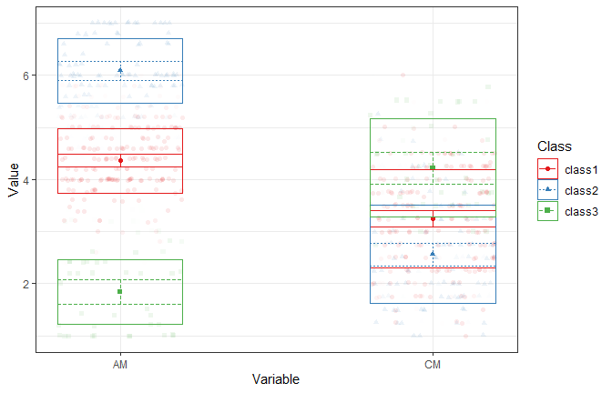
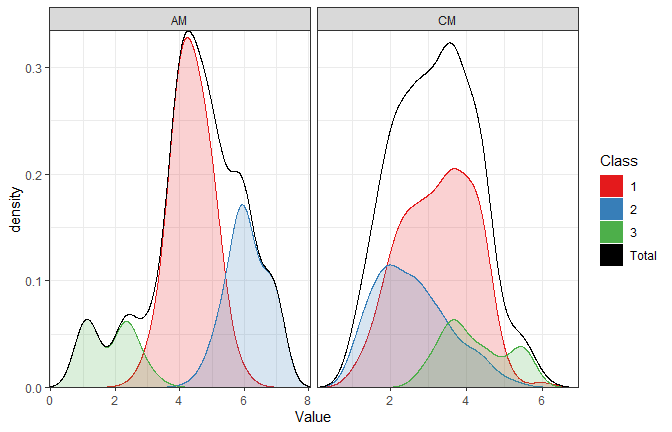
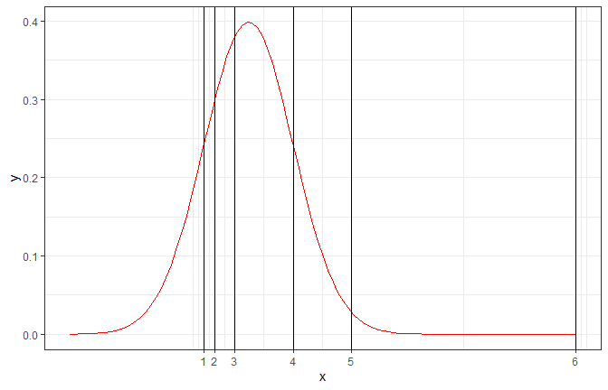
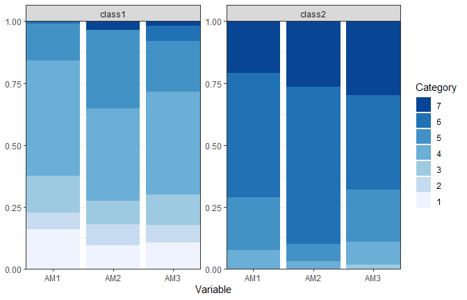
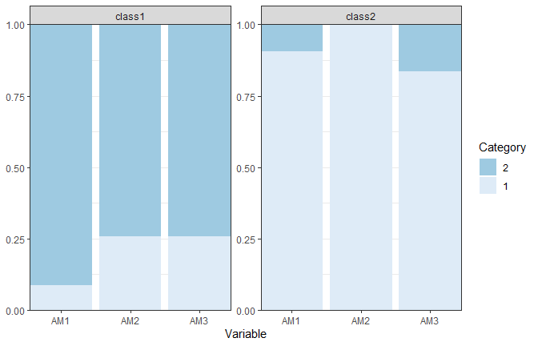
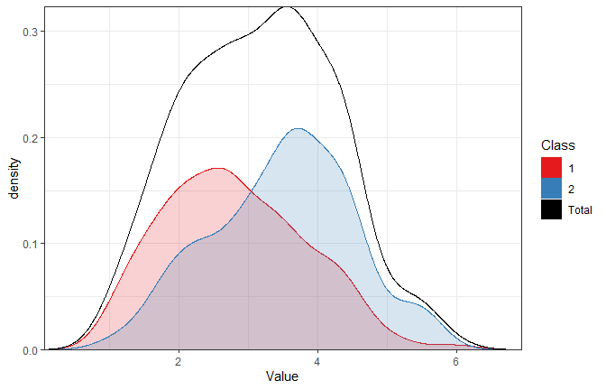
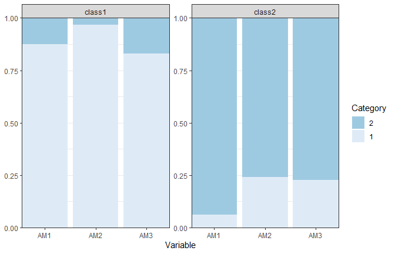
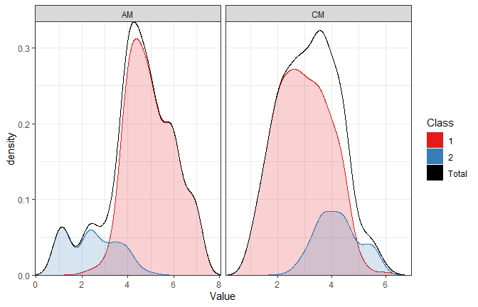

This vignette covers the core ideas behind LCA,
and takes you through the estimation of models with continuous, ordinal, and dichotomous indicators, and combinations of these.
We focus on the practical decisions researchers face: evaluating model fit, assessing classification accuracy, interpreting model parameters, and reporting results clearly with publication-ready tables and figures.
After this vignette, you should be able to:

Note that this vignette roughly follows the steps outlined in the [SMART-LCA Checklist](https://cjvanlissa.github.io/tidySEM/articles/SMART_LCA_checklist.html) (Standards for More Accuracy in Reporting of different Types of Latent Class Analysis),
as introduced in [Van Lissa, C. J., Garnier-Villarreal, M., & Anadria, D. (2023). *Recommended Practices in Latent Class Analysis using the Open-Source R-Package tidySEM.* Structural Equation Modeling.](https://doi.org/10.1080/10705511.2023.2250920).


## Pre-Analysis

In this case, we're estimating LCAs as toy examples to become familiar with the technique. 
This application of LCA is purely **exploratory** (there is no theory about the number and kind of classes).
We are unsure if the indicators are valid and reliable for LCA,
and our sample size is predetermined by the data available for secondary analysis.
We will use data from [Zhao K, Zhao Y, Xu W. Relationship between middle school students' academic stress and physical exercise behavior from the perspective of Self-Determination Theory: The chained mediation of motivation and intention. PLoS One. 2025 Jan 3;20(1):e0316599](http://doi.org/10.1371/journal.pone.0316599). 

These data are available in the object `zhao_2025`, and we can load them as follows:


``` r
library(tidySEM)
library(OpenMx)
library(ggplot2)
df <- zhao_2025
```

Run `View(df)` to inspect the data.

### Using Your Own Data

If you are using your own data, you might be able to load them by using or modifying one of the following functions:


``` r
# For CSV data:
df <- read.csv("your_file.csv")
# For Excel spreadsheets:
df <- readxl::read_excel("your_file.xlsx", sheet = 1)
# For SPSS data:
df <- foreign::read.spss("your_file.sav", to.data.frame = TRUE)
# For Stata data:
df <- foreign::read.dta("your_file.dta")
```

## Examining Observed Data

Now, inspect descriptive statistics for the variables in the dataset.
This is an important initial data-screening step because it helps us
understand the structure of the data and identify features such as
variable ranges, means, standard deviations, missing values, and the
number of unique observed values.


``` r
table_desc <- descriptives(df)
table_desc
#>      name    type   n     missing unique       mean median mode mode_value         sd  v min
#> 1      ID numeric 290 0.003436426    182 153.131034    158  158         NA 84.8178390 NA   2
#> 2   Grade numeric 291 0.000000000      3   2.010309      2    2         NA  0.8885654 NA   1
#> 3     Age numeric 291 0.000000000      5  13.732907     14   14         NA  0.9584744 NA  12
#> 4  Gender numeric 291 0.000000000      2   1.635739      2    2         NA  0.4820513 NA   1
#> 5     TS1 numeric 291 0.000000000      7   2.920962      3    3         NA  1.5235871 NA   1
#> 6     TS2 numeric 291 0.000000000      7   3.072165      3    3         NA  1.4568323 NA   1
#> 7     TS3 numeric 290 0.003436426      7   2.403448      2    2         NA  1.5560981 NA   1
#> 8     TS4 numeric 291 0.000000000      7   2.783505      3    3         NA  1.5639923 NA   1
#> 9    SOS1 numeric 290 0.003436426      7   4.665517      5    5         NA  1.6072448 NA   1
#> 10   SOS2 numeric 290 0.003436426      7   3.296552      3    3         NA  1.7235360 NA   1
#> 11   SOS3 numeric 290 0.003436426      7   2.631034      2    2         NA  1.7464949 NA   1
#> 12   SOS4 numeric 290 0.003436426      7   2.889655      3    3         NA  1.4366302 NA   1
#> 13    PS1 numeric 291 0.000000000      7   4.463918      4    4         NA  1.7363965 NA   1
#> 14    PS2 numeric 291 0.000000000      7   2.587629      2    2         NA  1.6510346 NA   1
#> 15    PS3 numeric 287 0.013745704      7   3.059233      3    3         NA  1.6994374 NA   1
#> 16    PS4 numeric 291 0.000000000      7   3.034364      3    3         NA  1.8454570 NA   1
#> 17    PS5 numeric 288 0.010309278      7   2.868056      2    2         NA  1.7138360 NA   1
#> 18    AM1 numeric 290 0.003436426      7   4.327586      4    4         NA  1.6532230 NA   1
#> 19    AM2 numeric 288 0.010309278      7   4.729167      5    5         NA  1.5979898 NA   1
#> 20    AM3 numeric 290 0.003436426      7   4.575862      5    5         NA  1.6075417 NA   1
#> 21    AM4 numeric 291 0.000000000      7   4.505155      4    4         NA  1.5522423 NA   1
#> 22    AM5 numeric 290 0.003436426      7   4.593103      5    5         NA  1.5739952 NA   1
#> 23    CM1 numeric 290 0.003436426      7   2.968966      3    3         NA  1.6117225 NA   1
#> 24    CM2 numeric 291 0.000000000      7   2.872852      3    3         NA  1.5134974 NA   1
#> 25    CM3 numeric 290 0.003436426      7   3.372414      4    4         NA  1.4715048 NA   1
#> 26    CM4 numeric 289 0.006872852      7   3.463668      4    4         NA  1.5875695 NA   1
#> 27    BI1 numeric 290 0.003436426      7   4.644828      5    5         NA  1.4651868 NA   1
#> 28    BI2 numeric 289 0.006872852      7   4.740484      5    5         NA  1.3963448 NA   1
#> 29    BI3 numeric 289 0.006872852      7   4.806228      5    5         NA  1.5288303 NA   1
#> 30    BH1 numeric 291 0.000000000      7   5.020619      5    5         NA  1.7359051 NA   1
#> 31    BH2 numeric 288 0.010309278      7   3.329861      3    3         NA  1.4502952 NA   1
#>    max range        skew    skew_2se        kurt    kurt_2se
#> 1  289   287 -0.13605878 -0.47538950 -1.23702373 -2.16834100
#> 2    3     2 -0.02020154 -0.07070456 -1.73796112 -3.05157911
#> 3   15     3 -0.14993992 -0.52478349 -0.98374543 -1.72729813
#> 4    2     1 -0.56706905 -1.98471816 -1.69009615 -2.96753595
#> 5    7     6  0.35810259  1.25334423 -0.57152889 -1.00351246
#> 6    7     6  0.20397798  0.71391447 -0.73878365 -1.29718480
#> 7    7     6  0.97736229  3.41490469  0.13192871  0.23125379
#> 8    7     6  0.38543102  1.34899258 -0.84100869 -1.47667547
#> 9    7     6 -0.20393909 -0.71256336 -0.80307039 -1.40767748
#> 10   7     6  0.45232786  1.58043393 -0.66280704 -1.16181415
#> 11   7     6  0.84850098  2.96466317 -0.34828509 -0.61049827
#> 12   7     6  0.50510413  1.76483428 -0.44207245 -0.77489526
#> 13   7     6 -0.18766355 -0.65681466 -0.79781285 -1.40083054
#> 14   7     6  0.84891591  2.97117049 -0.18677644 -0.32794927
#> 15   7     6  0.39324544  1.36694733 -0.98904728 -1.72483072
#> 16   7     6  0.47961096  1.67861846 -0.92685506 -1.62740783
#> 17   7     6  0.64148536  2.23368727 -0.56809490 -0.99241401
#> 18   7     6 -0.43602530 -1.52347277 -0.37259837 -0.65311628
#> 19   7     6 -0.64387068 -2.24199308 -0.08372378 -0.14625841
#> 20   7     6 -0.44502468 -1.55491660 -0.22795609 -0.39957724
#> 21   7     6 -0.26869691 -0.94042803 -0.23399890 -0.41086428
#> 22   7     6 -0.53473329 -1.86835856  0.05989265  0.10498399
#> 23   7     6  0.72478103  2.53238553  0.02339709  0.04101204
#> 24   7     6  0.42162188  1.47565911 -0.50157333 -0.88068179
#> 25   7     6  0.32791591  1.14573847  0.01942356  0.03404696
#> 26   7     6  0.33686541  1.17499766 -0.33952285 -0.59412939
#> 27   7     6 -0.55047037 -1.92334396  0.26543133  0.46526645
#> 28   7     6 -0.77666405 -2.70902985  0.60647064  1.06126003
#> 29   7     6 -0.87923548 -3.06680238  0.45955236  0.80416846
#> 30   7     6 -0.53371071 -1.86796534 -0.49033875 -0.86095567
#> 31   7     6  0.64559662  2.24800289  0.29855650  0.52155308
```

The `type` column tells you the measurement level of each variable. The `tidySEM` package supports latent class analysis with `numeric` (or `integer`) and `ordered` variables. 

Numeric and integer variables should be truly continuous (e.g., centimeters), or you must be willing to assume that they behave as continuous (scale mean scores in a questionnaire).

Ordinal indicators consist of categories that have a meaningful order, such as Likert responses ranging from *strongly disagree* to *strongly agree*.

Note that integer variables containing only a small number of values could be numeric score, but could also be ordered. The correct treatment depends on what the numbers mean, not merely on how R stores them. Check the `unique` column of `descriptives()` to see how many unique values there are; this may alert you to such issues.

If you have variables with other data types than numeric/integer/ordered - you will need to convert them.

One key issue is that variables are not always correctly stored. The `type` column may not correspond to the variable's substantive measurement level. For example, you might have a variable of type `integer` with values `1, 2`, but which actually represents employment, with values `Unemployed` and `Employed`.
Moreover, an integer variable may represent a truly continuous quantity (e.g., number of children), or an ordinal Likert scale, in which case it should be recoded to `ordered`. Similarly, a factor may represent an unordered categorical variable with several categories. For LCA, each category should be coded as a binary `ordered` variable.

You should therefore inspect both the variable type and the meaning of the variable before deciding how it should enter the model.

## Data Preprocessing

If a variable is incorrectly coded, you may be able to restore its correct type. Here are a few examples of type conversions:


``` r
# This is a character variable, because someone misstyped a t:
v1 <- c("5.1", "4.9", "4.7", "4.6t", "5", "5.4")
class(v1)
#> [1] "character"
# You can turn it into numeric; the mistyped value is lost:
as.numeric(v1)
#> [1] 5.1 4.9 4.7  NA 5.0 5.4
# This is an integer variable representing a Likert scale:
v2 <- c(2L, 3L, 2L, 5L, 3L, 4L)
class(v2)
#> [1] "integer"
# You can turn it into ordered:
ordered(v2)
#> [1] 2 3 2 5 3 4
#> Levels: 2 < 3 < 4 < 5
# This is a factor variable:
v3 <- factor(c("Medicine", "Humanities", "Humanities", "Medicine", "Social science", 
"Medicine"))
class(v3)
#> [1] "factor"
# You can encode it as multiple binary dummmies:
tidySEM::mx_dummies(v3)
#>   Humanities Medicine Social.science
#> 1          0        1              0
#> 2          1        0              0
#> 3          1        0              0
#> 4          0        1              0
#> 5          0        0              1
#> 6          0        1              0
```

The final command takes an unordered factor and represents it as a set of binary dummy variables; one for each category. These dummy variables can then be added to the analysis dataset.

Note that, in our example dataset, all variable `type`s are numeric, even though some must be integer (age), and others must be factors (Gender) or ordered (all Likert scales).
Note that all variables have just few  low number of unique values; this is another hint that some recoding is in order.

Here we recode 'gender' from its original numeric codes into
a factor variable. We also attach meaningful text labels to the numeric
categories so that subsequent tables and output are easier to understand.
The 'levels' argument specifies the original codes found in the dataset,
while 'labels' specifies the corresponding category names that R should
display instead.


``` r
df$Gender <- factor(df$Gender,
                    levels = c(1,2),
                    labels = c("M", "F"))
```

Several variables in the dataset are individual questionnaire items that
belong to broader multi-item scales. 

We can use these to practice two things:

1) Computing numeric scale mean scores
2) Encoding them as ordered variables

We will compute the scale scores first, because this still requires these variables to be `numeric`.

For example, the scale named TS consists of TS1 through TS4, while SOS
consists of SOS1 through SOS4. 
I like to store this information in a list, as this would allow you to, for example, easily perform psychometric analyses for every scale automatically (which is out of scope for the current tutorial).


``` r
# To prepare the scales list, I used:
scales_list <- grep("\\w{2}\\d", names(df), value = TRUE)
scalenames <- unique(gsub("\\d", "", scales_list))
scales_list <- lapply(scalenames, grep, x = names(df), value = TRUE)
names(scales_list) <- scalenames

# This gives the list below; you can also construct it for your dataset by hand:
scales_list <- list(
  TS = c("TS1", "TS2", "TS3", "TS4"),
  SOS = c("SOS1", "SOS2", "SOS3", "SOS4"),
  PS = c("PS1", "PS2", "PS3", "PS4", "PS5"),
  AM = c("AM1", "AM2", "AM3", "AM4", "AM5"),
  CM = c("CM1", "CM2", "CM3", "CM4"),
  BI = c("BI1", "BI2", "BI3"),
  BH = c("BH1", "BH2")
  )
```

To compute mean scale scores, we can use:


``` r
df_scales <- sapply(scales_list, function(items){
  rowMeans(df[, items, drop = FALSE], na.rm = TRUE)
})
# Add them to df:
df <- data.frame(df, df_scales)
```

Second, the encode these items as ordered variables, we could grab all relevant variables based on the naming pattern (these variable names end with a number),
or we can take all items in the `scales_list` using `unlist()`:


``` r
ord_vars <- grep("\\d$", names(df), value = TRUE)
ord_vars
#>  [1] "TS1"  "TS2"  "TS3"  "TS4"  "SOS1" "SOS2" "SOS3" "SOS4" "PS1"  "PS2"  "PS3"  "PS4"  "PS5" 
#> [14] "AM1"  "AM2"  "AM3"  "AM4"  "AM5"  "CM1"  "CM2"  "CM3"  "CM4"  "BI1"  "BI2"  "BI3"  "BH1" 
#> [27] "BH2"
# Or alternatively:
ord_vars <- unlist(scales_list)
```

Then, we can recode these variables as ordered:


``` r
df[ord_vars] <- lapply(df[ord_vars], ordered)
```

Inspect the cleaned dataset again before fitting the model. Check that numeric indicators really represent continuous quantities, ordered indicators have the intended category order, and binary indicators contain exactly two possible response categories. Also check for unexpected values, unused factor levels, miscoded missing values, and variables with little or no variation.

## Missing Data

This dataset has no missing data.
However, you can increase the challenge for yourself by adding some missingness.
If you want to do this - do it immediately after loading the data and removing the empty rows, with code like this:


``` r
library(mice)
df <- ampute(df)$amp
```

Regardless of the presence of missingness or not, `tidySEM` uses FIML which includes cases with partially missing data.

## Model Specification

The type of model you can specify depends partially on the measurement level of your indicators:

| Indicator type | Typical examples | tidySEM function | Class-specific quantities |
|---|---|---|---|
| Continuous | test scores, reaction time, symptom sum scores | `mx_profiles()` | means, variances, possibly covariances |
| Ordinal | Likert items, ordered severity categories | `mx_lca()` | category probabilities / thresholds |
| Dichotomous | yes/no, present/absent, correct/incorrect | `mx_lca()` | response probabilities |
| Mixed | a combination of the above | `mx_mixed_lca()` | parameters appropriate to each indicator type |


## Latent Profile Analysis (LPA) with Continuous Indicators {#sec-lpa}

We will use two scale scores from the Zhao dataset as a teaching example;
specifically, `c("AM", "CM")`, which represent autonomous and controlled motivation. 
You can increase the challenge level of this tutorial by using your own dataset, or by selecting different scales.
For example, `c("TS", "SOS", "PS")`, which represent three sources of stress/pressure: teacher stress, social stress, and parent stress.


``` r
df_lpa <- df[, c("AM", "CM")]
```

Note that standardizing indicators is not required and should not affect results, with two caveats: if continuous indicators are on very different scales (e.g., the variance differs by a factor 10+), this can cause problems for model convergence. Second, this can make plots harder to read because the plotting range of one variable could be much smaller than another.

### Model Specification

The arguments `variances` and `covariances` control the model specification for LPA.
For example, a model with equal variances and zero covariances assumpes that every indicator has the same residual variance across classes, and that indicators are "locally independent" (=uncorrelated) within each class, even if they should be correlated at the sample level.
Note that you can also specify different (co)variance structures, either for thorough exploration of because you have some theory about e.g., smaller variance in some classes, or different correlations between classes.
See the help file by running `?mx_profiles`. For example, you could specify the code below. 

Note that this analysis will take a very long time because these are many models and some of them are hard to estimate.
For any computationally intensive analyses like this, we can save the results to a file, so you can load the results from that file directly without having to wait for the code to run.
We do recommend that you experiment with running *some* analyses yourself, of course.


``` r
res_lpa <- mx_profiles(
  df_lpa,
  classes = 1:5,
  variances = c("equal", "varying"),
  covariances = c("zero", "equal")
)
#> 
MxComputeSimAnnealing(tsallis1996) evaluations 1891 fit 3322.89 change 131.7
MxComputeSimAnnealing(tsallis1996) evaluations 5702 fit 1829.24 change -6.29
                                                                            
#> 
MxComputeSimAnnealing(tsallis1996) evaluations 2300 fit 1807.56 change -69.26
MxComputeSimAnnealing(tsallis1996) evaluations 4905 fit 2019.89 change 218.9 
MxComputeSimAnnealing(tsallis1996) evaluations 7480 fit 2366.63 change 566  
MxComputeSimAnnealing(tsallis1996) evaluations 10058 fit 1800.63 change -3070
MxComputeSimAnnealing(tsallis1996) evaluations 12628 fit 1803.41 change 2.785
                                                                             
#> 
MxComputeSimAnnealing(tsallis1996) evaluations 1104 fit 2369.75 change -3738
MxComputeSimAnnealing(tsallis1996) evaluations 3092 fit 6733.31 change 3350 
MxComputeSimAnnealing(tsallis1996) evaluations 5072 fit 1986.64 change 0   
MxComputeSimAnnealing(tsallis1996) evaluations 7048 fit 1792.14 change 8.728
MxComputeSimAnnealing(tsallis1996) evaluations 9006 fit 2525.47 change 742.4
MxComputeSimAnnealing(tsallis1996) evaluations 10968 fit 6777.71 change 4995
MxComputeSimAnnealing(tsallis1996) evaluations 12930 fit 2084.03 change -615.5
MxComputeSimAnnealing(tsallis1996) evaluations 14884 fit 1987.88 change 182.7 
                                                                             
#> 
MxComputeSimAnnealing(tsallis1996) evaluations 786 fit 2166.07 change -34.24
MxComputeSimAnnealing(tsallis1996) evaluations 2375 fit 1984.7 change 0     
MxComputeSimAnnealing(tsallis1996) evaluations 3965 fit 2521.48 change -2628
MxComputeSimAnnealing(tsallis1996) evaluations 5553 fit 1800.32 change -249.6
MxComputeSimAnnealing(tsallis1996) evaluations 7138 fit 2081.37 change 109.5 
MxComputeSimAnnealing(tsallis1996) evaluations 8712 fit 2706.08 change 839.3
MxComputeSimAnnealing(tsallis1996) evaluations 10296 fit 1785.64 change -76.79
MxComputeSimAnnealing(tsallis1996) evaluations 11875 fit 1799.79 change 34.36 
MxComputeSimAnnealing(tsallis1996) evaluations 13455 fit 2211.02 change -0.0358
MxComputeSimAnnealing(tsallis1996) evaluations 15028 fit 1775.82 change -308.8 
MxComputeSimAnnealing(tsallis1996) evaluations 16595 fit 1765.44 change 0.02047
MxComputeSimAnnealing(tsallis1996) evaluations 18164 fit 1765.42 change 0.0002289
MxComputeSimAnnealing(tsallis1996) evaluations 19735 fit 1765.41 change -0.008017
                                                                                 
#> 
MxComputeSimAnnealing(tsallis1996) evaluations 13 fit 2626.39 change 0
MxComputeSimAnnealing(tsallis1996) evaluations 3956 fit 2028.28 change -289.1
MxComputeSimAnnealing(tsallis1996) evaluations 7825 fit 2134.07 change 331.2 
MxComputeSimAnnealing(tsallis1996) evaluations 11668 fit 1803.19 change 0.6312
                                                                              
#> 
MxComputeSimAnnealing(tsallis1996) evaluations 1125 fit 3041.14 change 0
MxComputeSimAnnealing(tsallis1996) evaluations 3768 fit 1947.04 change -51.22
MxComputeSimAnnealing(tsallis1996) evaluations 6398 fit 2382.93 change 603.3 
MxComputeSimAnnealing(tsallis1996) evaluations 8986 fit 1783.33 change 4.876
MxComputeSimAnnealing(tsallis1996) evaluations 11572 fit 1777.46 change -0.11
MxComputeSimAnnealing(tsallis1996) evaluations 14150 fit 1777.15 change -2.549
MxComputeSimAnnealing(tsallis1996) evaluations 16729 fit 1777.1 change -1058  
                                                                            
#> 
MxComputeSimAnnealing(tsallis1996) evaluations 1092 fit 2597.25 change 27.53
MxComputeSimAnnealing(tsallis1996) evaluations 3077 fit 2338.77 change 383.9
MxComputeSimAnnealing(tsallis1996) evaluations 5066 fit 1812.3 change -481  
MxComputeSimAnnealing(tsallis1996) evaluations 7052 fit 2460.28 change 700.4
MxComputeSimAnnealing(tsallis1996) evaluations 9032 fit 1927.92 change 102.4
MxComputeSimAnnealing(tsallis1996) evaluations 11003 fit 1898.27 change 139 
MxComputeSimAnnealing(tsallis1996) evaluations 12960 fit 1801.2 change 42.31
MxComputeSimAnnealing(tsallis1996) evaluations 14925 fit 1758.62 change -43.13
MxComputeSimAnnealing(tsallis1996) evaluations 16889 fit 2303.74 change 544.7 
MxComputeSimAnnealing(tsallis1996) evaluations 18853 fit 1760.69 change -648.9
MxComputeSimAnnealing(tsallis1996) evaluations 20817 fit 2421.52 change 663   
MxComputeSimAnnealing(tsallis1996) evaluations 22775 fit 2430.81 change 23.17
MxComputeSimAnnealing(tsallis1996) evaluations 24735 fit 1758.57 change -0.009263
                                                                                 
#> 
MxComputeSimAnnealing(tsallis1996) evaluations 1268 fit 2139.64 change 0
MxComputeSimAnnealing(tsallis1996) evaluations 2860 fit 2838.84 change -2074
MxComputeSimAnnealing(tsallis1996) evaluations 4448 fit 2301.64 change 0    
MxComputeSimAnnealing(tsallis1996) evaluations 6039 fit 2259.87 change 0
MxComputeSimAnnealing(tsallis1996) evaluations 7624 fit 1926.45 change 176.4
MxComputeSimAnnealing(tsallis1996) evaluations 9211 fit 2423.89 change 676.3
MxComputeSimAnnealing(tsallis1996) evaluations 10800 fit 2002.17 change -11.05
MxComputeSimAnnealing(tsallis1996) evaluations 12374 fit 1979.45 change 0     
MxComputeSimAnnealing(tsallis1996) evaluations 13958 fit 2465.52 change 719.9
MxComputeSimAnnealing(tsallis1996) evaluations 15534 fit 1744.03 change 2.725
MxComputeSimAnnealing(tsallis1996) evaluations 17109 fit 1740.3 change 0.02475
MxComputeSimAnnealing(tsallis1996) evaluations 18685 fit 1853.65 change 114.2 
MxComputeSimAnnealing(tsallis1996) evaluations 20253 fit 1739.24 change -562.9
MxComputeSimAnnealing(tsallis1996) evaluations 21826 fit 1739.13 change -0.06655
MxComputeSimAnnealing(tsallis1996) evaluations 23397 fit 1739.07 change 0.002638
MxComputeSimAnnealing(tsallis1996) evaluations 24968 fit 1736.51 change -0.3853 
MxComputeSimAnnealing(tsallis1996) evaluations 26543 fit 1733.78 change -5.635 
MxComputeSimAnnealing(tsallis1996) evaluations 28086 fit 1733.07 change -242.8
MxComputeSimAnnealing(tsallis1996) evaluations 29658 fit 1732.96 change 0.1332
MxComputeSimAnnealing(tsallis1996) evaluations 31232 fit 2326.02 change 593.3 
                                                                             
saveRDS(res_lpa, "res_lpa_different_spect.rds")
```


``` r
res_lpa <- readRDS("res_lpa_different_spect.rds")
format_numeric(table_fit(res_lpa))
#>                     Name Classes      LL      n Parameters     AIC     BIC   saBIC Entropy
#> 1            equal var 1    1.00 -951.56 291.00          4 1911.12 1925.81 1913.13    1.00
#> 2            equal var 2    2.00 -914.57 291.00          7 1843.14 1868.86 1846.66    0.79
#> 3            equal var 3    3.00 -900.31 291.00         10 1820.62 1857.35 1825.64    0.68
#> 4            equal var 4    4.00 -887.52 291.00         13 1801.03 1848.79 1807.56    0.86
#> 5            equal var 5    5.00 -882.70 291.00         16 1797.41 1856.18 1805.44    0.73
#> 6  free var, equal cov 1    1.00 -920.19 291.00          5 1850.37 1868.74 1852.88    1.00
#> 7  free var, equal cov 2    2.00 -901.28 291.00         10 1822.56 1859.29 1827.58    0.58
#> 8  free var, equal cov 3    3.00 -888.53 291.00         15 1807.07 1862.17 1814.60    0.78
#> 9  free var, equal cov 4    4.00 -879.28 291.00         20 1798.56 1872.03 1808.60    0.78
#> 10 free var, equal cov 5    5.00 -866.36 291.00         25 1782.71 1874.54 1795.26    0.80
#>    prob_min prob_max n_min n_max np_ratio np_local
#> 1      1.00     1.00  1.00  1.00    72.75    72.75
#> 2      0.77     0.98  0.16  0.84    41.57    15.33
#> 3      0.82     0.87  0.12  0.44    29.10    13.12
#> 4      0.85     0.95  0.06  0.56    22.38     7.20
#> 5      0.76     0.96  0.07  0.32    18.19     7.92
#> 6      1.00     1.00  1.00  1.00    58.20    58.20
#> 7      0.87     0.88  0.48  0.52    29.10    31.33
#> 8      0.83     0.93  0.18  0.52    19.40    12.00
#> 9      0.79     0.92  0.13  0.37    14.55     8.71
#> 10     0.82     0.94  0.09  0.43    11.64     6.19
```

More complex models are not automatically better: extra parameters can create unstable solutions, tiny classes, or local maxima.
Think about which models make sense to estimate, and how many classes your data could reasonably support.

### Maximum Number of Classes

We can set an upper limit on the number of classes to estimate, for example, by saying we want to aim for 20 observations per parameter, if cases would be evenly split between classes. We could then estimate 290/20 = 14.5 parameters.
With 2 indicators, zero covariances, and equal variances, the number of parameters for our model is:

* k-1 mixture weights
* k*2 means
* 2 variances

Which would give this many cases per parameter:


``` r
k <- 1:10
nrow(df) / (1+3*k)
#>  [1] 72.750000 41.571429 29.100000 22.384615 18.187500 15.315789 13.227273 11.640000 10.392857
#> [10]  9.387097
```

So we could estimate at least 4 classes. Let's round up and estimate 1:5 class solutions:


``` r
res_lpa <- mx_profiles(
  df_lpa,
  classes = 1:5,
  variances = "equal",
  covariances = "zero"
)
#> 
MxComputeSimAnnealing(tsallis1996) evaluations 3524 fit 1830.01 change -2298
MxComputeSimAnnealing(tsallis1996) evaluations 7318 fit 1876.19 change 47.02
                                                                            
#> 
MxComputeSimAnnealing(tsallis1996) evaluations 823 fit 2541.32 change 0
MxComputeSimAnnealing(tsallis1996) evaluations 3450 fit 2826.7 change 946.7
MxComputeSimAnnealing(tsallis1996) evaluations 6040 fit 1786.91 change -2.551
MxComputeSimAnnealing(tsallis1996) evaluations 8605 fit 1786.97 change -549  
MxComputeSimAnnealing(tsallis1996) evaluations 11169 fit 1786.78 change -1128
                                                                             
#> 
MxComputeSimAnnealing(tsallis1996) evaluations 1941 fit 1934.3 change 0
MxComputeSimAnnealing(tsallis1996) evaluations 3907 fit 1917.27 change 45.05
MxComputeSimAnnealing(tsallis1996) evaluations 5874 fit 1798.2 change -1721 
MxComputeSimAnnealing(tsallis1996) evaluations 7846 fit 1789.12 change -281.5
MxComputeSimAnnealing(tsallis1996) evaluations 9810 fit 1794.54 change -14.19
MxComputeSimAnnealing(tsallis1996) evaluations 11770 fit 1797.5 change -53.08
MxComputeSimAnnealing(tsallis1996) evaluations 13727 fit 1789.12 change -3.42
MxComputeSimAnnealing(tsallis1996) evaluations 15678 fit 1789.11 change -0.01114
                                                                                
#> 
MxComputeSimAnnealing(tsallis1996) evaluations 1513 fit 3919.58 change 475.1
MxComputeSimAnnealing(tsallis1996) evaluations 3108 fit 1952.42 change -602.8
MxComputeSimAnnealing(tsallis1996) evaluations 4692 fit 1882.74 change -635.3
MxComputeSimAnnealing(tsallis1996) evaluations 6276 fit 1814.71 change -758.4
MxComputeSimAnnealing(tsallis1996) evaluations 7859 fit 1773.7 change -0.7669
MxComputeSimAnnealing(tsallis1996) evaluations 9439 fit 1810.21 change -238.7
MxComputeSimAnnealing(tsallis1996) evaluations 11022 fit 1773.06 change -17.28
MxComputeSimAnnealing(tsallis1996) evaluations 12604 fit 4513.05 change 2610  
MxComputeSimAnnealing(tsallis1996) evaluations 14176 fit 1772.7 change -0.2893
MxComputeSimAnnealing(tsallis1996) evaluations 15754 fit 1772.54 change 0.0001085
MxComputeSimAnnealing(tsallis1996) evaluations 17333 fit 1772.45 change -0.4516  
MxComputeSimAnnealing(tsallis1996) evaluations 18915 fit 1772.38 change 0.01646
MxComputeSimAnnealing(tsallis1996) evaluations 20494 fit 1828.7 change 56.39   
                                                                            
saveRDS(res_lpa, "res_lpa_equal.rds")
```


``` r
res_lpa <- readRDS("res_lpa_equal.rds")
```

### Class Enumeration

First, extract a model fit table:


``` r
tab_lpa_fit <- table_fit(res_lpa)
tab_lpa_fit
#>          Name Classes        LL   n Parameters      AIC      BIC    saBIC   Entropy  prob_min
#> 1 equal var 1       1 -951.5584 291          4 1911.117 1925.810 1913.125 1.0000000 1.0000000
#> 2 equal var 2       2 -914.5721 291          7 1843.144 1868.857 1846.659 0.7857956 0.7652851
#> 3 equal var 3       3 -893.3834 291         10 1806.767 1843.500 1811.788 0.8365068 0.8968021
#> 4 equal var 4       4 -894.5514 291         13 1815.103 1862.856 1821.630 0.7317583 0.5928521
#> 5 equal var 5       5 -885.9574 291         16 1803.915 1862.688 1811.949 0.7636743 0.4887870
#>    prob_max      n_min     n_max np_ratio np_local
#> 1 1.0000000 1.00000000 1.0000000 72.75000 72.75000
#> 2 0.9799943 0.15807560 0.8419244 41.57143 15.33333
#> 3 0.9439569 0.12714777 0.5807560 29.10000 13.87500
#> 4 0.8994559 0.04467354 0.4432990 22.38462  5.20000
#> 5 0.9183118 0.06185567 0.4845361 18.18750  7.50000
```

#### BIC

One well-supported criterion for class enumeration is the BIC:
a relative fit index that rewards good fit and penalizes model complexity.
The absolute BIC value has no substantive meaning; you can compare BIC values of models fitted to the same data, and lower values are preferred.
We can see that the three-class model has the lowest BIC:


``` r
which.min(tab_lpa_fit$BIC)
#> [1] 3
```


#### BLRT

We can also conduct a bootstrapped likelihood ratio test, which asks whether a model with $k$ classes improves fit over a model with $k-1$ classes.
However, this test is extremely computationally expensive.
Before we do so, it is useful to check if we can eliminate some models from consideration (also see next section).
For example, note that `np_local`, the minimum number of cases assigned to a class divided by the number of parameters in that class, is as low as 2.4 for models with 4-5 classes.
You want a healthy number of cases per parameter, so we can exclude these two models, then perform our BLRT:


``` r
res_lpa_blrt <- res_lpa
res_lpa_blrt[c(4, 5)] <- NULL
res_blrt <- BLRT(res_lpa_blrt)
saveRDS(res_blrt, "res_blrt_intro.rds")
```


``` r
res_blrt <- readRDS("res_blrt_intro.rds")
res_blrt
#> Bootstrapped Likelihood Ratio Test:
#> 
#>  null  alt   lr df blrt_p samples
#>  mix1 mix2 74.0  3      0      99
#>  mix2 mix3 42.4  3      0      98
```

We see that adding classes leads to a significant improvement in model fit.


### Eliminating Models from Consideration {#sec-eliminating}

As mentioned before, we will eliminate the 4-5 class models because they have a very low number of observations per parameter.

We can also check model diagnostics for any problems with convergence, parameter values near the boundaries, et cetera.
If one of these checks fails, you can examine a detailed report by running `mx_diagnostics(res_lpa[[model_numer]])`, where `model_number` is the number of the failing model:


``` r
sapply(res_lpa, function(i) mx_diagnostics(i)$checks_pass)
#> equal var 1 equal var 2 equal var 3 equal var 4 equal var 5 
#>        TRUE        TRUE        TRUE        TRUE        TRUE
```

Another consideration is that classification diagnostics are poor for the 4-5 class models:


``` r
tab_lpa_fit[, c("Entropy", "prob_min", "prob_max")]
#>     Entropy  prob_min  prob_max
#> 1 1.0000000 1.0000000 1.0000000
#> 2 0.7857956 0.7652851 0.9799943
#> 3 0.8365068 0.8968021 0.9439569
#> 4 0.7317583 0.5928521 0.8994559
#> 5 0.7636743 0.4887870 0.9183118
```

The entropy statistic is an overall summary of class separation, where values approaching 1 indicate clear delineation of classes [@celeuxEntropyCriterionAssessing1996].

The statistics `prob_min` and `prob_max` give us the minumum and maximum of the diagonal of the `mostlikely.class` classification table (see `?class_prob`).
If C is the true class of an observation, and N is the most likely class based on the model, then this table shows the probability P(N==i|C==j).
The diagonal represents the probability that observations in each class will be correctly classified.
We see that `prob_min` is very low for the 4-5 class models; thus,
for some classes, there is a low probability that its members will be correctly classified.
This is also reflected in the entropy.

### Reporting Results

We already obtained the model fit table.
There are many ways to prepare it for a scientific paper.
The regular formatting function in R has some peculiar behavior; 
it does not guarantee that a certain number of decimals are displayed.
This is a design choice in R, and has to do with the principle of "significant figures".
However, APA style simply requires reporting to double digits.
So let's consider two options:


``` r
# Standard R formatting, some columns get 3 digits, some get 1, but they remain
# numeric type:
tab_lpa_fit_formatted <- format(tab_lpa_fit, digits = 2)
tab_lpa_fit_formatted
#>          Name Classes   LL   n Parameters  AIC  BIC saBIC Entropy prob_min prob_max n_min
#> 1 equal var 1       1 -952 291          4 1911 1926  1913    1.00     1.00     1.00 1.000
#> 2 equal var 2       2 -915 291          7 1843 1869  1847    0.79     0.77     0.98 0.158
#> 3 equal var 3       3 -893 291         10 1807 1843  1812    0.84     0.90     0.94 0.127
#> 4 equal var 4       4 -895 291         13 1815 1863  1822    0.73     0.59     0.90 0.045
#> 5 equal var 5       5 -886 291         16 1804 1863  1812    0.76     0.49     0.92 0.062
#>   n_max np_ratio np_local
#> 1  1.00       73     72.8
#> 2  0.84       42     15.3
#> 3  0.58       29     13.9
#> 4  0.44       22      5.2
#> 5  0.48       18      7.5
# Using format_numeric; reports 2 digits, but all columns become
# character type:
tab_lpa_fit_formatted <- format_numeric(tab_lpa_fit, digits = 2)
write.csv(tab_lpa_fit_formatted, "tab_lpa_fit.csv", row.names = FALSE)
```

Based on the BIC, the elimination of the 4-5 class models, and significant BLRT tests, we would retain a 3-class model.

The class proportions of this model are:


``` r
class_prob(res_lpa[[3]], "sum.posterior")
#> $sum.posterior
#>    class     count proportion
#> 1 class1 167.04348  0.5740326
#> 2 class2  85.72089  0.2945735
#> 3 class3  38.23563  0.1313939
```

We can examine the parameters of this model as follows:


``` r
tab_lpa_res <- table_results(res_lpa[[3]])
tab_lpa_res
#>                   label est_sig   se pval      confint  class
#> 1       Means.AM.class1 4.36*** 0.07 0.00 [4.23, 4.49] class1
#> 2       Means.CM.class1 3.24*** 0.08 0.00 [3.09, 3.40] class1
#> 3   Variances.AM.class1 0.39*** 0.04 0.00 [0.30, 0.48] class1
#> 4   Variances.CM.class1 0.89*** 0.08 0.00 [0.74, 1.04] class1
#> 5       Means.AM.class2 6.09*** 0.09 0.00 [5.91, 6.27] class2
#> 6       Means.CM.class2 2.56*** 0.11 0.00 [2.34, 2.78] class2
#> 7       Means.AM.class3 1.84*** 0.12 0.00 [1.60, 2.08] class3
#> 8       Means.CM.class3 4.22*** 0.16 0.00 [3.91, 4.53] class3
#> 9  mix3.weights[1,1].NA    1.00 <NA> <NA>         <NA>   <NA>
#> 10 mix3.weights[1,2].NA 0.51*** 0.09 0.00 [0.34, 0.69]   <NA>
#> 11 mix3.weights[1,3].NA 0.23*** 0.04 0.00 [0.14, 0.32]   <NA>
```

Notice that we get one estimate for the variances (because these are equal across classes), no covariances, and unique estimates for the means across classes.

The pattern of results is easier to see when plotting it:


``` r
plot_profiles(res_lpa[[3]])
```

<!-- -->

``` r
plot_density(res_lpa[[3]])
```

<!-- -->

Examining the class-specific means, we see that Class 1 has moderate values on both indicators, whereas Class 2 does not have high means on both autonomous motivation (AM) and controlled motivation (CM).

The marginal (whole-sample) distributions of both indicators are approximately normal.
Combined with the relatively low class separability, this raises an important question: Do the data really contain distinct latent classes?
It is possible that the identified classes merely represent differences along continuous dimensions rather than qualitatively distinct subgroups.
We should therefore seriously consider whether a model without latent classes might provide a more parsimonious explanation of the data.

## Latent Class Analysis with Ordinal indicators

We can conduct ordinal LCA by using some of the raw items underlying the scale scores, for example:


``` r
df_lca <- df[, c("AM1", "AM2", "AM3")]
```

For a model with ordinal indicators, there is (currently) only one parametrization available.
Specifically, we represent each ordinal variable as a latent normal variable with thresholds representing the quantiles of people who score a particular score or lower.
In these models, each variable will have a number of thresholds equal to the number of response options minus one.
It is easy to see that this model will have more parameters than the LPA model. If L is the number of levels of our ordinal indicators, and M is the number of indicators:

* k-1 mixture weights
* k*((L-1)*M) thresholds

Since our indicators have 7 categories, this gives:


``` r
k <- 1:10
L <- length(unique(df_lca$AM1))
M <- ncol(df_lca)
nrow(df) / ((k-1)+k*((L-1)*M))
#>  [1] 13.857143  6.767442  4.476923  3.344828  2.669725  2.221374  1.901961  1.662857  1.477157
#> [10]  1.328767
```

Note that even for a 1-class model, we have fewer than 20 observations per parameter.
Thus, we might doubt whether we have enough data here to estimate more than one class.
For educational purposes - we will proceed, but to save time estimating overly complex models, we omit the 4-5 class models.


``` r
res_lca <- mx_lca(
  df_lca,
  classes = 1:3
)
#> 
Beginning initial fit attempt
Fit attempt 0, fit=3076.55795135632, new current best! (was 3076.55795135632)
Beginning fit attempt 1 of at maximum 10 extra tries                         
Beginning fit attempt 2 of at maximum 10 extra tries
Beginning fit attempt 3 of at maximum 10 extra tries
Beginning fit attempt 4 of at maximum 10 extra tries
Beginning fit attempt 5 of at maximum 10 extra tries
Beginning fit attempt 6 of at maximum 10 extra tries
Beginning fit attempt 7 of at maximum 10 extra tries
Beginning fit attempt 8 of at maximum 10 extra tries
Beginning fit attempt 9 of at maximum 10 extra tries
Beginning fit attempt 10 of at maximum 10 extra tries
Final run, for Hessian and/or standard errors and/or confidence intervals
                                                                         
#> 
Beginning initial fit attempt
Fit attempt 0, fit=3076.55795135632, new current best! (was 3076.55795135632)
Beginning fit attempt 1 of at maximum 10 extra tries                         
MxComputeGradientDescent(SLSQP) evaluations 2676 fit 2774.98 change -0.4001
                                                                           

Fit attempt 1, fit=2749.45980344113, new current best! (was 3076.55795135632)
Beginning fit attempt 2 of at maximum 10 extra tries                         
MxComputeGradientDescent(SLSQP) evaluations 2111 fit 2749.87 change -0.09518
                                                                            

Fit attempt 2, fit=2748.74290395434, new current best! (was 2749.45980344113)
Beginning fit attempt 3 of at maximum 10 extra tries                         
MxComputeGradientDescent(SLSQP) evaluations 1881 fit 2748.91 change -0.09803
                                                                            

Fit attempt 3, fit=2748.7429037639, new current best! (was 2748.74290395434)
Beginning fit attempt 4 of at maximum 10 extra tries                        
Fit attempt 4, fit=2756.77295021122, worse than previous best (2748.7429037639)
Beginning fit attempt 5 of at maximum 10 extra tries                           
MxComputeGradientDescent(SLSQP) evaluations 1524 fit 2873.45 change -16.71
                                                                          

Fit attempt 5, fit=2756.77305395651, worse than previous best (2748.7429037639)
Beginning fit attempt 6 of at maximum 10 extra tries                           
MxComputeGradientDescent(SLSQP) evaluations 3195 fit 2749 change -0.1246
                                                                        

Beginning fit attempt 7 of at maximum 10 extra tries
MxComputeGradientDescent(SLSQP) evaluations 4119 fit 2750.66 change -0.41
                                                                         

Fit attempt 7, fit=2749.45960750765, worse than previous best (2748.7429037639)
Beginning fit attempt 8 of at maximum 10 extra tries                           
Fit attempt 8, fit=2748.74290375754, new current best! (was 2748.7429037639)
Beginning fit attempt 9 of at maximum 10 extra tries                        
Fit attempt 9, fit=3071.28046735898, worse than previous best (2748.74290375754)
Beginning fit attempt 10 of at maximum 10 extra tries                           
MxComputeGradientDescent(SLSQP) evaluations 78 fit 3211.06
                                                          

Fit attempt 10, fit=2748.74290375012, new current best! (was 2748.74290375754)
Final run, for Hessian and/or standard errors and/or confidence intervals     
MxComputeNumericDeriv 604/703
                             

                                                                         
#> 
Beginning initial fit attempt
Fit attempt 0, fit=3076.55795135631, new current best! (was 3076.55795135632)
Beginning fit attempt 1 of at maximum 10 extra tries                         
MxComputeGradientDescent(SLSQP) evaluations 2805 fit 2509.84 change -1.667
MxComputeGradientDescent(SLSQP) evaluations 6024 fit 2498.89 change -0.003768
MxComputeGradientDescent(SLSQP) evaluations 8876 fit 2498.88 change -4.426e-06
                                                                              

Fit attempt 1, fit=2498.88370292598, new current best! (was 3076.55795135631)
Beginning fit attempt 2 of at maximum 10 extra tries                         
MxComputeGradientDescent(SLSQP) evaluations 117 fit 3128.42
MxComputeGradientDescent(SLSQP) evaluations 2576 fit 2527.13 change -6.374
MxComputeGradientDescent(SLSQP) evaluations 5111 fit 2498.89 change -0.003923
                                                                             

Beginning fit attempt 3 of at maximum 10 extra tries
MxComputeGradientDescent(SLSQP) evaluations 1640 fit 2555.78 change -19.53
MxComputeGradientDescent(SLSQP) evaluations 4070 fit 2499.45 change -0.188
                                                                          

Beginning fit attempt 4 of at maximum 10 extra tries
MxComputeGradientDescent(SLSQP) evaluations 947 fit 2722.33 change -3.441
MxComputeGradientDescent(SLSQP) evaluations 3391 fit 2661.86 change -2.036
MxComputeGradientDescent(SLSQP) evaluations 5808 fit 2500.88 change -0.002946
MxComputeGradientDescent(SLSQP) evaluations 8316 fit 2500.88 change -2.202e-05
MxComputeGradientDescent(SLSQP) evaluations 10724 fit 2500.88 change -9.144e-07
MxComputeGradientDescent(SLSQP) evaluations 13139 fit 2500.88 change -7.138e-08
                                                                               

Fit attempt 4, fit=2500.87565672186, worse than previous best (2498.88370292598)
Beginning fit attempt 5 of at maximum 10 extra tries                            
MxComputeGradientDescent(SLSQP) evaluations 1524 fit 2708.87 change -2.395
MxComputeGradientDescent(SLSQP) evaluations 3840 fit 2654.32 change -2.993
MxComputeGradientDescent(SLSQP) evaluations 6015 fit 2509.82 change -0.0006752
MxComputeGradientDescent(SLSQP) evaluations 8181 fit 2509.82 change -2.379e-07
                                                                              

Fit attempt 5, fit=2509.81842706664, worse than previous best (2498.88370292598)
Beginning fit attempt 6 of at maximum 10 extra tries                            
MxComputeGradientDescent(SLSQP) evaluations 1880 fit 2615.1 change -8.78
MxComputeGradientDescent(SLSQP) evaluations 4309 fit 2516.49 change -7.587
                                                                          

Fit attempt 6, fit=2503.16473810832, worse than previous best (2498.88370292598)
Beginning fit attempt 7 of at maximum 10 extra tries                            
MxComputeGradientDescent(SLSQP) evaluations 354 fit 2654.86 change -284.6
MxComputeGradientDescent(SLSQP) evaluations 2798 fit 2562.67 change -0.9031
MxComputeGradientDescent(SLSQP) evaluations 5215 fit 2499.96 change -0.04344
MxComputeGradientDescent(SLSQP) evaluations 7609 fit 2499.9 change -6.579e-05
MxComputeGradientDescent(SLSQP) evaluations 9693 fit 2499.78 change -0.04194 
MxComputeGradientDescent(SLSQP) evaluations 11781 fit 2499.12 change -0.03633
MxComputeGradientDescent(SLSQP) evaluations 13980 fit 2498.88 change -1.997e-06
                                                                               

Fit attempt 7, fit=2498.8837028373, new current best! (was 2498.88370292598)
Beginning fit attempt 8 of at maximum 10 extra tries                        
MxComputeGradientDescent(SLSQP) evaluations 1662 fit 2883.54 change -41.56
MxComputeGradientDescent(SLSQP) evaluations 3758 fit 2666.15 change -1.039
MxComputeGradientDescent(SLSQP) evaluations 5823 fit 2509.99 change -9.493
MxComputeGradientDescent(SLSQP) evaluations 7992 fit 2503.89 change -1.605
MxComputeGradientDescent(SLSQP) evaluations 9816 fit 2500.88 change -0.02002
                                                                            

Fit attempt 8, fit=2500.87584202547, worse than previous best (2498.8837028373)
Beginning fit attempt 9 of at maximum 10 extra tries                           
MxComputeGradientDescent(SLSQP) evaluations 1526 fit 2597.82 change -2.774
MxComputeGradientDescent(SLSQP) evaluations 3730 fit 2557.5 change -1.657 
MxComputeGradientDescent(SLSQP) evaluations 5790 fit 2498.89 change -0.003705
                                                                             

Beginning fit attempt 10 of at maximum 10 extra tries
MxComputeGradientDescent(SLSQP) evaluations 1295 fit 2658.74 change -1.365
MxComputeGradientDescent(SLSQP) evaluations 3381 fit 2608.84 change -19.2 
MxComputeGradientDescent(SLSQP) evaluations 5675 fit 2499.9 change -0.0002253
                                                                             

Fit attempt 10, fit=2499.89749179674, worse than previous best (2498.8837028373)
Final run, for Hessian and/or standard errors and/or confidence intervals       
MxComputeNumericDeriv 223/1596
MxComputeNumericDeriv 501/1596
MxComputeNumericDeriv 780/1596
MxComputeNumericDeriv 1060/1596
MxComputeNumericDeriv 1339/1596
                               

                                                                         
saveRDS(res_lca, "res_lca_intro.rds")
```


``` r
res_lca <- readRDS("res_lca_intro.rds")
tab_lca_fit <- table_fit(res_lca)
#> 
MxComputeGradientDescent(SLSQP) evaluations 1534 fit 2561.75 change -0.03825
                                                                            
tab_lca_fit
#>   Name Classes        LL   n Parameters      AIC      BIC    saBIC   Entropy  prob_min
#> 1    1       1 -1538.279 291         18 3112.558 3178.678 3121.596 1.0000000 1.0000000
#> 2    2       2 -1374.371 291         37 2822.743 2958.656 2841.321 0.8960743 0.9555562
#> 3    3       3 -1249.442 291         56 2610.884 2816.590 2639.002 0.9544476 0.9723859
#>    prob_max     n_min     n_max warning  np_ratio  np_local
#> 1 1.0000000 1.0000000 1.0000000      NA 16.166667 16.166667
#> 2 0.9826240 0.3711340 0.6288660    TRUE  7.864865  6.000000
#> 3 0.9899082 0.1443299 0.5051546    TRUE  5.196429  2.333333
```

The BIC indicates that adding classes improves model fit.
However, even for the 2-class model, the number of cases/parameters in the smallest class (`np_local`) is smaller than 10.
Thus, we might be skeptical about selecting more than 1 class for these data.
For educational purposes, however, let's examine the 2-class solution.


``` r
tab_lca_res <- table_results(res_lca[[2]])
tab_lca_res
#>                            label  est_sig      se pval             confint  class
#> 1           Variances.AM1.class1     1.00    <NA> <NA>                <NA> class1
#> 2           Variances.AM2.class1     1.00    <NA> <NA>                <NA> class1
#> 3           Variances.AM3.class1     1.00    <NA> <NA>                <NA> class1
#> 4  class1.Thresholds[1,1].class1 -0.99***    0.11 0.00      [-1.21, -0.77] class1
#> 5  class1.Thresholds[1,2].class1 -1.31***    0.13 0.00      [-1.57, -1.05] class1
#> 6  class1.Thresholds[1,3].class1 -1.25***    0.13 0.00      [-1.50, -1.00] class1
#> 7  class1.Thresholds[2,1].class1 -0.75***    0.11 0.00      [-0.96, -0.54] class1
#> 8  class1.Thresholds[2,2].class1 -0.92***    0.11 0.00      [-1.14, -0.70] class1
#> 9  class1.Thresholds[2,3].class1 -0.92***    0.11 0.00      [-1.14, -0.71] class1
#> 10 class1.Thresholds[3,1].class1  -0.31**    0.10 0.00      [-0.51, -0.12] class1
#> 11 class1.Thresholds[3,2].class1 -0.60***    0.10 0.00      [-0.80, -0.40] class1
#> 12 class1.Thresholds[3,3].class1 -0.52***    0.10 0.00      [-0.72, -0.32] class1
#> 13 class1.Thresholds[4,1].class1  1.00***    0.14 0.00        [0.73, 1.27] class1
#> 14 class1.Thresholds[4,2].class1  0.38***    0.10 0.00        [0.17, 0.58] class1
#> 15 class1.Thresholds[4,3].class1  0.57***    0.11 0.00        [0.35, 0.78] class1
#> 16 class1.Thresholds[5,1].class1  2.31***    0.45 0.00        [1.43, 3.19] class1
#> 17 class1.Thresholds[5,2].class1  1.82***    0.19 0.00        [1.45, 2.20] class1
#> 18 class1.Thresholds[5,3].class1  1.41***    0.16 0.00        [1.09, 1.72] class1
#> 19 class1.Thresholds[6,1].class1     7.34    <NA> <NA>                <NA> class1
#> 20 class1.Thresholds[6,2].class1  1.82***    0.19 0.00        [1.45, 2.20] class1
#> 21 class1.Thresholds[6,3].class1  2.10***    0.28 0.00        [1.54, 2.65] class1
#> 22          Variances.AM1.class2     1.00    <NA> <NA>                <NA> class2
#> 23          Variances.AM2.class2     1.00    <NA> <NA>                <NA> class2
#> 24          Variances.AM3.class2     1.00    <NA> <NA>                <NA> class2
#> 25 class2.Thresholds[1,1].class2   -14.68 1010.75 0.99 [-1995.71, 1966.34] class2
#> 26 class2.Thresholds[1,2].class2    -8.15    <NA> <NA>                <NA> class2
#> 27 class2.Thresholds[1,3].class2   -13.10 2839.51 1.00 [-5578.44, 5552.24] class2
#> 28 class2.Thresholds[2,1].class2    -9.43    <NA> <NA>                <NA> class2
#> 29 class2.Thresholds[2,2].class2    -7.61    <NA> <NA>                <NA> class2
#> 30 class2.Thresholds[2,3].class2    -9.64 4268.64 1.00 [-8376.02, 8356.74] class2
#> 31 class2.Thresholds[3,1].class2    -8.10    <NA> <NA>                <NA> class2
#> 32 class2.Thresholds[3,2].class2    -7.30 1927.09 1.00 [-3784.32, 3769.72] class2
#> 33 class2.Thresholds[3,3].class2    -2.14    <NA> <NA>                <NA> class2
#> 34 class2.Thresholds[4,1].class2    -1.43    <NA> <NA>                <NA> class2
#> 35 class2.Thresholds[4,2].class2    -1.89    1.00 0.06       [-3.84, 0.07] class2
#> 36 class2.Thresholds[4,3].class2    -1.23    <NA> <NA>                <NA> class2
#> 37 class2.Thresholds[5,1].class2    -0.56    <NA> <NA>                <NA> class2
#> 38 class2.Thresholds[5,2].class2    -1.27    0.95 0.18       [-3.14, 0.59] class2
#> 39 class2.Thresholds[5,3].class2    -0.47    <NA> <NA>                <NA> class2
#> 40 class2.Thresholds[6,1].class2     0.81    <NA> <NA>                <NA> class2
#> 41 class2.Thresholds[6,2].class2     0.63    0.92 0.49       [-1.17, 2.42] class2
#> 42 class2.Thresholds[6,3].class2     0.53    <NA> <NA>                <NA> class2
#> 43          mix2.weights[1,1].NA     1.00    <NA> <NA>                <NA>   <NA>
#> 44          mix2.weights[1,2].NA  0.61***    0.09 0.00        [0.43, 0.78]   <NA>
#> 
#> Note: Standard errors are unavailable or non-finite.
#> Note: Hessian is not positive definite.
```

We see that all the parameters are thresholds (and a mixture weight).

These thresholds are z-values at which a standard normal distribution would be intersected so that the proportion of participants falling below the threshold corresponds to the proportion of particiants who selected that answer category or lower.
We can plot this to give you an intuitive understanding, for example, for the thresholds for variable AM1 in class 1:


``` r
library(ggplot2)
thresholds <- res_lca[[2]]$class1$Thresholds$result[, "AM1"]
ggplot(data.frame(x = c(-4, 4)), aes(x = x)) + 
  stat_function(fun = dnorm, color = "red") +
  geom_vline(xintercept = thresholds) +
  scale_x_continuous(breaks = thresholds, labels = 1:6) +
  theme_bw()
```

<!-- -->

This figure implies that the most common response to AM1 in class 1 is 6, quite a few people score 5 or 7, and very few people score 4 or below.
We can do a sanity check to confirm this interpretation by assigning people to their most likely class (note that this ignores classification uncertainty), and then tabulating the observed scores of AM1 for the people who are assigned class 1:


``` r
individual_class <- predict_class(res_lca[[2]])
table(df$AM1[individual_class == 1])
#> 
#>  1  2  3  4  5  6  7 
#> 29 12 27 85 27  2  0
```


Another way to interpret the threshold parameters is to convert them to the estimated probability of choosing each response category:


``` r
tab_lca_prob <- table_prob(res_lca[[2]])
# Let's format it for easier visual interpretation:
format_numeric(tab_lca_prob, digits = 2)
#>    Variable Category Probability  group
#> 1       AM1        1        0.16 class1
#> 2       AM1        2        0.07 class1
#> 3       AM1        3        0.15 class1
#> 4       AM1        4        0.46 class1
#> 5       AM1        5        0.15 class1
#> 6       AM1        6        0.01 class1
#> 7       AM1        7        0.00 class1
#> 8       AM2        1        0.09 class1
#> 9       AM2        2        0.08 class1
#> 10      AM2        3        0.09 class1
#> 11      AM2        4        0.37 class1
#> 12      AM2        5        0.32 class1
#> 13      AM2        6        0.00 class1
#> 14      AM2        7        0.03 class1
#> 15      AM3        1        0.11 class1
#> 16      AM3        2        0.07 class1
#> 17      AM3        3        0.12 class1
#> 18      AM3        4        0.41 class1
#> 19      AM3        5        0.21 class1
#> 20      AM3        6        0.06 class1
#> 21      AM3        7        0.02 class1
#> 22      AM1        1        0.00 class2
#> 23      AM1        2        0.00 class2
#> 24      AM1        3        0.00 class2
#> 25      AM1        4        0.08 class2
#> 26      AM1        5        0.21 class2
#> 27      AM1        6        0.50 class2
#> 28      AM1        7        0.21 class2
#> 29      AM2        1        0.00 class2
#> 30      AM2        2        0.00 class2
#> 31      AM2        3        0.00 class2
#> 32      AM2        4        0.03 class2
#> 33      AM2        5        0.07 class2
#> 34      AM2        6        0.63 class2
#> 35      AM2        7        0.27 class2
#> 36      AM3        1        0.00 class2
#> 37      AM3        2        0.00 class2
#> 38      AM3        3        0.02 class2
#> 39      AM3        4        0.09 class2
#> 40      AM3        5        0.21 class2
#> 41      AM3        6        0.38 class2
#> 42      AM3        7        0.30 class2
```

We see that the majority of people in class 1 scored a 4 on all indicators,
and the majority of people in class 2 scored a 5 or 6 on all indicators.
Thus, we could call these classes the "moderate AM" class, and the "high AM" class, respectively.

We can also plot this information, leading to the same conclusion:


``` r
plot_prob(res_lca[[2]])
```

<!-- -->


## Dichotomous indicators: `mx_lca()`

The Zhao dataset does not contain any binary indicators.
To practice LCA with binary indicators, we will dichotomize the indicators from the previous example to practice.
<!-- , or you can load and prepare a different dataset. -->
<!-- Choose your own adventure. -->

<!-- ### Dichotomizing the Zhao Data -->

Note that in real-world analyses, one should (almost) never artificially dichotomize variables, because this loses information.
Because we saw that the main differences between the two classes in the previous example was between people scoring mostly 4 (class 1) versus 5 and 6 (class 2),
it makes sense to cut the variables at this value:


``` r
df_bin <- df_lca
df_bin[] <- lapply(df_bin, function(x) ordered(as.integer(x <= 4)))
```

<!-- ### Loading a New Dataset -->

<!-- Alternatively, we can use a different dataset on depressive symptoms in adolescent athletes: -->

<!-- > Renton, Tian, 2018, "Depression & Concussion-Like Symptoms in Adolescent Athletes in the Absence of Recent Injury", https://doi.org/10.7910/DVN/5YF5XJ, Harvard Dataverse, V2 -->

<!-- Actually - these indicators of depression are also not binary; they're coded: -->

<!-- * Not true = 0 -->
<!-- * Sometimes = 1 -->
<!-- * True = 2 -->

<!-- For this exercise, we'll collapse any answers that exceed 0. -->

<!-- ```{r eval = FALSE} -->
<!-- df_dep <- readxl::read_xlsx("Normative Athlete Data - PCSS & MFQ.xlsx", sheet = 1) -->
<!-- df_bin <- df_dep[, grep("MFQ\\s?\\d", names(df_dep))][, -1] -->
<!-- names(df_bin) <- gsub(" ", "", names(df_bin)) -->
<!-- df_bin[] <- lapply(df_bin, function(x){ordered(x > 0)}) -->
<!-- ``` -->


### Model Fitting

The number of parameters is calculated the same as for the other ordinal LCA example, but now, the number of levels L is 2.
If we divide the number of cases by the number of parameters, we see that we could estimate up to 4 classes while still having, on average, about 20 observations per parameter:


``` r
k <- 1:10
L <- 2
M <- ncol(df_lca)
nrow(df) / ((k-1)+k*((L-1)*M))
#>  [1] 97.000000 41.571429 26.454545 19.400000 15.315789 12.652174 10.777778  9.387097  8.314286
#> [10]  7.461538
```

We can fit the model:


``` r
res_bin <- mx_lca(
  df_bin,
  classes = 1:4
)
#> 
Beginning initial fit attempt
Fit attempt 0, fit=1191.2490839595, new current best! (was 1191.2490839595)
Beginning fit attempt 1 of at maximum 10 extra tries                       
Beginning fit attempt 2 of at maximum 10 extra tries
Beginning fit attempt 3 of at maximum 10 extra tries
Beginning fit attempt 4 of at maximum 10 extra tries
Fit attempt 4, fit=1191.2490839595, new current best! (was 1191.2490839595)
Beginning fit attempt 5 of at maximum 10 extra tries                       
Beginning fit attempt 6 of at maximum 10 extra tries
Beginning fit attempt 7 of at maximum 10 extra tries
Beginning fit attempt 8 of at maximum 10 extra tries
Beginning fit attempt 9 of at maximum 10 extra tries
Beginning fit attempt 10 of at maximum 10 extra tries
Final run, for Hessian and/or standard errors and/or confidence intervals
                                                                         
#> 
Beginning initial fit attempt
Fit attempt 0, fit=1191.2490839595, new current best! (was 1191.2490839595)
Beginning fit attempt 1 of at maximum 10 extra tries                       
Fit attempt 1, fit=986.83537240976, new current best! (was 1191.2490839595)
Beginning fit attempt 2 of at maximum 10 extra tries                       
Fit attempt 2, fit=986.835372409652, new current best! (was 986.83537240976)
Beginning fit attempt 3 of at maximum 10 extra tries                        
Fit attempt 3, fit=986.835372409652, new current best! (was 986.835372409652)
Beginning fit attempt 4 of at maximum 10 extra tries                         
Beginning fit attempt 5 of at maximum 10 extra tries
Beginning fit attempt 6 of at maximum 10 extra tries
Beginning fit attempt 7 of at maximum 10 extra tries
Beginning fit attempt 8 of at maximum 10 extra tries
Beginning fit attempt 9 of at maximum 10 extra tries
Fit attempt 9, fit=986.835372409651, new current best! (was 986.835372409652)
Beginning fit attempt 10 of at maximum 10 extra tries                        
Final run, for Hessian and/or standard errors and/or confidence intervals
                                                                         
#> 
Beginning initial fit attempt
Fit attempt 0, fit=1191.2490839595, new current best! (was 1191.2490839595)
Beginning fit attempt 1 of at maximum 10 extra tries                       
Fit attempt 1, fit=985.934481289206, new current best! (was 1191.2490839595)
Beginning fit attempt 2 of at maximum 10 extra tries                        
Beginning fit attempt 3 of at maximum 10 extra tries
Beginning fit attempt 4 of at maximum 10 extra tries
MxComputeGradientDescent(SLSQP) evaluations 56 fit 991.723 change -9.943
                                                                        

Beginning fit attempt 5 of at maximum 10 extra tries
Beginning fit attempt 6 of at maximum 10 extra tries
Fit attempt 6, fit=985.934481289206, new current best! (was 985.934481289206)
Beginning fit attempt 7 of at maximum 10 extra tries                         
Beginning fit attempt 8 of at maximum 10 extra tries
Beginning fit attempt 9 of at maximum 10 extra tries
Beginning fit attempt 10 of at maximum 10 extra tries
Final run, for Hessian and/or standard errors and/or confidence intervals
                                                                         
#> 
Beginning initial fit attempt
Fit attempt 0, fit=1191.2490839595, new current best! (was 1191.2490839595)
Beginning fit attempt 1 of at maximum 10 extra tries                       
Fit attempt 1, fit=985.934481289252, new current best! (was 1191.2490839595)
Beginning fit attempt 2 of at maximum 10 extra tries                        
Fit attempt 2, fit=985.934481289216, new current best! (was 985.934481289252)
Beginning fit attempt 3 of at maximum 10 extra tries                         
Beginning fit attempt 4 of at maximum 10 extra tries
Fit attempt 4, fit=985.934481289207, new current best! (was 985.934481289216)
Beginning fit attempt 5 of at maximum 10 extra tries                         
Beginning fit attempt 6 of at maximum 10 extra tries
Beginning fit attempt 7 of at maximum 10 extra tries
Beginning fit attempt 8 of at maximum 10 extra tries
Beginning fit attempt 9 of at maximum 10 extra tries
MxComputeGradientDescent(SLSQP) evaluations 307 fit 985.943 change -0.02357
                                                                           

Beginning fit attempt 10 of at maximum 10 extra tries
Final run, for Hessian and/or standard errors and/or confidence intervals
                                                                         
saveRDS(res_bin, "res_bin_intro.rds")
```


``` r
res_bin <- readRDS("res_bin_intro.rds")
tab_bin_fit <- table_fit(res_bin)
tab_bin_fit
#>   Name Classes        LL   n Parameters      AIC      BIC    saBIC   Entropy  prob_min
#> 1    1       1 -595.6245 291          3 1197.249 1208.269 1198.755 1.0000000 1.0000000
#> 2    2       2 -493.4177 291          7 1000.835 1026.549 1004.350 0.8265864 0.9149059
#> 3    3       3 -492.9672 291         11 1007.934 1048.341 1013.458 0.9142715 0.9395589
#> 4    4       4 -492.9672 291         15 1015.934 1071.034 1023.466 0.5909632 0.0000000
#>    prob_max     n_min     n_max warning np_ratio np_local
#> 1 1.0000000 1.0000000 1.0000000      NA 97.00000 97.00000
#> 2 0.9846493 0.4810997 0.5189003    TRUE 41.57143 46.66667
#> 3 1.0000000 0.1752577 0.4123711    TRUE 26.45455 17.00000
#> 4 0.9926952 0.0000000 0.4123711    TRUE 19.40000  0.00000
```

Here, we see that the 2-class solution is best according to the BIC, and that `np_local` is near-zero for the 3- and 4-class solution.
This is happens because (almost) no observations are allocated to those classes, see `n_min`.
Thus, these classes are superfluous.

We can examine the results for the 2-class solution.
Note that, because there are only two response categories, we can ignore half the table because the response proportions sum to 1, so half the rows are just one minus the other half of the rows.
The table now only shows what percentage of participants scored 1 on each indicator:


``` r
tab_bin_prob <- table_prob(res_bin[[2]])
tab_bin_prob <- tab_bin_prob[!tab_bin_prob$Category == 1, -2]
# Let's format it for easier visual interpretation:
format_numeric(tab_bin_prob, digits = 2)
#>    Variable Probability  group
#> 2       AM1        0.91 class1
#> 4       AM2        0.74 class1
#> 6       AM3        0.74 class1
#> 8       AM1        0.09 class2
#> 10      AM2        0.00 class2
#> 12      AM3        0.16 class2
```

We see that people in class 2 tend to score 1 more often than people in class 1.
This tells us that AM1 is most discriminating (nearly all people in class 2 endorse it, but nearly nobody in class 1), whereas AM2 is less discriminating.

We can also plot this information:


``` r
plot_prob(res_bin[[2]])
```

<!-- -->


## Mixed indicator types: `mx_mixed_lca()`

Many applied datasets contain continuous outcomes alongside ordered or binary indicators. `mx_mixed_lca()` is designed for this setting.
As an example, we can combine `df_bin` with the scale score of `CM`:


``` r
df_mixed <- data.frame(df[, "CM", drop = FALSE], df_bin)
```

The parameters are now given as:

* k-1 mixture weights
* k*((L-1)*ncol(df_lca)) thresholds
* k means for CM
* 1 variance for CM (if we keep it constant across classes)
* No covariances


``` r
k <- 1:10
L <- 2
M <- ncol(df_lca)
nrow(df) / ((k-1)+k*((L-1)*M) + 1 + k) 
#>  [1] 58.200000 29.100000 19.400000 14.550000 11.640000  9.700000  8.314286  7.275000  6.466667
#> [10]  5.820000
```

So following our rule of thumb, we could safely estimate up to 3 classes:


``` r
res_mixed <- mx_mixed_lca(
  df_mixed,
  classes = 1:3
)
#> 
MxComputeSimAnnealing(tsallis1996) evaluations 1147 fit 3445.92 change 38.97
MxComputeSimAnnealing(tsallis1996) evaluations 3049 fit 88603.3 change 0    
MxComputeSimAnnealing(tsallis1996) evaluations 4870 fit 1895.9 change -1105
MxComputeSimAnnealing(tsallis1996) evaluations 6648 fit 1855.35 change -1221
MxComputeSimAnnealing(tsallis1996) evaluations 8401 fit 2708.71 change 883  
MxComputeSimAnnealing(tsallis1996) evaluations 10154 fit 1824.01 change -1287
MxComputeSimAnnealing(tsallis1996) evaluations 11897 fit 3082.74 change 1252 
                                                                            
#> 
MxComputeSimAnnealing(tsallis1996) evaluations 646 fit 2809.81 change 0
MxComputeSimAnnealing(tsallis1996) evaluations 1901 fit 2479.94 change 367
MxComputeSimAnnealing(tsallis1996) evaluations 3144 fit 2403.96 change 303.6
MxComputeSimAnnealing(tsallis1996) evaluations 4364 fit 1861.04 change -402 
MxComputeSimAnnealing(tsallis1996) evaluations 5589 fit 1843.95 change 19.71
MxComputeSimAnnealing(tsallis1996) evaluations 6795 fit 2213.56 change 0    
MxComputeSimAnnealing(tsallis1996) evaluations 7987 fit 1822.15 change -9.223
MxComputeSimAnnealing(tsallis1996) evaluations 9178 fit 2183.53 change -1336 
MxComputeSimAnnealing(tsallis1996) evaluations 10367 fit 2318.54 change 499 
MxComputeSimAnnealing(tsallis1996) evaluations 11552 fit 1821.46 change -359.2
MxComputeSimAnnealing(tsallis1996) evaluations 12728 fit 1823.22 change -1389 
MxComputeSimAnnealing(tsallis1996) evaluations 13904 fit 1819.43 change -363.5
MxComputeSimAnnealing(tsallis1996) evaluations 15083 fit 1825.93 change -5431 
MxComputeSimAnnealing(tsallis1996) evaluations 16261 fit 1819.39 change 0.0001143
MxComputeSimAnnealing(tsallis1996) evaluations 17438 fit 1821.83 change 2.458    
MxComputeSimAnnealing(tsallis1996) evaluations 18605 fit 1819.61 change -562.4
                                                                              
#> 
Beginning initial fit attempt
Fit attempt 0, fit=1816.55996468621, new current best! (was 1816.55996468621)
Beginning fit attempt 1 of at maximum 10 extra tries                         
MxComputeGradientDescent(SLSQP) evaluations 141 fit 1818.7 change -1.057
                                                                        

Fit attempt 1, fit=1816.55996466704, new current best! (was 1816.55996468621)
Beginning fit attempt 2 of at maximum 10 extra tries                         
Beginning fit attempt 3 of at maximum 10 extra tries
Beginning fit attempt 4 of at maximum 10 extra tries
MxComputeGradientDescent(SLSQP) evaluations 577 fit 1842.55 change -0.01754
                                                                           

Fit attempt 4, fit=1842.54658261721, worse than previous best (1816.55996466704)
Beginning fit attempt 5 of at maximum 10 extra tries                            
Fit attempt 5, fit=1862.16933299608, worse than previous best (1816.55996466704)
Beginning fit attempt 6 of at maximum 10 extra tries                            
Beginning fit attempt 7 of at maximum 10 extra tries
MxComputeGradientDescent(SLSQP) evaluations 734 fit 1816.56 change -4.873e-06
                                                                             

Beginning fit attempt 8 of at maximum 10 extra tries
Fit attempt 8, fit=1816.55996202299, new current best! (was 1816.55996466704)
Beginning fit attempt 9 of at maximum 10 extra tries                         
MxComputeGradientDescent(SLSQP) evaluations 1073 fit 1816.42 change -0.03468
                                                                            

Fit attempt 9, fit=1816.30859957993, new current best! (was 1816.55996202299)
Beginning fit attempt 10 of at maximum 10 extra tries                        
Fit attempt 10, fit=1816.30859942127, new current best! (was 1816.30859957993)
Final run, for Hessian and/or standard errors and/or confidence intervals     
MxComputeNumericDeriv 47/120
                            

                                                                         
saveRDS(res_mixed, "res_mixed_intro.rds")
```


``` r
res_mixed <- readRDS("res_mixed_intro.rds")
tab_mixed_fit <- table_fit(res_mixed)
tab_mixed_fit
#>     Name Classes         LL   n Parameters      AIC      BIC    saBIC   Entropy  prob_min
#> 1  equal       1 -1028.0808 291          5 2066.162 2084.528 2068.672 1.0000000 1.0000000
#> 2 equal1       2  -912.0007 291         10 1844.001 1880.735 1849.023 0.8044964 0.9349282
#> 3 equal2       3  -908.1543 291         15 1846.309 1901.408 1853.840 0.8299415 0.8154539
#>    prob_max     n_min     n_max warning np_ratio np_local
#> 1 1.0000000 1.0000000 1.0000000      NA     58.2 58.20000
#> 2 0.9646735 0.4914089 0.5085911      NA     29.1 31.77778
#> 3 1.0000000 0.1958763 0.4226804    TRUE     19.4 13.15385
```

Here, we see that the 2-class solution is best according to the BIC, and that `np_local` is low for the 3-class solution.
We can examine the results for the 2-class solution.
Note that these results will now be a combination of means/variances and probabilities (thresholds):


``` r
tab_mixed_res <- table_results(res_mixed[[2]])
tab_mixed_res
#>                            label  est_sig   se pval        confint  class
#> 1                Means.CM.class1  2.81*** 0.09 0.00   [2.63, 2.99] class1
#> 2            Variances.CM.class1  1.03*** 0.09 0.00   [0.86, 1.20] class1
#> 3           Variances.AM1.class1     1.00 <NA> <NA>           <NA> class1
#> 4           Variances.AM2.class1     1.00 <NA> <NA>           <NA> class1
#> 5           Variances.AM3.class1     1.00 <NA> <NA>           <NA> class1
#> 6  class1.Thresholds[1,1].class1  1.15*** 0.21 0.00   [0.74, 1.57] class1
#> 7  class1.Thresholds[1,2].class1  1.85*** 0.31 0.00   [1.25, 2.46] class1
#> 8  class1.Thresholds[1,3].class1  0.96*** 0.15 0.00   [0.66, 1.26] class1
#> 9                Means.CM.class2  3.50*** 0.09 0.00   [3.32, 3.67] class2
#> 10          Variances.AM1.class2     1.00 <NA> <NA>           <NA> class2
#> 11          Variances.AM2.class2     1.00 <NA> <NA>           <NA> class2
#> 12          Variances.AM3.class2     1.00 <NA> <NA>           <NA> class2
#> 13 class2.Thresholds[1,1].class2 -1.54*** 0.23 0.00 [-2.00, -1.09] class2
#> 14 class2.Thresholds[1,2].class2 -0.71*** 0.15 0.00 [-0.99, -0.42] class2
#> 15 class2.Thresholds[1,3].class2 -0.75*** 0.13 0.00 [-1.01, -0.49] class2
#> 16   equal var 2.weights[1,1].NA     1.00 <NA> <NA>           <NA>   <NA>
#> 17   equal var 2.weights[1,2].NA  1.11*** 0.17 0.00   [0.77, 1.45]   <NA>
```

We can plot the continuous indicators:


``` r
plot_density(res_mixed[[2]], variables = "CM")
```

<!-- -->

And the response probabilities for the binary indicators:


``` r
plot_prob(res_mixed[[2]])
```

<!-- -->


The interpretation now depends on the indicator: describe class-specific means for continuous variables, response-category probabilities for ordinal variables, and endorsement probabilities for dichotomous variables.

## Classification Accuracy Deep Dive

After estimating a mixture model, every participant has a vector of posterior class-membership probabilities (i.e., the probability that they belong to each class).
The function `class_prob()` gives you this matrix, and several other diagnostic tables based on it:


``` r
cp <- class_prob(res_lpa[[3]])
format_numeric(head(cp$individual))
#>      class1 class2 class3 predicted
#> [1,] "1.00" "0.00" "0.00" "1.00"   
#> [2,] "0.16" "0.84" "0.00" "2.00"   
#> [3,] "0.98" "0.02" "0.00" "1.00"   
#> [4,] "0.98" "0.02" "0.00" "1.00"   
#> [5,] "0.99" "0.01" "0.00" "1.00"   
#> [6,] "0.02" "0.00" "0.98" "3.00"
```

This table can be summarized in different ways to summarize the classifications, and to diagnose classification accuracy.

For example, `$sum.posterior` gives us the column sums of the individual classification probabilities; this indicates what proportion of your sample contributes to each class (and allows people to contribute fractionally to multiple classes):


``` r
format_numeric(head(cp$sum.posterior))
#>    class  count proportion
#> 1 class1 167.04       0.57
#> 2 class2  85.72       0.29
#> 3 class3  38.24       0.13
```

If you make a forced choice, assigning every person to the class for which they have the highest probability, you would get the following statistics. Note that these numbers now have measurement error baked into them:


``` r
format_numeric(head(cp$sum.mostlikely))
#>    class count.mostlikely count.Freq proportion.mostlikely proportion.Freq
#> 1 class1                1        169                     1            0.58
#> 2 class2                2         85                     2            0.29
#> 3 class3                3         37                     3            0.13
```

In @sec-eliminating, we already encountered the average classification probabilities for the most likely class membership, whose range is represented in the fit table as `prob_min` and `prob_max`.
We can see the full matrix by calling:


``` r
format_numeric(cp$mostlikely.class)
#>           assigned.1 assigned.2 assigned.3
#> avgprob.1 "0.94"     "0.05"     "0.01"    
#> avgprob.2 "0.10"     "0.90"     "0.00"    
#> avgprob.3 "0.06"     "0.00"     "0.94"
```

On the diagonal, we find the average probability that observations belongs to the classes they are assigned to.
If the classes are well-separated, you should see large diagonal values and small off-diagonal values.
The separation here is OK; some diagonal values are not that high (.87-.88), and some off-diagonal values are non-negligible (.12-.13).
For instance, you see that the people who are assigned to class 1 have an average posterior probability of .95 for belonging to that class - which is very high. However, they also have non-zero probabilities of belonging to class 2 or 3.


## Reporting Results

Going back to the LPA example, you might report the analysis as follows:

> We conducted exploratory latent profile analysis using `tidySEM` version 0.3.0 and `OpenMx` version 2.22.11.
We followed recommended practices by @vanlissaRecommendedPracticesLatent2024.
The two continuous indicators were AM and CM. Model parameters were class-varying means and fixed variances across classes. We assumed conditional independence of these indicators within classes. Based on the available sample size, we considered a maximum of five classes. This model has 16 parameters, which allows for a maximum of about 20 observations per parameter. We selected the best-fitting model based on the BIC and significant BLRT test. We eliminated solutions with classes where the number of observations to parameters was smaller than 10.
Based on these criteria, a 3-class solution was retained.  This model had reasonable classification accuracy: entropy was .82, and the probability that observations in each class were correctly classified ranged from [.87, .95]. The smallest class contained 9.7% of participants. The model parameters are show in Table 1, and are visually represented in Figure 1. The retained classes were characterized as [label 1], [label 2], and [label 3] based on their estimated [means / category-response probabilities / endorsement probabilities].

Here is the code to produce Table 1; we extract the means and paste the SE behind it (note that you can also use `est_sig` or another value column). We do not report the variances in this table, because they are fixed across classes.
We also write it to a spreadsheet, so we can easily import it into other desktop publishing software:


``` r
tab <- table_results(res_lpa[[2]], columns = NULL)
tab <- tab[tab$Category == "Means", c("lhs", "class", "est", "se")]
tab$Mean <- paste0(tab$est, "(", tab$se, ")")
tab <- reshape(tab[, c("class", "lhs", "Mean")], direction = "wide", idvar = "class", timevar = "lhs", sep = " ")
write.csv(tab, "tab_res.csv", row.names = FALSE)
tab
#>    class    Mean AM    Mean CM
#> 1 class1 5.02(0.08) 2.93(0.08)
#> 5 class2 2.42(0.30) 4.21(0.14)
```

To produce Figure 1, use the following code.
We're saving the file to SVG format, which is a (lossless) type of vector graphic.
Other vector graphic types include PDF and EPS.
Do not save to a raster graphic type (PNG, BMP, JPG), because these images will have low quality when reproduced in print or digital publication.
The dimensions of the figure, in millimeter, correspond to A6 paper format:


``` r
p <- plot_density(res_lpa[[2]])
```

<!-- -->

``` r
ggsave(filename = "figure1.svg", plot = p, width = 148, height = 105, units = "mm", dpi = 300)
p
```

<!-- -->


