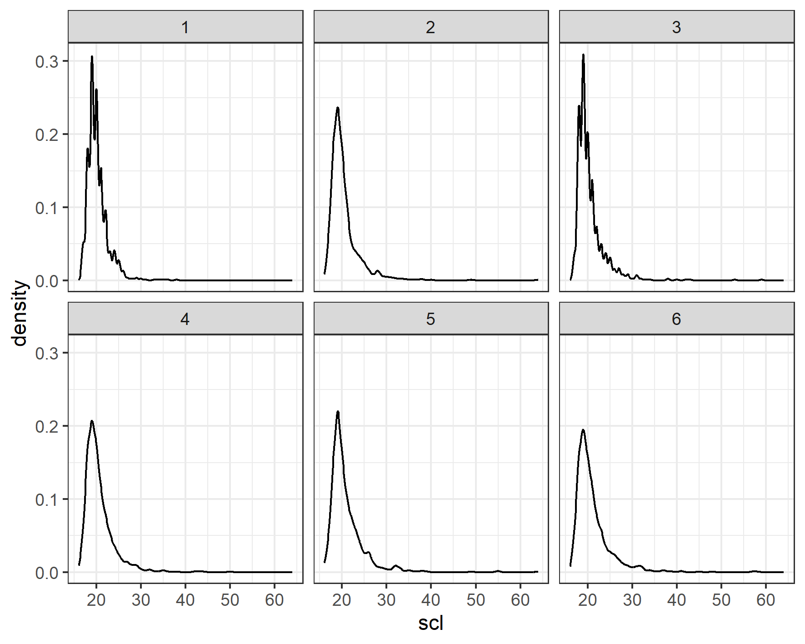
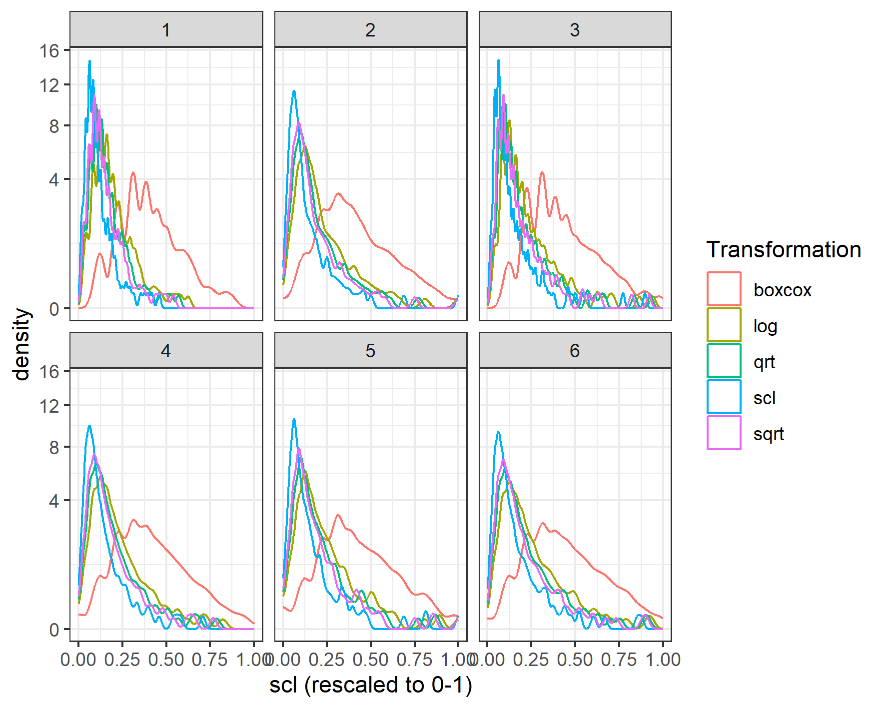
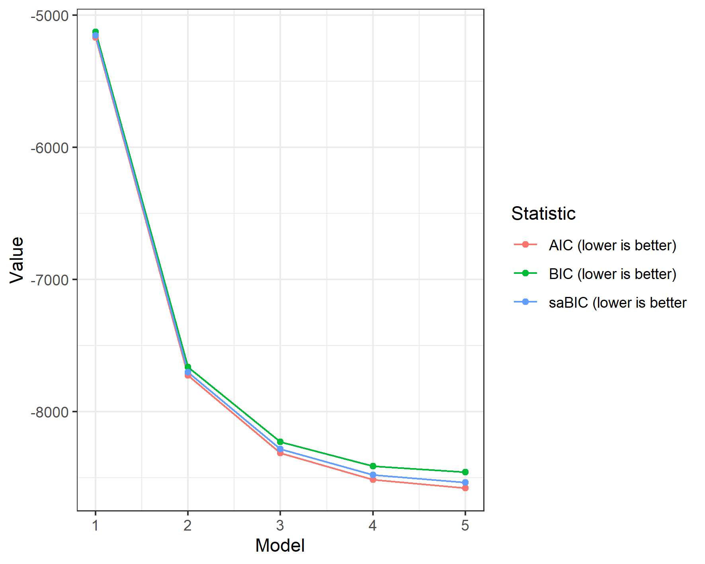
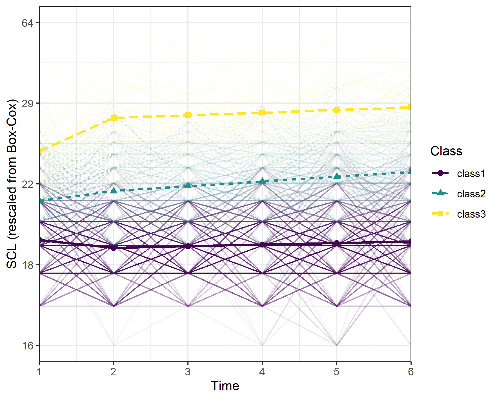

This vignette illustrated `tidySEM`'s ability to perform latent class growth analysis, or growth mixture modeling,
as explained in Van Lissa, C. J., Garnier-Villarreal, M., & Anadria, D. (2023). *Recommended Practices in Latent Class Analysis using the Open-Source R-Package tidySEM.* Structural Equation Modeling. https://doi.org/10.1080/10705511.2023.2250920.
The simulated data used for this example are inspired by work in progress by Plas and colleagues,
on heterogeneity in depression trajectories among Dutch military personnel who were deployed to Afghanistan.
The original data were collected as part of the *Prospection in Stress-related Military Research (PRISMO)* study,
which examined of psychological problems after deployment in more than 1,000 Dutch military personnel from 2005-2019.

First, we load all required packages:


``` r
library(tidySEM)
library(OpenMx)
library(ggplot2)
library(MASS)
```

## Data preprocessing

We first examined the descriptive statistics for the sum score scales:


``` r
# Get descriptives
df <- plas_depression
desc <- descriptives(df)
desc <- desc[, c("name", "mean", "median", "sd", "min", "max",
    "skew_2se", "kurt_2se")]
knitr::kable(desc, caption = "Item descriptives")
```


Table: Item descriptives

|name  | mean| median|  sd| min| max| skew_2se| kurt_2se|
|:-----|----:|------:|---:|---:|---:|--------:|--------:|
|scl.1 |   20|     20| 2.4|  17|  38|       15|       31|
|scl.2 |   20|     19| 3.5|  16|  64|       26|      103|
|scl.3 |   20|     20| 3.4|  17|  59|       26|       98|
|scl.4 |   21|     20| 3.4|  16|  50|       18|       45|
|scl.5 |   21|     20| 4.1|  16|  64|       25|       84|
|scl.6 |   21|     20| 4.1|  16|  58|       20|       56|


Note that all variables were extremely right-skewed due to censoring at the lower end of the scale.

We can examine these distributions visually as well:


``` r
df_plot <- reshape(df, direction = "long", varying = names(df))
ggplot(df_plot, aes(x = scl)) + geom_density() + facet_wrap(~time) +
    theme_bw()
```




As this type of skew can result in convergence problems in LCGA,
we compared several transformations to reduce skew:
The square and cube root, log, inverse, and Box-Cox transformations.


``` r
df_scores <- df_plot
# Store original range of SCL
rng_scl <- range(df_scores$scl)
# Log-transform
df_scores$log <- scales::rescale(log(df_scores$scl), to = c(0,
    1))
# Square root transform
df_scores$sqrt <- scales::rescale(sqrt(df_scores$scl), to = c(0,
    1))
# Cube root transform
df_scores$qrt <- scales::rescale(df_scores$scl^0.33, to = c(0,
    1))
# Reciprocal transform
df_scores$reciprocal <- scales::rescale(1/df_scores$scl, to = c(0,
    1))
# Define function for Box-Cox transformation
bc <- function(x, lambda) {
    (((x^lambda) - 1)/lambda)
}
# Inverse Box-Cox transformation
invbc <- function(x, lambda) {
    ((x * lambda) + 1)^(1/lambda)
}
# Box-Cox transform
b <- MASS::boxcox(lm(df_scores$scl ~ 1), plotit = FALSE)
lambda <- b$x[which.max(b$y)]
df_scores$boxcox <- bc(df_scores$scl, lambda)
# Store range of Box-Cox transformed data
rng_bc <- range(df_scores$boxcox)
df_scores$boxcox <- scales::rescale(df_scores$boxcox, to = c(0,
    1))
# Rescale SCL
df_scores$scl <- scales::rescale(df_scores$scl, to = c(0, 1))
```

We can plot these transformations:


``` r
# Make plot data
df_plot <- do.call(rbind, lapply(c("scl", "log", "sqrt", "qrt",
    "boxcox"), function(n) {
    data.frame(df_scores[c("time", "id")], Value = df_scores[[n]],
        Transformation = n)
}))
# Plot
ggplot(df_plot, aes(x = Value, colour = Transformation)) + geom_density() +
    facet_wrap(~time) + scale_y_sqrt() + xlab("scl (rescaled to 0-1)") +
    theme_bw()
```




Evidently, the Box-Cox transformation reduced skew the most.
Consequently, we proceeded with the Box-Cox transformed scores for analysis.


``` r
dat <- df_scores[, c("id", "time", "boxcox")]
dat <- reshape(dat, direction = "wide", v.names = "boxcox", timevar = "time",
    idvar = "id")
names(dat) <- gsub("boxcox.", "scl", names(dat))
```

# Model Estimation

Next, we estimated a latent class growth model
for SCL.
The model included an overall intercept, centered at T1, `i`.
To model the potential effect of deployment on
depresion,
we also included a dummy variable that was zero before
deployment, and 1 after deployment, `step`.
Finally, to model potential change (or recovery) in depression post-deployment,
we included a linear slope from T2-T6, `s`.
All variances of growth parameters were fixed to zero due to the sparse nature of the data.
In this vignette,
we do not consider more than 5 classes,
because the analyses are computationally very intensive and the data were simulated from a 3-class model.

It is important to highlight that in LCGA, the subgroups will be limited by
the specify growth structure, meaning that LCA will identify distinctive
growth patterns within the intercept, step, and slope growth. For
example, if there is a subgroup that follows a quadratic growth pattern
this models will not be able to identify it.

**NOTE: The time scales in this model are not correct; it currently assumes that all measurements are equidistant. Feel free to experiment with adjusting this.**


``` r
set.seed(27796)
dat[["id"]] <- NULL
res_step <- mx_growth_mixture(model = "
  i =~ 1*scl1 + 1*scl2 + 1*scl3 +1*scl4 +1*scl5 +1*scl6
  step =~ 0*scl1 + 1*scl2 + 1*scl3 +1*scl4 +1*scl5 +1*scl6
  s =~ 0*scl1 + 0*scl2 + 1*scl3 +2*scl4 +3*scl5 +4*scl6
  scl1 ~~ vscl1*scl1
  scl2 ~~ vscl2*scl2
  scl3 ~~ vscl3*scl3
  scl4 ~~ vscl4*scl4
  scl5 ~~ vscl5*scl5
  scl6 ~~ vscl6*scl6
  i ~~ 0*i
  step ~~ 0*step
  s ~~ 0*s
  i ~~ 0*s
  i ~~ 0*step
  s ~~ 0*step
  scl1~0*1
  scl2~0*1
  scl3~0*1
  scl4~0*1
  scl5~0*1
  scl6~0*1
  i~NA*1
  s~NA*1
  step~NA*1
  ",
    classes = 1:5, data = dat)
# Additional iterations because of convergence problems for
# model 1:
res_step[[1]] <- mxTryHardWideSearch(res_step[[1]], extraTries = 50)
```


```
#> 
MxComputeSimAnnealing(tsallis1996) evaluations 158 fit -1176.2 change -1.335e+04
MxComputeSimAnnealing(tsallis1996) evaluations 469 fit 12175.6 change 0         
MxComputeSimAnnealing(tsallis1996) evaluations 785 fit 5617.11 change 6793
MxComputeSimAnnealing(tsallis1996) evaluations 1088 fit 2414.91 change -3687
MxComputeSimAnnealing(tsallis1996) evaluations 1396 fit -346.435 change 829.8
MxComputeSimAnnealing(tsallis1996) evaluations 1712 fit 8790.26 change 2352  
MxComputeSimAnnealing(tsallis1996) evaluations 2019 fit -1176.2 change 0   
MxComputeSimAnnealing(tsallis1996) evaluations 2335 fit -959.03 change 2838
MxComputeSimAnnealing(tsallis1996) evaluations 2644 fit -2086.76 change -910.6
MxComputeSimAnnealing(tsallis1996) evaluations 2960 fit -3327.42 change 4397  
MxComputeSimAnnealing(tsallis1996) evaluations 3269 fit 16434.2 change 1.284e+04
MxComputeSimAnnealing(tsallis1996) evaluations 3587 fit 12175.6 change 9532     
MxComputeSimAnnealing(tsallis1996) evaluations 3897 fit 1724.82 change 4612
MxComputeSimAnnealing(tsallis1996) evaluations 4211 fit 12175.6 change -5863
MxComputeSimAnnealing(tsallis1996) evaluations 4525 fit 12237.7 change 0    
MxComputeSimAnnealing(tsallis1996) evaluations 4836 fit 12237.7 change 0
MxComputeSimAnnealing(tsallis1996) evaluations 5147 fit 12237.5 change 1.014e+04
MxComputeSimAnnealing(tsallis1996) evaluations 5460 fit -7144.72 change -2.015e+04
MxComputeSimAnnealing(tsallis1996) evaluations 5762 fit -7684.99 change -6354     
MxComputeSimAnnealing(tsallis1996) evaluations 6076 fit -7577.3 change -262.8
MxComputeSimAnnealing(tsallis1996) evaluations 6384 fit -7679.31 change -1.683e+04
MxComputeSimAnnealing(tsallis1996) evaluations 6686 fit -7515.27 change -6080     
MxComputeSimAnnealing(tsallis1996) evaluations 6993 fit -7705.32 change -29.54
MxComputeSimAnnealing(tsallis1996) evaluations 7305 fit 13602.8 change 1.876e+04
MxComputeSimAnnealing(tsallis1996) evaluations 7612 fit -5391.46 change 2346    
MxComputeSimAnnealing(tsallis1996) evaluations 7920 fit -1536.92 change 0   
MxComputeSimAnnealing(tsallis1996) evaluations 8231 fit -1551.8 change -1.53e+04
MxComputeSimAnnealing(tsallis1996) evaluations 8540 fit 13167.6 change 2.086e+04
MxComputeSimAnnealing(tsallis1996) evaluations 8848 fit -7746.09 change -7512   
MxComputeSimAnnealing(tsallis1996) evaluations 9158 fit 1321.62 change 7649  
MxComputeSimAnnealing(tsallis1996) evaluations 9466 fit -7747.11 change -2.168e+04
MxComputeSimAnnealing(tsallis1996) evaluations 9774 fit -7054.54 change -2338     
MxComputeSimAnnealing(tsallis1996) evaluations 10080 fit -5356.68 change -3711
MxComputeSimAnnealing(tsallis1996) evaluations 10384 fit 585.333 change 7811  
MxComputeSimAnnealing(tsallis1996) evaluations 10691 fit -7738.57 change -6186
MxComputeSimAnnealing(tsallis1996) evaluations 10997 fit 14367.7 change 2.162e+04
MxComputeSimAnnealing(tsallis1996) evaluations 11306 fit -7749.67 change -12.87  
MxComputeSimAnnealing(tsallis1996) evaluations 11610 fit -7668.32 change -1.389e+04
MxComputeSimAnnealing(tsallis1996) evaluations 11903 fit -2267.59 change 2633      
MxComputeSimAnnealing(tsallis1996) evaluations 12206 fit 14498.2 change 1.787e+04
MxComputeSimAnnealing(tsallis1996) evaluations 12509 fit -7750.4 change -2043    
MxComputeSimAnnealing(tsallis1996) evaluations 12814 fit -7741.65 change -490.7
MxComputeSimAnnealing(tsallis1996) evaluations 13117 fit -7572.98 change -805  
MxComputeSimAnnealing(tsallis1996) evaluations 13420 fit -7734.18 change -312.6
MxComputeSimAnnealing(tsallis1996) evaluations 13723 fit -2073.07 change 2441  
MxComputeSimAnnealing(tsallis1996) evaluations 14026 fit -7737.01 change 12.65
MxComputeSimAnnealing(tsallis1996) evaluations 14328 fit -1573.6 change 5934  
MxComputeSimAnnealing(tsallis1996) evaluations 14633 fit -4379.86 change 3363
MxComputeSimAnnealing(tsallis1996) evaluations 14930 fit -4088.26 change 2687
MxComputeSimAnnealing(tsallis1996) evaluations 15231 fit -7724.21 change -18.91
MxComputeSimAnnealing(tsallis1996) evaluations 15534 fit -7750.32 change -32.18
MxComputeSimAnnealing(tsallis1996) evaluations 15835 fit 11876.1 change -2610  
MxComputeSimAnnealing(tsallis1996) evaluations 16141 fit -6862.84 change -2521
MxComputeSimAnnealing(tsallis1996) evaluations 16439 fit -7716.8 change -40.11
                                                                              
#> 
MxComputeSimAnnealing(tsallis1996) evaluations 71 fit -6024.25 change 169.1
MxComputeSimAnnealing(tsallis1996) evaluations 269 fit 586.668 change -9806
MxComputeSimAnnealing(tsallis1996) evaluations 465 fit -53.8478 change 5970
MxComputeSimAnnealing(tsallis1996) evaluations 663 fit -6193.33 change -6780
MxComputeSimAnnealing(tsallis1996) evaluations 864 fit 586.668 change -994.2
MxComputeSimAnnealing(tsallis1996) evaluations 1068 fit 586.668 change 1504 
MxComputeSimAnnealing(tsallis1996) evaluations 1270 fit -965.992 change -1973
MxComputeSimAnnealing(tsallis1996) evaluations 1473 fit 2309.16 change 1226  
MxComputeSimAnnealing(tsallis1996) evaluations 1677 fit 1926.63 change -1658
MxComputeSimAnnealing(tsallis1996) evaluations 1875 fit -6024.25 change 0   
MxComputeSimAnnealing(tsallis1996) evaluations 2075 fit -6193.33 change 0
MxComputeSimAnnealing(tsallis1996) evaluations 2276 fit 586.668 change 0 
MxComputeSimAnnealing(tsallis1996) evaluations 2472 fit -4967.83 change -4710
MxComputeSimAnnealing(tsallis1996) evaluations 2682 fit 5050.55 change 7216  
MxComputeSimAnnealing(tsallis1996) evaluations 2887 fit 586.668 change 1881
MxComputeSimAnnealing(tsallis1996) evaluations 3091 fit 586.668 change 2249
MxComputeSimAnnealing(tsallis1996) evaluations 3294 fit -4046.15 change -677.3
MxComputeSimAnnealing(tsallis1996) evaluations 3496 fit -1305.52 change -735  
MxComputeSimAnnealing(tsallis1996) evaluations 3698 fit -4912.37 change -2573
MxComputeSimAnnealing(tsallis1996) evaluations 3901 fit 8690.29 change 8849  
MxComputeSimAnnealing(tsallis1996) evaluations 4104 fit -8250.2 change -4110
MxComputeSimAnnealing(tsallis1996) evaluations 4311 fit -3259.38 change -4498
MxComputeSimAnnealing(tsallis1996) evaluations 4506 fit -6414.04 change -219.2
MxComputeSimAnnealing(tsallis1996) evaluations 4707 fit 586.668 change 0      
MxComputeSimAnnealing(tsallis1996) evaluations 4912 fit 586.668 change 0
MxComputeSimAnnealing(tsallis1996) evaluations 5117 fit -6193.33 change -6780
MxComputeSimAnnealing(tsallis1996) evaluations 5315 fit -829.569 change 2450 
MxComputeSimAnnealing(tsallis1996) evaluations 5509 fit -5832.27 change 0   
MxComputeSimAnnealing(tsallis1996) evaluations 5712 fit -5832.27 change -6894
MxComputeSimAnnealing(tsallis1996) evaluations 5916 fit -5832.27 change -7881
MxComputeSimAnnealing(tsallis1996) evaluations 6118 fit 2048.46 change 0     
MxComputeSimAnnealing(tsallis1996) evaluations 6323 fit 2046.52 change 0
MxComputeSimAnnealing(tsallis1996) evaluations 6527 fit 1936.27 change 0
MxComputeSimAnnealing(tsallis1996) evaluations 6729 fit 1936.27 change 6881
MxComputeSimAnnealing(tsallis1996) evaluations 6933 fit 1936.27 change 5105
MxComputeSimAnnealing(tsallis1996) evaluations 7138 fit 1936.27 change 1.015e+04
MxComputeSimAnnealing(tsallis1996) evaluations 7338 fit -6374.85 change 1813    
MxComputeSimAnnealing(tsallis1996) evaluations 7533 fit -5983.64 change 0   
MxComputeSimAnnealing(tsallis1996) evaluations 7732 fit 5649.6 change 1.136e+04
MxComputeSimAnnealing(tsallis1996) evaluations 7931 fit 63.2836 change 6686    
MxComputeSimAnnealing(tsallis1996) evaluations 8124 fit 5648.04 change 0   
MxComputeSimAnnealing(tsallis1996) evaluations 8320 fit -8127.75 change 165.5
MxComputeSimAnnealing(tsallis1996) evaluations 8518 fit -5601.78 change 2720 
MxComputeSimAnnealing(tsallis1996) evaluations 8717 fit -5731.71 change 1256
MxComputeSimAnnealing(tsallis1996) evaluations 8915 fit -8155.17 change -2463
MxComputeSimAnnealing(tsallis1996) evaluations 9107 fit -4989.01 change -1.241e+04
MxComputeSimAnnealing(tsallis1996) evaluations 9301 fit -5592.92 change 0         
MxComputeSimAnnealing(tsallis1996) evaluations 9478 fit -3928.13 change 2028
MxComputeSimAnnealing(tsallis1996) evaluations 9675 fit -5582.99 change 0   
MxComputeSimAnnealing(tsallis1996) evaluations 9876 fit 4696.9 change 0  
MxComputeSimAnnealing(tsallis1996) evaluations 10076 fit -8117.05 change 207.7
MxComputeSimAnnealing(tsallis1996) evaluations 10272 fit -6961.04 change 0    
MxComputeSimAnnealing(tsallis1996) evaluations 10472 fit -8306.31 change -1.325e+04
MxComputeSimAnnealing(tsallis1996) evaluations 10664 fit -7651.61 change 666.2     
MxComputeSimAnnealing(tsallis1996) evaluations 10865 fit -5612.33 change 862.2
MxComputeSimAnnealing(tsallis1996) evaluations 11064 fit 4951.52 change 1.328e+04
MxComputeSimAnnealing(tsallis1996) evaluations 11259 fit -8333.8 change -1386    
MxComputeSimAnnealing(tsallis1996) evaluations 11452 fit -6755.68 change 113.9
MxComputeSimAnnealing(tsallis1996) evaluations 11643 fit -8297.63 change 27.65
MxComputeSimAnnealing(tsallis1996) evaluations 11838 fit -8189.78 change 132  
MxComputeSimAnnealing(tsallis1996) evaluations 12037 fit -5620.56 change 9.095e-13
MxComputeSimAnnealing(tsallis1996) evaluations 12237 fit 4521.74 change 1359      
MxComputeSimAnnealing(tsallis1996) evaluations 12436 fit -8341.32 change -1.967e+04
MxComputeSimAnnealing(tsallis1996) evaluations 12628 fit -8219.72 change 37.64     
MxComputeSimAnnealing(tsallis1996) evaluations 12823 fit -7018.63 change 0    
MxComputeSimAnnealing(tsallis1996) evaluations 13022 fit -5597.02 change 2675
MxComputeSimAnnealing(tsallis1996) evaluations 13218 fit -6312.55 change 1837
MxComputeSimAnnealing(tsallis1996) evaluations 13416 fit -7036.83 change 1295
MxComputeSimAnnealing(tsallis1996) evaluations 13615 fit -8272.74 change -1.331e+04
MxComputeSimAnnealing(tsallis1996) evaluations 13812 fit -8152.56 change -3502     
MxComputeSimAnnealing(tsallis1996) evaluations 14011 fit -7037.57 change 1256 
MxComputeSimAnnealing(tsallis1996) evaluations 14208 fit -7606.4 change 717.4
MxComputeSimAnnealing(tsallis1996) evaluations 14406 fit -7457.67 change 881.4
MxComputeSimAnnealing(tsallis1996) evaluations 14605 fit -8118.48 change -2548
MxComputeSimAnnealing(tsallis1996) evaluations 14792 fit -8326.03 change -2774
MxComputeSimAnnealing(tsallis1996) evaluations 14988 fit -4494.57 change 1900 
MxComputeSimAnnealing(tsallis1996) evaluations 15185 fit -7035.62 change 0   
MxComputeSimAnnealing(tsallis1996) evaluations 15382 fit -8346.08 change -4523
MxComputeSimAnnealing(tsallis1996) evaluations 15574 fit -8235.49 change -2650
MxComputeSimAnnealing(tsallis1996) evaluations 15773 fit -8327.75 change -43.41
MxComputeSimAnnealing(tsallis1996) evaluations 15974 fit -5789.95 change 2556  
MxComputeSimAnnealing(tsallis1996) evaluations 16169 fit -5579 change 2342   
MxComputeSimAnnealing(tsallis1996) evaluations 16364 fit -6458.75 change -501.8
MxComputeSimAnnealing(tsallis1996) evaluations 16555 fit -7831.63 change 514   
MxComputeSimAnnealing(tsallis1996) evaluations 16750 fit -7064.95 change -15.92
MxComputeSimAnnealing(tsallis1996) evaluations 16947 fit 5343.2 change 382.9   
MxComputeSimAnnealing(tsallis1996) evaluations 17141 fit -7060.94 change 1286
MxComputeSimAnnealing(tsallis1996) evaluations 17339 fit -8343.93 change -1.369e+04
MxComputeSimAnnealing(tsallis1996) evaluations 17538 fit -8343.24 change 1.345     
MxComputeSimAnnealing(tsallis1996) evaluations 17730 fit -8150.58 change -1537
MxComputeSimAnnealing(tsallis1996) evaluations 17926 fit -6906.91 change 1440 
MxComputeSimAnnealing(tsallis1996) evaluations 18116 fit -8322.78 change -2281
MxComputeSimAnnealing(tsallis1996) evaluations 18311 fit -8143.22 change -24.17
MxComputeSimAnnealing(tsallis1996) evaluations 18507 fit -8273.29 change -1.053e+04
MxComputeSimAnnealing(tsallis1996) evaluations 18704 fit -7047.87 change 1293      
MxComputeSimAnnealing(tsallis1996) evaluations 18902 fit -8039.18 change -655.8
MxComputeSimAnnealing(tsallis1996) evaluations 19099 fit -7623.32 change -316.1
MxComputeSimAnnealing(tsallis1996) evaluations 19295 fit -5574.15 change 2472  
MxComputeSimAnnealing(tsallis1996) evaluations 19492 fit -8237.18 change -2177
MxComputeSimAnnealing(tsallis1996) evaluations 19689 fit -8343.55 change -2756
MxComputeSimAnnealing(tsallis1996) evaluations 19879 fit -8334.86 change -1279
MxComputeSimAnnealing(tsallis1996) evaluations 20075 fit -8346.5 change -27.12
MxComputeSimAnnealing(tsallis1996) evaluations 20271 fit -7110.63 change -3209
MxComputeSimAnnealing(tsallis1996) evaluations 20468 fit -5571.97 change 2713 
MxComputeSimAnnealing(tsallis1996) evaluations 20664 fit -7979.61 change 185.4
MxComputeSimAnnealing(tsallis1996) evaluations 20861 fit -5576.78 change 0    
MxComputeSimAnnealing(tsallis1996) evaluations 21065 fit -5576.96 change 0
MxComputeSimAnnealing(tsallis1996) evaluations 21241 fit -8343.45 change -34.74
MxComputeSimAnnealing(tsallis1996) evaluations 21423 fit -7059.97 change 1287  
MxComputeSimAnnealing(tsallis1996) evaluations 21593 fit -7061.23 change -1489
MxComputeSimAnnealing(tsallis1996) evaluations 21768 fit -8144.28 change -2.271e+04
                                                                                   
#> 
MxComputeSimAnnealing(tsallis1996) evaluations 116 fit 15587.8 change 3835
MxComputeSimAnnealing(tsallis1996) evaluations 252 fit -7442.24 change 0  
MxComputeSimAnnealing(tsallis1996) evaluations 396 fit -3788.3 change 0 
MxComputeSimAnnealing(tsallis1996) evaluations 548 fit -7023.02 change 0
MxComputeSimAnnealing(tsallis1996) evaluations 700 fit -3283.37 change 4137
MxComputeSimAnnealing(tsallis1996) evaluations 842 fit -7023.02 change 0   
MxComputeSimAnnealing(tsallis1996) evaluations 981 fit 16071.5 change 1.389e+04
MxComputeSimAnnealing(tsallis1996) evaluations 1132 fit -7442.24 change -3654  
MxComputeSimAnnealing(tsallis1996) evaluations 1285 fit -7420.42 change -397.4
MxComputeSimAnnealing(tsallis1996) evaluations 1426 fit -7442.24 change -3654 
MxComputeSimAnnealing(tsallis1996) evaluations 1557 fit -7023.02 change 0    
MxComputeSimAnnealing(tsallis1996) evaluations 1686 fit -7420.42 change 0
MxComputeSimAnnealing(tsallis1996) evaluations 1825 fit -7442.24 change -3654
MxComputeSimAnnealing(tsallis1996) evaluations 1961 fit 861.464 change 4647  
MxComputeSimAnnealing(tsallis1996) evaluations 2101 fit -7023.02 change 419.2
MxComputeSimAnnealing(tsallis1996) evaluations 2239 fit -3669.96 change -1.249e+04
MxComputeSimAnnealing(tsallis1996) evaluations 2387 fit 5431.65 change 2648       
MxComputeSimAnnealing(tsallis1996) evaluations 2536 fit -3788.3 change -490.4
MxComputeSimAnnealing(tsallis1996) evaluations 2686 fit -7442.24 change -3654
MxComputeSimAnnealing(tsallis1996) evaluations 2838 fit -7023.02 change 0    
MxComputeSimAnnealing(tsallis1996) evaluations 2988 fit -7420.42 change 0
MxComputeSimAnnealing(tsallis1996) evaluations 3139 fit -3034.97 change 4022
MxComputeSimAnnealing(tsallis1996) evaluations 3291 fit 6730.34 change 6605 
MxComputeSimAnnealing(tsallis1996) evaluations 3442 fit -7442.24 change -3654
MxComputeSimAnnealing(tsallis1996) evaluations 3594 fit -7023.02 change 0    
MxComputeSimAnnealing(tsallis1996) evaluations 3746 fit -5260.73 change 2028
MxComputeSimAnnealing(tsallis1996) evaluations 3900 fit 3710.34 change 7145 
MxComputeSimAnnealing(tsallis1996) evaluations 4046 fit -1141.21 change -2778
MxComputeSimAnnealing(tsallis1996) evaluations 4198 fit -7442.24 change -3654
MxComputeSimAnnealing(tsallis1996) evaluations 4348 fit -7023.02 change 419.2
MxComputeSimAnnealing(tsallis1996) evaluations 4499 fit -7420.42 change 0    
MxComputeSimAnnealing(tsallis1996) evaluations 4649 fit -3862.03 change 4017
MxComputeSimAnnealing(tsallis1996) evaluations 4800 fit -3626.84 change -2279
MxComputeSimAnnealing(tsallis1996) evaluations 4952 fit -3741.74 change 0    
MxComputeSimAnnealing(tsallis1996) evaluations 5102 fit -7466.21 change 0
MxComputeSimAnnealing(tsallis1996) evaluations 5251 fit -7013.12 change 453.1
MxComputeSimAnnealing(tsallis1996) evaluations 5401 fit -7422.66 change -409.5
MxComputeSimAnnealing(tsallis1996) evaluations 5550 fit -7422.66 change 3.194e-06
MxComputeSimAnnealing(tsallis1996) evaluations 5700 fit 2225.34 change 7132      
MxComputeSimAnnealing(tsallis1996) evaluations 5854 fit -3741.74 change -1028
MxComputeSimAnnealing(tsallis1996) evaluations 6007 fit -7376.95 change 89.26
MxComputeSimAnnealing(tsallis1996) evaluations 6156 fit -7076.32 change 0    
MxComputeSimAnnealing(tsallis1996) evaluations 6308 fit -5547.15 change -1042
MxComputeSimAnnealing(tsallis1996) evaluations 6462 fit 990.168 change 5168  
MxComputeSimAnnealing(tsallis1996) evaluations 6614 fit -7466.21 change 0  
MxComputeSimAnnealing(tsallis1996) evaluations 6767 fit -7423.49 change 1035
MxComputeSimAnnealing(tsallis1996) evaluations 6919 fit -3326.17 change 2896
MxComputeSimAnnealing(tsallis1996) evaluations 7069 fit -4988.44 change -4531
MxComputeSimAnnealing(tsallis1996) evaluations 7222 fit -7466.21 change -3976
MxComputeSimAnnealing(tsallis1996) evaluations 7375 fit -7427.3 change -353.7
MxComputeSimAnnealing(tsallis1996) evaluations 7527 fit 5340.4 change 697.7  
MxComputeSimAnnealing(tsallis1996) evaluations 7681 fit -3490.47 change -2398
MxComputeSimAnnealing(tsallis1996) evaluations 7833 fit -7458.97 change 316.8
MxComputeSimAnnealing(tsallis1996) evaluations 7982 fit -7090.06 change 291.7
MxComputeSimAnnealing(tsallis1996) evaluations 8132 fit -7422.68 change 0    
MxComputeSimAnnealing(tsallis1996) evaluations 8286 fit -3995.6 change 963.1
MxComputeSimAnnealing(tsallis1996) evaluations 8438 fit -3462.12 change 0   
MxComputeSimAnnealing(tsallis1996) evaluations 8588 fit -7667.08 change 0
MxComputeSimAnnealing(tsallis1996) evaluations 8739 fit -7086.17 change 0
MxComputeSimAnnealing(tsallis1996) evaluations 8891 fit -8420.89 change 71.91
MxComputeSimAnnealing(tsallis1996) evaluations 9042 fit -2041.15 change 3068 
MxComputeSimAnnealing(tsallis1996) evaluations 9192 fit -6519.43 change 449.7
MxComputeSimAnnealing(tsallis1996) evaluations 9344 fit -8471.3 change -885.6
MxComputeSimAnnealing(tsallis1996) evaluations 9497 fit -7529.75 change 0    
MxComputeSimAnnealing(tsallis1996) evaluations 9648 fit -4860.9 change 790.7
MxComputeSimAnnealing(tsallis1996) evaluations 9800 fit -5963.7 change 9.938
MxComputeSimAnnealing(tsallis1996) evaluations 9952 fit -7698.12 change -4950
MxComputeSimAnnealing(tsallis1996) evaluations 10103 fit -7074.2 change 0    
MxComputeSimAnnealing(tsallis1996) evaluations 10255 fit -8479.85 change -939.8
MxComputeSimAnnealing(tsallis1996) evaluations 10410 fit -1669.71 change 5925  
MxComputeSimAnnealing(tsallis1996) evaluations 10565 fit -7185.81 change 0   
MxComputeSimAnnealing(tsallis1996) evaluations 10715 fit -7566.94 change 0
MxComputeSimAnnealing(tsallis1996) evaluations 10865 fit -6954.7 change 908.3
MxComputeSimAnnealing(tsallis1996) evaluations 11015 fit -7355.01 change -3407
MxComputeSimAnnealing(tsallis1996) evaluations 11168 fit -2169.1 change 0     
MxComputeSimAnnealing(tsallis1996) evaluations 11319 fit -7502.01 change 0
MxComputeSimAnnealing(tsallis1996) evaluations 11473 fit -7511.34 change 461
MxComputeSimAnnealing(tsallis1996) evaluations 11619 fit -8505.4 change -840.1
MxComputeSimAnnealing(tsallis1996) evaluations 11775 fit -7810.63 change 516.4
MxComputeSimAnnealing(tsallis1996) evaluations 11925 fit -1504.18 change 0    
MxComputeSimAnnealing(tsallis1996) evaluations 12073 fit -7549.27 change -5972
MxComputeSimAnnealing(tsallis1996) evaluations 12223 fit -7327.21 change 220.3
MxComputeSimAnnealing(tsallis1996) evaluations 12373 fit -7692.52 change -363.3
MxComputeSimAnnealing(tsallis1996) evaluations 12525 fit -8009.01 change 506.5 
MxComputeSimAnnealing(tsallis1996) evaluations 12678 fit -8512.7 change -3270 
MxComputeSimAnnealing(tsallis1996) evaluations 12827 fit -1521.27 change -1.364e-12
MxComputeSimAnnealing(tsallis1996) evaluations 12978 fit -7551.41 change 0         
MxComputeSimAnnealing(tsallis1996) evaluations 13125 fit -7551.41 change 0
MxComputeSimAnnealing(tsallis1996) evaluations 13277 fit -8524.07 change -768.2
MxComputeSimAnnealing(tsallis1996) evaluations 13424 fit -7755.9 change 767    
MxComputeSimAnnealing(tsallis1996) evaluations 13573 fit -8533.33 change -725.4
MxComputeSimAnnealing(tsallis1996) evaluations 13722 fit -7806.23 change -810.6
MxComputeSimAnnealing(tsallis1996) evaluations 13873 fit 584.065 change 3344   
MxComputeSimAnnealing(tsallis1996) evaluations 14025 fit -7791.73 change -6423
MxComputeSimAnnealing(tsallis1996) evaluations 14176 fit -8484.26 change -1020
MxComputeSimAnnealing(tsallis1996) evaluations 14327 fit -8536.49 change -701 
MxComputeSimAnnealing(tsallis1996) evaluations 14480 fit -8519.01 change 17.56
MxComputeSimAnnealing(tsallis1996) evaluations 14630 fit -3565.39 change 4235 
MxComputeSimAnnealing(tsallis1996) evaluations 14782 fit -8232.2 change -6998
MxComputeSimAnnealing(tsallis1996) evaluations 14933 fit -7380.44 change 0   
MxComputeSimAnnealing(tsallis1996) evaluations 15086 fit -8492.18 change -563.2
MxComputeSimAnnealing(tsallis1996) evaluations 15236 fit 6419.95 change 1.37e+04
MxComputeSimAnnealing(tsallis1996) evaluations 15384 fit -4634.38 change 3895   
MxComputeSimAnnealing(tsallis1996) evaluations 15535 fit -990.224 change 3777
MxComputeSimAnnealing(tsallis1996) evaluations 15683 fit -991.51 change 7180 
MxComputeSimAnnealing(tsallis1996) evaluations 15833 fit -8072.97 change -605.6
MxComputeSimAnnealing(tsallis1996) evaluations 15981 fit -8232.32 change -769.2
MxComputeSimAnnealing(tsallis1996) evaluations 16128 fit -8375.51 change -859.5
MxComputeSimAnnealing(tsallis1996) evaluations 16279 fit -7899.37 change -240  
MxComputeSimAnnealing(tsallis1996) evaluations 16431 fit -5550.98 change 2993
MxComputeSimAnnealing(tsallis1996) evaluations 16584 fit -5747.06 change -2462
MxComputeSimAnnealing(tsallis1996) evaluations 16737 fit -7419.03 change 708.8
MxComputeSimAnnealing(tsallis1996) evaluations 16891 fit -7271.93 change 619.9
MxComputeSimAnnealing(tsallis1996) evaluations 17046 fit -7969.78 change -19.02
MxComputeSimAnnealing(tsallis1996) evaluations 17196 fit -3285.41 change -2730 
MxComputeSimAnnealing(tsallis1996) evaluations 17349 fit -8103.03 change -636.5
MxComputeSimAnnealing(tsallis1996) evaluations 17500 fit -8270.94 change -396.1
MxComputeSimAnnealing(tsallis1996) evaluations 17648 fit -7695.43 change -4238 
MxComputeSimAnnealing(tsallis1996) evaluations 17798 fit -8551.86 change -1.133
MxComputeSimAnnealing(tsallis1996) evaluations 17947 fit -8551.03 change -655.5
MxComputeSimAnnealing(tsallis1996) evaluations 18099 fit -794.405 change 0     
MxComputeSimAnnealing(tsallis1996) evaluations 18252 fit -8550.58 change -1131
MxComputeSimAnnealing(tsallis1996) evaluations 18405 fit -8401.94 change -136.8
MxComputeSimAnnealing(tsallis1996) evaluations 18559 fit -1151.91 change 5870  
MxComputeSimAnnealing(tsallis1996) evaluations 18710 fit -7413 change 127.4  
MxComputeSimAnnealing(tsallis1996) evaluations 18858 fit -7413.12 change 0 
MxComputeSimAnnealing(tsallis1996) evaluations 19008 fit -8552.96 change -101.4
MxComputeSimAnnealing(tsallis1996) evaluations 19159 fit -8553.05 change -666.4
MxComputeSimAnnealing(tsallis1996) evaluations 19308 fit -8088.56 change 464.6 
MxComputeSimAnnealing(tsallis1996) evaluations 19460 fit -6401.25 change 900  
MxComputeSimAnnealing(tsallis1996) evaluations 19600 fit -7984.93 change 419.7
MxComputeSimAnnealing(tsallis1996) evaluations 19752 fit -7684.71 change 866.8
MxComputeSimAnnealing(tsallis1996) evaluations 19900 fit 5695.67 change 6872  
MxComputeSimAnnealing(tsallis1996) evaluations 20051 fit -596.165 change 0  
MxComputeSimAnnealing(tsallis1996) evaluations 20196 fit -8508.15 change -1191
MxComputeSimAnnealing(tsallis1996) evaluations 20342 fit -4067.42 change -4424
MxComputeSimAnnealing(tsallis1996) evaluations 20491 fit -445.194 change 8106 
MxComputeSimAnnealing(tsallis1996) evaluations 20639 fit -329.232 change 8219
MxComputeSimAnnealing(tsallis1996) evaluations 20786 fit -307.397 change 7686
MxComputeSimAnnealing(tsallis1996) evaluations 20936 fit -8553.4 change -207.9
MxComputeSimAnnealing(tsallis1996) evaluations 21084 fit -8545.21 change 9.53 
MxComputeSimAnnealing(tsallis1996) evaluations 21237 fit -7895.34 change 659.5
MxComputeSimAnnealing(tsallis1996) evaluations 21387 fit -8553.52 change -8252
MxComputeSimAnnealing(tsallis1996) evaluations 21539 fit -7126.54 change 963.5
MxComputeSimAnnealing(tsallis1996) evaluations 21687 fit -7960.88 change -116 
MxComputeSimAnnealing(tsallis1996) evaluations 21837 fit -8550.29 change -8058
MxComputeSimAnnealing(tsallis1996) evaluations 21987 fit -7424.52 change 1131 
MxComputeSimAnnealing(tsallis1996) evaluations 22139 fit -7903.94 change -21.6
MxComputeSimAnnealing(tsallis1996) evaluations 22285 fit -8482.7 change -1011 
MxComputeSimAnnealing(tsallis1996) evaluations 22433 fit -7881.79 change 670.6
MxComputeSimAnnealing(tsallis1996) evaluations 22583 fit -8550.94 change 1.434
MxComputeSimAnnealing(tsallis1996) evaluations 22733 fit -8443.38 change -2296
MxComputeSimAnnealing(tsallis1996) evaluations 22882 fit -7166.91 change 1154 
MxComputeSimAnnealing(tsallis1996) evaluations 23034 fit -8527.54 change -8286
MxComputeSimAnnealing(tsallis1996) evaluations 23185 fit -8541.1 change -1124 
MxComputeSimAnnealing(tsallis1996) evaluations 23336 fit -8552.84 change 0.6644
MxComputeSimAnnealing(tsallis1996) evaluations 23486 fit -3028.79 change 3783  
MxComputeSimAnnealing(tsallis1996) evaluations 23636 fit -8159.79 change -1007
MxComputeSimAnnealing(tsallis1996) evaluations 23781 fit 11403.8 change 1.597e+04
MxComputeSimAnnealing(tsallis1996) evaluations 23932 fit -8553.72 change -4.084  
MxComputeSimAnnealing(tsallis1996) evaluations 24081 fit -485.975 change -1.158e+04
MxComputeSimAnnealing(tsallis1996) evaluations 24231 fit -8552.87 change -51.85    
MxComputeSimAnnealing(tsallis1996) evaluations 24383 fit -8390.98 change -921.2
MxComputeSimAnnealing(tsallis1996) evaluations 24533 fit -8555.87 change -177.5
MxComputeSimAnnealing(tsallis1996) evaluations 24684 fit 3820.58 change 1.201e+04
MxComputeSimAnnealing(tsallis1996) evaluations 24834 fit -7827.03 change -3683   
MxComputeSimAnnealing(tsallis1996) evaluations 24982 fit -8521.71 change -566.7
MxComputeSimAnnealing(tsallis1996) evaluations 25134 fit -357.743 change 8198  
MxComputeSimAnnealing(tsallis1996) evaluations 25280 fit -8555.18 change -1328
MxComputeSimAnnealing(tsallis1996) evaluations 25429 fit -8555.19 change -1369
MxComputeSimAnnealing(tsallis1996) evaluations 25579 fit -8487.79 change -1065
MxComputeSimAnnealing(tsallis1996) evaluations 25729 fit -8474.77 change 78.98
MxComputeSimAnnealing(tsallis1996) evaluations 25879 fit -8556.28 change -669 
MxComputeSimAnnealing(tsallis1996) evaluations 26025 fit -7886.65 change 0   
MxComputeSimAnnealing(tsallis1996) evaluations 26174 fit -8496.06 change 57.12
MxComputeSimAnnealing(tsallis1996) evaluations 26325 fit -8530.02 change -2.694e+04
MxComputeSimAnnealing(tsallis1996) evaluations 26476 fit -274.907 change 8273      
MxComputeSimAnnealing(tsallis1996) evaluations 26626 fit -8528 change -8253  
MxComputeSimAnnealing(tsallis1996) evaluations 26770 fit -8543.27 change 6.31
                                                                             
#> 
MxComputeSimAnnealing(tsallis1996) evaluations 104 fit -7027.27 change 0
MxComputeSimAnnealing(tsallis1996) evaluations 223 fit -7825.65 change 0
MxComputeSimAnnealing(tsallis1996) evaluations 345 fit -7295.31 change 0
MxComputeSimAnnealing(tsallis1996) evaluations 470 fit -7295.31 change 0
MxComputeSimAnnealing(tsallis1996) evaluations 592 fit 8714.35 change 2613
MxComputeSimAnnealing(tsallis1996) evaluations 713 fit 2391.94 change -1.724e+04
MxComputeSimAnnealing(tsallis1996) evaluations 835 fit -904.638 change 1797     
MxComputeSimAnnealing(tsallis1996) evaluations 956 fit -7367.16 change 0   
MxComputeSimAnnealing(tsallis1996) evaluations 1078 fit -7027.27 change 0
MxComputeSimAnnealing(tsallis1996) evaluations 1199 fit -7465.85 change 359.8
MxComputeSimAnnealing(tsallis1996) evaluations 1321 fit -7825.65 change -530.3
MxComputeSimAnnealing(tsallis1996) evaluations 1439 fit 7990.65 change 3897   
MxComputeSimAnnealing(tsallis1996) evaluations 1561 fit 11514.3 change 3861
MxComputeSimAnnealing(tsallis1996) evaluations 1683 fit -6412.41 change 954.8
MxComputeSimAnnealing(tsallis1996) evaluations 1805 fit -7367.16 change -339.9
MxComputeSimAnnealing(tsallis1996) evaluations 1928 fit -7027.27 change 0     
MxComputeSimAnnealing(tsallis1996) evaluations 2050 fit -7465.85 change 0
MxComputeSimAnnealing(tsallis1996) evaluations 2171 fit -7825.65 change -530.3
MxComputeSimAnnealing(tsallis1996) evaluations 2292 fit 9683.62 change 1.322e+04
MxComputeSimAnnealing(tsallis1996) evaluations 2411 fit 2211.89 change -1324    
MxComputeSimAnnealing(tsallis1996) evaluations 2533 fit -5815.95 change 1551
MxComputeSimAnnealing(tsallis1996) evaluations 2653 fit -7027.27 change 0   
MxComputeSimAnnealing(tsallis1996) evaluations 2776 fit -7465.85 change 0
MxComputeSimAnnealing(tsallis1996) evaluations 2897 fit -7825.65 change 0
MxComputeSimAnnealing(tsallis1996) evaluations 3018 fit -7295.31 change -1.335e+04
MxComputeSimAnnealing(tsallis1996) evaluations 3137 fit -537.127 change -1.68e+04 
MxComputeSimAnnealing(tsallis1996) evaluations 3257 fit -7367.16 change 0        
MxComputeSimAnnealing(tsallis1996) evaluations 3375 fit -7465.85 change 0
MxComputeSimAnnealing(tsallis1996) evaluations 3492 fit -2114.82 change -4639
MxComputeSimAnnealing(tsallis1996) evaluations 3612 fit -1901.05 change -1.243e+04
MxComputeSimAnnealing(tsallis1996) evaluations 3733 fit -3733.44 change 3634      
MxComputeSimAnnealing(tsallis1996) evaluations 3853 fit -7027.27 change 0   
MxComputeSimAnnealing(tsallis1996) evaluations 3977 fit -7027.27 change 438.6
MxComputeSimAnnealing(tsallis1996) evaluations 4099 fit -7465.85 change 359.8
MxComputeSimAnnealing(tsallis1996) evaluations 4220 fit -7295.31 change 0    
MxComputeSimAnnealing(tsallis1996) evaluations 4343 fit -7295.31 change -1.424e+04
MxComputeSimAnnealing(tsallis1996) evaluations 4465 fit 10787.8 change 1.311e+04  
MxComputeSimAnnealing(tsallis1996) evaluations 4583 fit -4657.36 change 2710    
MxComputeSimAnnealing(tsallis1996) evaluations 4701 fit -7465.85 change 0   
MxComputeSimAnnealing(tsallis1996) evaluations 4821 fit -7825.65 change -530.3
MxComputeSimAnnealing(tsallis1996) evaluations 4940 fit 1907.84 change 606    
MxComputeSimAnnealing(tsallis1996) evaluations 5062 fit 5338.46 change 4476
MxComputeSimAnnealing(tsallis1996) evaluations 5180 fit -7367.16 change -339.9
MxComputeSimAnnealing(tsallis1996) evaluations 5301 fit -7465.85 change 0     
MxComputeSimAnnealing(tsallis1996) evaluations 5423 fit -7825.65 change 0
MxComputeSimAnnealing(tsallis1996) evaluations 5543 fit -7295.31 change -3271
MxComputeSimAnnealing(tsallis1996) evaluations 5663 fit -101.567 change -4549
MxComputeSimAnnealing(tsallis1996) evaluations 5781 fit -7367.16 change 0    
MxComputeSimAnnealing(tsallis1996) evaluations 5902 fit -7027.27 change 438.6
MxComputeSimAnnealing(tsallis1996) evaluations 6023 fit -7825.65 change 0    
MxComputeSimAnnealing(tsallis1996) evaluations 6143 fit -7295.31 change -4102
MxComputeSimAnnealing(tsallis1996) evaluations 6261 fit -1529.68 change -1.004e+04
MxComputeSimAnnealing(tsallis1996) evaluations 6378 fit -7027.27 change 0         
MxComputeSimAnnealing(tsallis1996) evaluations 6499 fit -7465.85 change 359.8
MxComputeSimAnnealing(tsallis1996) evaluations 6619 fit -7295.31 change 0    
MxComputeSimAnnealing(tsallis1996) evaluations 6743 fit -7295.31 change -1998
MxComputeSimAnnealing(tsallis1996) evaluations 6860 fit 1518.63 change 5491  
MxComputeSimAnnealing(tsallis1996) evaluations 6981 fit -8223.61 change -848.1
MxComputeSimAnnealing(tsallis1996) evaluations 7103 fit -7027.27 change 234.6 
MxComputeSimAnnealing(tsallis1996) evaluations 7224 fit -7479.97 change 343  
MxComputeSimAnnealing(tsallis1996) evaluations 7343 fit -7291.86 change -6019
MxComputeSimAnnealing(tsallis1996) evaluations 7463 fit 136.745 change 419.8 
MxComputeSimAnnealing(tsallis1996) evaluations 7582 fit -7375.63 change 0   
MxComputeSimAnnealing(tsallis1996) evaluations 7703 fit -7015.74 change 0
MxComputeSimAnnealing(tsallis1996) evaluations 7824 fit -7479.97 change 343
MxComputeSimAnnealing(tsallis1996) evaluations 7945 fit -7291.86 change 126.4
MxComputeSimAnnealing(tsallis1996) evaluations 8065 fit -4557.86 change 853.9
MxComputeSimAnnealing(tsallis1996) evaluations 8184 fit -3724.95 change 4692 
MxComputeSimAnnealing(tsallis1996) evaluations 8304 fit -7015.95 change 1380
MxComputeSimAnnealing(tsallis1996) evaluations 8426 fit -7489.97 change 0   
MxComputeSimAnnealing(tsallis1996) evaluations 8546 fit -7791.96 change -459.8
MxComputeSimAnnealing(tsallis1996) evaluations 8670 fit -7332.18 change 0     
MxComputeSimAnnealing(tsallis1996) evaluations 8788 fit 201.41 change 3915
MxComputeSimAnnealing(tsallis1996) evaluations 8908 fit -6827.05 change 563.4
MxComputeSimAnnealing(tsallis1996) evaluations 9028 fit -7004.29 change 0    
MxComputeSimAnnealing(tsallis1996) evaluations 9147 fit -7792.07 change 0
MxComputeSimAnnealing(tsallis1996) evaluations 9268 fit -7332.29 change -24.67
MxComputeSimAnnealing(tsallis1996) evaluations 9386 fit -8413.16 change -1.137e+04
MxComputeSimAnnealing(tsallis1996) evaluations 9507 fit -7390.49 change 2.414     
MxComputeSimAnnealing(tsallis1996) evaluations 9628 fit -7010.84 change 1388 
MxComputeSimAnnealing(tsallis1996) evaluations 9749 fit -7490.23 change 302 
MxComputeSimAnnealing(tsallis1996) evaluations 9870 fit -7332.94 change 0  
MxComputeSimAnnealing(tsallis1996) evaluations 9989 fit -8233.81 change -5142
MxComputeSimAnnealing(tsallis1996) evaluations 10103 fit -6951.2 change 0    
MxComputeSimAnnealing(tsallis1996) evaluations 10221 fit -7771.79 change -457.6
MxComputeSimAnnealing(tsallis1996) evaluations 10344 fit -7314.35 change 0     
MxComputeSimAnnealing(tsallis1996) evaluations 10465 fit 3791.04 change 7184
MxComputeSimAnnealing(tsallis1996) evaluations 10585 fit -7954.58 change 443.6
MxComputeSimAnnealing(tsallis1996) evaluations 10706 fit -7994.48 change -608.8
MxComputeSimAnnealing(tsallis1996) evaluations 10829 fit -7113.59 change 0     
MxComputeSimAnnealing(tsallis1996) evaluations 10949 fit -7494.82 change 286.2
MxComputeSimAnnealing(tsallis1996) evaluations 11069 fit -7316.11 change 124.1
MxComputeSimAnnealing(tsallis1996) evaluations 11188 fit -2596.34 change -2.33e+04
MxComputeSimAnnealing(tsallis1996) evaluations 11309 fit -7059.13 change 1372     
MxComputeSimAnnealing(tsallis1996) evaluations 11428 fit -7015.5 change 0    
MxComputeSimAnnealing(tsallis1996) evaluations 11548 fit -8444.85 change -662.9
MxComputeSimAnnealing(tsallis1996) evaluations 11670 fit -7339.52 change 0     
MxComputeSimAnnealing(tsallis1996) evaluations 11790 fit -4751.63 change 77.29
MxComputeSimAnnealing(tsallis1996) evaluations 11909 fit -4192.87 change 1530 
MxComputeSimAnnealing(tsallis1996) evaluations 12031 fit -7497.63 change 0   
MxComputeSimAnnealing(tsallis1996) evaluations 12148 fit -7777.18 change 0
MxComputeSimAnnealing(tsallis1996) evaluations 12269 fit -8268.95 change -909.9
MxComputeSimAnnealing(tsallis1996) evaluations 12385 fit -1283.53 change 7165  
MxComputeSimAnnealing(tsallis1996) evaluations 12506 fit -7517.98 change 6.208e-05
MxComputeSimAnnealing(tsallis1996) evaluations 12624 fit -7477.56 change 843.5    
MxComputeSimAnnealing(tsallis1996) evaluations 12743 fit -7321.7 change -4600 
MxComputeSimAnnealing(tsallis1996) evaluations 12860 fit -8450.06 change -0.3784
MxComputeSimAnnealing(tsallis1996) evaluations 12982 fit -8441.45 change -641.1 
MxComputeSimAnnealing(tsallis1996) evaluations 13105 fit -8326.58 change -1302 
MxComputeSimAnnealing(tsallis1996) evaluations 13225 fit -7452.34 change 0    
MxComputeSimAnnealing(tsallis1996) evaluations 13344 fit -7293.09 change 0
MxComputeSimAnnealing(tsallis1996) evaluations 13465 fit -6322.3 change -1.102e+04
MxComputeSimAnnealing(tsallis1996) evaluations 13582 fit -7511.24 change 464.6    
MxComputeSimAnnealing(tsallis1996) evaluations 13704 fit -7049.89 change 0    
MxComputeSimAnnealing(tsallis1996) evaluations 13826 fit -8401.61 change -909.7
MxComputeSimAnnealing(tsallis1996) evaluations 13949 fit -8123.58 change -280.1
MxComputeSimAnnealing(tsallis1996) evaluations 14072 fit -8253.11 change -283.3
MxComputeSimAnnealing(tsallis1996) evaluations 14195 fit -7609.77 change 803.6 
MxComputeSimAnnealing(tsallis1996) evaluations 14316 fit -7402.41 change -2662
MxComputeSimAnnealing(tsallis1996) evaluations 14436 fit -8446.02 change -6203
MxComputeSimAnnealing(tsallis1996) evaluations 14558 fit -8353.08 change -847.9
MxComputeSimAnnealing(tsallis1996) evaluations 14679 fit -7880.62 change -620.1
MxComputeSimAnnealing(tsallis1996) evaluations 14796 fit -8451.44 change -1161 
MxComputeSimAnnealing(tsallis1996) evaluations 14915 fit 8320.69 change 1.309e+04
MxComputeSimAnnealing(tsallis1996) evaluations 15034 fit -6094.13 change -3483   
MxComputeSimAnnealing(tsallis1996) evaluations 15155 fit -8480.98 change -1129
MxComputeSimAnnealing(tsallis1996) evaluations 15277 fit -7979.95 change -348.4
MxComputeSimAnnealing(tsallis1996) evaluations 15397 fit -7958.91 change 66.07 
MxComputeSimAnnealing(tsallis1996) evaluations 15518 fit -7256.2 change -5134 
MxComputeSimAnnealing(tsallis1996) evaluations 15640 fit -8030.4 change -3652
MxComputeSimAnnealing(tsallis1996) evaluations 15757 fit -7678.24 change 432.9
MxComputeSimAnnealing(tsallis1996) evaluations 15877 fit -8189.51 change 272.5
MxComputeSimAnnealing(tsallis1996) evaluations 15998 fit -8006.8 change 0     
MxComputeSimAnnealing(tsallis1996) evaluations 16124 fit -7628.27 change 378.6
MxComputeSimAnnealing(tsallis1996) evaluations 16246 fit -7982.58 change -752.6
MxComputeSimAnnealing(tsallis1996) evaluations 16369 fit -7228.62 change 549.5 
MxComputeSimAnnealing(tsallis1996) evaluations 16491 fit -8526.03 change -1803
MxComputeSimAnnealing(tsallis1996) evaluations 16609 fit -8447.72 change 78.92
MxComputeSimAnnealing(tsallis1996) evaluations 16734 fit -8526.95 change -2.539
MxComputeSimAnnealing(tsallis1996) evaluations 16858 fit -8520.47 change -715.7
MxComputeSimAnnealing(tsallis1996) evaluations 16979 fit -8209.27 change 318.8 
MxComputeSimAnnealing(tsallis1996) evaluations 17104 fit -7466.45 change 1031 
MxComputeSimAnnealing(tsallis1996) evaluations 17229 fit -7466.45 change 0   
MxComputeSimAnnealing(tsallis1996) evaluations 17350 fit -8135.67 change -560.5
MxComputeSimAnnealing(tsallis1996) evaluations 17474 fit -8090.97 change -158.6
MxComputeSimAnnealing(tsallis1996) evaluations 17595 fit -7280.93 change 296.8 
MxComputeSimAnnealing(tsallis1996) evaluations 17717 fit -8233.72 change -4227
MxComputeSimAnnealing(tsallis1996) evaluations 17841 fit -2927.46 change 5616 
MxComputeSimAnnealing(tsallis1996) evaluations 17961 fit -8544.84 change -0.02007
MxComputeSimAnnealing(tsallis1996) evaluations 18082 fit -7862.13 change 100.6   
MxComputeSimAnnealing(tsallis1996) evaluations 18202 fit -8477.61 change -902.1
MxComputeSimAnnealing(tsallis1996) evaluations 18322 fit -8333.8 change -328.6 
MxComputeSimAnnealing(tsallis1996) evaluations 18444 fit -8409.61 change -1221
MxComputeSimAnnealing(tsallis1996) evaluations 18561 fit -8084.3 change -1840 
MxComputeSimAnnealing(tsallis1996) evaluations 18675 fit -7727.2 change 821.3
MxComputeSimAnnealing(tsallis1996) evaluations 18795 fit -8361.11 change 134.4
MxComputeSimAnnealing(tsallis1996) evaluations 18916 fit -7642.92 change 534.1
MxComputeSimAnnealing(tsallis1996) evaluations 19036 fit -8483.4 change -1562 
MxComputeSimAnnealing(tsallis1996) evaluations 19156 fit -7870.89 change 0   
MxComputeSimAnnealing(tsallis1996) evaluations 19279 fit -8534.37 change -1073
MxComputeSimAnnealing(tsallis1996) evaluations 19400 fit -7564.51 change 985.2
MxComputeSimAnnealing(tsallis1996) evaluations 19521 fit -8468.48 change -1306
MxComputeSimAnnealing(tsallis1996) evaluations 19642 fit -8470.38 change -3394
MxComputeSimAnnealing(tsallis1996) evaluations 19760 fit -8555.11 change -192.8
MxComputeSimAnnealing(tsallis1996) evaluations 19881 fit -8033.44 change 472   
MxComputeSimAnnealing(tsallis1996) evaluations 20003 fit -7464.31 change 1020
MxComputeSimAnnealing(tsallis1996) evaluations 20125 fit -7538.48 change 0   
MxComputeSimAnnealing(tsallis1996) evaluations 20248 fit -8544.31 change -529.9
MxComputeSimAnnealing(tsallis1996) evaluations 20370 fit -7203.63 change 1220  
MxComputeSimAnnealing(tsallis1996) evaluations 20492 fit -8556.99 change -696.9
MxComputeSimAnnealing(tsallis1996) evaluations 20611 fit -8557.27 change -8811 
MxComputeSimAnnealing(tsallis1996) evaluations 20732 fit -7873.06 change 0    
MxComputeSimAnnealing(tsallis1996) evaluations 20853 fit -7509.07 change 1027
MxComputeSimAnnealing(tsallis1996) evaluations 20971 fit -7973.64 change -767
MxComputeSimAnnealing(tsallis1996) evaluations 21091 fit -8374.43 change -1863
MxComputeSimAnnealing(tsallis1996) evaluations 21211 fit -8553.16 change -430 
MxComputeSimAnnealing(tsallis1996) evaluations 21333 fit -8329.25 change 146.6
MxComputeSimAnnealing(tsallis1996) evaluations 21455 fit -7886.48 change -227.3
MxComputeSimAnnealing(tsallis1996) evaluations 21577 fit -7445.5 change 1029   
MxComputeSimAnnealing(tsallis1996) evaluations 21700 fit -7968.54 change -443.4
MxComputeSimAnnealing(tsallis1996) evaluations 21821 fit -7991.76 change -773.4
MxComputeSimAnnealing(tsallis1996) evaluations 21942 fit -3874.23 change 4530  
MxComputeSimAnnealing(tsallis1996) evaluations 22065 fit -8546.51 change -299.5
MxComputeSimAnnealing(tsallis1996) evaluations 22180 fit -8561.31 change -1077 
MxComputeSimAnnealing(tsallis1996) evaluations 22301 fit -7557.75 change 0    
MxComputeSimAnnealing(tsallis1996) evaluations 22419 fit -8068.42 change 391.2
MxComputeSimAnnealing(tsallis1996) evaluations 22537 fit -8555.36 change -4265
MxComputeSimAnnealing(tsallis1996) evaluations 22657 fit -7961.81 change -78.56
MxComputeSimAnnealing(tsallis1996) evaluations 22782 fit -7882.87 change 0     
MxComputeSimAnnealing(tsallis1996) evaluations 22898 fit -8533.62 change 25.65
MxComputeSimAnnealing(tsallis1996) evaluations 23019 fit -7222.73 change 1100 
MxComputeSimAnnealing(tsallis1996) evaluations 23142 fit -8514.52 change -5603
MxComputeSimAnnealing(tsallis1996) evaluations 23260 fit -8538.66 change 21.16
MxComputeSimAnnealing(tsallis1996) evaluations 23379 fit -8562.79 change -1057
MxComputeSimAnnealing(tsallis1996) evaluations 23498 fit -7920.43 change -3.251
MxComputeSimAnnealing(tsallis1996) evaluations 23617 fit 173.368 change -7038  
MxComputeSimAnnealing(tsallis1996) evaluations 23737 fit -7790.6 change 406.2
MxComputeSimAnnealing(tsallis1996) evaluations 23858 fit -8176.8 change -287.9
MxComputeSimAnnealing(tsallis1996) evaluations 23980 fit -8529.62 change -1020
MxComputeSimAnnealing(tsallis1996) evaluations 24102 fit -7500.21 change 1011 
MxComputeSimAnnealing(tsallis1996) evaluations 24225 fit -8540.04 change -697.4
MxComputeSimAnnealing(tsallis1996) evaluations 24347 fit -8379.03 change 183.3 
MxComputeSimAnnealing(tsallis1996) evaluations 24468 fit -8563.4 change -1.046e+04
MxComputeSimAnnealing(tsallis1996) evaluations 24586 fit -1084.66 change -4269    
MxComputeSimAnnealing(tsallis1996) evaluations 24708 fit -8563.43 change -14.7
MxComputeSimAnnealing(tsallis1996) evaluations 24831 fit -7890.47 change 0    
MxComputeSimAnnealing(tsallis1996) evaluations 24954 fit -7509.63 change 1048
MxComputeSimAnnealing(tsallis1996) evaluations 25075 fit -7553.72 change 0   
MxComputeSimAnnealing(tsallis1996) evaluations 25196 fit -7870.78 change -517.5
MxComputeSimAnnealing(tsallis1996) evaluations 25311 fit -8545.98 change -57.02
MxComputeSimAnnealing(tsallis1996) evaluations 25433 fit -8563.8 change -669.3 
MxComputeSimAnnealing(tsallis1996) evaluations 25547 fit -8562.29 change -703.4
MxComputeSimAnnealing(tsallis1996) evaluations 25668 fit -7303.35 change 1237  
MxComputeSimAnnealing(tsallis1996) evaluations 25787 fit -8552.24 change 11.56
MxComputeSimAnnealing(tsallis1996) evaluations 25904 fit -8557.98 change -1043
MxComputeSimAnnealing(tsallis1996) evaluations 26024 fit -7565.23 change 281  
MxComputeSimAnnealing(tsallis1996) evaluations 26142 fit -8541.99 change -25.61
MxComputeSimAnnealing(tsallis1996) evaluations 26263 fit -8298.74 change 178.4 
MxComputeSimAnnealing(tsallis1996) evaluations 26383 fit -8526.15 change -637.6
MxComputeSimAnnealing(tsallis1996) evaluations 26503 fit -8561.62 change 2.039 
MxComputeSimAnnealing(tsallis1996) evaluations 26625 fit -7568.61 change 1.492
MxComputeSimAnnealing(tsallis1996) evaluations 26751 fit -7589.9 change -16.84
MxComputeSimAnnealing(tsallis1996) evaluations 26871 fit -7816.39 change 385.4
MxComputeSimAnnealing(tsallis1996) evaluations 26992 fit -2038.03 change 6421 
MxComputeSimAnnealing(tsallis1996) evaluations 27116 fit -8548.37 change -704.2
MxComputeSimAnnealing(tsallis1996) evaluations 27240 fit -8351.3 change -4997  
MxComputeSimAnnealing(tsallis1996) evaluations 27361 fit 237.718 change 8642 
MxComputeSimAnnealing(tsallis1996) evaluations 27485 fit -8308.04 change 256.9
MxComputeSimAnnealing(tsallis1996) evaluations 27606 fit -7893.72 change 0    
MxComputeSimAnnealing(tsallis1996) evaluations 27725 fit -7584.25 change 0
MxComputeSimAnnealing(tsallis1996) evaluations 27844 fit -7399.21 change -4.547e-12
MxComputeSimAnnealing(tsallis1996) evaluations 27964 fit -8373.65 change 181.6     
MxComputeSimAnnealing(tsallis1996) evaluations 28082 fit -7892.95 change 0    
MxComputeSimAnnealing(tsallis1996) evaluations 28202 fit -7531.47 change 957.3
MxComputeSimAnnealing(tsallis1996) evaluations 28322 fit -8565.5 change -840.2
MxComputeSimAnnealing(tsallis1996) evaluations 28444 fit -7432.03 change 0    
MxComputeSimAnnealing(tsallis1996) evaluations 28564 fit -8279.02 change -780.7
MxComputeSimAnnealing(tsallis1996) evaluations 28684 fit -7363.96 change -313.7
MxComputeSimAnnealing(tsallis1996) evaluations 28805 fit -8565.79 change -0.1483
MxComputeSimAnnealing(tsallis1996) evaluations 28925 fit -7604.96 change 0      
MxComputeSimAnnealing(tsallis1996) evaluations 29042 fit -8537.27 change -64.48
MxComputeSimAnnealing(tsallis1996) evaluations 29161 fit -8169.53 change 386.7 
MxComputeSimAnnealing(tsallis1996) evaluations 29283 fit -8565.95 change -631.9
MxComputeSimAnnealing(tsallis1996) evaluations 29406 fit -8555.93 change -10.01
MxComputeSimAnnealing(tsallis1996) evaluations 29528 fit -8565.33 change -811.6
MxComputeSimAnnealing(tsallis1996) evaluations 29648 fit -8566.46 change -3.562
MxComputeSimAnnealing(tsallis1996) evaluations 29770 fit -8446.89 change 117.9 
MxComputeSimAnnealing(tsallis1996) evaluations 29886 fit -8369.32 change 175.5
MxComputeSimAnnealing(tsallis1996) evaluations 30009 fit -8566.75 change -1.094
MxComputeSimAnnealing(tsallis1996) evaluations 30129 fit -8566.77 change -1043 
MxComputeSimAnnealing(tsallis1996) evaluations 30251 fit -7642.31 change 914  
MxComputeSimAnnealing(tsallis1996) evaluations 30371 fit -7570.21 change 994.7
MxComputeSimAnnealing(tsallis1996) evaluations 30493 fit -8567.27 change -1.204e+04
MxComputeSimAnnealing(tsallis1996) evaluations 30612 fit -7230.42 change 1337      
MxComputeSimAnnealing(tsallis1996) evaluations 30729 fit -7523.36 change 337.2
MxComputeSimAnnealing(tsallis1996) evaluations 30848 fit -8493.5 change 70.3  
MxComputeSimAnnealing(tsallis1996) evaluations 30969 fit -7540.49 change 1027
MxComputeSimAnnealing(tsallis1996) evaluations 31093 fit -8129.31 change 317.3
MxComputeSimAnnealing(tsallis1996) evaluations 31214 fit -7010.23 change 1489 
MxComputeSimAnnealing(tsallis1996) evaluations 31333 fit -8568.65 change -67.09
MxComputeSimAnnealing(tsallis1996) evaluations 31452 fit -8542.22 change -286.9
MxComputeSimAnnealing(tsallis1996) evaluations 31573 fit -8250.21 change 319.2 
MxComputeSimAnnealing(tsallis1996) evaluations 31695 fit -8404.21 change -809.8
MxComputeSimAnnealing(tsallis1996) evaluations 31814 fit -5171.49 change -945.2
MxComputeSimAnnealing(tsallis1996) evaluations 31931 fit -7908.59 change 661.5 
                                                                              
#> 
Beginning initial fit attempt
Fit attempt 0, fit=-5186.90412866336, new current best! (was -5186.90412866336)
Beginning fit attempt 1 of at maximum 50 extra tries                           
Beginning fit attempt 2 of at maximum 50 extra tries
Beginning fit attempt 3 of at maximum 50 extra tries
Beginning fit attempt 4 of at maximum 50 extra tries
Beginning fit attempt 5 of at maximum 50 extra tries
Beginning fit attempt 6 of at maximum 50 extra tries
Beginning fit attempt 7 of at maximum 50 extra tries
Beginning fit attempt 8 of at maximum 50 extra tries
Beginning fit attempt 9 of at maximum 50 extra tries
Beginning fit attempt 10 of at maximum 50 extra tries
Beginning fit attempt 11 of at maximum 50 extra tries
Beginning fit attempt 12 of at maximum 50 extra tries
Beginning fit attempt 13 of at maximum 50 extra tries
MxComputeGradientDescent(SLSQP) evaluations 652 fit inf
                                                       

Beginning fit attempt 14 of at maximum 50 extra tries
Beginning fit attempt 15 of at maximum 50 extra tries
Beginning fit attempt 16 of at maximum 50 extra tries
Beginning fit attempt 17 of at maximum 50 extra tries
Beginning fit attempt 18 of at maximum 50 extra tries
Beginning fit attempt 19 of at maximum 50 extra tries
Beginning fit attempt 20 of at maximum 50 extra tries
Beginning fit attempt 21 of at maximum 50 extra tries
Beginning fit attempt 22 of at maximum 50 extra tries
Beginning fit attempt 23 of at maximum 50 extra tries
Beginning fit attempt 24 of at maximum 50 extra tries
Beginning fit attempt 25 of at maximum 50 extra tries
Beginning fit attempt 26 of at maximum 50 extra tries
Beginning fit attempt 27 of at maximum 50 extra tries
Beginning fit attempt 28 of at maximum 50 extra tries
Beginning fit attempt 29 of at maximum 50 extra tries
Beginning fit attempt 30 of at maximum 50 extra tries
MxComputeGradientDescent(SLSQP) evaluations 662 fit nan
                                                       

Beginning fit attempt 31 of at maximum 50 extra tries
Beginning fit attempt 32 of at maximum 50 extra tries
Beginning fit attempt 33 of at maximum 50 extra tries
Beginning fit attempt 34 of at maximum 50 extra tries
Beginning fit attempt 35 of at maximum 50 extra tries
Beginning fit attempt 36 of at maximum 50 extra tries
Beginning fit attempt 37 of at maximum 50 extra tries
Beginning fit attempt 38 of at maximum 50 extra tries
Beginning fit attempt 39 of at maximum 50 extra tries
Beginning fit attempt 40 of at maximum 50 extra tries
Beginning fit attempt 41 of at maximum 50 extra tries
Beginning fit attempt 42 of at maximum 50 extra tries
Beginning fit attempt 43 of at maximum 50 extra tries
Beginning fit attempt 44 of at maximum 50 extra tries
Beginning fit attempt 45 of at maximum 50 extra tries
Beginning fit attempt 46 of at maximum 50 extra tries
Beginning fit attempt 47 of at maximum 50 extra tries
Beginning fit attempt 48 of at maximum 50 extra tries
Beginning fit attempt 49 of at maximum 50 extra tries
Beginning fit attempt 50 of at maximum 50 extra tries
                                                     
```


Note that the first model showed convergence problems, throwing the error:
*The model does not satisfy the 
first-order optimality conditions to
the required accuracy, and no improved
point for the merit function could be
found during the final linesearch.*
To address this problem, we performed
additional iterations to  
find a better solution, using `OpenMx::mxTryHardWideSearch()`.
This also illustrates that `tidySEM` mixture models inherit from `OpenMx`'s `MxModel`,
and thus, different `OpenMx` functions can be used to act on models specified via `tidySEM`.

The fifth model also evidenced convergence problems, but this (as we will see) is because the solution is overfitted.

## Class enumeration

To determine the correct number of classes, we considered the following criteria:

1. We do not consider classes with, on average, fewer than 5 participants per parameter in a class due to potential local underidentification
1. Lower values for information criteria (AIC, BIC, saBIC) indicate better fit
1. Significant Lo-Mendell-Rubin LRT test indicates better fit for $k$ vs $k-1$ classes
1. We do not consider solutions with entropy < .90 because poor class separability compromises interpretability of the results
1. We do not consider solutions with minimum posterior classification probability < .90 because poor class separability compromises interpretability of the results


``` r
# Get fit table fit
tab_fit <- table_fit(res_step)
# Select columns
tab_fit[, c("Name", "Classes", "LL", "Parameters", "BIC", "Entropy",
    "prob_min", "n_min", "warning", "lmr_p")]
```


Table: Fit of LCGA models

| Name| Classes|   LL| Parameters|   BIC| Entropy| prob_min| n_min|
|----:|-------:|----:|----------:|-----:|-------:|--------:|-----:|
|    1|       1| 2593|          9| -5125|    1.00|     1.00|  1.00|
|    2|       2| 3876|         13| -7662|    0.94|     0.97|  0.24|
|    3|       3| 4174|         17| -8230|    0.93|     0.93|  0.06|
|    4|       4| 4278|         21| -8412|    0.89|     0.85|  0.04|
|    5|       5| 4315|         25| -8457|    0.86|     0.73|  0.04|


According to the Table, increasing the number of classes keeps increasing model fit according to all ICs except the BIC, which increased after 3 classes.

The first two LMR tests are significant,
indicating that a 2- and 3-class solution were a significant improvement over a 1- and 2-class solution, respectively.
However, solutions with >3 classes had entropy and minimum posterior classification probability below the pre-specified thresholds.
Models with >3 solutions also had fewer than five observations per parameter.
This suggests that the preferred model should be selected from 1-3 classes.

### Scree plot

A scree plot indicates that
the largest decrease in ICs occurs from 1-2 classes,
and the inflection point for all ICs is at 3 classes.
Moreover, the BIC increased after 3 classes.
A three-class solution thus appears to be the most parsimonious
solution with good fit.


``` r
plot(tab_fit, statistics = c("AIC", "BIC", "saBIC"))
```



Based on the aforementioned criteria,
we selected a 3-class model for further analyses.
First, to prevent label switching,
we re-order these classes by the value of the intercept `i`.
Then, we report the estimated parameters.

``` r
res_final <- mx_switch_labels(res_step[[3]], param = "M[1,7]",
    decreasing = FALSE)
tab_res <- table_results(res_final, columns = NULL)
# Select rows and columns
tab_res <- tab_res[tab_res$Category %in% c("Means", "Variances"),
    c("Category", "lhs", "est", "se", "pval", "confint", "name")]
tab_res
```


Table: Results from 3-class LCGA model

|   |Category  |lhs  |   est|   se| pval|confint        |name          |
|:--|:---------|:----|-----:|----:|----:|:--------------|:-------------|
|16 |Means     |i    |  0.33| 0.00| 0.00|[0.32, 0.33]   |class1.M[1,7] |
|17 |Means     |step | -0.02| 0.01| 0.00|[-0.03, -0.01] |class1.M[1,8] |
|18 |Means     |s    |  0.00| 0.00| 0.00|[0.00, 0.01]   |class1.M[1,9] |
|19 |Variances |scl1 |  0.01| 0.00| 0.00|[0.01, 0.01]   |class1.S[1,1] |
|20 |Variances |scl2 |  0.01| 0.00| 0.00|[0.01, 0.01]   |class1.S[2,2] |
|21 |Variances |scl3 |  0.01| 0.00| 0.00|[0.01, 0.01]   |class1.S[3,3] |
|22 |Variances |scl4 |  0.01| 0.00| 0.00|[0.01, 0.01]   |class1.S[4,4] |
|23 |Variances |scl5 |  0.01| 0.00| 0.00|[0.01, 0.01]   |class1.S[5,5] |
|24 |Variances |scl6 |  0.01| 0.00| 0.00|[0.01, 0.02]   |class1.S[6,6] |
|40 |Means     |i    |  0.45| 0.01| 0.00|[0.43, 0.46]   |class2.M[1,7] |
|41 |Means     |step |  0.03| 0.01| 0.00|[0.01, 0.05]   |class2.M[1,8] |
|42 |Means     |s    |  0.02| 0.00| 0.00|[0.01, 0.02]   |class2.M[1,9] |
|43 |Variances |scl1 |  0.01| 0.00| 0.00|[0.01, 0.01]   |class2.S[1,1] |
|44 |Variances |scl2 |  0.01| 0.00| 0.00|[0.01, 0.01]   |class2.S[2,2] |
|45 |Variances |scl3 |  0.01| 0.00| 0.00|[0.01, 0.01]   |class2.S[3,3] |
|46 |Variances |scl4 |  0.01| 0.00| 0.00|[0.01, 0.01]   |class2.S[4,4] |
|47 |Variances |scl5 |  0.01| 0.00| 0.00|[0.01, 0.01]   |class2.S[5,5] |
|48 |Variances |scl6 |  0.01| 0.00| 0.00|[0.01, 0.02]   |class2.S[6,6] |
|64 |Means     |i    |  0.60| 0.01| 0.00|[0.57, 0.63]   |class3.M[1,7] |
|65 |Means     |step |  0.10| 0.02| 0.00|[0.07, 0.14]   |class3.M[1,8] |
|66 |Means     |s    |  0.01| 0.00| 0.08|[-0.00, 0.02]  |class3.M[1,9] |
|67 |Variances |scl1 |  0.01| 0.00| 0.00|[0.01, 0.01]   |class3.S[1,1] |
|68 |Variances |scl2 |  0.01| 0.00| 0.00|[0.01, 0.01]   |class3.S[2,2] |
|69 |Variances |scl3 |  0.01| 0.00| 0.00|[0.01, 0.01]   |class3.S[3,3] |
|70 |Variances |scl4 |  0.01| 0.00| 0.00|[0.01, 0.01]   |class3.S[4,4] |
|71 |Variances |scl5 |  0.01| 0.00| 0.00|[0.01, 0.01]   |class3.S[5,5] |
|72 |Variances |scl6 |  0.01| 0.00| 0.00|[0.01, 0.02]   |class3.S[6,6] |


As evident from these results, 
Class 1 started at a relatively lower level of depressive symptoms,
experienced a decrease after deployment,
followed by increase over time.
Class 2 started at a moderate level of depressive symptoms,
experienced an increase after deployment,
followed by significant increase over time from T2-T6.
Class 3 started at a relatively higher level,
experienced an increase after deployment, followed by stability.

## Wald tests

To test whether parameters are significantly different between classes,
we can use Wald tests.
Wald tests can be specified for all parameters in the model,
using the hypothesis syntax from the `bain` package for informative hypothesis testing.

To identify the names of parameters in the model,
we can use the `name` column of the results table above.
Alternatively, to see all parameters in the model, run:


``` r
names(coef(res_final))
```

```
#>  [1] "mix3.weights[1,2]" "mix3.weights[1,3]" "vscl1"             "vscl2"            
#>  [5] "vscl3"             "vscl4"             "vscl5"             "vscl6"            
#>  [9] "class1.M[1,7]"     "class1.M[1,8]"     "class1.M[1,9]"     "class2.M[1,7]"    
#> [13] "class2.M[1,8]"     "class2.M[1,9]"     "class3.M[1,7]"     "class3.M[1,8]"    
#> [17] "class3.M[1,9]"
```

Next, specify equality constrained hypotheses.
For example, a hypothesis that states that the mean intercept is equal across groups is specified as follows:

`"class1.M[1,7] = class2.M[1,7] & class1.M[1,7] = class3.M[1,7]`

It is also possible to consider comparisons between two classes at a time.
When conducting many significance tests,
consider correcting for multiple comparisons however.


``` r
wald_tests <- wald_test(res_final, "
                   class1.M[1,7] = class2.M[1,7]&
                   class1.M[1,7] = class3.M[1,7];
                   class1.M[1,8] = class2.M[1,8]&
                   class1.M[1,8] = class3.M[1,8];
                   class1.M[1,9] = class2.M[1,9]&
                   class1.M[1,9] = class3.M[1,9]")
# Rename the hypothesis
wald_tests$Hypothesis <- c("Mean i", "Mean step", "Mean slope")
knitr::kable(wald_tests, digits = 2, caption = "Wald tests")
```


Table: Wald tests

|Hypothesis | df| chisq|  p|
|:----------|--:|-----:|--:|
|Mean i     |  2|   468|  0|
|Mean step  |  2|    69|  0|
|Mean slope |  2|    13|  0|


All Wald tests are significant, indicating that there are significant differences between the intercepts, step function, and slopes of the three classes.

## Trajectory plot

Finally, we can plot the growth trajectories.
This can help interpret the results better,
as well as the residual heterogeneity around class trajectories.


``` r
p <- plot_growth(res_step[[3]], rawdata = TRUE, alpha_range = c(0,
    0.05))
# Add Y-axis breaks in original scale
brks <- seq(0, 1, length.out = 5)
labs <- round(invbc(scales::rescale(brks, from = c(0, 1), to = rng_bc),
    lambda))
p <- p + scale_y_continuous(breaks = seq(0, 1, length.out = 5),
    labels = labs) + ylab("SCL (rescaled from Box-Cox)")
p
```



Note that the observed individual trajectories show very high variability within classes.
