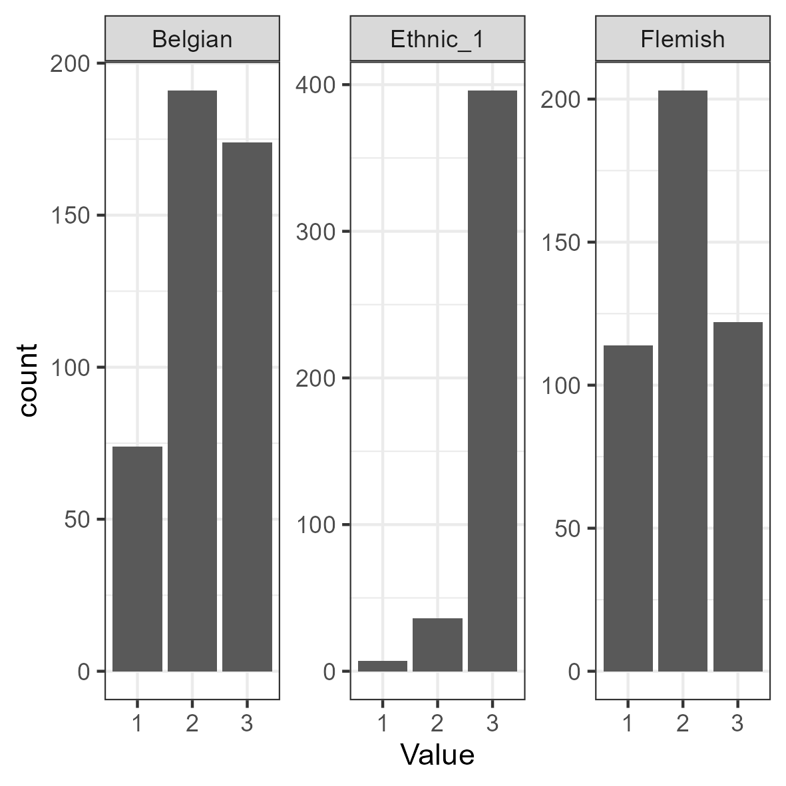
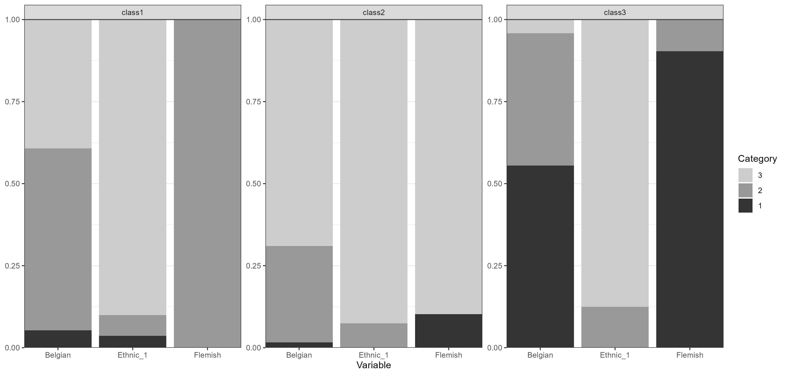

This is an example of exploratory LCA with ordinal indicators using `tidySEM`,
as explained in [Van Lissa, C. J., Garnier-Villarreal, M., & Anadria, D. (2023). *Recommended Practices in Latent Class Analysis using the Open-Source R-Package tidySEM.* Structural Equation Modeling](https://doi.org/10.1080/10705511.2023.2250920).

The present example uses synthetic data based on a study by [Maene, D'hondt, Van Lissa, Thijs, & Stevens (2022)](https://doi.org/10.1007/s10964-022-01665-7).
In a convenience sample of Flemish (Belgian) high-school students with a migration background,
this study set out to identify distinct classes based on ordinal indicators of National, Regional, and Heritage identity.
Sample size was not justified.

In the original study, the approach to class enumeration was semi-theory driven:
The researchers expected to find profiles that were distinct on all three types of identity (national, regional, and heritage) - but the exact number of classes was not pre-specified (hypothesis 1).

Hypothesis 2 stated that adolescents who are nationally integrated would have lower depressive feelings than students from students with other combinations of identifications (hypothesis 2).
Hypothesis 3 was that, for assimilated and separated adolescents, there would not be a significant effect of perceived teacher discrimination on depressive symptoms.

Use the command `?tidySEM::maene_identity` to view the data documentation.

## Loading the Data

To load the data, simply attach the `tidySEM` package.
For convenience, we assign the indicator data to an object called `df`.
As the analyses take a long time to run, this tutorial reduces the data to three identity indicators and collapses their ordered response categories into three levels.
This is a teaching simplification, do not do this for substantive analyses: collapsing categories discards information and changes the estimated latent classes.


``` r
# Load required packages
library(tidySEM)
library(ggplot2)
# Load data Keep one indicator for each identity domain and
# collapse adjacent categories.  This deliberately smaller
# example makes ordinal mixture estimation faster.
ordinal3 <- function(x) {
    z <- as.integer(x)
    observed <- sort(unique(z[!is.na(z)]))
    if (length(observed) < 3L)
        stop("Indicator has fewer than three observed categories")
    # Collapse ordered response categories into three
    # approximately equal ranges.
    groups <- cut(seq_along(observed), breaks = 3L, labels = FALSE)
    ordered(groups[match(z, observed)], levels = 1:3)
}
df <- maene_identity[c("Ethnic_1", "Belgian", "Flemish")]
df[] <- lapply(df, ordinal3)
# Auxiliary variables must correspond to the same rows as
# the indicators.
aux_data <- maene_identity
```

## Examining the Data

We use `tidySEM::descriptives()` to describe the data numerically.
Because all items are categorical,
we remove columns for continuous data to de-clutter the table:


``` r
desc <- tidySEM::descriptives(df)
desc <- desc[, c("name", "type", "n", "missing", "unique", "mode",
    "mode_value", "v")]
desc
```


Table: Descriptive statistics for recoded ordinal items

|name     |type            |   n| missing| unique| mode| mode_value|    v|
|:--------|:---------------|---:|-------:|------:|----:|----------:|----:|
|Ethnic_1 |ordered, factor | 439|       0|      3|  396|          3| 0.18|
|Belgian  |ordered, factor | 439|       0|      3|  191|          2| 0.63|
|Flemish  |ordered, factor | 439|       0|      3|  203|          2| 0.64|


Additionally, we can plot the data.
The `ggplot2` function `geom_bar()` is useful for ordinal data:


``` r
df_plot <- df
names(df_plot) <- paste0("Value.", names(df_plot))
df_plot <- reshape(df_plot, varying = names(df_plot), direction = "long")
ggplot(df_plot, aes(x = Value)) + geom_bar() + facet_wrap(~time,
    scales = "free") + theme_bw()
```


<div class="figure">

<p class="caption">Bar charts for ordinal indicators</p>
</div>

As we can see, the `descriptives()` table provides invaluable information about the measurement level of the indicators,
which is used to specify the model correctly.
If these data had not been coded as ordinal factors,
these descriptive statistics would have revealed that each variable has only a few distinct values.
The proportion of missing values is reported in the `"missing"` column.
If any variables had missing values, we would report an MCAR test with `mice::mcar()`
and explain that missing data are accounted for using FIML.
In our example, we inspect missingness before proceeding with our analysis.


## Conducting Latent Class Analysis

Before we fit a series of LCA models, we set a random seed using
`set.seed()`.
This is important because there is some inherent randomness in the estimation procedure,
and using a seed ensures that we (and others) can exactly reproduce the results.

Next, we fit the LCA models.
As all variables are ordinal, we can use the convenience function
`tidySEM::mx_lca()`, which is a wrapper for the generic function `mx_mixture()` optimized for LCA with ordinal data.
Any mixture model can be specified through `mx_mixture()`.
At the time of writing, there are two other wrapper functions for special cases:
`mx_profiles()`, for latent profile analysis, and `mx_growth_mixture()`, for latent growth analysis and growth mixture models.
All of these functions have arguments `data` and number of `classes`.
All variables in `data` are included in the analysis,
so relevant variables must be selected first.

We consider one- through three-class models. Limiting the number of classes and categories makes this tutorial faster to reproduce. A substantive analysis should investigate a broader range of plausible models and use the original measurement scale where feasible.


```
#> 
Beginning initial fit attempt
Fit attempt 0, fit=2156.11795699632, new current best! (was 2156.11795699633)
Beginning fit attempt 1 of at maximum 10 extra tries                         
Beginning fit attempt 2 of at maximum 10 extra tries
Beginning fit attempt 3 of at maximum 10 extra tries
Beginning fit attempt 4 of at maximum 10 extra tries
Beginning fit attempt 5 of at maximum 10 extra tries
Beginning fit attempt 6 of at maximum 10 extra tries
Beginning fit attempt 7 of at maximum 10 extra tries
Beginning fit attempt 8 of at maximum 10 extra tries
Beginning fit attempt 9 of at maximum 10 extra tries
Beginning fit attempt 10 of at maximum 10 extra tries
Final run, for Hessian and/or standard errors and/or confidence intervals
                                                                         
#> 
Beginning initial fit attempt
Fit attempt 0, fit=2156.11795699633, new current best! (was 2156.11795699634)
Beginning fit attempt 1 of at maximum 10 extra tries                         
Fit attempt 1, fit=2023.50861619781, new current best! (was 2156.11795699633)
Beginning fit attempt 2 of at maximum 10 extra tries                         
Beginning fit attempt 3 of at maximum 10 extra tries
Beginning fit attempt 4 of at maximum 10 extra tries
Fit attempt 4, fit=2023.50863205212, worse than previous best (2023.50861619781)
Beginning fit attempt 5 of at maximum 10 extra tries                            
MxComputeGradientDescent(SLSQP) evaluations 447 fit 2023.51 change -0.01516
                                                                           

Fit attempt 5, fit=2023.50864665003, worse than previous best (2023.50861619781)
Beginning fit attempt 6 of at maximum 10 extra tries                            
Beginning fit attempt 7 of at maximum 10 extra tries
Fit attempt 7, fit=2023.50864178318, worse than previous best (2023.50861619781)
Beginning fit attempt 8 of at maximum 10 extra tries                            
Fit attempt 8, fit=2023.50862856806, worse than previous best (2023.50861619781)
Beginning fit attempt 9 of at maximum 10 extra tries                            
Fit attempt 9, fit=2023.50861616775, new current best! (was 2023.50861619781)
Beginning fit attempt 10 of at maximum 10 extra tries                        
Final run, for Hessian and/or standard errors and/or confidence intervals
                                                                         
#> 
Beginning initial fit attempt
Fit attempt 0, fit=2156.11795699633, new current best! (was 2156.11795699634)
Beginning fit attempt 1 of at maximum 10 extra tries                         
MxComputeGradientDescent(SLSQP) evaluations 181 fit 2068.85 change -22.46
MxComputeGradientDescent(SLSQP) evaluations 6241 fit 1993.47 change -9.88e-06
                                                                             

Fit attempt 1, fit=1993.46573278004, new current best! (was 2156.11795699633)
Beginning fit attempt 2 of at maximum 10 extra tries                         
Fit attempt 2, fit=2101.27192331552, worse than previous best (1993.46573278004)
Beginning fit attempt 3 of at maximum 10 extra tries                            
MxComputeGradientDescent(SLSQP) evaluations 2197 fit 1993.5 change -0.0007477
                                                                             

Fit attempt 3, fit=1993.49661026413, worse than previous best (1993.46573278004)
Beginning fit attempt 4 of at maximum 10 extra tries                            
Fit attempt 4, fit=2041.82548394004, worse than previous best (1993.46573278004)
Beginning fit attempt 5 of at maximum 10 extra tries                            
MxComputeGradientDescent(SLSQP) evaluations 752 fit 2021.14 change -0.223
                                                                         

Fit attempt 5, fit=1993.69071140177, worse than previous best (1993.46573278004)
Beginning fit attempt 6 of at maximum 10 extra tries                            
Fit attempt 6, fit=2101.27191468948, worse than previous best (1993.46573278004)
Beginning fit attempt 7 of at maximum 10 extra tries                            
MxComputeGradientDescent(SLSQP) evaluations 226 fit 2027.53 change -0.9932
                                                                          

Fit attempt 7, fit=1993.49661026505, worse than previous best (1993.46573278004)
Beginning fit attempt 8 of at maximum 10 extra tries                            
MxComputeGradientDescent(SLSQP) evaluations 2618 fit 2001.29 change -0.05406
                                                                            

Fit attempt 8, fit=2000.80141019404, worse than previous best (1993.46573278004)
Beginning fit attempt 9 of at maximum 10 extra tries                            
Beginning fit attempt 10 of at maximum 10 extra tries
MxComputeGradientDescent(SLSQP) evaluations 1022 fit 2048.07 change -5.743
                                                                          

Fit attempt 10, fit=1996.31204567184, worse than previous best (1993.46573278004)
Final run, for Hessian and/or standard errors and/or confidence intervals        
                                                                         
```

``` r
library(OpenMx)
set.seed(123)
res <- mx_lca(data = df, classes = 1:3)
```


## Class Enumeration

In class enumeration, we want to compare a sequence of LCA models fitted
to the data. 
Convergence must be checked for each fitted model.
If a model with ordinal indicators does not converge,
it is possible to aid convergence using `mxTryHardOrdinal()`, which expands the search for optimal parameter values for models with ordinal indicators.
It is part of the family of functions based on `mxTryHard()`.

Next, we create a model fit table using
`table_fit()` and retain relevant columns.
We also determine whether any models can be disqualified.


``` r
fit <- table_fit(res)
fit[, c("Name", "LL", "n", "Parameters", "BIC", "Entropy", "prob_min",
    "n_min", "np_ratio", "np_local")]
```

```
#> 
MxComputeGradientDescent(SLSQP) evaluations 394 fit 2052.38 change -11.85
                                                                         
```


Table: Model fit table

| Name|    LL|   n| Parameters|  BIC| Entropy| prob_min| n_min| np_ratio| np_local|
|----:|-----:|---:|----------:|----:|-------:|--------:|-----:|--------:|--------:|
|    1| -1078| 439|          6| 2193|    1.00|     1.00|  1.00|       73|       73|
|    2| -1012| 439|         13| 2103|    0.77|     0.85|  0.30|       34|       22|
|    3|  -997| 439|         20| 2115|    0.89|     0.88|  0.23|       22|       17|


Inspect the ratio of cases to parameters (`np_ratio` and `np_local`) alongside classification diagnostics such as entropy and minimum classification probability. Models with small classes or unstable estimates require particular caution.

## Class Enumeration

### Using BIC

Compare the BIC values in the model-fit table. Lower BIC values indicate a preferred balance of fit and complexity. The fitted model ranking may differ from that obtained with the full, uncollapsed dataset.

### Theoretical considerations

For illustration, we examine the three-class solution. In a substantive analysis, class selection should consider theoretical interpretability, convergence, and class sizes alongside information criteria.


``` r
res_final <- res[[3]]
```


## Interpreting the Final Class Solution

Assess class sizes, entropy, and classification probabilities for the fitted three-class solution. The results below are based on the simplified dataset and should not be compared numerically with the original full-data example.
We can produce a table of results using `table_results(res_final)`.
However, the results are thresholds,
indicating quantiles of a standardized normal distribution.
These may be difficult to interpret.
Therefore, we ask for the results in probability scale:


``` r
tab <- table_prob(res_final)
reshape(tab, direction = "wide", v.names = "Probability", timevar = "group",
    idvar = c("Variable", "Category"))
```


Table: Three-class model results in probability scale

|Variable | Category| Probability.class1| Probability.class2| Probability.class3|
|:--------|--------:|------------------:|------------------:|------------------:|
|Ethnic_1 |        1|               0.04|               0.00|               0.00|
|Ethnic_1 |        2|               0.06|               0.07|               0.12|
|Ethnic_1 |        3|               0.90|               0.93|               0.88|
|Belgian  |        1|               0.05|               0.02|               0.56|
|Belgian  |        2|               0.55|               0.29|               0.40|
|Belgian  |        3|               0.39|               0.69|               0.04|
|Flemish  |        1|               0.00|               0.10|               0.90|
|Flemish  |        2|               1.00|               0.00|               0.10|
|Flemish  |        3|               0.00|               0.90|               0.00|


The results can also be interpreted by plotting the response probabilities:


``` r
plot_prob(res_final, bw = TRUE)
```

<div class="figure">

<p class="caption">Probability plot</p>
</div>

Use the response-probability plot to compare the identity patterns across classes. Class labels should be chosen based on the newly estimated probabilities rather than carried over from the original analysis.

## Auxiliary Analyses

To address the remaining two hypotheses,
we will perform auxiliary analyses.
Hypothesis 2 stated that adolescents who are nationally integrated would have lower depressive feelings than students from students with other combinations of identifications (hypothesis 2).

To test this hypothesis,
we can call the BCH function and supply the auxiliary variable depression to the `data` argument, omitting the `model` argument.
Below, we estimate an auxiliary model to compare depressive symptoms across classes:


``` r
aux_dep <- BCH(res_final, data = aux_data$depression)
```


To obtain an omnibus likelihood ratio test of the significance of depression differences across classes,
as well as pairwise comparisons between classes,
use `lr_test(aux_dep)`.
Interpret the omnibus and pairwise tests using the results from the simplified example; numerical conclusions from the original analysis do not necessarily carry over.

Hypothesis 3 was that, for assimilated and separated adolescents, there would not be a significant effect of perceived teacher discrimination on depressive symptoms.
To test this hypothesis, 
we will compare the regression coefficient of discrimination on depressive symptoms across classes.


``` r
df_aux <- aux_data[, c("vict_teacher", "depression")]
# Dummy-code vict_teacher
df_aux$vict_teacher <- (as.integer(df_aux$vict_teacher) - 1)
aux_model <- BCH(res_final, model = "depression ~ vict_teacher",
    data = df_aux)
```


To view the coefficients of this model, we can use either
`coef(aux_model)` or `table_results(aux_model, columns = NULL)`.
The regression coefficients are represented by paths in the
class-specific `A` matrices.


``` r
table_results(aux_model, columns = c("label", "est_sig", "se",
    "pval", "confint", "group", "matrix"))
```


```
#>                                            label est_sig   se pval       confint  group matrix
#> 1  Regressions.depression.ON.vict_teacher.class1   -0.00 0.10 1.00 [-0.19, 0.19] class1      A
#> 2                        Means.depression.class1 2.74*** 0.06 0.00  [2.63, 2.86] class1      M
#> 3                      Means.vict_teacher.class1 0.37*** 0.03 0.00  [0.30, 0.44] class1      M
#> 4                    Variances.depression.class1 0.41*** 0.04 0.00  [0.33, 0.49] class1      S
#> 5                  Variances.vict_teacher.class1 0.23*** 0.02 0.00  [0.19, 0.28] class1      S
#> 6  Regressions.depression.ON.vict_teacher.class2   -0.12 0.12 0.32 [-0.35, 0.11] class2      A
#> 7                        Means.depression.class2 2.86*** 0.06 0.00  [2.74, 2.97] class2      M
#> 8                      Means.vict_teacher.class2 0.25*** 0.04 0.00  [0.17, 0.32] class2      M
#> 9                    Variances.depression.class2 0.35*** 0.04 0.00  [0.27, 0.44] class2      S
#> 10                 Variances.vict_teacher.class2 0.19*** 0.02 0.00  [0.14, 0.23] class2      S
#> 11 Regressions.depression.ON.vict_teacher.class3   -0.14 0.13 0.28 [-0.40, 0.11] class3      A
#> 12                       Means.depression.class3 2.66*** 0.08 0.00  [2.51, 2.81] class3      M
#> 13                     Means.vict_teacher.class3 0.36*** 0.05 0.00  [0.27, 0.45] class3      M
#> 14                   Variances.depression.class3 0.44*** 0.06 0.00  [0.32, 0.55] class3      S
#> 15                 Variances.vict_teacher.class3 0.23*** 0.03 0.00  [0.17, 0.29] class3      S
```

There are two ways to test whether the regression coefficients differ
across classes.

First, we can use a likelihood-ratio test to compare the regression
coefficients in the class-specific `A` matrices:


``` r
lr_test(aux_model, compare = "A")
```


```
#> BCH test for equality across classes
#> 
#> Overall likelihood ratio test:
#>  LL_baseline LL_restricted LL_dif df   p
#>         1414          1415      1  2 0.6
#> 
#> Pairwise comparisons using likelihood ratio tests:
#>  Model1 Model2 LL_baseline LL_restricted LL_dif df    p
#>  class1 class2        1414          1414   0.60  1 0.44
#>  class1 class3        1414          1414   0.77  1 0.38
#>  class2 class3        1414          1414   0.02  1 0.89
```

Alternatively, we can use a Wald test to evaluate the equality
constraints directly:


``` r
wald_test(aux_model, "class1.A[1,2]=class2.A[1,2]&class1.A[1,2]=class3.A[1,2]")
```


```
#> Wald tests for linear hypotheses:
#>                                               Hypothesis df chisq   p
#>  class1.A[1,2]=class2.A[1,2]&class1.A[1,2]=class3.A[1,2]  2     1 0.6
```

Both tests evaluate the null hypothesis that the regression
coefficient of perceived teacher discrimination on depressive
symptoms is equal across the three latent classes. Interpret
the results based on the newly fitted auxiliary model; the
original test statistics do not apply to this reduced example.
