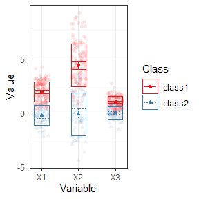
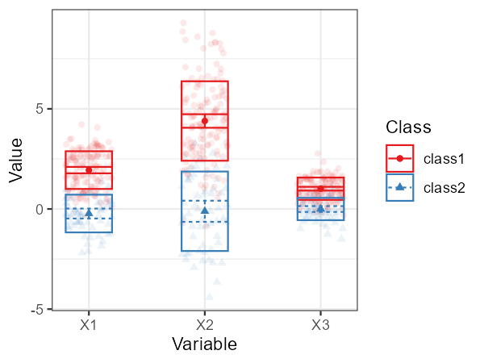
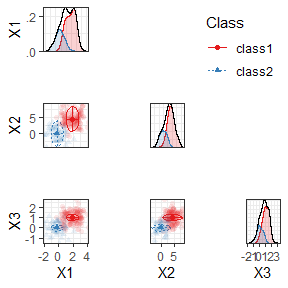
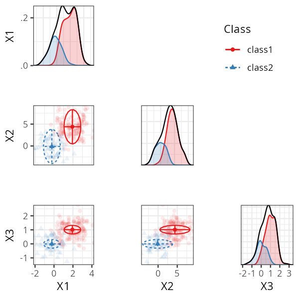
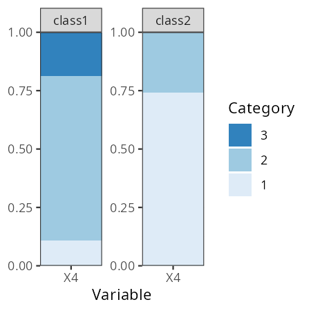

Latent class analysis for categorical indicators (LCA) and latent profile analysis for continuous indicators (LPA) are widely used
mixture modeling techniques for identifying unobserved subgroups in a
population. In practice, researchers often encounter **mixed data types**: a
combination of continuous, binary, and ordinal indicators.

Estimating such models was complicated in prior versions of `tidySEM`,
and often led to convergence issues.
The new function `mx_mixed_lca()`, introduced in `tidySEM` version `0.2.10`, provides a high-level interface to
estimate mixed-data latent class models.
At the same time, the function `mx_run()` was updated to use `mxTryHardOrdinal()` in case of convergence issues with ordinal categorical indicators,
which improves the estimation of mixed data LCAs.

This vignette demonstrates how to:

* Prepare mixed continuous and ordinal data
* Estimate mixed-data latent class models
* Fit multiple class solutions
* Inspect and interpret the resulting OpenMx models

## Requirements

The `mx_mixed_lca()` function relies on `OpenMx`. Make sure both packages are
installed and loaded.


``` r
library(tidySEM)
library(OpenMx)
```

## Example Data

We simulate a dataset with:

* Three continuous indicators
* One ordinal indicator
* Two latent classes


``` r
set.seed(10)
n <- 200

# Set class-specific means
class_means <- c(rep(0, floor(0.3 * n)),
rep(2, ceiling(0.7 * n)))

# Simulate continuous indicators
df <- rnorm(4 * n, mean = rep(class_means, 4))
df <- matrix(df, nrow = n)
df <- t(t(df) * c(1, 2, 0.5, 1))
df <- data.frame(df)
names(df) <- paste0("X", 1:4)

# Convert one indicator to ordinal
df$X4 <- cut(df$X4, breaks = 3, labels = FALSE)
df$X4 <- mxFactor(df$X4, levels = 1:3)
```


## Model Estimation with `mx_mixed_lca()`

<!-- The `mx_mixed_lca()` function estimates mixed-data latent class models using the -->
<!-- following procedure: -->

<!-- 1. Estimate an **Latent profile analysis (LPA)** for the continuous indicators using -->
<!--    `mx_profiles()` -->
<!-- 2. Use the **BCH method** to obtain starting values for ordinal indicators: the classes probabilities from step 1 are used to estimate thresholds for the remaining ordinal indicators. -->
<!-- 3. **Latent class analysis (LCA)** for ordinal indicators using `mx_lca()`, using the thresholds from step 2. as starting values. -->
<!-- 4. **Joint estimation** of continuous and ordinal indicators in a single model, using the results from steps 1. and 3. as starting values. -->

### Estimating a Single Class Solution

To estimate a 2-class mixed-data latent class model, use the following code:


``` r
res_2 <- mx_mixed_lca(
data = df,
classes = 2
)
#> 
MxComputeSimAnnealing(tsallis1996) evaluations 1080 fit 3274.3 change 0
MxComputeSimAnnealing(tsallis1996) evaluations 3397 fit 5321.54 change 3048
MxComputeSimAnnealing(tsallis1996) evaluations 5610 fit 2972.11 change -2188
MxComputeSimAnnealing(tsallis1996) evaluations 7811 fit 5314.03 change 3076 
MxComputeSimAnnealing(tsallis1996) evaluations 9959 fit 2237.96 change 0.8713
MxComputeSimAnnealing(tsallis1996) evaluations 12141 fit 2237.09 change -0.3039
MxComputeSimAnnealing(tsallis1996) evaluations 14306 fit 2417.63 change -2643  
MxComputeSimAnnealing(tsallis1996) evaluations 16484 fit 2237.1 change 0.0009278
                                                                                
```

The returned object is an `OpenMx::mxModel`, and can be modified using the functions in that package:


``` r
class(res_2)
#> [1] "MxModel"
#> attr(,"package")
#> [1] "OpenMx"
```

## Estimating Multiple Class Solutions

A common workflow is to estimate several class solutions and compare model fit.
This can be done by passing a vector of class numbers.


``` r
res_1_3 <- mx_mixed_lca(
  data = df,
  classes = 1:3
)
```

```
#> 
MxComputeSimAnnealing(tsallis1996) evaluations 1177 fit 3190.26 change 0
MxComputeSimAnnealing(tsallis1996) evaluations 3453 fit 5349.71 change 2963
MxComputeSimAnnealing(tsallis1996) evaluations 5712 fit 2241.9 change 2.127
MxComputeSimAnnealing(tsallis1996) evaluations 7929 fit 2239.23 change 2.134
MxComputeSimAnnealing(tsallis1996) evaluations 10133 fit 2258.95 change 21.79
MxComputeSimAnnealing(tsallis1996) evaluations 12322 fit 2237.11 change -898 
MxComputeSimAnnealing(tsallis1996) evaluations 14515 fit 3187.85 change -2004
MxComputeSimAnnealing(tsallis1996) evaluations 16641 fit 2238.2 change 1.089 
                                                                            
#> 
MxComputeSimAnnealing(tsallis1996) evaluations 654 fit 2826.27 change 0
MxComputeSimAnnealing(tsallis1996) evaluations 2133 fit 2811.48 change 0
MxComputeSimAnnealing(tsallis1996) evaluations 3573 fit 2625.37 change 0
MxComputeSimAnnealing(tsallis1996) evaluations 5040 fit 2448.23 change 0
MxComputeSimAnnealing(tsallis1996) evaluations 6504 fit 2235.33 change -890.1
MxComputeSimAnnealing(tsallis1996) evaluations 7999 fit 2322.54 change -99.79
MxComputeSimAnnealing(tsallis1996) evaluations 9445 fit 2232.31 change -2.348
MxComputeSimAnnealing(tsallis1996) evaluations 10937 fit 2416.09 change 51.48
MxComputeSimAnnealing(tsallis1996) evaluations 12411 fit 2628.47 change -972.6
MxComputeSimAnnealing(tsallis1996) evaluations 13885 fit 2231.25 change -942.3
MxComputeSimAnnealing(tsallis1996) evaluations 15289 fit 2623.19 change 202.4 
MxComputeSimAnnealing(tsallis1996) evaluations 16696 fit 2231.18 change 0.1173
MxComputeSimAnnealing(tsallis1996) evaluations 18141 fit 2261.09 change -97.24
MxComputeSimAnnealing(tsallis1996) evaluations 19570 fit 2232.97 change 2.177 
MxComputeSimAnnealing(tsallis1996) evaluations 20985 fit 2230.76 change -7.371e-10
MxComputeSimAnnealing(tsallis1996) evaluations 22405 fit 2230.77 change -4.64     
MxComputeSimAnnealing(tsallis1996) evaluations 23837 fit 2239.12 change -107.5
MxComputeSimAnnealing(tsallis1996) evaluations 25309 fit 2230.75 change -2984 
                                                                             
#> 
Beginning initial fit attempt
Fit attempt 0, fit=2230.74793595893, new current best! (was 2230.74793595893)
Beginning fit attempt 1 of at maximum 10 extra tries                         
Beginning fit attempt 2 of at maximum 10 extra tries
Beginning fit attempt 3 of at maximum 10 extra tries
Beginning fit attempt 4 of at maximum 10 extra tries
MxComputeGradientDescent(SLSQP) evaluations 1057 fit 2230.76 change -0.01808
                                                                            

Beginning fit attempt 5 of at maximum 10 extra tries
Fit attempt 5, fit=2237.09546071394, worse than previous best (2230.74793595893)
Beginning fit attempt 6 of at maximum 10 extra tries                            
MxComputeGradientDescent(SLSQP) evaluations 229 fit 2244.14 change -3.484
                                                                         

Beginning fit attempt 7 of at maximum 10 extra tries
Beginning fit attempt 8 of at maximum 10 extra tries
MxComputeGradientDescent(SLSQP) evaluations 95 fit 2309.15 change -63.25
                                                                        

Fit attempt 8, fit=2230.08267540371, new current best! (was 2230.74793595893)
Beginning fit attempt 9 of at maximum 10 extra tries                         
MxComputeGradientDescent(SLSQP) evaluations 280 fit 2245.17 change -2.603
                                                                         

Fit attempt 9, fit=2230.08267394999, new current best! (was 2230.08267540371)
Beginning fit attempt 10 of at maximum 10 extra tries                        
MxComputeGradientDescent(SLSQP) evaluations 1656 fit 2230.08 change -6.686e-07
                                                                              

Fit attempt 10, fit=2230.08493321593, worse than previous best (2230.08267394999)
Final run, for Hessian and/or standard errors and/or confidence intervals        
                                                                         
```

The result is a list of OpenMx models, one for each class solution.

## Class Enumeration

As explained in Van Lissa, Garnier-Villareal, and Anadria (2023), there are several approaches to class enumeration.
The most straightforward best-practice approach is to examine the BIC fit index, and select the model with the lowest BIC.
This is obtained by inspecting model fit, by printing the object, or calling `table_fit(res_1_3)`:


``` r
table_fit(res_1_3)
```


```
#>     Name Classes    LL   n Parameters  AIC  BIC saBIC Entropy prob_min prob_max n_min n_max
#> 1  equal       1 -1251 200          8 2517 2543  2518    1.00     1.00     1.00 1.000  1.00
#> 2 equal1       2 -1119 200         14 2265 2311  2267    0.93     0.96     0.99 0.295  0.70
#> 3 equal2       3 -1115 200         20 2270 2336  2273    0.94     0.94     1.00 0.075  0.63
#>   np_ratio np_local
#> 1       25     25.0
#> 2       14      9.1
#> 3       10      2.5
```

As expected, the BIC for the 2-class solution is lowest.
Note that the 3-class solution also has an extremely low ratio of cases to parameters,
so this model is most likely overfit.

Another best-practice approach to class enumeration is to perform the bootstrapped likelihood ratio test.
This gives a significance test, but takes a long time to run.
To accelerate computations, we can use the `future` package for parallel computing (see `?plan` to select the appropriate back-end for your system).
To track the function's progress,
we use the `progressr` ecosystem,
which allows users to choose how they want to be informed.
The example below uses a progress bar:


``` r
library(future)
library(progressr)
plan(multisession) # Parallel processing for Windows
handlers("progress") # Progress bar
set.seed(1)
res_blrt <- BLRT(res_1_3, replications = 100)
res_blrt
```


```
#> Bootstrapped Likelihood Ratio Test:
#> 
#>         null         alt  lr df blrt_p samples
#>  equal var 1 equal var 2 264  6   0.00      43
#>  equal var 2 equal var 3   7  6   0.31      11
```


This test, too, confirms that the 2-class solution is significantly better than the 1-class solution - but the 3-class solution offers no further significant improvement.
Note that, by default, the BLRT conducts 100 bootstrapped analyses - but only some of these samples could be used to conduct the test, as the model did not converge in remaining iterations.

A third option is to use a predictive model comparison, a method conceptually similar to Bayesian posterior predictive checks.


``` r
set.seed(1)
res_pmc <- pmc(res_1_3)
res_pmc
```

```
#>   comparison        null         alt null_stat alt_stat     lb     ub sig
#> 1    dif_seq equal var 1 equal var 2     0.469    0.069 -0.459 -0.328   *
#> 2    dif_seq equal var 2 equal var 3     0.069    0.057 -0.059  0.036    
#> 3    dif_one equal var 1 equal var 2     0.469    0.069 -0.459 -0.328   *
#> 4    dif_one equal var 1 equal var 3     0.469    0.057 -0.473 -0.351   *
```

This test, too, confirms that the 2-class solution is significantly better than the 1-class solution - but the 3-class solution offers no further significant improvement.

## Examine Results

We can investigate the class proportions for the two-class solution by calling:


``` r
class_prob(res_1_3[[2]], c("sum.posterior", "sum.mostlikely"))
```

```
#> $sum.posterior
#>    class count proportion
#> 1 class1   139        0.7
#> 2 class2    61        0.3
#> 
#> $sum.mostlikely
#>    class count.mostlikely count.Freq proportion.mostlikely proportion.Freq
#> 1 class2                1        141                     1            0.70
#> 2 class1                2         59                     2            0.29
```

The sum.posterior class probabilities incorporate classification error; each case can (fractionally) contribute to multiple classes.

The sum.mostlikely class probabilities ignore classification error, assigning each case to the class it has the highest class probability for.

Note that, in this case, both correspond nicely to the simulated .3/.7 split. Thus, we should have good class discrimination.

This is confirmed by checking:


``` r
table_fit(res_1_3[[2]])
```


```
#>   Minus2LogLikelihood   n Parameters observedStatistics  df RMSEASquared RMSEANull   modelName
#> 1                2237 200         14                800 186            0      0.05 equal var 2
#>    AIC  BIC saBIC Classes Entropy prob_min prob_max n_min n_max    LL
#> 1 2265 2311  2267       2    0.93     0.96     0.99  0.29   0.7 -1119
```

We have a high minimal- and maximal posterior classification probability, and a high entropy.

Finally, we can examine the parameter values using `table_results()` on the second element of the model list, or the 2-class model:


``` r
table_results(res_1_3[[2]])
```


```
#>                            label  est_sig       se pval               confint  class
#> 1                Means.X1.class1  1.94***     0.08 0.00          [1.78, 2.10] class1
#> 2                Means.X2.class1  4.39***     0.17 0.00          [4.05, 4.73] class1
#> 3                Means.X3.class1  1.01***     0.05 0.00          [0.92, 1.11] class1
#> 4            Variances.X1.class1  0.89***     0.09 0.00          [0.71, 1.07] class1
#> 5            Variances.X2.class1  3.94***     0.42 0.00          [3.12, 4.75] class1
#> 6            Variances.X3.class1  0.31***     0.03 0.00          [0.25, 0.37] class1
#> 7            Variances.X4.class1     1.00       NA   NA                  <NA> class1
#> 8  class1.Thresholds[1,1].class1 -1.24***     0.15 0.00        [-1.52, -0.95] class1
#> 9  class1.Thresholds[2,1].class1  0.89***     0.12 0.00          [0.65, 1.13] class1
#> 10               Means.X1.class2    -0.23     0.13 0.07         [-0.48, 0.02] class2
#> 11               Means.X2.class2    -0.11     0.27 0.67         [-0.64, 0.41] class2
#> 12               Means.X3.class2    -0.00     0.07 0.98         [-0.15, 0.14] class2
#> 13           Variances.X4.class2     1.00       NA   NA                  <NA> class2
#> 14 class2.Thresholds[1,1].class2  0.65***     0.18 0.00          [0.29, 1.01] class2
#> 15 class2.Thresholds[2,1].class2     7.11 35680.19 1.00 [-69924.78, 69939.01] class2
#> 16   equal var 2.weights[1,1].NA     1.00       NA   NA                  <NA>   <NA>
#> 17   equal var 2.weights[1,2].NA  0.43***     0.07 0.00          [0.30, 0.57]   <NA>
```

Note that we get free means for each class, with the variances constrained to be equal across classes.
For the categorical variable, we get thresholds:
These correspond to quartiles of a normal distribution.
For class 1, the probability of scoring within the first response category corresponds to `pnorm(-2.38, lower.tail = TRUE)`, or about 1%.
To convert these thresholds to the probability scale, we can run:


``` r
table_prob(res_1_3[[2]])
```


```
#>   Variable Category Probability  group
#> 1       X4        1     1.1e-01 class1
#> 2       X4        2     7.1e-01 class1
#> 3       X4        3     1.9e-01 class1
#> 4       X4        1     7.4e-01 class2
#> 5       X4        2     2.6e-01 class2
#> 6       X4        3     5.7e-13 class2
```

## Advanced Options

Additional arguments can be passed via `...` and are forwarded to the underlying
model-building functions. For example,
you can release the variance constraints for
the continuous indicators by passing the `variances` argument of `mx_profiles()`:


``` r
res_2_free <- mx_mixed_lca(
  data = df,
  classes = 2,
  variances = "varying"
)
#> 
MxComputeSimAnnealing(tsallis1996) evaluations 1347 fit 3205.91 change 0
MxComputeSimAnnealing(tsallis1996) evaluations 3541 fit 3690.34 change 563.3
MxComputeSimAnnealing(tsallis1996) evaluations 5832 fit 3103.35 change 0    
MxComputeSimAnnealing(tsallis1996) evaluations 8001 fit 2252.01 change -4.892
MxComputeSimAnnealing(tsallis1996) evaluations 10160 fit 2236.17 change -4.456
MxComputeSimAnnealing(tsallis1996) evaluations 12301 fit 2308.53 change 70.24 
MxComputeSimAnnealing(tsallis1996) evaluations 14422 fit 2236 change -860.7  
MxComputeSimAnnealing(tsallis1996) evaluations 16559 fit 2235.96 change -0.2521
MxComputeSimAnnealing(tsallis1996) evaluations 18683 fit 2251.06 change -30.27 
MxComputeSimAnnealing(tsallis1996) evaluations 20825 fit 2236.78 change -860.3
                                                                              
```

We can compare the BICs of these models to determine whether the added complexity improves the model fit:


``` r
compare <- list(
  fixed_covs = res_1_3[[2]],
  free_covs = res_2_free)
table_fit(compare)
```


```
#>          Name Classes    LL   n Parameters  AIC  BIC saBIC Entropy prob_min prob_max n_min
#> 1 equal var 2       2 -1119 200         14 2265 2311  2267    0.93     0.96     0.99  0.29
#> 2  free var 2       2 -1118 200         17 2270 2326  2272    0.94     0.97     0.99  0.29
#>   n_max
#> 1   0.7
#> 2   0.7
```

Note that the BIC of the model with free covariances is higher than that of the model with fixed variances, so it fits worse.
This is as expected, because we did not simulate class-specific variances.

# Plotting the Model

The model can be plot with the usual functions, but note that categorical indicators will not look good in plots for continuous indicators, and could lead to errors.

Thus, for example, we can use a profile plot for the continuous indicators:

<!-- -->


``` r
plot_profiles(res_1_3[[2]], variables = c("X1", "X2", "X3"))
```
<!-- -->

Alternatively, we can use a bivariate plot with densities:

<!-- -->


``` r
plot_bivariate(res_1_3[[2]], variables = c("X1", "X2", "X3"))
```
<!-- -->

We can plot the categorical variables as follows:


``` r
plot_prob(res_1_3[[2]])
```
<!-- -->

## References

Van Lissa, C. J., Garnier-Villarreal, M., & Anadria, D. (2023).
*Recommended Practices in Latent Class Analysis using the Open-Source R-Package
tidySEM.* Structural Equation Modeling.
[https://doi.org/10.1080/10705511.2023.2250920](https://doi.org/10.1080/10705511.2023.2250920)
